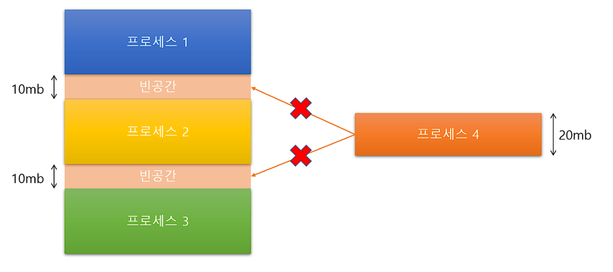
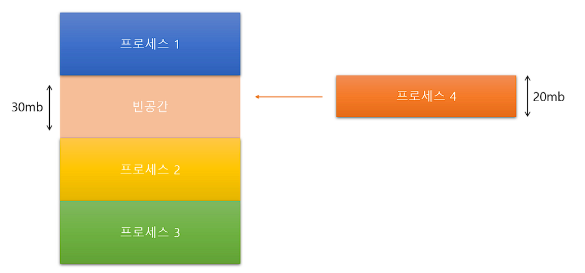
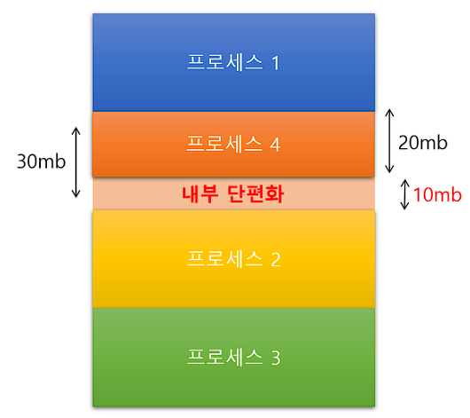

c++에서 일어나는 메모리 단편화를 다룬다.

---

## 단편화 (Fragmentation)

RAM 공간이 작은 조각들로 나누어져 사용 가능한 충분한 메모리가 존재하지만 할당이 불가능한 상태이다.

메모리 단편화는 크게 외부/내부로 나뉜다.

## 외부 단편화

프로세스들에게 메모리를 할당해주고 나서 남은 메모리들이 작은조각들로 흩어져있어

조각들을 합치면 새로운 프로세스를 할당할 수 있지만 메모리들이 연속적이지 않아

할당을 못해주는 현상



## 내부 단편화

os가 프로세스에 메모리를 할당해 줄 때 프로세스가 필요한 메모리보다 더 많이 할당해줘서

메모리 공간이 낭비되는 현상

ex) os가 프로세스에게 30mb를 할당해줬는데 프로세스는 실제로 20mb만 필요를 하면

내부 단편화가 10mb발생했다고 말함.





## 해결책

### 페이징

- 가상 메모리 사용
- 외부 단편화 해결, 내부 단편화 존재

<b>페이지 </b>: 가상메모리를 같은 크기의 블록으로 나눈 것

<b>프레임 </b>: 물리메모리를 페이지와 같은 크기의 블록으로 나눈 것

쪼갠 페이지와 프레임들을 서로 매핑할 페이지 테이블을 만든다.

<b>페이지 테이블 </b>: 페이지 번호와 페이지 번호에 매칭되는 프레임의 시작 물리 주소를 저장한다.

(페이지가 무조건 프레임보다 많기 때문에 invalid 값이 들어가있는 경우가 있음)

페이징은 페이지에 프로세스들을 페이지 크기에 맞추어 페이지들에 넣는 것을 말한다.

<b>장점</b>

- 메모리 해제해도 바로 다른 데이터를 그 자리에 넣을 수 있다 (모두 같은 크기이기 때문)
- 프로세스를 페이지 크기에 맞게 올리기 때문에 외부 단편화 문제를 해결할 수 있다.

<b>문제점</b>

- 하지만 페이지 크기보다 작은 프로세스들이 많으면 페이지 공간이 낭비되기 때문에 내부 단편화 문제는 존재한다.
  - 페이지를 엄청 작게 설정하면 내부 단편화도 해결이 가능하긴한데 page와 frame을매핑하는 과정이 많아지기 때문에 효율이 떨어질 수 있다.

### 세그멘테이션

- 가상 메모리 사용
- 내부 단편화 해결, 외부 단편화 존재

<b>세그먼트 </b>: 가상 메모리를 서로 크기가 다른 논리적 단위로 나눈 것

//<b>세그먼트는 연속적인 공간에 저장되어 있다.</b>

세그먼트는 페이징처럼 미리 분할하는 방법이 아니라 메모리에 적재할 때 빈 공간을 찾아가는 기법이다.

세그먼트도 마찬가지로 mapping을 위해 table이 필요하다.

<b>세그먼트 테이블</b> : 세그먼트 항목별 세그먼트 시작 주소와 세그먼트 길이 정보를 가진다.

세그먼트는 프로세스 크기만큼 세그먼트를 만들기 때문에 세그먼트에 빈 공간이 생기지 않아 내부 단편화가 생기지 않는다.

반대로 메모리를 선형적으로 사용하지는 않기 때문에 외부 단편화는 생길 수 있다.

### [<b>메모리 풀</b>](%EB%A9%94%EB%AA%A8%EB%A6%AC-%ED%92%80-9b24cd90.md)

- 내부, 외부 단편화 해결

필요한 메모리 공간을 필요한 크기, 개수 만큼 사용자가 직접 지정하여 미리 할당받아 놓고

필요할 때 사용하고, 사용이 끝나면 다시 반납하는 기법

공간을 할당해놓고 쓰기 때문에 외부 단편화 발생 X

필요한 크기만큼 할당하기 때문에 내부 단편화 발생 X

```c++
const int* a;
int* const a;
const int* const a;
void func(int _iValue) const
```
