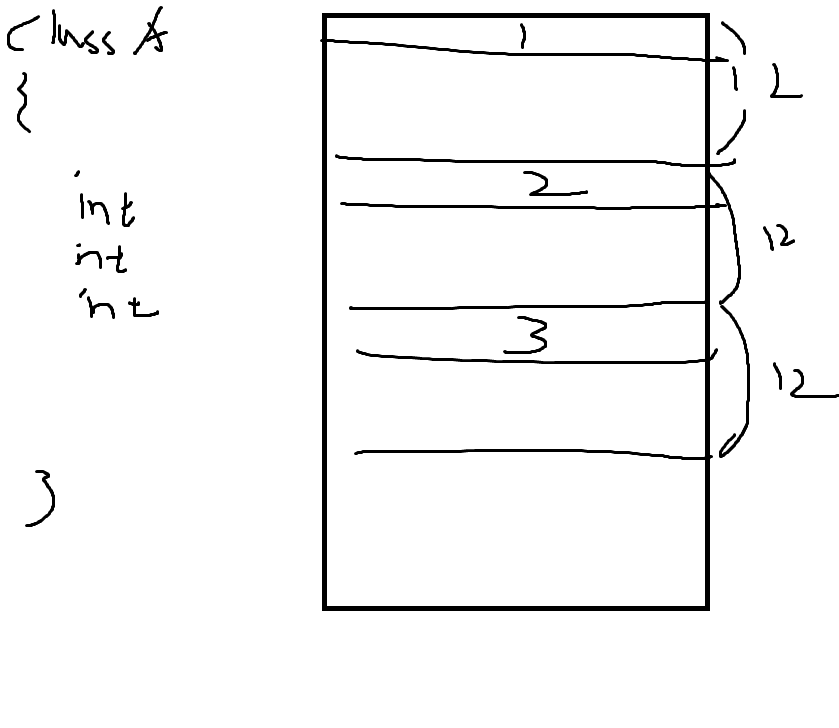

---

<b>동적할당의 문제</b>

보통, 동적 메모리를 다루기 위해선 C 에선 malloc()/free(void \*) 함수를 사용해야 하며

C++ 의 경우는 new()/delete() 연산자를 사용한다.

게임프로그래밍은 객체지향 프로그래밍을 주로 사용하기 때문에 게임내 항목들을 객체로써 관리중이다. 따라서 동적할당이 많이 일어날 수 밖에 없다.

하지만 게임이 돌아가는 와중에 <b><span>시스템콜인 동적할당을 많이 하면 인터럽트가 걸려</span></b> 게임의 코어 점유율이 떨어질 것이다. 동적할당의 연산처리도 비용이 어느정도 드는 작업이다.

<b>게임 시작 전 혹은 로딩시간때 필요한 메모리들을 미리 할당해둬서 해당 문제를 해결한다.</b>

그리고 <b><span>메모리 단편화 문제</span></b>를 해결하기 위해서 우리의 의도대로 메모리를 관리해야 할 것이다.

메모리를 필요한 크기만큼만 할당하기 때문에 <b>내부 단편화</b>가 일어나지 않고

메모리를 해제할때 다시 메모리에 반납하기 때문에 <b>외부 단편화</b>가 일어나지 않는다.

<b>마지막으로 캐시적중률을 위해 메모리풀이 사용된다.</b>

우리가 사용할 메모리 영역을 정확히 지정해놓고 그 곳에서만 할당과 해제를 하면

일정 수준이상의 캐시 적중률이 보장되어 있을 것이다.

<b>구현</b>

메모리 풀 메커니즘은 다음과 같다.

- 메모리풀은 메모리풀을 사용하고 싶은 클래스(인스턴스X)들이 들고있는 형태이다.
- 클래스의 첫 할당이 일어날 때 메모리 풀을 생성한다.
  - 매크로화 하여 사용하면 편하다 ㅇㅇ 클래스마다 코드 넣어주기 싫어

  <b>Macro.h</b>

  정적 메모리풀  생성되어있지 않으면 메모리풀 만들어준다.

  - 우리가 쓰는 연산자 new에는 클래스의 사이즈 매개인자가 알잘딱 들어가는거다
    따라서 오퍼레이터를 오버라이드 받을때는 size\_t를 인자로 넣어야한다.

    커스텀 new에서는 메모리풀의 Allocate

  - 마찬가지로 연산자 delete에는 메모리를 해제시킬 시작 주소와 클래스 크기가 인자로 들어간다. (시작주소 (delete를 호출한 인스턴스일것) 부터 클래스 크기만큼 메모리 해제시킨다.
    커스텀 delete에서는 메모리풀의 DeAllocate 호출한다.

  ```c++
  #define IMPLEMENATION_MEMORYPOOL( ClassName )\
  MemeoryPool* ClassName::m_pMemoryPool = 0; \

  #define DECLARE_MEMORYPOOL \
  public: \
       void* operator new(size_t BlockSize) /*new 연산자는 매개인자 생략으로 클래스의 size를 가지고 있는 듯하다*/ \
   { \
       if (!m_pMemoryPool) \
       { \
           m_pMemoryPool = new MemeoryPool; \
       } \
           return m_pMemoryPool->Allocate(BlockSize); \
   } \
       void operator delete(void* pToBlockDelete, size_t BlockSize) \
       { \
           m_pMemoryPool->DeAllocate(pToBlockDelete, BlockSize); \
       } \
   protected: \
           static MemeoryPool* m_pMemoryPool; \
  ```

  <b>Class A.h</b>

  ```c++
  #pragma once

  #include "MemeoryPool.h"
  #include "Macro.h"

  class A
  {
  public:
      A();
      ~A();

      int num1 = 0;
      int num2 = 0;

       DECLARE_MEMORYPOOL;
  };
  ```

  <b>Class A.cpp</b>

  ```c++
  #include "A.h"
  IMPLEMENATION_MEMORYPOOL(A); // 스태틱변수니까 초기화
  ...
  ```
- <b>MemoryPool::Allocate</b>
  new에 들어온 클래스 사이즈를 인자로 받는다.

  ```c++
  void* MemeoryPool::Allocate(size_t BlockSize)
  {
      // 페이지가 할당되지 않을경우 - 페이지( 전체 블럭들 )를 생성
      if (!m_Page) // 시작주소가 없으면
      {
          m_Page = static_cast<unsigned char*>(malloc(BlockSize * MaxBlockCount));
  	                                                  // 클래스를 Max사이즈만큼 할당해놓음               
          m_CanAllocate = MaxBlockCount; // 현재 동적할당 할 수 있는 개수는 최대개수

          unsigned char* p = m_Page;
          // 각각의 블럭 마다 최초 4 Byte 에 자신의 다음 블럭을 가르키는 인덱스를 써 넣는다
          for (int i = 0; i < MaxBlockCount; i++) // 페이지 내의 모든 블럭에 인덱스 작성
          {
              *p = i + 1;       // 링크 Id( 다음 블럭의 인덱스 )를 써 넣는다
              p += BlockSize;   // 다음 블럭으로 이동

          }

      }

      // *이미 사용중인 블럭이 꽉 차있어 할당할 블럭이 없는 경우
      if (m_CanAllocate == 0)
      {
          return 0;  /// *임시 : 일단 0( NULL ) 을 반환
      }

      // 요청한 블럭( 주소 )을 넘겨준다
     // 요청한 블럭의 주소를 계산      페이지 시작주소부터 + (요청 블록인덱스 * 블록 사이즈)
      unsigned char* pBlockToAllocate = m_Page + (m_BlockIdToAllocate * BlockSize);

      // m_pBlockIdToAllocate 가( 현재 할당할 블럭을 가르키는 ) 요청한 블럭의
      // 다음 블럭( Id )을 가르킨다.
      m_BlockIdToAllocate = *pBlockToAllocate;

      // 할당한 블럭이 생겼으므로 메모리 풀에 남아있는 갯수를 줄인다
      m_CanAllocate--;

      // 블럭을 요청 측에 반환
      return (void*)pBlockToAllocate;
  }
  ```


