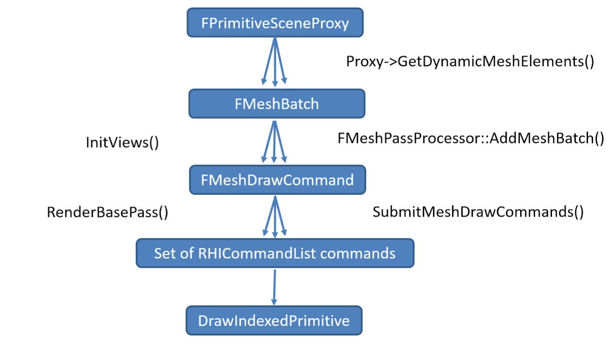

[Mesh Drawing Pipeline in Unreal Engine \| Unreal Engine 5.8 Documentation \| Epic Developer Community](https://dev.epicgames.com/documentation/unreal-engine/mesh-drawing-pipeline-in-unreal-engine)

<b>메시를 어떻게 그릴지"를 매 프레임 다시 계산하지 말고, 씬에 추가될 때 한 번 계산해서 캐시해두고 재사용하자.</b>

---

UE4 초기에는 프레임마다 "이 메시 + 이 머티리얼 = 어떤 셰이더, 어떤 렌더 스테이트?"를 다시 계산했다. 4.22부터 이걸 이번에 설명할 <b>retained mode(유지 모드)</b>로 바꿨다.

<b>메시 그리기 파이프라인(Mesh Drawing Pipeline)</b> 은 모든 씬 드로가 프레임마다 빌드되는 것이 아니라 사전에 준비되는 유지 모드라는 개념을 바탕으로 합니다. <br />또한 변경이 드물고 여러 프레임에 걸쳐 재사용할 수 있는 스태틱 메시의 프로퍼티를 활용하기 위한 공격적인 캐싱과 드로 콜 병합도 특징입니다.<br />



레벨에 바위 하나(<code>SM_Rock</code> + <code>M_Rock</code>)를 놓았다. 이게 화면 픽셀이 되기까지:

```txt
[ 바위 컴포넌트 ]                      게임 스레드. "레벨에 바위가 있다"
        │
        │  
        ▼
[ Proxy ]                              "바위는 이렇게 생겼다" 를
                                       렌더 스레드가 읽을 수 있는 형태로 복사
        │
        │  
        ▼
[ MeshBatch ]                          "정점버퍼 A / 인덱스 300~800 /
                                        머티리얼 M_Rock"
                                       ← 무엇을 그릴지. 셰이더는 아직 미정
        │
        │    ← 패스마다 따로 돈다
        ▼
[ MeshPassProcessor ]                  "나는 BasePass다. M_Rock이면
                                        BasePassVS/PS를 써야겠군"
        │
        │  
        ▼
[ MeshDrawCommand ]                    "VS=X, PS=Y, 텍스처0=T_Rock,
                                        상수버퍼=..., 인덱스 300~800 그려"
                                       ← 완전히 확정. 더 결정할 게 없음
        │
        │  
        ▼
[ RHI 제출 ]                           DirectX12 / Vulkan 명령어로 번역
        │
        ▼
      GPU
```

이게 전부다. <b>정보가 5번에 걸쳐 점점 구체화되는 과정</b>이고, 그 이상도 이하도 아니다.

```javascript
Game Thread
────────────────────
UPrimitiveComponent
    │
    │ CreateSceneProxy()
    ▼
FPrimitiveSceneProxy 생성
    │
    │ 렌더 스레드로 등록
    ▼

Render Thread
────────────────────
FPrimitiveSceneProxy
    │
    │ GetDynamicMeshElements()
    ▼
FMeshBatch
    │
    ▼
FMeshDrawCommand (이렇게 그려라”라는 언리얼 공통 명령서)
    │
    ▼
RHI (지금 DX12니까 이 명령서를 DX12 API 호출로 바꿔줄게)
    │
    ▼
GPU
```

### 왜 5단계나 되냐

한 번에 다 하면 안 되나? 답은 <b>실행 빈도가 단계마다 다르기 때문</b>이다.

<table header-row="true">
<colgroup>
<col width="190.609375" />
<col width="234" />
<col width="190.96875" />
<col width="97" />
</colgroup>
<tr>
<td>
단계
</td>
<td>
뭐임?
</td>
<td>
언제 실행되나
</td>
<td>
60fps에서
</td>
</tr>
<tr>
<td>
① Proxy
</td>
<td>
게임 스레드의 <code>PrimitiveComponent</code>를 <b>렌더 스레드에서 대신 표현하는 객체</b>.
</td>
<td>
바위를 레벨에 놓을 때
</td>
<td>
<b>딱 1번</b>
</td>
</tr>
<tr>
<td>
② MeshBatch
</td>
<td>
<b>어떤 메시 데이터를 어떤 머티리얼로 그릴지</b> 묶어놓은 렌더링 입력 데이터.
</td>
<td>
위와 같음 (StaticMesh 기준)
</td>
<td>
<b>딱 1번</b>
</td>
</tr>
<tr>
<td>
③ Processor
</td>
<td>
<code>MeshBatch</code>를 보고 <b>현재 렌더 패스에 맞는 셰이더·렌더 상태를 결정해서 DrawCommand로 변환</b>하는 단계.
</td>
<td>
위와 같음
</td>
<td>
<b>딱 1번</b>
</td>
</tr>
<tr>
<td>
④ MeshDrawCommand
</td>
<td>
셰이더, 버텍스/인덱스 버퍼, 렌더 상태 등이 확정된 <b>실제 Draw Call 직전의 명령 데이터</b>.<br />(이렇게 그려라”라는 언리얼 공통 명령서)
</td>
<td>
만들어진 뒤 그냥 보관
</td>
<td>
<b>재사용</b>
</td>
</tr>
<tr>
<td>
⑤ 제출
</td>
<td>
<code>MeshDrawCommand</code>를 바탕으로 <b>RHI 명령(</b><b><code>DrawIndexedPrimitive</code></b><b> 등)을 만들어 GPU 쪽으로 보내는 단계</b>.
</td>
<td>
매 프레임
</td>
<td>
<b>초당 60번</b>
</td>
</tr>
</table>

<b>여기서 의문</b>

어차피 MeshComponent에 정보가 다 있는데 뭐하러 MeshProxy를 렌더스레드랑 나눠가지냐?

<b>MeshComponent와 SceneProxy를 나누는 핵심 이유는 게임 스레드와 렌더 스레드가 서로 독립적으로 안전하게 동작하게 하기 위해서이다.</b>

- <code>MeshComponent</code> → <b>Game Thread 소유</b>. UObject, Transform, Collision, Material 설정 같은 게임 상태를 관리
- <code>SceneProxy</code> → <b>Render Thread용 복사/가공된 렌더링 상태</b>를 관리

그래서 Game Thread가 N프레임을 처리하는 동안 Render Thread가 이전에 전달받은 N-1프레임 데이터를 그릴 수 있다.

> <b>Game Thread와 Render Thread를 병렬로 돌리기 위해 데이터를 분리했고, 그 결과 Render Thread가 보통 이전 프레임의 데이터를 처리하는 구조가 된다.</b>

만약 <code>MeshComponent</code> 하나를 두 스레드가 같이 봤다면, Game Thread가 메시나 Transform을 수정하는 순간 Render Thread가 동시에 읽을 수 있어서 <b>Race Condition</b>이 생길 수 있음.

<b>렌더 스레드는 컴포넌트를 아예 안보고 Proxy에서 GetDynamicMeshElements로 MeshBtach를 구성해서 렌더링 파이프라인에 제출한다.</b>

---

#### Proxy가 실제로 복사하는 것

답부터: <b>두 종류로 나뉜다.</b>

| 종류 | 어떻게 | 예시 |
| --- | --- | --- |
| <b>무겁고 모두가 공유하는 것</b> | 복사 안 함. <b>포인터만</b> | 정점 버퍼, 인덱스 버퍼 |
| <b>가볍고 컴포넌트마다 다른 것</b> | <b>값으로 복사</b> | 머티리얼, 그림자 on/off, 강제 LOD |

---

#### 왜 이렇게 나뉘나

<b>정점 데이터</b>는 100개가 전부 똑같다. 삼각형 5000개짜리 바위를 100번 복사하면 메모리가 100배 든다. 애초에 정점 데이터는 <code>SM_Rock</code> 애셋이 로드될 때 <b>이미 GPU 메모리에 한 번 올라가 있다.</b> 바꿀 일도 없다. → 그냥 그걸 가리키는 포인터 하나만 들면 된다.

<b>설정값</b>은 100개가 다 다를 수 있다.

- 47번 바위만 그림자 끔
- 12번 바위만 다른 머티리얼로 덮어씀
- 80번 바위는 멀리 있어서 LOD 2 강제

→ 이건 컴포넌트마다 따로 복사해둬야 한다.

<b>그럼 InstancedStaticMesh는 왜써요??</b>

바위 100개를 따로 놓으면, 병합이 잘 되더라도 여전히:

| 비용 | 개별 컴포넌트 100개 | ISM 1개 |
| --- | --- | --- |
| <code>UPrimitiveComponent</code> | 100개 (등록/틱/트랜스폼 전파) | 1개 |
| <code>FPrimitiveSceneProxy</code> | 100개 | 1개 |
| <code>FPrimitiveSceneInfo</code> | 100개 | 1개 |
| 프러스텀/오클루전 컬링 | <b>매 프레임 100번</b> | 1번 (+ GPU 인스턴스 컬링) |
| GPUScene 엔트리 | 100개 | 1개 (인스턴스 데이터는 별도) |
| 병합 가능 여부 비교·정렬 | <b>매 프레임 100개 정렬</b> | 없음 |

→ 드로우콜은 1개로 합쳐져도 <b>CPU가 100번 일한다.</b>

게다가 자동 병합은 조건이 까다로워서 자주 깨진다 (문서 "Instancing Efficiency Limiters"):

1. 라이트맵이 서로 다름 → 바인딩이 달라서 병합 불가
2. 컴포넌트별 버텍스 컬러
3. 캐시 경로 + <code>FLocalVertexFactory</code>가 아니면 <b>아예 병합 시도조차 안 함</b>

<b>한 줄</b>: 자동 병합은 "그리는 비용"만 줄이고, ISM은 <b>"존재하는 비용"</b> 을 줄인다.

<b>머티리얼 변경이 ①\~④를 다 돌리는 이유</b>

<b>원리적 이유</b>: 머티리얼 → 셰이더 → PSO. 4번에서 봤듯이 PSO가 바뀌면 캐시해둔 <code>FMeshDrawCommand</code>는 <b>전부 무효</b>다. 그 커맨드 안에는 셰이더 포인터, 바인딩 테이블, 파이프라인 스테이트가 다 박혀 있다. 고쳐 쓸 수 있는 게 없다.

<b>구현상 이유</b>: UE는 "머티리얼 포인터만 갈아끼우기" 같은 부분 갱신을 안 한다. Proxy를 통째로 버린다.

<b>왜 이렇게 거칠게 하냐</b>: 머티리얼 변경은 아래로 너무 많은 게 딸려온다.

1. Opaque → Translucent로 바뀌면 <code>MaterialRelevance</code>가 바뀐다
2. 그러면 <code>GetViewRelevance()</code> 결과가 바뀐다
3. 그러면 <b>어느 패스에 들어갈지 자체</b>가 바뀐다 (BasePass → Translucency Pass)
4. 정렬 순서도 바뀐다 (반투명은 뒤→앞 정렬 필요)
5. 새 셰이더 조합이면 PSO를 새로 만들어야 한다

<table header-row="true">
<colgroup>
<col />
<col width="184" />
<col width="392" />
</colgroup>
<tr>
<td></td>
<td>
트랜스폼
</td>
<td>
머티리얼
</td>
</tr>
<tr>
<td>
바뀌는 것
</td>
<td>
버퍼 <b>내용</b> 16 float
</td>
<td>
셰이더 <b>코드</b> = PSO (Pipeline State Object
</td>
</tr>
<tr>
<td>
영향 범위
</td>
<td>
GPUScene 슬롯 1개
</td>
<td>
패스 선택, 정렬, 바인딩 전부
</td>
</tr>
<tr>
<td>
처리
</td>
<td>
값만 덮어쓰기
</td>
<td>
Proxy 폐기 → ①②③④ 재실행
</td>
</tr>
</table>

---

### FMeshBatch

<code>FMeshBatch</code> 하나의 단위는:

```txt
(Proxy 1개) × (LOD 1개) × (머티리얼 섹션 1개)
```

<b>Proxy마다 따로 만들어진다.</b> 즉 바위 100개면 내용이 완전히 똑같아도 <code>FMeshBatch</code> 100개다 (각 컴포넌트가 자기 Proxy를 갖고, 각 Proxy가 자기 Batch를 내놓으므로).

네 예시대로면:

| 설정 | 컴포넌트 수 | <code>FMeshBatch</code> 수 | 최종 드로우콜 |
| --- | --- | --- | --- |
| A (Mat1, 그림자 O) | 50 | <b>50개</b> | 1개 (50 인스턴스) |
| B (Mat2, 그림자 O) | 1 | <b>1개</b> | 1개 (1 인스턴스) |
| C (Mat1, 그림자 X) | 10 | <b>10개</b> | 1개 (10 인스턴스) |

---

### DynamicMesh는 어떻게 처리하나

\[ 컴포넌트 \]<br />│<br />\[ Proxy \]              StaticMesh: 1회    │  DynamicMesh: 1회<br />│<br />\[ MeshBatch \]          StaticMesh: 1회    │  DynamicMesh: ★매 프레임★<br />│<br />\[ MeshPassProcessor \]  StaticMesh: 1회    │  DynamicMesh: ★매 프레임★<br />│<br />\[ MeshDrawCommand \]    StaticMesh: 재사용  │  DynamicMesh: ★매 프레임 새로★<br />│<br />\[ RHI 제출 \]            둘 다 매 프레임

### 드로우콜이 높은 이유

동적 경로는 <b>인스턴싱 병합을 안 한다.</b>

<code>MeshDrawCommands.cpp:1253</code>에 주석과 함께 하드코딩돼 있다:

```txt
// we don't support dynamic instancing for this path since we require one primitive per draw command
const bool bDynamicInstancing = false;
```

→ DynamicMesh 100개 = <b>드로우콜 100개</b>. StaticMesh 100개는 1개로 합쳐질 수 있는 것과 대비된다.

추가로 DynamicMeshComponent는 <b>머티리얼 슬롯마다 별도 버퍼셋</b>을 만든다 (<code>AllocatedBufferSets</code>). 슬롯 3개면 드로우콜이 또 3배.
