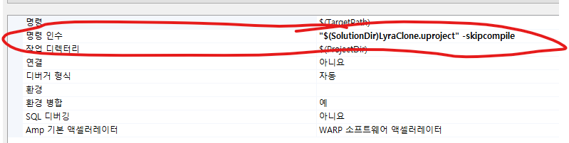

라이라에서 사용한 기법이라고한다.

```c++
bool ULCAssetManager::ShouldLogAssetLoads()
{
	const TCHAR* CommandLineContent = FCommandLine::Get();
	static bool bLogAssetLoads = FParse::Param(CommandLineContent, TEXT("LogAssetLoads")); 
	// cmd의 CommandLine에 "LogAssetLoads"라는 arg가 호출되었는지 확인한다. 있으면 true 반환
	
	return false;
}

```

프로젝트 이름 우클릭 후 속성→디버깅 들어가면 <br />아래의 명령인수 부분을 확인이 가능하다.



사진을 보면 -skipcompile이라는게 보이는데 현재 CommandLine의 arg로 skilcompile이라는 인수가 들어간 상태라는 뜻이다.

우리는 저기에 -LogAssetLoads라는 인수를 추가한다.

그럼 해당함수를 호출할때마다 true를 반환한다.
