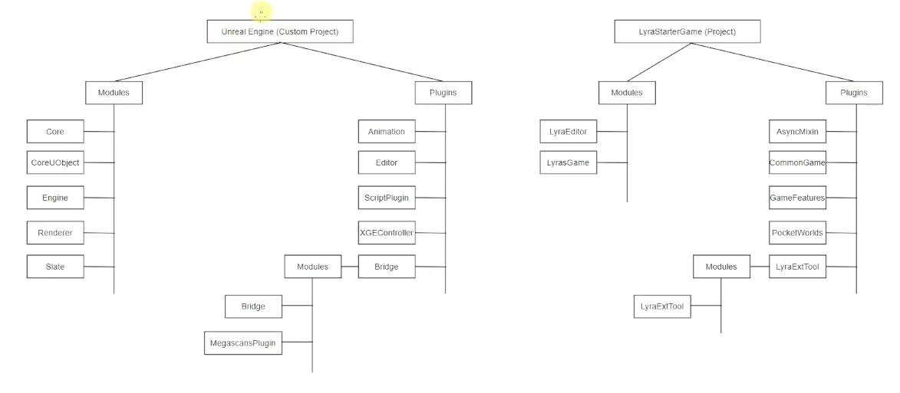

## 모듈이란?

언리얼 엔진에서의 모듈이란 cpp + h로 이루어진 하나의 단위이다.

## 플러그인이란?

모듈들로 이루어진 객체와 기능의 덩어리? 라고 보면 될 것 같다.

대부분 플러그인에서 실험적인 기능이나 <b>외부 확장 용도</b>로 사용.

플러그인은 하나의 프로젝트에 종속되는 모듈이 아니라 다른 프로젝트에도 이식할 수 있는 등 확장성이 좋다.

<b>프로젝트는 모듈과 플러그인 에셋 컨텐츠들을 모두 포함하는 단위</b>

---

언리얼 엔진 프로젝트를 만들면 프로젝트 이름의 기본 모듈을 반드시 하나 포함한다.<br />기본 모듈은 엔진 사용에 있어 필수적이다.

커스톰 모듈은 아래와 같이 사용한다.

```c++
// 커스텀 모듈 생성
class FLCModule : public FDefaultGameModuleImpl
{
public:
	virtual void StartupModule() override;
	virtual void ShutdownModule() override;

};
void FLCModule::StartupModule()
{
}

void FLCModule::ShutdownModule()
{
}
```

위와 같이 커스텀 모듈을 만들고 엔진에게 사용하라고 명령을 내리고 싶으면<br /><br />프로젝트 이름.cpp에 아래와 같이 호출한다.

PrimaryModule은 반드시 엔진내에 하나만 꼭 필요하다.

```c++
IMPLEMENT_PRIMARY_GAME_MODULE( FLCModule, LyraClone, "LyraClone" );
```

만약 주요 모듈이 있는 상태에서 새로운 모듈을 만들고 싶으면 이렇게 하면 된다.

```c++
IMPLEMENT_MODULE( FLCModule, LyraClone, "LyraClone" );
```

---

<b>모듈</b>

현재 <code>Overwatch.Build.cs</code>를 보면 이 프로젝트가 어떤 Lyra식 시스템을 받아들이고 있는지 바로 보인다.

```c++
PublicDependencyModuleNames.AddRange(new string[]
{
    "EnhancedInput",
    "ModularGameplay",
    "GameFeatures",
    "ModularGameplayActors",
    "GameplayTags",
    "GameplayTasks",
    "GameplayAbilities",
    "CommonUI",
    "CommonUser"
});
```

여기서 중요한 점은 <code>Overwatch</code> 모듈 하나 안에 모든 기능을 직접 우겨넣는게 아니라, 엔진 모듈들이 제공하는 확장 지점 위에 우리 타입을 얹는다는 것이다.

- <code>ModularGameplay</code> : <code>GameFrameworkComponentManager</code>, <code>InitState</code> 흐름
- <code>GameFeatures</code> : 런타임 기능 활성화/비활성화
- <code>EnhancedInput</code> : LocalPlayer 기준 입력 매핑
- <code>GameplayAbilities</code> : ASC, AbilitySet, InputTag 기반 Ability 입력
- <code>CommonUI</code>, <code>CommonUser</code> : 프론트엔드/세션 진입 흐름

왜 이렇게 하냐

→ GameMode 하나가 모든 규칙을 들고있는 구조로 가면 게임 모드가 늘어날수록 분기가 커진다. Lyra식 구조는 모듈 의존성을 명시하고, 실제 기능 변화는 Experience/GameFeature/Component 쪽으로 밀어내는 방식이다.
