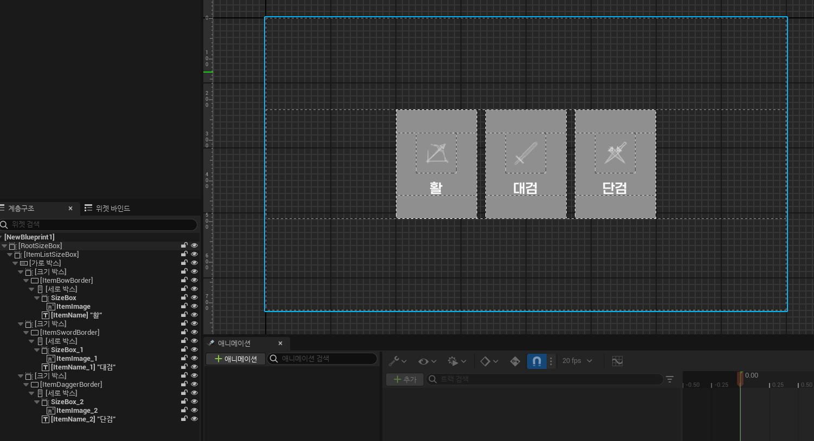
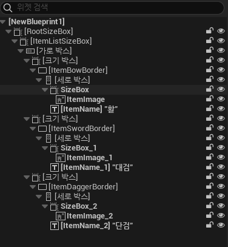
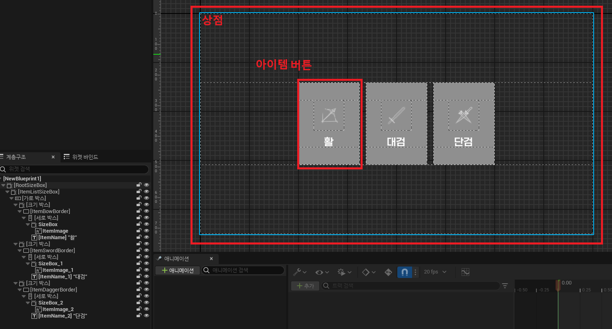
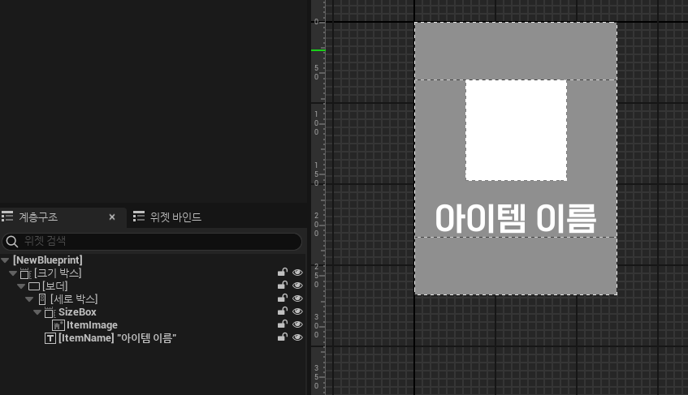
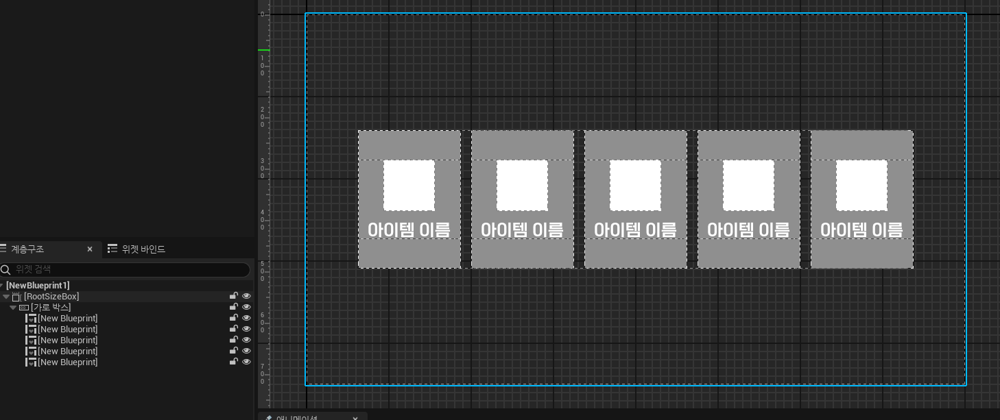
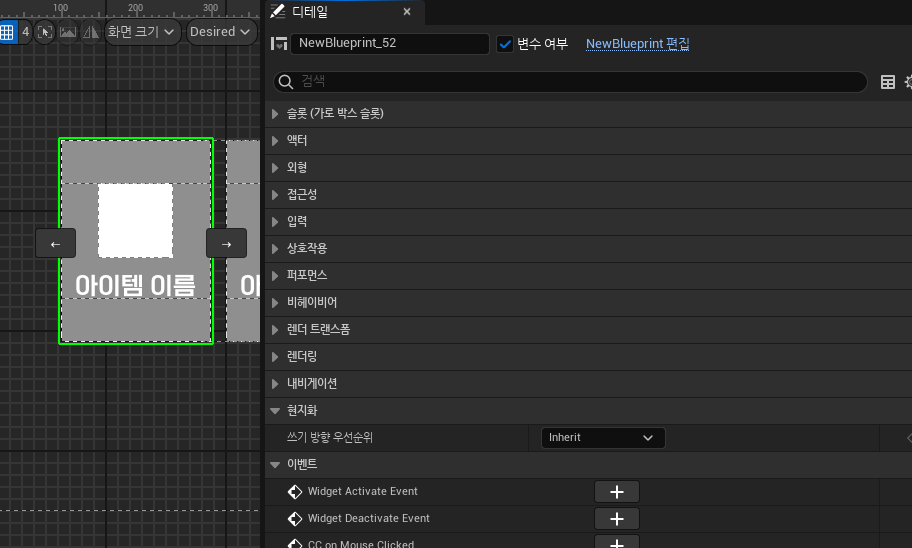
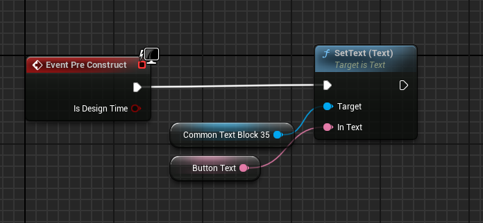
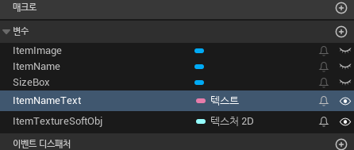
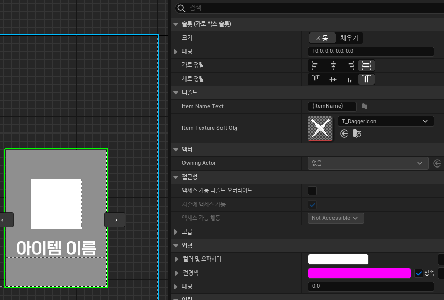

<b>-행동- </b>키워드가 붙으면 내가에디터에서 구현 보여준다. 

---

안녕하세요 오늘 보조강사를 맡게된 조세현이라고 합니다.

오늘 강의를 맡게된 내용은 위젯생산성을 높일 수 있는 모듈화 위젯이라는 주제로 강의를 진행해보려고 합니다.

아시는 분도 계시겠지만 언리얼에서 위젯 만들려면 꼭 알고 넘어갔으면 하는 부분이라 강의를 진행하게 되었어요

저희 강의 제목이 모듈화 위젯이잖아요?

어 그럼 위젯은 배워서 아는데 모듈화가 뭘까

모듈화는 하나의 시스템을 여러 부품들로 나누어 설계해서 제작하는것을 말합니다.

이야기만 들어도 객체지향 프로그래밍과 유사하죠

예를들어봅시다)

기획자가 이 위젯을 사용해서 레벨디자인을 하게 될텐데 상점 A에서 활, 대검, 단검을 고정으로 나오게 하려고 해요

그러면 상점 UI에다가 아래 그림처럼 만들면 되죠<b> -행동-</b>



이 위젯을 봤을때 문제점이 보이시나요?

- 계층구조가 더러움, 유지보수성 떨어짐

우선 가장 먼저 보이는 위젯 계층구조를 볼까요?



이렇게 되있으면 일단 어때요 이름도 위젯 이름을 하나하나 지어주지않는이상 구분하기 어렵고<br />지어준다고 하더라도 지저분해서 뭐가뭔지 모르겠죠

그리고 더 큰 문제가 2개 더 있습니다.

게임 UI면 어느정도 UI/UX가 공통점들이 많이 존재하겠죠?<br />이제 악세서리 상점을 만들어달라고 디렉팅이 들어왔다고 하면 저거 가로박스 복사해다가<br />WBP\_AccessoryShop 만들어서 붙여넣어야죠 <b> -행동-</b>

근데 이렇게 해버리면 디자인 데이터, UX등이 다 따로따로 놀게 될것입니다.

<i>여기서 Style같은거 데이터테이블같은거로 빼는거 강의할지는 아직 고민</i>

그리고 갑자기 디렉터가 아이템 리스트 차일드들 크기 바꾸고 아이템 사진 동그랗게 바꿔고 라고제안을 하면.

어떻게해요 이거 다\~ 일일히 바꿔줘야죠! <b>-행동-</b>

생각만해도 귀찮은 작업입니다.

---

자 모듈화가 객체지향이랑 비슷하다고 했죠 객체지향에서는 이런문제 해결할때 어떻게 해결했죠?

부품들을 따로 클래스화해서 그걸 모아서 해결했었죠

그럼 이번 문제는 어떻게 해결하면 좋을까요

위젯을 먼저 분석해봅시다.



일단 가장 간단하게 이 위젯은 우선 상점 위젯이고 이 안에 아이템들이 들어가있는 간단한 위젯이죠

그럼 여기서 아이템 버튼들은 부품으로 뺄수가 있는거죠

이 아이템 버튼을 클래스로 빼서 인스턴스들을 만들고 아이템 데이터 변수만 바꿔주면 무기든 악세사리던 찍어낼수 있겠죠 

자 이렇게 아이템버튼 의 기본 형태가 완성되었습니다. <b>-행동-</b>



다들 시도해보셨을수도 있는데



이렇게 추가 해서 아이템 이름 위젯에 접근해서 막 데이터들 바꿔주고싶죠



근데 보시면 UPROPERTY를 키던 뭘하던 자식디자인에 접근하고 그런기능은 없어요

그래서 이 기능을 만들어주려고 합니다.

이 기능을 구현하기 위해 저희는 파라미터들을 외부로 공개해서 수정하고 PreConstruct 기능을 사용해서 위젯이 생성되기 전 해당 파라미터들을 적용시켜주는겁니다.

그래서 저희는 언리얼 위젯의 PreConstruct함수를 사용해서 이 문제를 해결해볼겁니다.

<details>
<summary><b>PreConstruct함수</b></summary>

<b>PreConstruct</b>함수는 말 그대로 Construct함수 이전에 호출되는 함수입니다.<br />에디터 미리보기/런타임 <b>둘 다 호출</b>. 위젯이 Slate로 재구성될 때마다 다시 호출됩니다.<br /><br />이외로 <b>Construct 함수</b>는 런타임에서만 호출이되는데<br />위젯 계층에서 붙였다 떼면 여러번호출이 가능합니다. (한번만 보장되는 이벤트가 아니라는 뜻이구요)<br />꼭 한번만 실행되어야한다고 한다면 <b>OnInitialized</b>에 구현하면됩니다.<br /><br />C++에는 위 함수들이름에 앞에 Native를 붙인 가상함수가 있으니 오버라이드 하시면 됩니다.

다시 <b>PreConstruct</b>함수로 넘어와서<br />해당 함수는 엔진에디터 디테일 패널 값을 바꾸면 호출되는 <code>PostEditChangeProperty</code> 함수 내에서 호출됩니다

<details>
<summary>함수 호출 부분 코드 </summary>

```javascript
// Slate 재구성될때 호출
void UUserWidget::OnWidgetRebuilt()
{
	...
	if (!IsDesignTime())
	{
		// Notify the widget to run per-construct.
		NativePreConstruct();

		// Notify the widget that it has been constructed.
		NativeConstruct();
	}
#if WITH_EDITOR
	else if ( HasAnyDesignerFlags(EWidgetDesignFlags::ExecutePreConstruct) )
	{
	...
		if (bCanCallPreConstruct)
		{
			NativePreConstruct();
		}
	}
#endif
}

```

```javascript
// 에디터 디테일패널에서 프로퍼티 변경 후 호출
void UUserWidget::PostEditChangeProperty(FPropertyChangedEvent& PropertyChangedEvent)
{
	Super::PostEditChangeProperty(PropertyChangedEvent);

	const FName PropertyName = PropertyChangedEvent.GetPropertyName();

	static FName DesiredFocusWidgetPropertyName(GET_MEMBER_NAME_CHECKED(UUserWidget, DesiredFocusWidget));
	if (PropertyName == DesiredFocusWidgetPropertyName)
	{
		if (UWidgetBlueprintGeneratedClass* BGClass = GetWidgetTreeOwningClass())
		{
			if (UUserWidget* UserWidgetCDO = BGClass->GetDefaultObject<UUserWidget>())
			{
				// We cannot use the Widget Ptr as we need to find the widget with the same name in the CDO
				UserWidgetCDO->SetDesiredFocusWidget(DesiredFocusWidget.GetFName());
			}
		}
	}

	if ( PropertyChangedEvent.ChangeType != EPropertyChangeType::Interactive )
	{
		TSharedPtr<SWidget> SafeWidget = GetCachedWidget();
		if ( SafeWidget.IsValid() )
		{
			// Re-Run execute PreConstruct when we get a post edit property change, to do something
			// akin to running Sync Properties, so users don't have to recompile to see updates.
			NativePreConstruct();
		}
	}
}
```

</details>

이 말은 저희가 에디터에 보이고 있는 위젯에 프로퍼티를 적용할 수 있다는 말입니다.

이 사진은 언리얼 공식 콘텐츠예제 프로젝트에서 사용중인 버튼 UI에서 가져온 블루프린트 그래프에요<br />보시면 <b>PreConstruct</b>단계에서 ButtonText라는 변수를 받아 TextBlock에 적용하고있죠

언리얼에서도 해당 방법을 사용하고있으니 안심하고 사용하셔도 된다고 보여드린거구요.



</details>

---


이 버튼에서 아이템마다 바뀌어야하는 부분이 뭐죠?

아이템 사진과 이름이죠

그럼 그 바뀌어야하는 변수값들을 해당 클래스에 멤버변수로 만들어줍니다.<b> -행동-</b>



이 변수 오른쪽에 있는 눈알모양보이시죠

이걸 누르면 인스턴스를 클릭했을때 해당 변수가 보이게 됩니다.

컴파일 누르시면 디폴트값 설정이 가능하구요



아 여기 이렇게 아이템 네임, 아이템 텍스처가 보이죠?

이제 아까 말씀드린 PreConstruct단계에서 디자인을 적용해주기만 하면 적용이됩니다.
