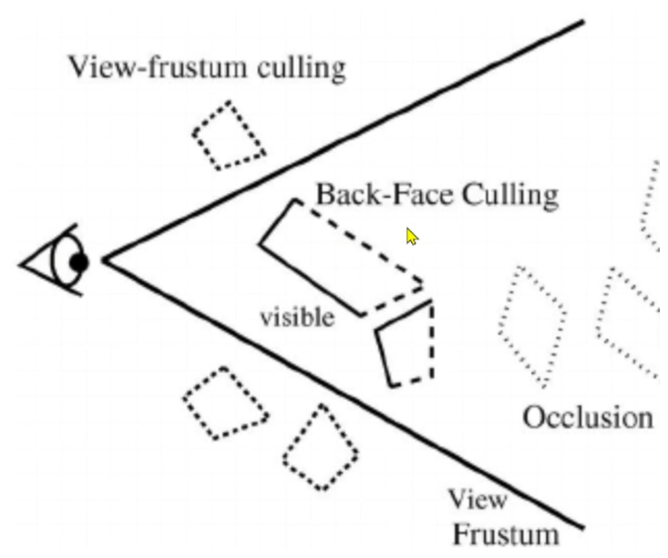
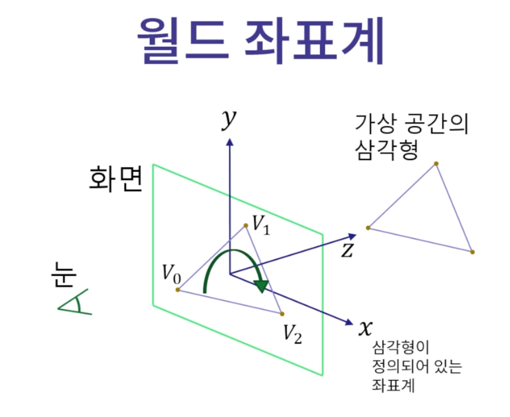
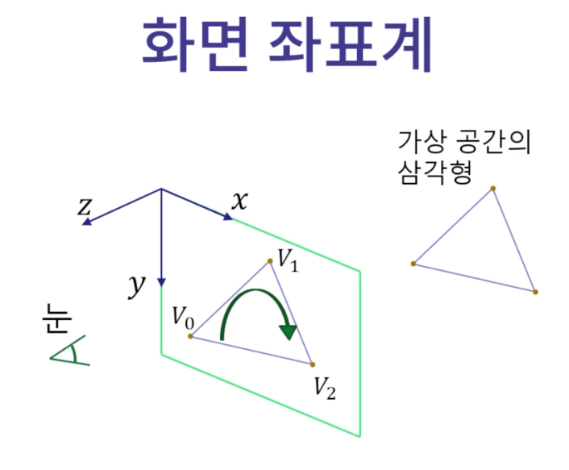
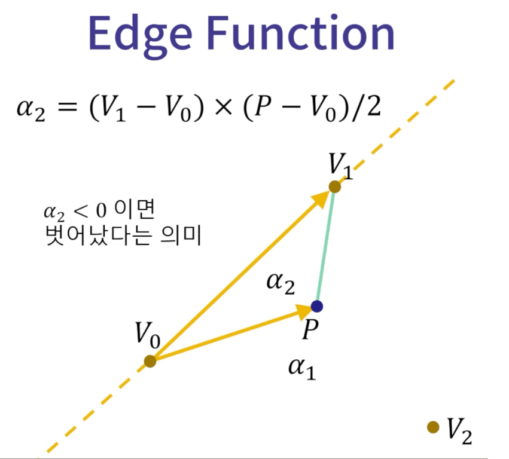

---

눈에 보이지 않을 메쉬의 뒷면들을 렌더링에서 제외해버리는 최적화 기법이다.

가상공간의 삼각형을 화면에 투영했을때 벡터들을 Edge Function했을때 양수면 앞면 음수면 뒷면으로 간주한다.

화면 좌표계에서는 그림처럼 z가 우리의 눈쪽을 향하기 때문에

양수인 결과를 얻어야 한다.

<b> Edge Function</b>

- 3차원공간에서는 외적으로 계산하지만, 우리는 화면으로 투영시킨 상태기 때문에 2d공간이다.
  따라서 더 빠른 연산을 위해 edge function을 사용한다.

  
