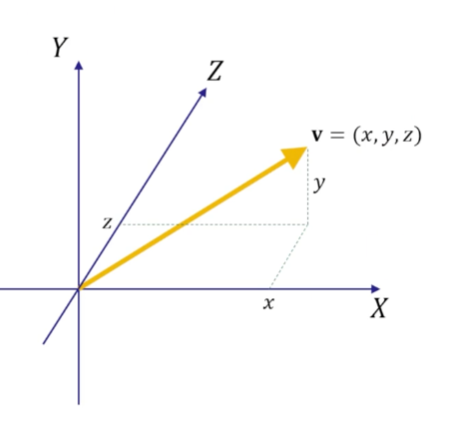
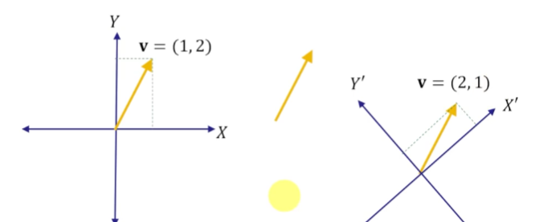
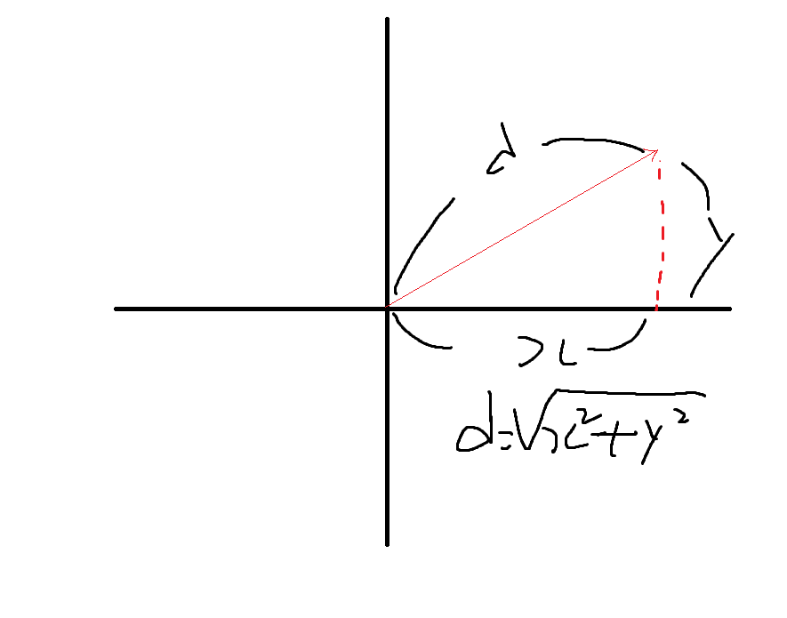

<b>크기와 방향이 있는 물리량</b>

---

데카르트 좌표계의 점은 위치정보/스칼라만 가진다.

<b>벡터</b>는 0,0 이라는 기준점을 가지고 있기때문에 0,0에서 벡터 V로의 방향정보까지 가진다.

즉

- 벡터는 방향과 크기를 가진다 위치정보는 없다
- 두 벡터는 방향과 길이가 같으면 같은 벡터이다.

### <b>변위</b>

벡터로 이동하는 행위를 표현하는 것을 변위라고 부른다.

길이가 1인 방향을 가리키는 벡터가 A에 크기 n을 곱해주면

A 방향으로 n만큼 가는 변위가 완성된다.

### <b>기저벡터 (좌표계라고 생각하면 쉽다)</b>

- 기준이 되는 벡터
- <b>벡터 V는 벡터 V로 연산해 만들 수 있는 모든 벡터들의 기저벡터이다</b>
  - 예를들어 벡터 (1,0)으로는 x=y\^2를 표현할 수 없다.
- ex ) x축상의 기저벡터는 <b>(1,0)</b>, y축상의 기저벡터는 <b>(0,1)</b>이다.

벡터A 에서 벡터B쪽으로의 벡터V를 알고 싶으면

V = B - A 로 구해진다.

같은벡터지만 좌표계에 따라 다르게 표현된다.

### <b>벡터의 길이</b>

피타고라스 쓴다.
