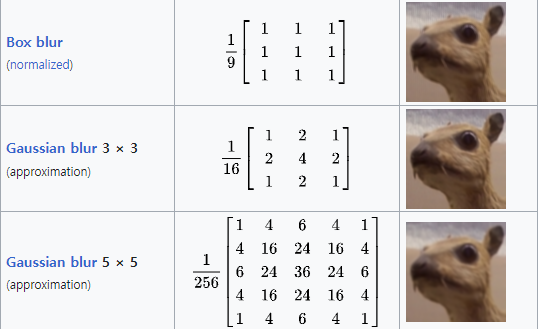
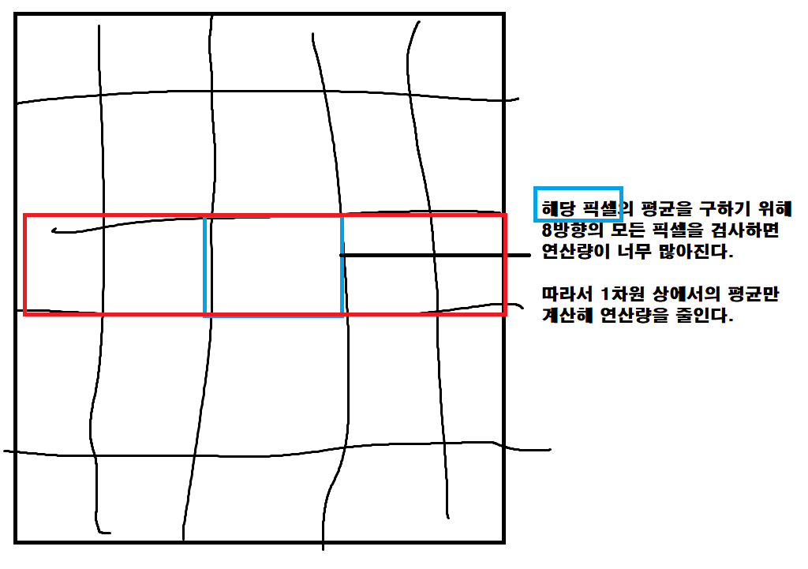
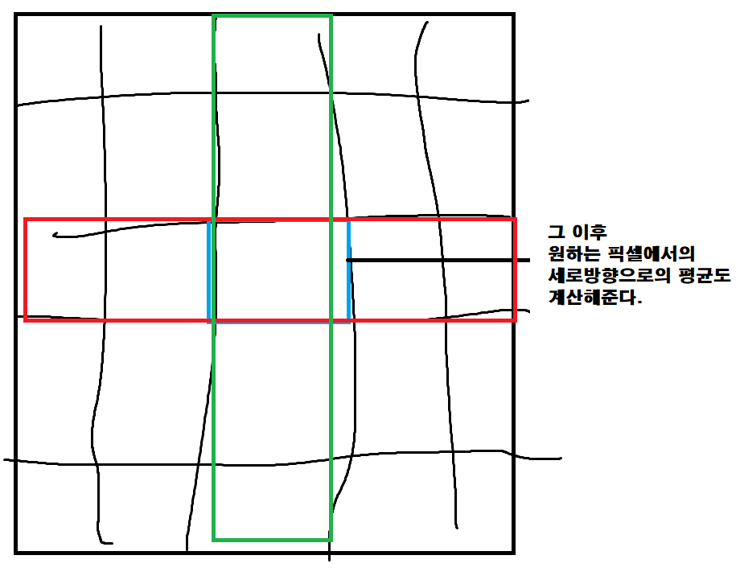
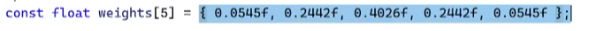

<a href="https://en.wikipedia.org/wiki/Kernel_(image_processing)">en.wikipedia.org</a>

---

<b>블러</b>는 이미지를 <b>부드럽게 하는 효과</b>이다.

이미지를 부드럽게 한다는 것은 픽셀 색상간의 차이가 적다는 것이다.

두 픽셀의 색상의 차이를 줄이려면 두 픽셀의 평균치를 구하는 편이 간단한다.



- <b>kernel</b>의 평균을 내고있다.

<b>해당 이미지를 필터링 해보자</b>


<b>BoxBlur</b>

- 가우시안 블러보다 원본의 형태를 더 알아보기 힘들다

<details>
<summary><b>방법</b></summary>





```c++
for (int k = 0; k < 5; k++)
{
	Vec4 nearColor = GetPixel(i + k - 2, j);
	sum.v[0] += nearColor.v[0];
	sum.v[1] += nearColor.v[1];
	sum.v[2] += nearColor.v[2];
}
pixelsBuffer[idx].v[0] = sum.v[0] * 0.2f; // 평균값을 내준다.
pixelsBuffer[idx].v[1] = sum.v[1] * 0.2f;
pixelsBuffer[idx].v[2] = sum.v[2] * 0.2f;
```

</details>

<details>
<summary><b>결과</b></summary>


</details>

<b>GaussianBlur</b>

- 가우시안 블러도 박스블러랑 크게 다를게 없다.
  다만 평균값을 내줄 때, 균등하게 내주는게 아니라 

  

  이렇게 가중치에 따라서 다르게 평균값을 내준다.

<details>
<summary><b>방법</b></summary>

```c++
for (int k = 0; k < 5; k++)
{
	Vec4 nearColor = GetPixel(i, j + k - 2);
	sum.v[0] += nearColor.v[0] * weights[k];
	sum.v[1] += nearColor.v[1] * weights[k];
	sum.v[2] += nearColor.v[2] * weights[k];
}
// 가우시안 블러는 위에서 가중치로 처리해주는 것이기 때문에 평균을 구할 필요가 없다.
pixelsBuffer[idx].v[0] = sum.v[0];
pixelsBuffer[idx].v[1] = sum.v[1];
pixelsBuffer[idx].v[2] = sum.v[2];
```

</details>

<details>
<summary><b>결과</b></summary>


<b>(조금..더 선명하다!)</b>

</details>
