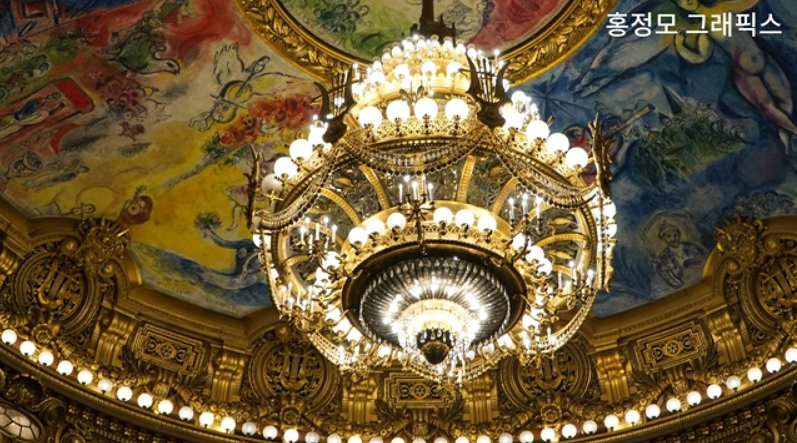
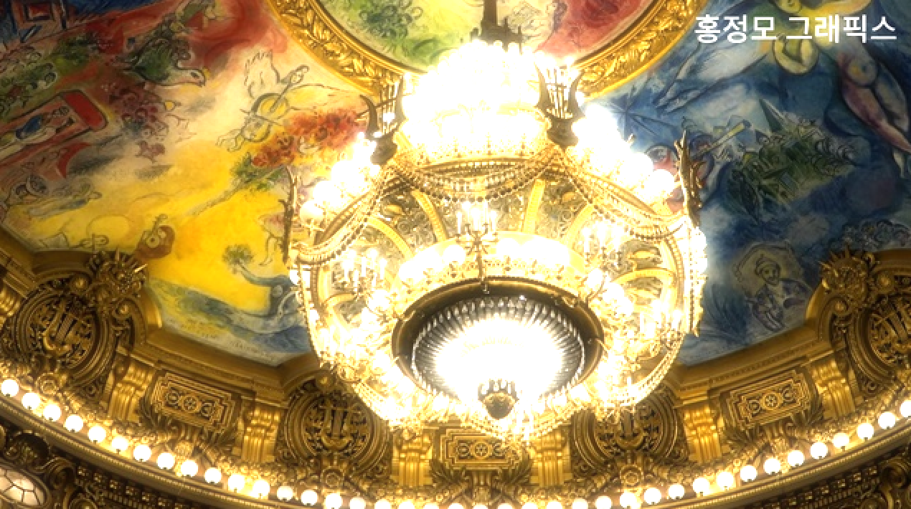
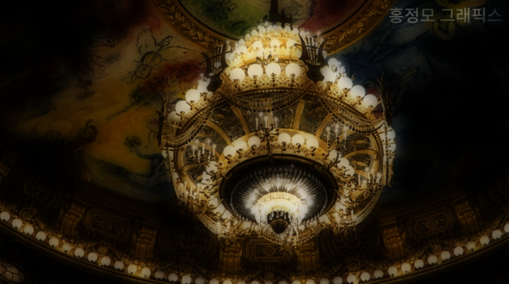
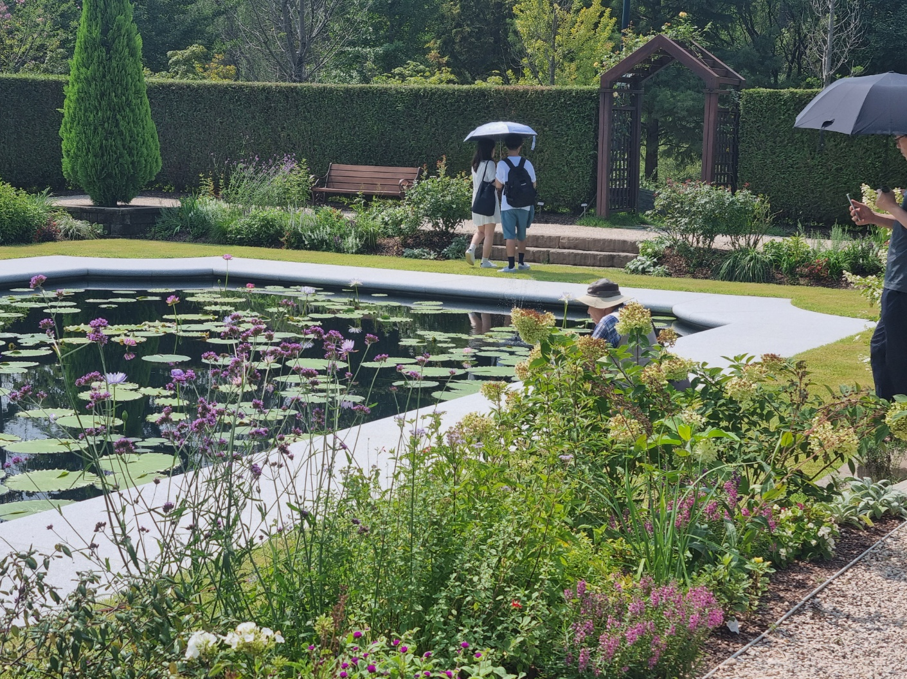
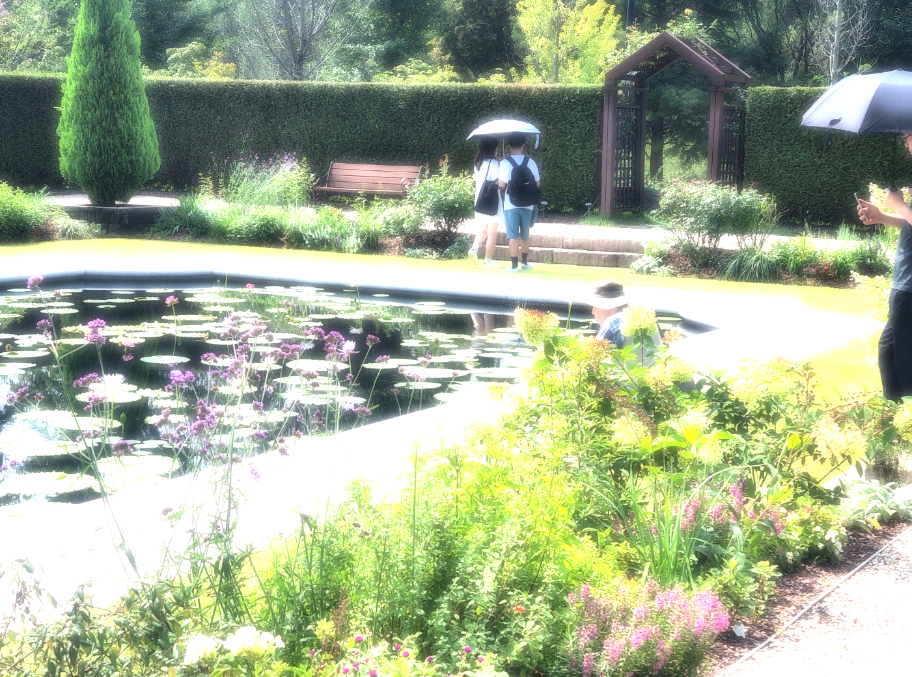

---

모니터의 밝기 범위가 제한되어있기 때문에

광원과 밝은 조명이 있는 영역은 viewer에게 의도대로 전해지지 않는 경우가 많다.

<b>블룸 효과는 밝은 광원을 더 빛나게 하는 효과이다.</b>

<b>구현 방법</b>

1. 이미지의 모든 픽셀에 대해서 밝은 픽셀은 그대로 두고 어두운 픽셀은 검정색으로 만들어버린다.
   <b>어두운 픽셀의 기준</b>

2. 가우시안 블러를 적용한다.
   밝은색들이 주변으로 퍼져나가는 느낌을 줄 수 있다.

3. 원본 이미지와 가우시안 블러를 적용한 이미지를 더한다.
   이때 강도를 조절하기위해 weight 를 사용하는 방법도 있다.

<b>원본</b>

<b>효과 적용 결과</b>

<b>번외</b>

실수로 더하지 않고 곱하니까 요런 효과가 나왔다. ㅋㅋㅋ

<b>내 사진에 블룸효과도 줘봤다!</b>

