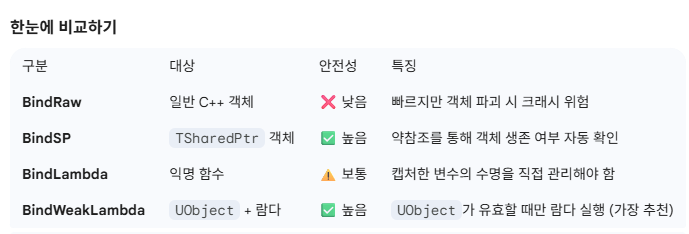

---

- <b>PRAGMA\_DISABLE\_OPTIMIZATION<br /></b>Development Editor로 빌드해 중단점이 걸리지 않는 부분에 중단점을 걸 수 있게해준다.

```c++
PRAGMA_DISABLE_OPTIMIZATION
{
	codes // 중단점 가능!
}
PRAGMA_ENABLE_OPTIMIZATION
```

- <b>PrimaryAsset</b>
  PrimaryAsset은 일반 DataAsset에서 PrimaryAssetId와 Asset Bundle에 대한 구현이 추가된 상태이다.<br />PrimaryAsset으로 만들어진 에셋은 Assetmanager를 통한 load/unload관련 메서드호출로 활성화가 가능하다

  - GetPrimaryAssetId 함수를 통해 아래의 두 가지 패턴 구현이 가능하다.
    1. UPrimaryDataAsset을 상속 받은 Nativec++ 클래스 정의하면 그 정의된 클래스를 PrimaryAssetType으로 사용 가능하다.
    2. UPrimaryDataAsset을 상속 받은 Blueprint는 아래의 두 가지 방식에 따라 PrimaryAssetType이 결정된다<br />- 부모를 거슬러 올라가며 가장 처음으로 만난 Cpp클래스<br />- 또는 가장 부모인 BP클래스 (해당 BP클래스는 PrimaryDataAsset을 상속 받아야함
  - 만약 위의 동작방식을 바꾸고 싶다면 GetPrimaryAssetId함수를 재정의하면 된다.

- <b>FObjectKey</b><br />동일한 CDO를 사용해 만든 2개의 오브젝트가 있다고 했을때<br />해당 오브젝트들을 구별하기 위해 만들어진 Key이다 (내부적으로 주소등의 정보를 사용해 만든다고 한다)

- <b>UE\_INLINE\_GENERATED\_CPP\_BY\_NAME<br />UHT에 의해 생기는 gen.cpp 파일을 inline화 하여 컴파일되는 Unit의 수를 줄인다.<br />(원래는 cpp + gen.cpp로 2개를 했다면 cpp내에 gen.cpp를 포함하게하여 1개로 줄인다.<br />예시</b>
  ```c++
  #include "GameFeatureAction_WorldActionBase.h"
  #include UE_INLINE_GENERATED_CPP_BY_NAME(GameFeatureAction_WorldActionBase) // gen.cpp파일을 Inline화 한다.

  ```

  - 그럼 전부다 UE\_INLINE\_GENERATED\_CPP\_BY\_NAME쓰면 될거같은데 왜 안써요?<br />→ <code>gen.cpp</code> 안에는 <b>전역 함수/정적 데이터</b>(<code>Z_Construct_UClass_UMyObject</code>, <code>StaticRegisterNativesUMyObject</code> 같은 심볼)가 들어간다.<br />그렇기 때문에 한 클래스에 대해 UE\_INLINE\_GENERATED\_CPP\_BY\_NAME를 여러곳에 쓰게되면 중복 전역변수에 의해 링킹에러가 나게 된다.<br />만약 한 클래스에 대해 UE\_INLINE\_GENERATED\_CPP\_BY\_NAME를 여러곳에 쓰지않으면 뭐 상관 없을거같다.<br />

<details>
<summary><b>FGuid</b></summary>

### 1. <b>FGuid란?</b>

FGuid는 <b>Globally Unique Identifier</b>(GUID, 전역 고유 식별자)를 나타내는 구조체로, 언리얼 엔진에서 객체, 리소스, 또는 데이터를 고유하게 식별할 때 사용됩니다. 이는 128비트(16바이트)로 구성된 고유한 값으로, 중복될 가능성이 매우 낮아 다양한 시스템에서 충돌 없이 사용할 수 있습니다.

- <b>용도</b>:
  - 액터, 컴포넌트, 애셋 등의 고유 식별
  - 네트워크 복제 시 객체 동기화
  - 데이터 직렬화 및 저장
  - 에디터와 런타임에서 고유 식별자 필요 시

### 2. <b>구조</b>

FGuid는 네 개의 32비트 정수(int32)로 구성됩니다:

cpp

<pre><code>struct FGuid
{
    uint32 A;
    uint32 B;
    uint32 C;
    uint32 D;
};</code></pre>

- 각 필드(A, B, C, D)는 4바이트로, 총 16바이트를 구성합니다.
- 일반적으로 16진수 형태로 표현되며, 예를 들어 550E8400-E29B-41D4-A716-446655440000 같은 형식을 가집니다.

### 3. <b>주요 기능</b>

FGuid는 언리얼 엔진에서 다음과 같은 기능을 제공합니다:

- <b>생성</b>: FGuid::NewGuid()를 호출하여 새로운 고유 GUID를 생성할 수 있습니다.<br /><br />이 함수는 시스템 시간, 랜덤 값, 또는 기타 고유성을 보장하는 알고리즘을 기반으로 GUID를 생성합니다.
  cpp

  <code>FGuid NewGuid = FGuid::NewGuid();</code>

- <b>유효성 확인</b>: IsValid()를 사용해 GUID가 유효한지 확인할 수 있습니다.
  cpp

  <pre><code>if (MyGuid.IsValid())
  {
      </code></pre><i><code>// 유효한 GUID</code></i><code>}</code>

- <b>비교</b>: 두 FGuid가 같은지 비교할 수 있습니다.
  cpp

  <pre><code>if (Guid1 == Guid2)
  {
      </code></pre><i><code>// 동일한 GUID</code></i><code>}</code>

- <b>문자열 변환</b>: GUID를 문자열로 변환하거나 문자열에서 GUID로 변환할 수 있습니다.
  cpp

  <code>FString GuidString = MyGuid.ToString(); </code><i><code>// 예: "550E8400-E29B-41D4-A716-446655440000"</code></i><code>FGuid::Parse(GuidString, MyGuid); </code><i><code>// 문자열에서 FGuid로 파싱</code></i>

- <b>직렬화</b>: FGuid는 네트워크 전송이나 파일 저장을 위해 직렬화 가능합니다.

### 4. <b>주요 메서드</b>

- static FGuid NewGuid(): 새로운 GUID 생성.
- bool IsValid(): GUID가 유효한지 확인 (0이 아닌지).
- FString ToString(): GUID를 문자열로 변환.
- static bool Parse(const FString& InString, FGuid& OutGuid): 문자열에서 GUID 파싱.
- static bool ParseExact(const FString& InString, EGuidFormats InFormat, FGuid& OutGuid): 특정 형식의 문자열에서 GUID 파싱.

### 5. <b>사용 예시</b>

### 새로운 GUID 생성

cpp

<pre><code>#include "Misc/Guid.h"
FGuid MyGuid = FGuid::NewGuid();
UE_LOG(LogTemp, Log, TEXT("New GUID: %s"), *MyGuid.ToString());</code></pre>

### GUID 비교

cpp

<pre><code>FGuid Guid1 = FGuid::NewGuid();
FGuid Guid2 = Guid1;
if (Guid1 == Guid2)
{
    UE_LOG(LogTemp, Log, TEXT("GUIDs are equal!"));
}</code></pre>

### 문자열로 변환 및 파싱

cpp

<pre><code>FString GuidString = MyGuid.ToString();
FGuid ParsedGuid;
if (FGuid::Parse(GuidString, ParsedGuid))
{
    UE_LOG(LogTemp, Log, TEXT("Parsed GUID: %s"), *ParsedGuid.ToString());
}</code></pre>

### 6. <b>주의사항</b>

- <b>고유성</b>: FGuid는 고유성을 보장하지만, 매우 드물게 충돌 가능성이 존재합니다. 따라서 중요한 시스템에서는 추가 검증이 필요할 수 있습니다.
- <b>성능</b>: FGuid 생성 및 비교는 빠르지만, 문자열 변환은 상대적으로 비용이 높을 수 있으니 빈번한 호출은 피하는 것이 좋습니다.
- <b>형식</b>: 문자열로 변환 시 기본적으로 D 형식(32자리 16진수, 하이픈 포함)을 사용합니다. 다른 형식이 필요하면 EGuidFormats를 사용하세요.

### 7. <b>언리얼 엔진 내에서의 활용</b>

- <b>액터 식별</b>: 각 액터는 고유한 FGuid를 가질 수 있어, 월드 내에서 액터를 고유하게 참조 가능.
- <b>애셋 관리</b>: 언리얼 에디터에서 애셋의 고유 식별자로 사용.
- <b>네트워크</b>: 멀티플레이어 게임에서 객체를 동기화할 때 GUID를 사용해 특정 객체를 식별.

</details>

<details>
<summary><b>FInstancedStruct</b></summary>

### 1. <b>FInstancedStruct란?</b>

FInstancedStruct는 언리얼 엔진에서 \*\*다형성(polymorphism)\*\*과 <b>동적 데이터 저장</b>을 지원하는 구조체입니다. 이는 특정 구조체 타입(예: UScriptStruct)의 인스턴스를 래핑하여, 런타임에 다양한 구조체 타입을 단일 컨테이너에 저장하거나 전달할 수 있도록 합니다. 주로 <b>데이터 중심 설계</b>(Data-Driven Design)와 <b>제네릭 프로그래밍</b>에서 유용합니다.

- <b>핵심 목적</b>:
  - 서로 다른 구조체 타입을 단일 인터페이스로 관리.
  - 런타임에 구조체의 타입과 데이터를 동적으로 처리.
  - 메모리 효율성과 타입 안전성을 유지하며 유연한 데이터 관리.

### 2. <b>구조</b>

FInstancedStruct는 내부적으로 UScriptStruct 포인터와 해당 구조체의 데이터 버퍼를 관리합니다. 주요 구성은 다음과 같습니다:

- <b>ScriptStruct</b>: UScriptStruct 포인터로, 저장된 데이터의 구조체 타입을 정의.
- <b>Data</b>: 실제 구조체 데이터를 저장하는 동적 메모리 버퍼.
- <b>메타데이터</b>: 구조체의 유효성 및 상태를 관리하는 추가 정보.

### 3. <b>주요 특징</b>

- <b>다형성 지원</b>: 서로 다른 UScriptStruct 타입의 데이터를 단일 FInstancedStruct 인스턴스에 저장 가능.
- <b>메모리 효율성</b>: 구조체 데이터를 복사하거나 참조로 관리하며, 메모리 할당을 최적화.
- <b>직렬화 가능</b>: 네트워크 복제 및 세이브/로드 시스템에서 사용 가능.
- <b>타입 안전성</b>: 런타임에 구조체 타입을 확인할 수 있어 안전한 데이터 접근 가능.

### 4. <b>주요 메서드 및 기능</b>

FInstancedStruct는 다양한 메서드를 제공하여 구조체 데이터를 관리합니다. 주요 메서드는 다음과 같습니다:

- <b>생성</b>:
  cpp

  <pre><code>FInstancedStruct MyStruct;
  MyStruct.InitializeAs(MyScriptStruct, DataPtr); </code></pre><i><code>// 특정 UScriptStruct와 데이터로 초기화</code></i>

  - InitializeAs: 지정된 UScriptStruct 타입으로 초기화.
  - Reset: 구조체 데이터를 초기화하거나 해제.
- <b>타입 확인</b>:
  cpp

  <pre><code>UScriptStruct* StructType = MyStruct.GetScriptStruct();
  if (StructType == TBaseStructure&lt;FMyStruct&gt;::Get())
  {
      </code></pre><i><code>// 특정 구조체 타입인지 확인</code></i><code>}</code>

- <b>데이터 접근</b>:
  cpp

  <code>void* RawData = MyStruct.GetMutableMemory(); </code><i><code>// 원시 데이터 포인터 반환</code></i><code>FMyStruct* MyData = MyStruct.GetMutable&lt;FMyStruct&gt;(); </code><i><code>// 타입 캐스팅하여 접근</code></i>

- <b>복사 및 이동</b>:
  - FInstancedStruct는 복사 생성자와 이동 생성자를 지원하며, 깊은 복사(deep copy)로 데이터를 관리.

  cpp

  <code>FInstancedStruct CopiedStruct = MyStruct; </code><i><code>// 깊은 복사</code></i>

- <b>유효성 확인</b>:
  cpp

  <pre><code>if (MyStruct.IsValid())
  {
      </code></pre><i><code>// 유효한 구조체 데이터</code></i><code>}</code>

- <b>직렬화</b>:
  - FInstancedStruct는 FArchive를 통해 직렬화 가능, 네트워크 복제 및 저장에 사용.

### 5. <b>사용 예시</b>

### 예시 1: 구조체 데이터 저장

cpp

<pre><code>#include "InstancedStruct.h"
#include "StructUtils/InstancedStruct.h"
</code></pre><i><code>// 사용자 정의 구조체</code></i><pre><code>struct FMyStruct
{
    int32 Value = 0;
    FString Name;
};
</code></pre><i><code>// FInstancedStruct 생성</code></i><pre><code>FInstancedStruct MyInstancedStruct;
FMyStruct MyData;
MyData.Value = 42;
MyData.Name = TEXT("Test");
MyInstancedStruct.InitializeAs(TBaseStructure&lt;FMyStruct&gt;::Get(), &amp;MyData);
</code></pre><i><code>// 데이터 접근</code></i><pre><code>if (MyInstancedStruct.IsValid())
{
    FMyStruct* RetrievedData = MyInstancedStruct.GetMutable&lt;FMyStruct&gt;();
    UE_LOG(LogTemp, Log, TEXT("Value: %d, Name: %s"), RetrievedData-&gt;Value, *RetrievedData-&gt;Name);
}</code></pre>

### 예시 2: 서로 다른 구조체 타입 관리

cpp

<pre><code>struct FStructA { int32 A; };
struct FStructB { FString B; };
TArray&lt;FInstancedStruct&gt; StructArray;
FStructA DataA;
DataA.A = 100;
FInstancedStruct InstA;
InstA.InitializeAs(TBaseStructure&lt;FStructA&gt;::Get(), &amp;DataA);
FStructB DataB;
DataB.B = TEXT("Hello");
FInstancedStruct InstB;
InstB.InitializeAs(TBaseStructure&lt;FStructB&gt;::Get(), &amp;DataB);
StructArray.Add(InstA);
StructArray.Add(InstB);
</code></pre><i><code>// 타입에 따라 처리</code></i><pre><code>for (const FInstancedStruct&amp; Struct : StructArray)
{
    if (Struct.GetScriptStruct() == TBaseStructure&lt;FStructA&gt;::Get())
    {
        UE_LOG(LogTemp, Log, TEXT("StructA Value: %d"), Struct.Get&lt;FStructA&gt;().A);
    }
    else if (Struct.GetScriptStruct() == TBaseStructure&lt;FStructB&gt;::Get())
    {
        UE_LOG(LogTemp, Log, TEXT("StructB Value: %s"), *Struct.Get&lt;FStructB&gt;().B);
    }
}</code></pre>

### 6. <b>주요 활용 사례</b>

- <b>데이터 중심 시스템</b>: 게임플레이 시스템에서 다양한 데이터 타입(예: 아이템, 퀘스트, 상태 효과)을 동적으로 관리.
- <b>에디터 툴</b>: 언리얼 에디터에서 다양한 구조체를 직렬화하거나 UI로 표시.
- <b>네트워크 복제</b>: 멀티플레이어 게임에서 동적 데이터 전송.
- <b>플러그인 및 모듈</b>: 제네릭 데이터 처리가 필요한 확장 가능한 시스템.

### 7. <b>주의사항</b>

- <b>성능</b>: FInstancedStruct는 동적 메모리 할당을 사용하므로, 빈번한 생성/삭제는 성능에 영향을 줄 수 있습니다.
- <b>타입 안전성</b>: 잘못된 타입으로 캐스팅 시 런타임 오류가 발생할 수 있으니, GetScriptStruct()로 타입 확인이 필수.
- <b>메모리 관리</b>: FInstancedStruct는 내부적으로 메모리를 관리하므로, 명시적으로 Reset을 호출하여 정리하는 것이 좋습니다.
- <b>호환성</b>: FInstancedStruct는 비교적 최신 언리얼 엔진(5.x 이상)에서 적극적으로 사용되며, 이전 버전에서는 제한적일 수 있습니다.

### 

</details>

- <b>EditInlineNew<br /></b><i>이 클래스의 객체를 기존 에셋에서 참조하는 대신 언리얼 에디터 프로퍼티 창에서 생성할 수 있음을 나타냅니다. 기본 동작은 기존 객체에 대한 참조만 프로퍼티 창을 통해 할당할 수 있다는 것입니다. 이 지정자는 모든 자식 클래스에 전파되며, 자식 클래스는 NotEditInlineNew 지정자를 사용하여 이를 재정의할 수 있습니다.<br /></i>이걸 UCLASS에 붙여줘야지 외부에서 해당 클래스로 인스턴스를 만들었을때 인스턴스의 멤버에 접근이 가능하다.

- <b>LOCTEXT</b>
  - <b>로컬라이즈(현지화)</b> 가능한 텍스트 객체를 반환하는 매크로이다.
  - 해당 매크로를 사용하기 전 현재 소스파일에<br />#define LOCTEXT\_NAMESPACE "SomeNamespace” 처럼 선언을 해야 사용이 가능하다.
    ```javascript
    #define LOCTEXT_NAMESPACE "SomeNamespace"
    // ... 이 구역의 LOCTEXT는 SomeNamespace
    #undef  LOCTEXT_NAMESPACE

    #define LOCTEXT_NAMESPACE "ZZ"
    // ... 이 구역의 LOCTEXT는 ZZ
    #undef  LOCTEXT_NAMESPACE


    #define LOCTEXT_NAMESPACE "SomeNamespace"
    #define LOCTEXT_NAMESPACE "ZZ"
    // ... 이 구역의 LOCTEXT는 ZZ
    #undef  LOCTEXT_NAMESPACE
    #undef  LOCTEXT_NAMESPACE
    ```
  - <b>NSLOCTEXT</b>
    - 이 매크로는 Namespace를 Define해야하는 <b>LOCTEXT</b>와는 다르게<pre><code>
    NSLOCTEXT("Namespace", "Key", "...")</code></pre> 이렇게 네임스페이스를 직접 지정해서 어디에서나<br />사용이 가능하다.<br />
  - 파일 전반적으로 사용할때는 네임스페이스 선언 후 <b>LOCTEXT</b>를 사용하고<br />함수 등에서는 <b>NSLOCTEXT</b>사용이 좋아보인다.

- <b>metatag</b> : DeterminesOutputType<br />C++의 템플릿과 유사한 기능을 BP에서도 사용 가능하게 하는 매크로이다.
  ```c++
  UFUNCTION(BlueprintCallable, meta = (DeterminesOutputType = PawnType))
  APawn* GetTypedPawn(TSubclassOf<APawn> PawnType)
  ```

- <b>AutoCreateRefTerm<br /></b>c++에서 Ref로 만든 매개변수를 에디터 내에서 인라인으로 편집할수 있게 하는 meta태그

```txt
	UFUNCTION(BlueprintCallable, meta = (AutoCreateRefTerm = "InGameplayTag"))
	TArray<FGuid> PublishGameplayTag(const FGameplayTag& InGameplayTag);
```

<details>
<summary><b>IDetailCustomNodeBuilder</b></summary>

</details>

<details>
<summary><b>Lambda Binding</b></summary>

### 1. BindRaw (생포인터 바인딩)

일반적인 C++ 클래스(Non-UObject)의 인스턴스 포인터를 직접 바인딩합니다.

- <b>특징:</b> 성능이 가장 빠르지만, <b>가장 위험합니다.</b> \* <b>위험성:</b> 객체가 <code>delete</code> 되어도 델리게이트는 그 사실을 모릅니다. 호출 시점에 이미 파괴된 객체라면 바로 '댕글링 포인터'로 인한 크래시가 발생합니다.
- <b>용도:</b> 객체의 수명이 델리게이트보다 확실히 길다고 보장될 때만 사용합니다.

### 2. BindSP (Shared Pointer 바인딩)

<code>TSharedPtr</code>로 관리되는 클래스의 멤버 함수를 바인딩합니다.

- <b>특징:</b> <b>스마트 포인터의 장점</b>을 활용합니다. 델리게이트가 호출될 때 객체가 살아있는지 확인(IsValid)하고, 살아있을 때만 실행합니다.
- <b>동작:</b> <code>BindSP</code>는 내부적으로 <code>TWeakPtr</code>를 보관하므로, 객체의 참조 카운트를 올리지 않아 메모리 누수를 방지하면서도 안전합니다.

### 3. BindLambda (일반 람다 바인딩)

C++ 람다 식을 직접 바인딩합니다.

- <b>특징:</b> 함수를 따로 정의하지 않고 즉석에서 로직을 작성할 수 있어 편리합니다.
- <b>위험성:</b> 람다 캡처(Capture) 주의! 만약 람다 내부에서 <code>this</code>나 지역 변수 포인터를 캡처했는데, 실행 시점에 그 객체가 사라졌다면 크래시가 납니다. <b>수명 관리를 수동으로 해야 합니다.</b>

### 4. BindWeakLambda (약참조 람다 바인딩)

<code>UObject</code> 기반 객체와 람다를 함께 사용할 때 가장 권장되는 방식입니다.

- <b>특징:</b> 특정 <code>UObject</code>를 감시자로 지정합니다.
- <b>동작:</b> 델리게이트를 실행하기 전, 지정한 <code>UObject</code>가 <b>가비지 컬렉션(GC)</b> 되었는지 확인합니다. 만약 객체가 유효하지 않다면 람다를 실행하지 않습니다.
- <b>사용 예:</b> <code>BindWeakLambda(this, [this]() { ... });</code> (여기서 <code>this</code>는 UObject)

### 5. SP람다 (Shared Pointer + Lambda)

공식 명칭은 아니지만, 보통 <code>TSharedPtr</code>를 활용한 안전한 람다 바인딩을 의미합니다.

- <b>방식:</b> 람다 캡처 리스트에 <code>TWeakPtr</code>를 넣어 전달하거나, 특정 클래스에서는 <code>BindSP</code> 처럼 동작하는 람다 바인딩을 의미하기도 합니다.
- <b>핵심:</b> <code>TSharedPtr</code> 객체가 살아있을 때만 람다가 동작하도록 수동으로 <code>Pin()</code>을 체크하거나 엔진의 기능을 활용하는 구조입니다.



</details>
