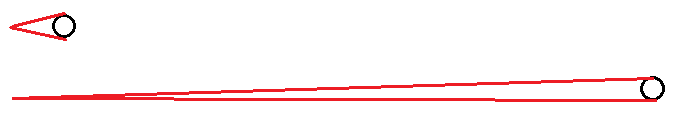
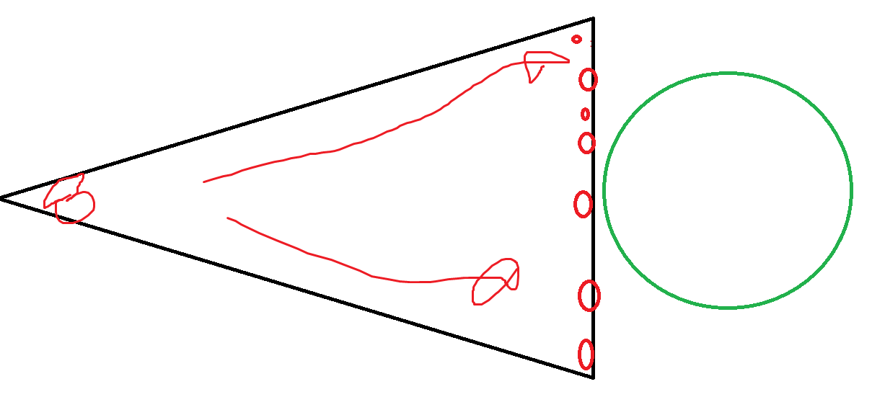
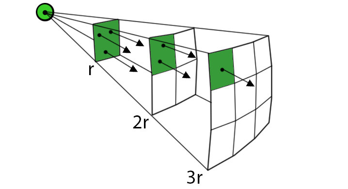
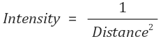
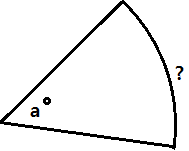
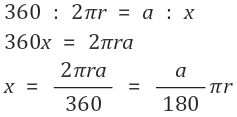
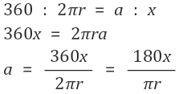
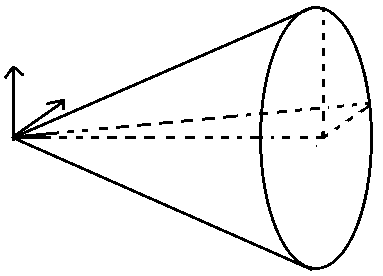
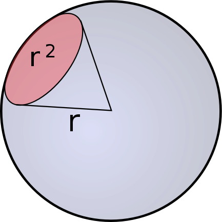
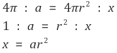

---

토막 상식★ : 대부분의 PBR엔진에서는 spot/point light의 intenstiy를 lumen 단위로 표시한다고 한다.

<b>빛의 왜 감쇠하나요?</b>

일단… 감쇠와 감쇄의 차이를 알아야 한다고 한다.

<b>감쇠 (attenuation)</b> : 힘이나 세력이 <b>약해짐</b>

<b>감쇄</b> <b>(reduction) </b>: 힘이나 세력이 약해져서 최종적으로 <b>없어짐</b>

---

우리가 diffuse light에 대한 감쇠를 설저하지 않는 이유

우리는 태양광의 빛이 평행하다고 생각하지만

이렇게 거리가 엄\~\~\~\~\~청나게 멀기 때문에 

평행하게 느껴지는 것이다. (spot/point light보다 광자가 압도적으로 많기도 하다)

<b>이러한 이유 때문에 우리가 spot/point light에 대해 감쇠를 적용하는것이다!</b>

아니 그런데 그 각도랑 감쇠가 무슨상관임???

대충 양자역학에서 하도 떠들어서 알겠지만 <b>빛은 파장이면서 입자</b>이기도 하다.

빛이 입자(광자)이고 개수가 적다고 가정했을때

각도가 넓어지면 물체 표면에 닿는 광자들의 개수가 적을것이다

그림2를 봤을때 r이 증가함에 따라 표면에 닿는 광자의 개수는 줄어든다

광자 1개당 세기가 1이라고 할 때 공식은 아래와 같다.

 <em>거리의 제곱에 반비례한다.</em>

식에서 알 수 있듯 거리가 무한이면 빛은 0에 수렴한다.

정리하면 빛이 감쇠하는 이유는 그냥 거리가 멀어서가 아니라 거리가 멀 수록 면적당 광자 개수가 줄기 때문이다.

---

그럼 감쇠는 어떻게 계산돼요??? 왜 위의 식이 나와요??????

이를 이해하기 위해서는 <b>입체각</b> 이라는 개념을 알아야 한다고 한다.

### <b>호도법</b>

<b>호도법 나온 배경</b>

입체각에 대해 아러면 호도법을 알아야 한다.

호도법은 말 그대로 각(도)의 크기를 호의 길이의 단위로 바꾼다는 것이다.

(degree → radian)

수학적인 영역에서는 degree보다 radian이 더 직관적이고 편하다고 한다.

우리는 반지름이 1인 원의 둘레는 2PI인것을 알고 있다.

그럼 우린 각도가 a인 부채꼴의 호의 길이는 간단한 비례식으로 구 할 수 있다.

그럼 반대로!

우리는 호의 길이를 알 때 반지름의 길이를 구 할 수 있다는 것

그런데 똑똑이들은 비례식 계산하기도 싫고 나눗셈도 하기 싫어서 이 작업을 쉽게 할 수 있는 법을 찾았다고 한다.

이게 바로 호도법이다

반지름이 r인 원의 둘레는 2PI\*r이다 

그럼 반지름이 r인 부채꼴의 호의 길이는 PI\*r일 것이다.

그럼 내각이 a이고 반지름이 r인 부채꼴의 호의 길이는

a\*r이다!

<b>호의 길이 = 반지름 길이 \* 부채꼴 내각(라디안)</b>

즉 내각, 반지름, 호의 길이가 삼위일체로다가 엮여있는 것이다.

---

### 3차원에서의 각

아니 그럼 우리는 3d게임인데 3차원 각은 어떻게해요?

일반적으로는 아래 그림같이 생각할 것이다.

그런데 그럼 그렇다고해서 3차원 각도를 어떻게 표현할지 어디서부터 어디까지가 각도일지가 알 수가 없다.

똑똑이들은 호도법을 발명했듯이 입체각 (solid angle) 이라는것도 만들었다고 한다.

<b>입체각</b>

반지름이 r인 구에서 면적이 r\^2인 면적을 포함하는 원뿔형의 각을 <b>1 스테라디안</b> 이라고 부르고 이를 입체각이라고 한다.

 <em>구 평면까지의 거리 = r, 구 평면의 반지름 = r</em>

호도법은 호의 길이를 각으로 치환했듯, 입체각은 겉넓이를 각으로 치환한 것이다.

구의 겉면적은 4PI\*r\^2이라고 한다.

여기서 r\^2이 1스테라디안을 의미하므로, 구 전체의 입체각은 4PI 인 것이다.

<b>결론</b>

- <b>빛의 밝기가 거리의 제곱에 반비례해 감쇠하는 이유</b>
  광자가 1초당 1을 움직인다고 할 때 r초당 r을 움직일 것이다.

  즉 r초를 이동하면 광자가 분포되는 구의 반지름은 r이 된다는 것이다.

  이때

  1초 움직였을때 겉면적 = a\*1\^2

  r초 움직였을때 겉면적 = a\*r\^2이다.

  스테라디안이 r\^2만큼 늘었으니 광자가 커버해야 하는 영역은 넓어졌고

  밝기는 r\^2에 반비례한다는 것이다.
