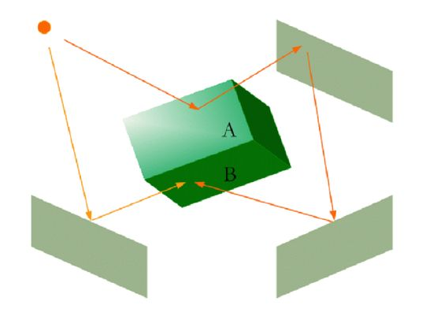
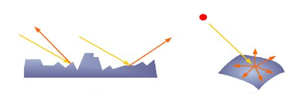
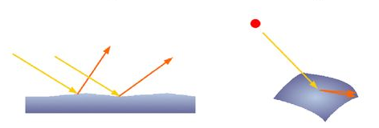
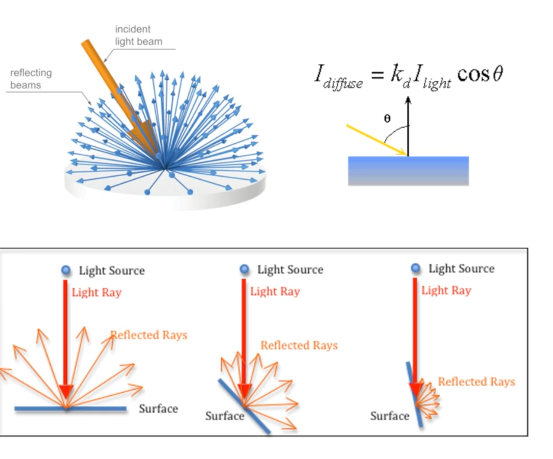
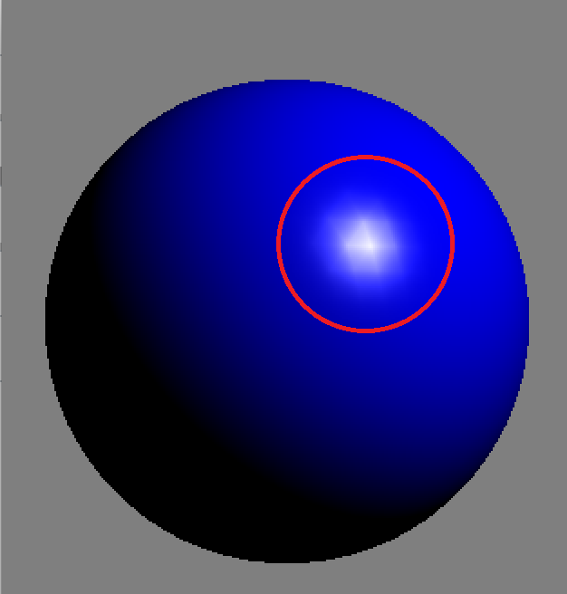
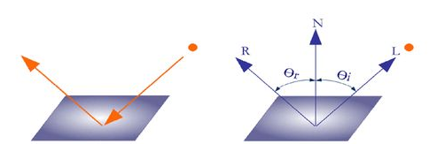
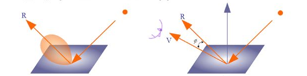

---

### <b>Ambient Reflection</b>

주변<b>광, 주변반사</b>

- 주변 반사는 광원에 직접 노출되지 않는 면에 밝기를 부여하기 위해 사용한다. 지역 조명 모델에서 전역 조명 모델 효과를 근사적으로 부여하기 위해 사용된다.

B면은 직접적으로 빛에 노출되지 않지만 주변의 다른 물체면으로 부터 반사되어온 빛에 의해 밝기가 생긴다. 

이렇게 주변 반사에 의해 우리 눈으로 반사되는 빛을 <b>주변광(Ambient light)</b>라고 한다

실시간 렌더링에서 모든물체로부터 받는 빛을 계산하기에는 부담이 되기 때문에

주변광은 시<b>점의 위치에 무관</b>하게 <b>모든 물체면에 대해 일정 크기로 밝기를 증가</b>시키는 것으로 대신한다. 

- rayTracing에서는 모든 빛의 반사에 대해 처리한다 (전역 조명 모델이라고 한다)
- 반대로 rasterization에서는 그렇지 않기 때문에 (지역 조명 모델이라고 한다)

즉, 주변광에 의한 효과는 모든 면을 상수로 밝히는 것이다.

### <b>Diffuse Reflection</b>

<b>난반사광, 확산 반사</b>

주변 반사만 사용하면 물체의 모든 부분은 동일한 밝기로 보인다. 

광원의 위치에 따른 명암 차이가 전혀 드러나지 않기 때문에 입체감을 부여하기 어렵기 때문에

<b>물체의 명암을 부여하기 위한 것이 확산 반사이다</b>.

확산 반사는 광원에서 나온 빛이 직접 물체면에 부딪쳐 여러방향으로 확산되는 <b>난반사</b>에 해당된다.  

반사는 거친 면과 매끈한 면에 따라 다르게 나타나는데

이전의 실시간 렌더링에서는 표면의 거침을 일일히 계산할 수가 없었다.

따라서 그래픽 처리를 단순화하기 위해서 반 원구 형태의 완벽 확산체를 가정한다.

<b>Lambertian model</b>

램버티안 모델에서는 표면에 도달한 빛이 반 구 모형의 방향으로 반사된다고 생각한다.

(빛이 투과가 아니라 밑으로 반사된다는 것은 물리적으로 불가능하기때문에 제외한 것)

반사광의 스칼라는 모두 균일하다고 가정한다.

<b>확산광(Diffuse light)</b>의 세기는 물체면이 서 있는 방향에 따라 달라지며, 광원에 정면으로 노출된 물체면이 가장 밝다.

<b>면의 밝기는 광원 벡터와 법선 벡터가 이루는 각 즉, 입사각의 코사인에 정비례한다.</b>

<b>면의 밝기는 광원 벡터와 법선 벡터가 이루는 각 즉, 입사각의 코사인에 정비례한다.</b>

<b>면의 밝기는 광원 벡터와 법선 벡터가 이루는 각 즉, 입사각의 코사인에 정비례한다.</b>

### <b>Specular Reflection </b>

<b>정반사광, 경면광(거울면)</b>

우리 생활속에서 볼 수 있는 빤딲빤딲한 물체들에서 볼 수 있는 경면광이다.

면광에 의해 물체면에 형성된 반짝이는 이미지를 <b>하이라이트(Highlight)</b>라 한다.

경면광에 의한 물체면의 색은 물체 자체의 색이 아니라 광원에서 나오는 빛의 색이 그대로 우리 눈에 들어온다.

경면 반사는 빛의 정반사에 의한 것이다. 시점이 정확히 반사광의 진행방향에 놓여 있을 때만 반사광을 볼 수 있다.

일반적으로 어떤 물체면이 완벽하게 매끄러울 수는 없으므로 경면광도 약간은 다른 방향으로 흩어진다. 

오른쪽 그림과 같이 시점이 약간 비껴 나 있어도 반사광 일부가 시점에 도달한다. 

시점과 반사벡터가 일치할때 빛이 가장 강할 것이다.

---
