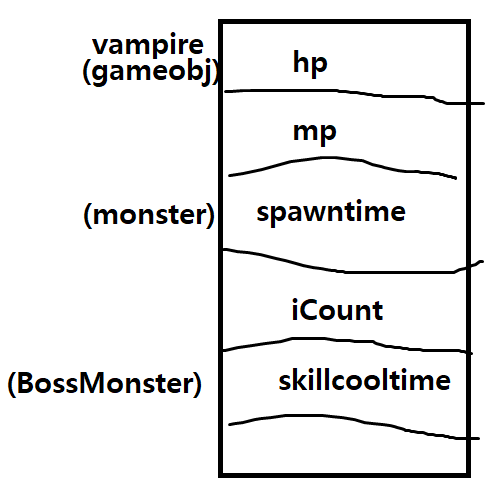

# 상속

<b>부모클래스의 멤버들을 필요로 하는 자식클래스들이 해당 멤버들을 사용 가능하게 해준다.</b>

우리가 같은 멤버들을 사용하는 class들을 여러개 만들때

그 같은 멤버들을 계속 새로 만들어줘야함

```c++
class Monster
{
public:
	int iHp;
	int iMp;

	void Attack ()
	{
	}
};

class Player
{
public:
	int iHp; // Monster와 멤버들이 겹친다.
	int iMp;

	void Attack()
	{
	}
};
```

---

### <b>상속 구현</b>

```c++
class GameObj
{
public:
	int iHp;
	int iMp;

	void Attack()
	{
	}
};
-----------------------------------------------------------
class Monster : public GameObj // 이 클래스 상속받을거야 ~ 라고 선언
{
private:
	int spawnTime;

protected:
	int iCount;

// 클래스 접근 가능하게 할 클래스 지정
	friend class EventMonster;
};
-----------------------------------------------------------
class BossMonster : public Monster // 상속받은거 또 상속 가능
{
public:
	int SkillCoolTime;

public:
	void SetCount()
	{
		iCount++; // 여기서는 protected 변수 접근 가능
	}
};
-----------------------------------------------------------
class Player : public GameObj
{
public:
	int level; // Monster와 다른 멤버들을 선언

};
-----------------------------------------------------------
class EventMonster : public GameObj, NetWork
{

	public:
		void SetSpawnTime(Monster monster)
		{
			monster.spawnTime = 1; // friend class 처리 하였기 때문에 private변수인 spawnTime에 접근 가능
		}
};


int main()
{
	Monster goblin;
	goblin.Attack();
	Player player;
	player.iHp = 0; // 멤버로 안가지고 있지만 상속 받았기 때문에 사용 가능하다

	BossMonster vampire;
	vampire.iHp = 10; // 상속의 상속도 사용 가능
	//	vampire.spawnTime = 10; 사용 불가능
	//	vampire.iCount++; protected도 사용 불가능

	return 0;
}
```

<b>메모리할당</b>



<b>다중상속</b>

그냥 상속 여러개 필요하면 여러개 받는거임

```c++
class GameObj
{
public:
	int iHp;
	int iMp;

	void Attack()
	{
	}
};

class NetWork
{
public:
	int ip;
	int port;
};

class EventMonster : public GameObj, NetWork
{
		// main함수에서 network와 gameobj 멤버 사용가능
};
```

<b>다중상속의 문제점</b>

```c++
EventMonster eventmob;

	// 다중상속의 문제점
	GameObj* mons[10] = { 
(GameObj*) &goblin
, &vampire
, &gnoll
, &eventmob}; // 얘가 Gameobj상속인지 Network상속인지 모름
							// 이를 다이아몬드 상속이라고 부름
```

<b>생성자와 소멸자</b>

A를 상속받는 B객체 생성후 프로그램 종료시

<b>A생성자 → B생성자 → B생성자 → A생성자 호출</b>

<b>가상함수</b>

- 부모 클래스에 선언해주어야함
- 선언문
  ```c++
  class Polygon
  {
  protected:
  	int width, height;

  public:
  	virtual ~Polygon() // 자식 객채의 댕글링 포인터를 남기지 않기 위한 예외처리
  	{
  	
  	}

  public:
  	virtual int area() override // 가상함수 생성
  	{
  		return 0;
  	};
  };

  class Rect : public Polygon
  {

  public:
  	virtual int area() // 가상함수로 사용힐 Polygon과 같은 함수 생성
  	{
  		return width * height;
  	}
  };

  class Tri : public Polygon
  {
  public:
  	virtual int area() override
  	{
  		return (width * height)/2;
  	}
  };

  int main()
  {
  	Polygon* rect = new Rect(); // 부모 포인터로 받아서 소멸자에서 문제가 생긴다!
  															// Rect의 소멸자가 호출되지않고 Polygon의 소멸자만 호출
    Tri* tri = new Tri();
  	rect->area(); // 부모포인터로 있지만 Rect의 area로 잘 찾아감
  	tri->area();	

  	return 0;
  	// 여기서 소멸자가 호출될텐데
  	// 부모의 소멸자에 virtual을 붙여야
  	// 부모 포인터로 선언한 자식의 소멸자가 호출이 된다.
  }

  ```

<b>가상함수 테이블</b>

- 파이프라인
  빌드를 하고 가상함수가 존재하면 가상함수 테이블 생성 

  → 자식 1객체생성 → 자식1의 부모생성자

  → 자식1class 가상함수 테이블의 0번지 주소를 자식1class 메모리에 적재 

  → 자식1class 가상함수 테이블 0번지에  부모의 함수주소 적재 

  → 자식생성자 → 가상함수 테이블에 있는 부모 함수 주소에 <b>자식1의 가상함수를 override</b>

  → 자식2객체 생성 → 자식2의 부모생성자 

  → 자식2class 가상함수테이블의 0번지 주소를 자식2class 메모리에 적재

  → 가상함수 테이블 0번지에 부모의 함수주소 적재

  → 부모의 나머지 함수 적재

  → 자식의 나머지 함수 적재

  → 자식생성자 → 가상함수 테이블에 있는 부모 함수 주소에 <b>자식2의 가상함수를 override</b>

<b>순수가상함수</b>

```c++
// 부모클래스 - 추상클래스
virtual void Funciton() = 0;

// 자식클래스
virtual void Function();
{
	// 구현부
	// 구현하지 않으면 오류가 생긴다!
}
```

<b>순수가상함수</b>가 하나라도 있는 클래스를 <b>추상 클래스</b>라고 한다.

추상클래스 → 나는 이 클래스를 오로지 상속용으로만 사용하겠다.(이 클래스로 객체를 안만들꺼야)
