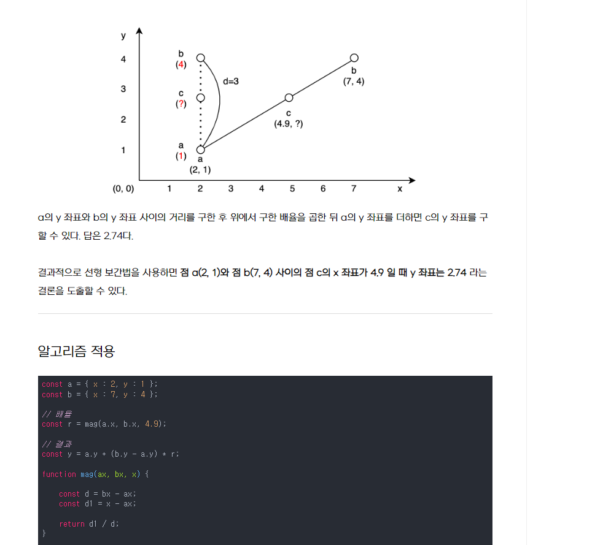

두 점 사이의 값을 추정하기 위해 직선 방정식을 사용하는 방법

---



```c++
template<typename T>
	T Interpolation(float _Start, float _End, float _Elapsed, T _ResultStart, T _ResultEnd)
	{
		float t = (_Elapsed - _Start) / (_End - _Start); // 가로축 얼마나 지났는지
		T Result = static_cast<T>(_ResultStart + (_ResultEnd - _ResultStart) * t);
		// 가로축 비율로 세로축 계산

		return Result;
	}
```
