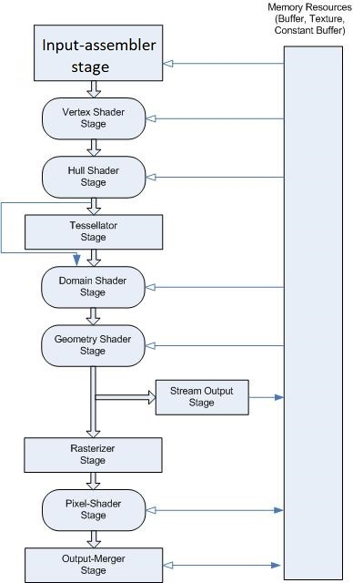

---

렌더링 파이프라인 단계에서 개발자들이 사용하는 영역을 쉐이더라고 부른다.

쉐이딩(가상공간의 물체에 음영을 더하는 행동)을 할 때 사용해서 Shader 라는 이름이 붙었다.

쉐이더는 gpu상에서 돌아가는 또 하나의 <b>프로그램</b>이다.

우리는 쉐이더를 구성 할 때 어떤 데이터가 들어가고 나오는지 정의해야한다. - 

<b>InputAssembler</b>

- 오브젝트 데이터를 받아오는 과정
- 정점 쉐이더에 정점 버퍼 전달
- 정점들을 어떤 방식으로 처리할까 결정함
- Topology 결정함

---

<b>Tessellation</b>

테셀레이션을 적용할때는 Primitive Topology를

<b>N\_CONTROL\_POINT\_PATCHLIST</b>로 바꿔줘야한다. (N에 보통 3, 4를 사용한다)

- [Hull Shader](%ED%97%90-%EC%85%B0%EC%9D%B4%EB%8D%94-09f14454.md)

테셀레이션 발생!

- [Domain Shader](%EB%8F%84%EB%A9%94%EC%9D%B8-%EC%85%B0%EC%9D%B4%EB%8D%94-e816cb04.md)

---

- [Geometry Shader](%EC%A7%80%EC%98%A4%EB%A9%94%ED%8A%B8%EB%A6%AC-%EC%85%B0%EC%9D%B4%EB%8D%94-a527c9e3.md)

---

---

정점 정보를 변환하는데에 집중된 쉐이더

쉐이더 내에서 현재 모델을 구성하는 모든 vertex들에게 ConstantBuffer를 사용해

동일한 연산을 해줄 수 있다. (이동, 회전, 스케일)

<b>모든 이동, 회전, 스케일</b>은 <b>하나의 행렬</b>을 사용해서 표현할 수 있다.

---

---

화면에 있는 픽셀의 색을 결정하는 쉐이더다

픽셀쉐이더의 출력은 <b>color</b>하나이다.

픽셀쉐이더는 정점이 <b>bounding box에 있어서 픽셀을 결정해야한다! </b>라고 했을때 호출된다.
