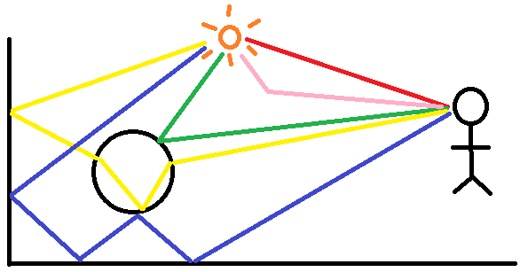
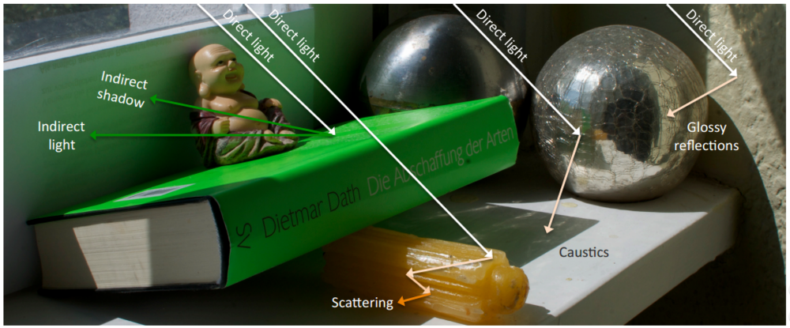
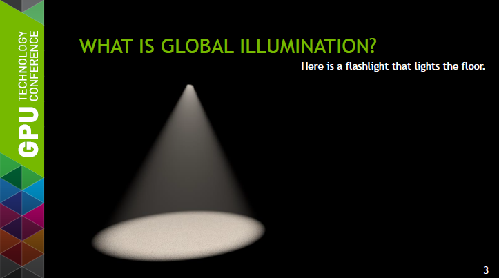
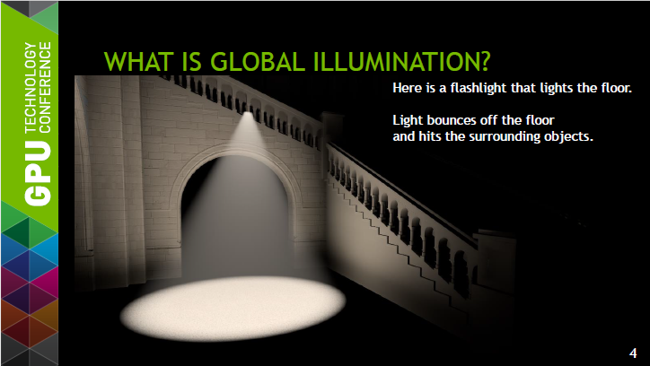
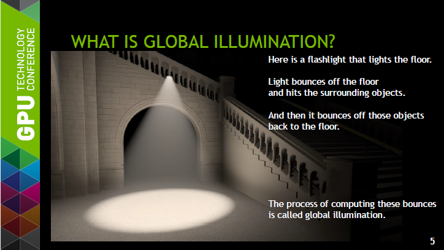

- [Reflection](%EB%B9%9B%EC%9D%98-%EB%B0%98%EC%82%AC-df13dada.md)

- [Lights](%EA%B4%91%EC%9B%90-%EC%A2%85%EB%A5%98-c90cfd72.md)

- [Phong Model](phong%EA%B3%BC-blinn-phong-35050b82.md)

- [Blinn Phong Model](phong%EA%B3%BC-blinn-phong-35050b82.md)

- [PBR](pbr-%EA%B0%9C%EC%9A%94-8bc1dd4b.md)

- [Shadow](%EA%B7%B8%EB%A6%BC%EC%9E%90-d827b49a.md)

<b>Ambient (Local Illumination) </b>: 위의 그림처럼 빛은 무한히 반사 산란 등등 그리고 거리에따라 감쇄하면서 남아있는 광자 입자들때문에 빛의 세기가 0이 된다는건 말이 안된다. 그런데 컴터에서는 이정도의 빛 연산은 불가능하다. 그래서 현대 렌더링에서는 빛이 닿는 부분만 쉐이딩을 하는데, 빛이 없는 부분을 0으로 처리할 수는 없기 때문에 ambient라는 개념을 사용한다. 이를 보통 Local Illumination이라고 부른다.

<b>GL(Global Illumination)</b> : GL은 표면에서 반사되거나 표면에 굴절되는 모든 빛을 광원으로 삼는 것을 말한다. 

GL에는 뭐 이런 엄청난것들이 있는데

크게 보면 <b>Direct light</b>는 광원에서 표면으로 직접 들어 온 빛을 의미합니다. <b>Indirect light</b>는 표면에 들어 온 빛이 반사되어 새로운 광원처럼 사용되는 경우를 의미합니다.

위처럼 빛이 반사되서 다른곳에 비치는 내용들은 실시간 그래픽스에서 이런 계산하기가 힘들다. 그래서 이를 근사계산하기 위해서 LPV( Light Propagation Volume ), SVOGI( Sparse Voxel Octree Global Illumination ) 등의 실시간 GI 알고리즘들과 Image Based Lighting( IBL ) 과 같은 개념들이 나오게 되었습니다.

난 IBL 썼다.
