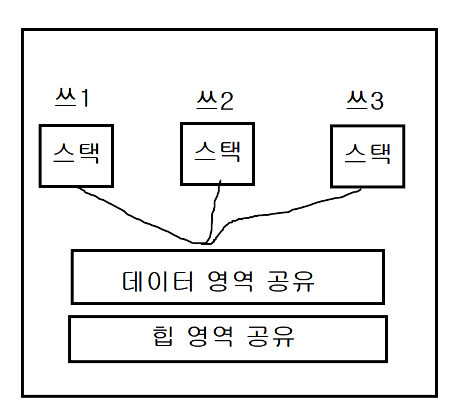
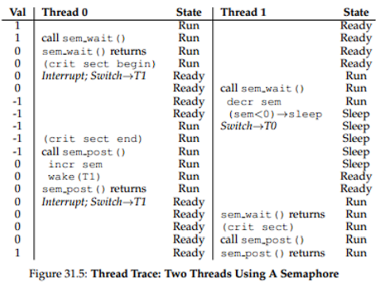

다중쓰레드 프로그래밍을 향해..! 알아보자\~

---

<a href="%ED%94%84%EB%A1%9C%EA%B7%B8%EB%9E%A8-%ED%94%84%EB%A1%9C%EC%84%B8%EC%8A%A4-%EC%8A%A4%EB%A0%88%EB%93%9C-40bb7690.md">Program, Process, Thread</a> 

위 글에서 볼 수 있듯이 쓰레드는  멀티 프로세스의 단점들을 극복하기 위해 사용된다.



쓰레드들은 데이터와, 힙영역을 공유하기 때문에 동기화 문제가 일어난다..

(데이터 영역의 변수 i가 i++라는 연산이 있을때 해당 연산은 cpu단에서 일어나기 때문)

<b>잠깐!</b>

임계구역이랑 공유 데이터는 다르다!

공유 데이터는 위 그림에 있는 스택을 제외한 공유 데이터 영역을 말하고

임계구역은 각 프로세스에서 공유 데이터를 접근 하는 프로그램 코드 부분을 가리킨다

<b>임계구역 문제 해결 방법</b>

1. <b>상호 배제 (mutual exclusion)</b>
   쓰레드 p가 자기의 임계구역에서 실행된다면 다른 쓰레드들은 임계구역에서 실행될 수 없다.

   Mutex가 상호 배제인게 아니다!

   상호 배제 종류중

   뮤텍스와 세마포어가 있는 것

2. <b>진행</b>
   임계구역에서 실행되는 쓰레드가 없고 여러 쓰레드들이 임계구역으로 진입하려고 한다면

   어떤 쓰레드가 임계구역으로 진입할 수 있는지를 결정하는데 결정한다.

   (이는 무제한 연기될 수 없다)

3. <b>한정된 대기 (bounded waiting)</b>
   쓰레드가 자기의 임계구역에 진입하려는 요청 한 후부터 요청이 허용될 때 까지 다른 쓰ㅜ레드가 임계구역에 진입하도록 허용되는 횟수에 한계가 있어야한다.

이 동기화 문제를 해결하기 위해서 쓰레드의 접근 순서 측면에서 개선이 필요하다.

<b>동기화가 필요한 상황은 2가지 정도가 있다.</b>

- 동일한 메모리 영역으로의 동시접근 발생
  ex) 쓰레드1이 i++하고 저장하기 전에 쓰레드2도 i++를 해버려서 연산의 결과가 한번만 적용되는 경우

- 동일한 메모리 영역에 접근하는 쓰레드의 실행순서 지정
  ex) 쓰레드1이 i에게 값을 저장하고 쓰레드2가 값을 가져가서 사용하는데 B가 먼저 접근하는 경우

가장 대표적인 동기화 방법은<b> 3가지</b>가 있다.

### <b>SpinLock</b>

Lock과 Unlock을 사용하여서 공유 자원에 대한 접근을 관리하는 방식

<b>특징</b>

- 현재 임계영역을 사용중이지 않은 스레드들이 락을 획득하기 위해 계속해서 락의 해제를 확인하기 때문에 단일 cpu면 무한 루프에 빠지게 된다(busy waiting)
- 하지만 해제를 지속적으로 확인하기 때문에 락이 해제되는 즉시 작업을 수행하기 때문에 빠르다.
  cpu 점유가 다른 프로세스의 작업에 지연을 줄 수 있기 때문에 짧은 작업에서 쓰면 좋다.

  (코어가 오랫동안 뺏기니까)

### Mutex (mutual exclusion)

- 쓰레드의 동시접근 허용 X

스레드들은 다른 쓰레드의 접근을 막고싶은영역 (임계구역)에 진입하기 위해 Mutex Lock을 획득해야 하고, 임계구역을 빠져나올 때 락을 반환해야 한다.

```c++
pthread_mutex_lock(&mutex); // 락 획득
for(i = 0; i < 5000000; ++i)
{
num++;
}
pthread_mutex_unlock(&mutex); // 락 반환
```

이렇게 막는다.

스핀락이랑 비슷한데 얘는 busy waiting이 아니라 sleep 상태로 대기하다 wakeup 상태가 되면 권환 획득을 시도한다고 한다.

공유 자원을 선점한 스레드가 작업을 시작하기 전 자원에 접근하려는 다른 스레드들을 sleep 상태로 만들고 락을 반환할 때 wake up 상태로 만든다.

### Semaphore

세마포어는 mutex와 유사하게 동작하지만 프로세스들이 자신의 행동을 더 정교하게 동기화 할 수 있는 방법을 제공하는 강력한 도구를 설명한다.

세마포어는 하나 이상의 스레드가 공유 자원의 접근을 허용한다.

<b>세마포어 연산 종류</b>

<b>P 연산</b> : 자원의 여분이 없다면, Block

<b>V 연산</b> : 자원의 여분이 있다면, 바로 획득.-> 자원을 다쓴후 기다리는 프로세스에게 깨워서 줌(wake up)

<aside class="callout">

<b>P (Proberen 검사하다) </b>: 세마포어 값을 1 감소시키는 연산입니다. 값이 0 이상인 경우 바로 감소시키고, 값이 0 이하인 경우 세마포어 값이 양수가 될 때까지 대기합니다.

<b>V (Verhogen 증가하다) </b>: 세마포어 값을 1 증가시키는 연산입니다. 값이 0 이상인 경우 바로 증가시키고, 값이 음수인 경우 대기 중인 스레드 중 하나를 깨웁니다.

</aside>

<b>세마포어는 다음과 같이 동작한다.</b>

- 공유 자원을 접근하려는 스레드는 P 연산을 이용하여 세마포어 값(초기값은 아마 한 번에 가용할 수 있는 스레드의 개수를 말하는듯 )을 감소시킨다.
  (만약 세마포어 값이 0 이상인 경우, 스레드는 공유 자원에 접근할 수 있습니다. 이때 다른 스레드는 P 연산 대기.)

  만약 세마포어가 양수고 P연산 대기중인 스레드가 있으면 P연산을 수행하고 임계영역에 진입한다.

  세마포어가 음수면 Semaphore Waiting Queue에 스레드를 추가시키고 대기 상태가 된다.

  스레드의 공유 자원 사용이 끝나면, 스레드는 V 연산을 이용하여 세마포어 값을 증가시킵니다.

V연산 이전에 세마포어 값이 음수인 경우(P연산 수행하고 Semaphore Waiting Queue안에 들어가 있는 스레드가 있으면), 대기 중인 스레드 중 하나를 깨워 공유 자원에 접근할 수 있게 합니다.


