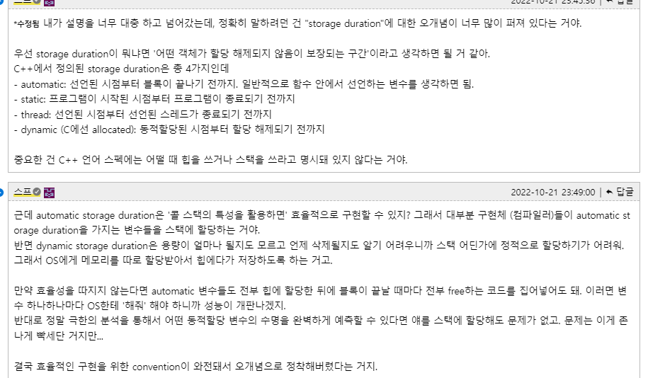

스택 영역과 힙 영역이 같은 공간을 사용한다는건 누구나 아는 사실

<b>근데 왜 스택이 더 빠를까>?</b>

### <b>할당속도</b>

스택은 컴파일 했을때 이미 할당된 공간을 사용하고

힙은 사용자가 별도로 할당해서 사용한다.

<b>스택 할당</b>: 스택 포인터 감소 -> 끝 <b>힙 할당</b>: brk/mmap 시스템 콜 -> 메타데이터 쓰기 -> 포인터 반환

<b>스택 해제</b>: 스택 포인터 증가 -> 끝 <b>힙 해제</b>: 메타데이터 읽기 -> 마킹 -> 병합

물론 요즘 malloc 구현들은 메모리풀 써서 시스템콜도 자주 안하고 분할/병합도 줄이긴 했는데 

스택포인터만 조작해서 OS의 도움이 필요없는 스택보단 훨씬 비쌀듯함

### 접근속도

현재 쓰이는 대부분의 cpu는 <b>서브루틴의 스택 base주소(스택의 가장 바닥 주소)</b> 저장을 위한

‘스택 레지스터’를 따로 지정해두고 있고, 대부분의 컴파일러들도 이를 사용하고 있다.

그리고 컴파일러들은 스택에 할당될 변수들이 정확히 어떤 크기고 어떤 순서로 할당되는지 알고 있기 때문에

<i><b>정말 간단한 연산</b></i>으로 변수들의 주소를 구할 수 있다. (addr + stride)

어셈블리 코드에서 알아서 해준다고 한다.

힙은 OS(프로그래머)가 관리하는거라서 어셈블리 컴파일 단계에서 확인할 수 없다.

