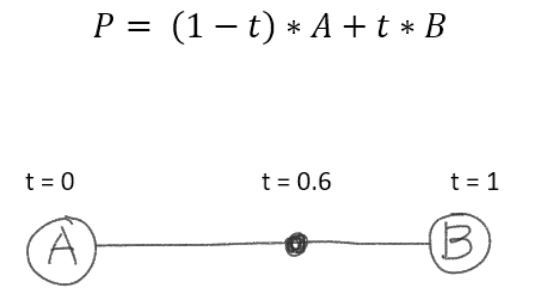
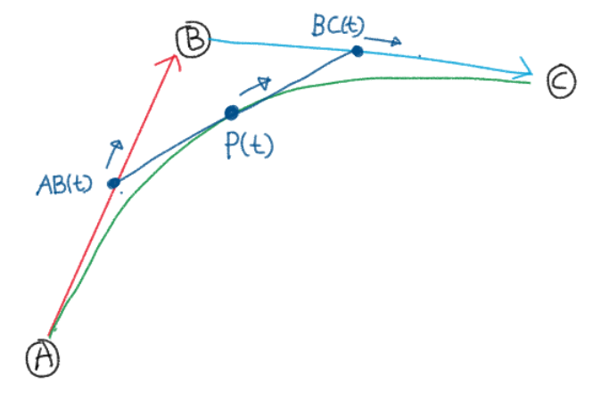
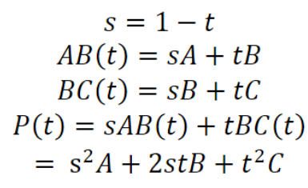

---

<b>참고자료</b>

<a href="https://tsyang.tistory.com/57">tsyang.tistory.com</a>

---

# 개요

<b>두 정점 A, B 사이의 임의의 점 P</b>는 위의 공식으로 표현이 가능하다.

### 베지에 곡선

: n차 베지에 곡선은 n+1개의 점으로 얻을 수 있는 베지에 곡선이다.

- <b>1차 베지에 곡선 (Linear)</b>
  1차 베지에 곡선은 개요에서 말한 점 A,B 사이에 있는 점 P의 집합으로 표현할 수 있다.

  말이 곡선이지, 사실상 A-B를 잇는 선분이다.

- <b>2차 베지에 곡선 (Quadratic)</b>
  2차 베지에 곡선은 A,B 사이의 <b>점 AB(t)</b>와 B, C 사이의 <b>점 BC(t)</b>를<b> </b>잇는

  선 위 의 점 P(t)의 집합이다.

  

  <b>수식</b>

  
