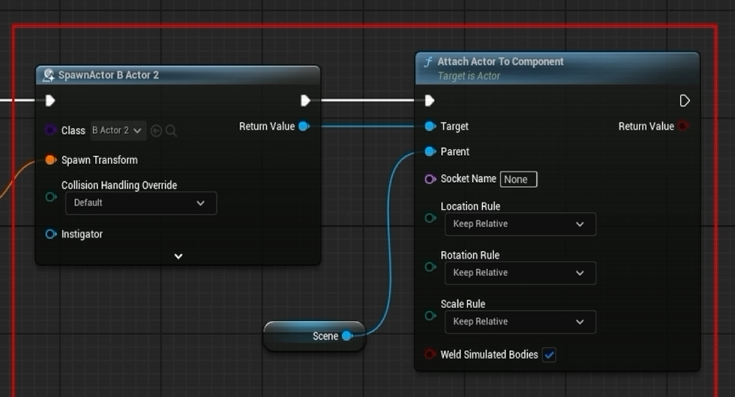
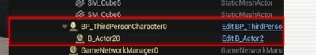
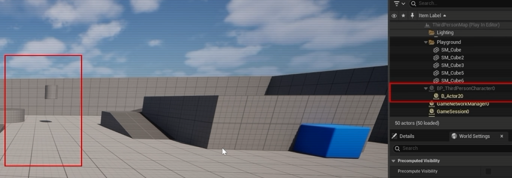
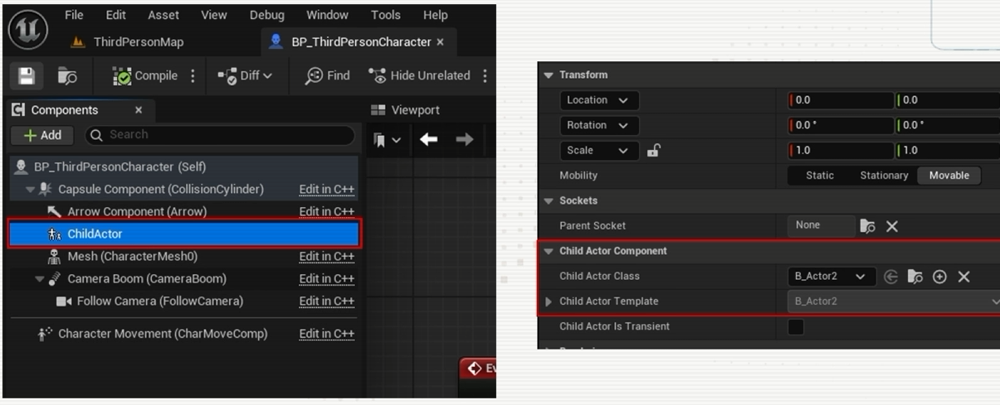
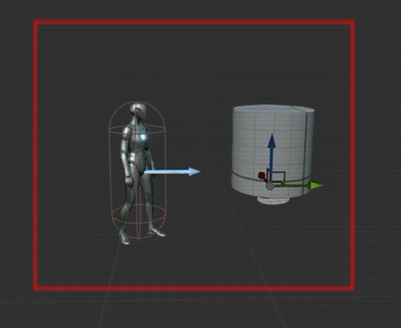
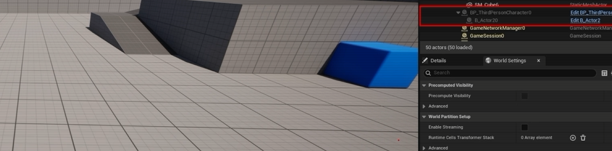

---

USceneComponent

<blockquote>

액터에게 좌표라는 개념을 추가해주는 컴포넌트 

</blockquote>

<ul>
<li>
<b>좌표값을 가지게 된다.</b>

이 컴포넌트가 없으면 월드에 배치해도 3차원공간 안에 존재할 Root가 없기때문에 존재할수 없다. 논리적으로만 존재함으로 UObject랑 크게 다를바가 없어진다고 보면 된다.

근데 어차피 Actor에 SceneComponent 추가 안하면 알아서 엔진에서 추가해준다.

따라서 Actor의 RootComponent는 SceneComponent여야 한다.
</li>
<li>
<b>계층구조를 가질 수 있다.</b> 

컴포넌트 내에서 부모 자식 관계를 형성할 수 있게 해준다. 계층을 가질 수 있는 이유 마찬가지로 좌표 개념때문이다.

만약 좌표라는 개념이 없으면 계층구조를 딱히 가질 필요가 없다. (Update순서를 부모자식순으로 하는 방법이라면 가능 하지만

그런데 좌표라는 개념을 가짐으로써 부모와 상대적인 좌표를 가질 수 있다.

- <b>따라서 액터간의 부모 자식 관계를 형성할 수 있게 된다.</b>
  자식Actor는 부모의Component에 부착이 되어 상대적인 좌표를 갖게 된다. Actor끼리 갖는 계층처럼 보이지만 사실은<b> 부모Actor의 SceneComponent에 자식Actor의SceneComponent가 붙는 것</b>  

  

  

  그런데 이렇게 SceneComponent로 붙인 Actor는 부모 액터가 사라져도 월드에서 파괴되지 않는다. (좌표로만 붙어있는거지 생명주기를 함께하지는 않는다.)

  

  ---

  그래서 부모 액터와 생명주기를 함께 공유하는, 진짜 한 몸처럼 부모자식관계를 형성하게 해주는 컴포넌트가 바로 <b>UChildActorComponent</b> 이다.

   

</li>
</ul>

UChildActorComponent

> UChildActorComponent는 SceneComponent 상속으로 다른 <b>Actor 자체를 부착</b>하는 특수한 컴포넌트이다. 스폰한 액터를 USceneComponent에 부착하는것과는 다르게,  월드에서 스폰 전부터 액터가 부착되어있어 뷰포트에서 확인이 가능하다. 부모 액터와 생명주기를 공유한다.

 <em>BlueprintViewport에서 이미 붙어있는걸 확인할 수 있다.</em>

 <em>부모와 생명주기를 공유한다.</em>

---

---

<b>화면에 출력하기 위한 기본 컴포넌트</b>

### Scene Component

- ActorComponent 상속
- Transform 정보를 갖게되는 컴포넌트

### Primitive Component

- Scene Component 상속
- SceneComponent말고 이거 넣어줘도 Transform 정보들어감
- 화면에 프리미티브 출력하는 컴포넌트

### Movement Component

- ActorComponent 상속
- 움직임만을 담당하는 컴포넌트

### <b>Player Controller Component</b>

- 이걸 주면 사용자가 조종 할 수 있게 된다.

### AI Controller Component

- 플레이어 폰 이외에는 전부 AI Controller를 갖는다.
