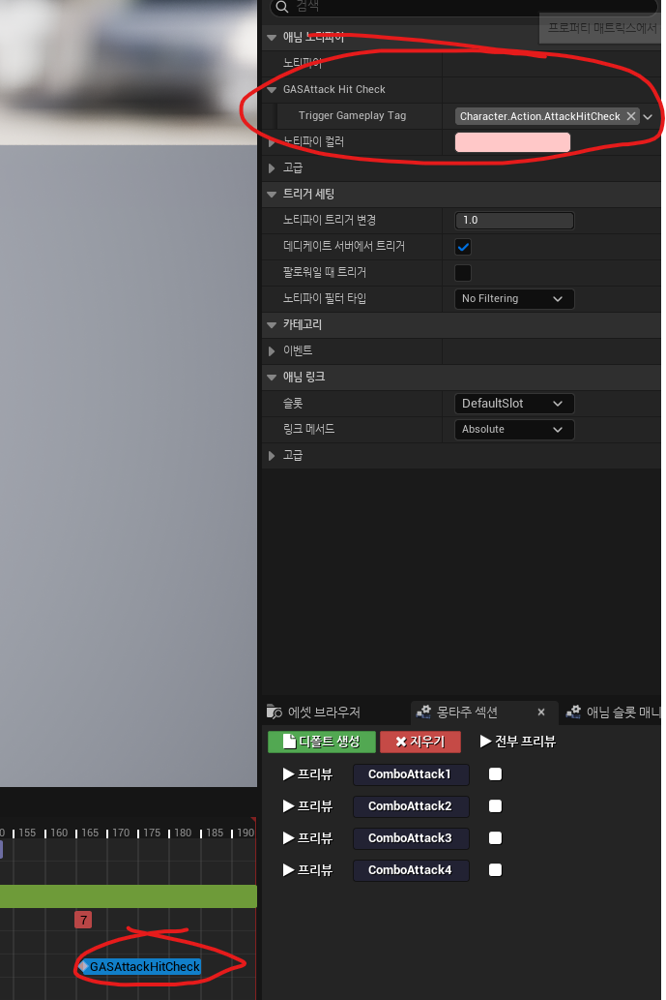
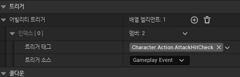

---

기존의 Animnotify에서 캐릭터가 들고있는 공격 함수를 직접 호출하는 방법에서<br />GA를 실행시키는 방법으로 변경해보자

우선 애님 노티파이를 생성한다.

```c++
// MyNotify.h
protected:
  // 에디터에서 보여질 노티파이 이름 return
	virtual FString GetNotifyName_Implementation() const override;
	virtual void Notify(USkeletalMeshComponent* MeshComp, UAnimSequenceBase* Animation, const FAnimNotifyEventReference& EventReference) override;

protected:
	UPROPERTY(EditAnywhere)
	FGameplayTag TriggerGameplayTag;
```

```c++
// MyNotify.cpp

#include "AbilitySystemBlueprintLibrary.h" // GAS의 KismetLib같은거라고 보면 된다.
void UAnimNotify_GASAttackHitCheck::Notify(USkeletalMeshComponent* MeshComp, UAnimSequenceBase* Animation, const FAnimNotifyEventReference& EventReference)
{
	Super::Notify(MeshComp, Animation, EventReference);

	if (MeshComp)
	{
		AActor* OwnerActor = MeshComp->GetOwner();
		if (OwnerActor)
		{
			FGameplayEventData PayloadData;
			
			// 액터의ASC를 가져와서 게임플레이태그를 실행시켜주는 함수이다.
			UAbilitySystemBlueprintLibrary::SendGameplayEventToActor
			(OwnerActor, TriggerGameplayTag, PayloadData);
		}
	}
}
```

노티파이를 추가하고 트리거할 게임플레이 태그를 넣는다<br />강의에서는 UAnimNotify\_GASAttackHitCheck라는 클래스로 이름을 지어줬지만..<br /><b>단순하게 Tag를 Trigger해주는 노티파이라면 명칭을 범용적으로 만들어도 좋을 것 같다.</b>



그 후 <code>UABGA_AttackHitCheck</code> 라는 클래스를 생성해서<br />



트리거 태그에 해당 태그를 넣어준다.

그럼 노티파이가 발동할 때 <code>UABGA_AttackHitCheck::ActivateAbility</code> 호출된다. 

어빌리티가 발동할 때 동작할 Task를 추가한다.

```c++
void UABAT_Trace::Activate()
{
    Super::Activate();

    if (ShouldBroadcastAbilityTaskDelegates())
    {
		    // 해당 순간에 Trace하고 어빌리티가 끝나기 때문에 Activate에 구현
        OnComplete.Broadcast();
    }
    EndTask();
}
```
