<details>
<summary>액터가 World에 등록되는 과정</summary>

<b><code>InitWorld</code></b>이후에 호출되는 함수인 <code>UpdateWorldComponents</code> 함수는

월드에 있는 모든 레벨에대해서 액터들을 전부 등록하는 함수이다.

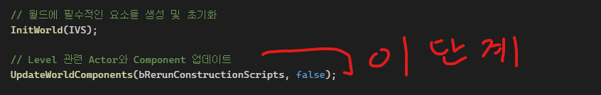

액터는 아래처럼 월드에 보이는 모든것이다. (안보일수도 있긴하지만,)

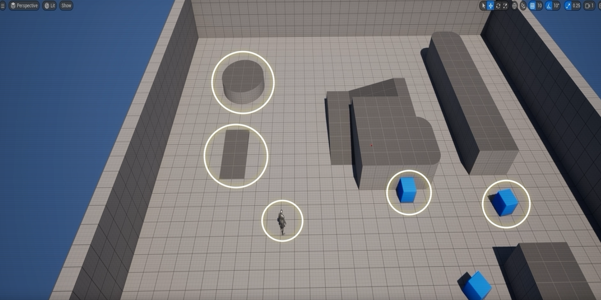

얘네들은 언제 어떻게 등록되는 것일까??

<b>3줄요약</b>

<aside class="callout">

- 레벨은 모든 액터 배열을 부모 액터가 앞에 오도록 한 번 정렬한다.
- 정렬된 액터를 앞에서부터 처리하며, 각 액터에게 자기 컴포넌트 등록을 맡긴다.
- 한 액터의 등록이 끝나야 다음 액터로 넘어가며, 모두 끝나면 등록 사이클을 완료한다.

</aside>

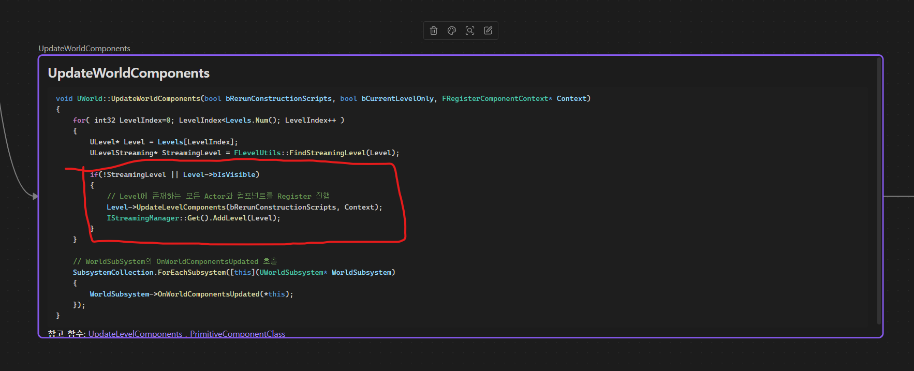

#### 액터의 등록 : 액터가 가진 컴포넌트를 월드에 등록하는 과정

월드에 있는 액터들은 월드가 생성될때 등록된다.

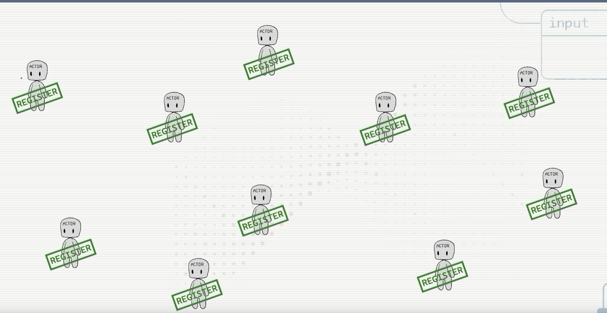

그냥 이렇게 죄다 한번에 등록하는건 아니고,,

<details>
<summary>등록하는 몇가지 방법이 있다.</summary>

1. <b>나눠서 등록</b>
   한 프레임에 모든 액터들을 전부 등록하지 않고, 프레임별로 나눠서 등록한다.

   큰 Hitching을 줄이기 위함이다.

   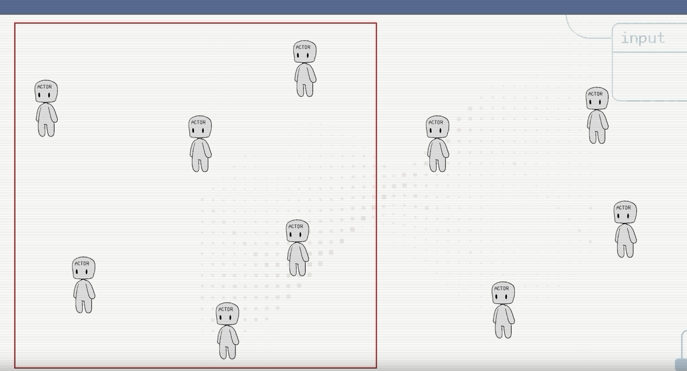
2. <b>액터의 계층 구조를 보장</b>
   계층구조를 가지게 만들어놓은 액터들은 계층의 순서대로 등록이 된다.<br />(Transform정보부터 부모의 종속이 있기 때문)

   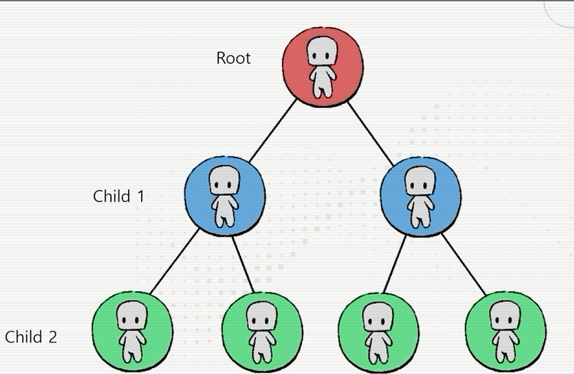

   그런데 레벨에 액터가 저장될 때 아래처럼 이쁘게 저장되지는 않는다.

   

   이런 느낌에 가깝다

   

   이럼 루트를 가장 마지막에 등록하면 순회시간이 오래 걸릴 것이다.

   따라서 그 전에 <b><span>정렬 과정</span></b>을 거친다.

3. <b>액터들의 컴포넌트들도 나눠서 처리한다.</b>
   액터의 정렬이 끝나면 액터들의 컴포넌트 등록이 시작된다.<br />위에서 적었듯 초기 월드가 아니라면 프레임단위로 나누어서 처리한다.

   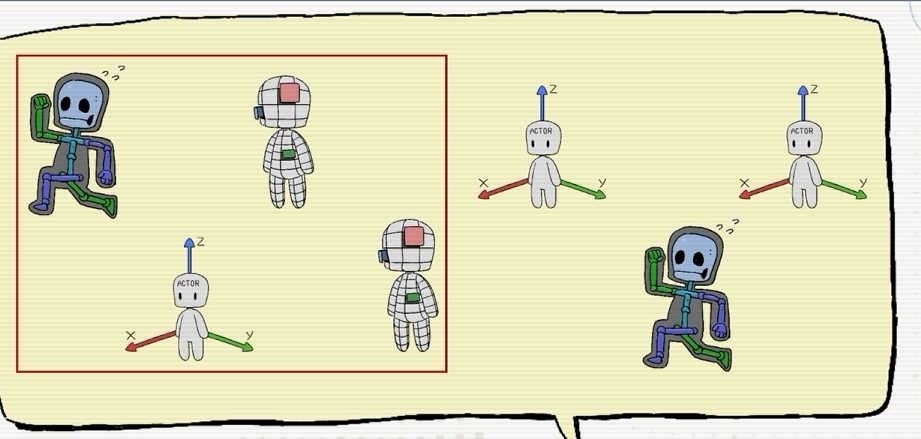
4. <b>컴포넌트의 계층구조도 보장을 해야한다.</b>
   컴포넌트 역시 계층구조가 있다.

   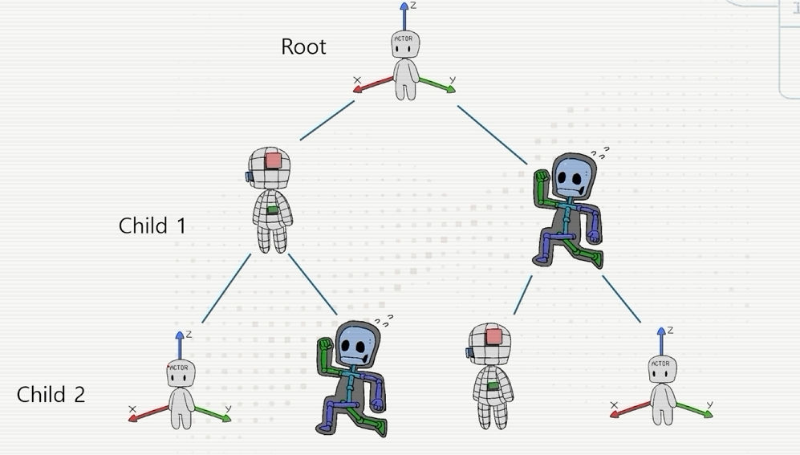

   등록을 요청받은 Component는 아래의 구조를 거친다

   <ol type="a">
   <li>
   계층구조를 타고 부모 Component가 있는지 확인한다.

   a.1. 있으면 등록되었는지 확인한다 ⇒ b<br />a.2. 없으면 등록한다.
   </li>
   <li>
   부모가 등록되어있는지 확인한다.

   b.1. 등록되어 있으면 등록한다.<br />b.2. 계층 구조를 타고 부모 Component가 있는지 확인한다. ⇒ a
   </li>
   </ol>

</details>

<b>하지만 충격적인 사실은 초기 엔진 로드하면서 월드를 생성 할 때는 이 방법같은거 안쓰고 그냥 한프레임에 전부 처리한다.</b>

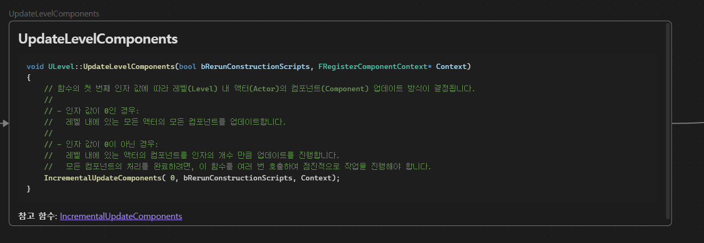

<code>IncrementalUpdateComponents</code> 함수에 0을 넣으면 레벨에 있는 모든 Actor/Component들을 한 프레임에 업데이트 하겠다는 것이다.<br />만약 3넣으면 한 액터의 3개의 컴포넌트만 등록하고 넘어간다.

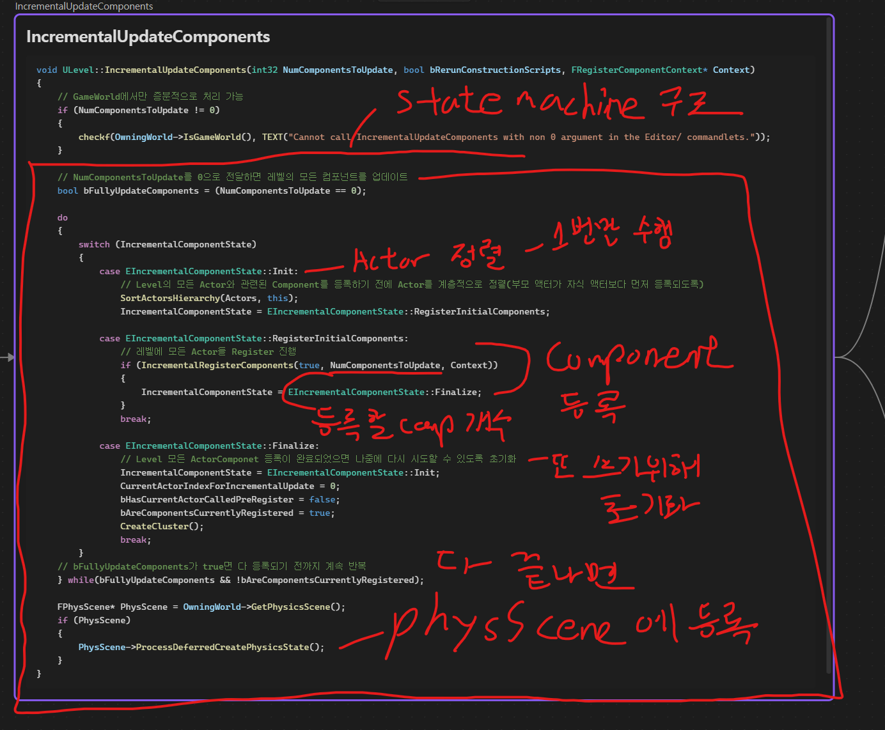

<b>공부하면서 궁금했던점</b>

- <b><code>NumComponentsToUpdate</code></b><b>를 여러 번 호출하면 매번 액터를 정렬하나?</b>
  <aside class="callout">

   아니다. 등록 사이클 시작 시 <code>Init</code> 상태에서 한 번만 정렬한다. 이후에는 현재 액터 위치부터 계속 진행한다. (Finialize 가기 전까지 상태머신은 <b>Register단계에 머문다</b>.)

  </aside>

- <b>컴포넌트 등록이 남아 있으면 </b><b><code>Finalize</code></b><b>에 못 가는데 문제 아닌가?</b>
  <aside class="callout">

  정상이다. <code>RegisterInitialComponents</code> 상태와 현재 액터 위치를 유지하고 다음 호출에서 이어서 처리한다.

  </aside>

- <b>등록 중에 액터 배열이 바뀌면 어떡하나?</b>
  <aside class="callout">

  일반적인 흐름에서는 현재 스트리밍 중인 레벨의 액터 배열을 중간에 수정하지 않는다. 런타임 Spawn 액터나 다른 스트리밍 레벨은 별도 등록 흐름으로 처리한다.

  즉 <b>일반적인 흐름에서는 등록중인 액터 배열이 바뀔 일이 없어서</b> 재정렬의 걱정을 하지 않아도 된다.

  </aside>

<details>
<summary><b>Level.IncrementalUpdateComponents.SortActorsHierarchy</b></summary>

<details>
<summary><b>코드</b></summary>

```c++
static void SortActorsHierarchy(TArray<TObjectPtr<AActor>>& Actors, ULevel* Level)
{
    TMap<AActor*, int32> DepthMap;
    DepthMap.Reserve(Actors.Num());

	TArray<AActor*, TInlineAllocator<10>> VisitedActors;

    bool bFoundWorldSettings = false;

    // Depth를 계산하기 위한 Lambda
	TFunction<int32(AActor*)> CalcAttachDepth = [&DepthMap, &VisitedActors, &CalcAttachDepth, &bFoundWorldSettings](AActor* Actor)
	{
	    int32 Depth = 0;

	    // 이미 Depth를 계산한 경우 중복 계산 방지
	    if (int32* FoundDepth = DepthMap.Find(Actor))
		{
			Depth = *FoundDepth;
		}
		else
		{
	
	// WorldSetting은 UWorld를 생성할 때 처음 추가되는 액터라서 0번에 저장
		    if (Actor->IsA<AWorldSettings>())
			{
			    if (!bFoundWorldSettings)
				{
					Depth = TNumericLimits<int32>::Lowest();
					bFoundWorldSettings = true;
				}
			}
			// Actor가 다른 Actor에게 부착된 경우
			else if (AActor* ParentActor = Actor->GetAttachParentActor())
			{
			    // 이미 검사를 수행한 Actor인지 판별(재귀적 호출이라 없으면 재귀 탈출 못할 가능성 있음)
			    if (VisitedActors.Contains(ParentActor))
				{
				    // 이미 방문한 Actor면 Log
				}
				else
				{
				    VisitedActors.Add(Actor);
				    // ChildActor인 경우
				    // ChildActor에 부착된 액터들은 AttachChildren 리스트가 아직 완전히 채워지기 전에 등록되면, 부착 정보가 제대로 기록되지 않아 분리될 위험이
				    // 있으므로 반드시 먼저 등록되어야 해서 ChildActor의 자식 액터의 깊이를 일반적인 경우보다 낮게 설정하여, 등록 순서에서 먼저 처리되도록 보장
					// ┌──────────────────────────┐
					// │       Owner Actor        │◄─────────────────────────────── Depth = 0 (최상위)
					// │   (IsChildActor=false)   │
					// │ ┌──────────────────────┐ │
					// │ │    RootComponent     │ │
					// │ ├──────────────────────┤ │
					// │ │   ChildActorComp     │─┼─(Spawns Child Actor)──────────┐
					// │ │(UChildActorComponent)│ │                               │
					// │ └──────────────────────┘ │                               │
					// └──────────────────────────┘                               │ Spawn & Attach (handled internally)
					//                                                            │
					// ┌──────────────────────────┐                               │
					// │   Attached ChildActor    │◄──────────────────────────────┴─ Depth = CalcAttachDepth(Owner Actor) + 1 = 1
					// │   (IsChildActor=true)    │
					// │ ┌──────────────────────┐ │
					// │ │    RootComponent     │─┼───┐
					// │ └──────────────────────┘ │   │(Attach Point for Attached Actor)
					// └──────────────────────────┘   │
					//                                │
					// ┌──────────────────────────┐   │
					// │     Attached Actor       │◄──┴─────────────── Depth = CalcAttachDepth(Spawned ChildActor) - 1 = 0  <== 특별 규칙!
					// │   (IsChildActor=false)   │
					// │ ┌──────────────────────┐ │
					// │ │    RootComponent     │ │
					// │ └──────────────────────┘ │
					// └──────────────────────────┘
				    if (ParentActor->IsChildActor())
					{
						Depth = CalcAttachDepth(ParentActor) - 1;
					}

					// 일반적인 경우
					// ┌─────────────────────┐
					// │       Actor A       │◄────────────────────────── Depth = 0 (최상위)
					// │(IsChildActor=false) │
					// │ ┌─────────────────┐ │
					// │ │  RootComponent  │─│───┐ (Attach Point for Actor B)
					// │ └─────────────────┘ │   │
					// └─────────────────────┘   │
					//                           │
					// ┌─────────────────────┐   │
					// │       Actor B       │◄──┴─────────────── Depth = CalcAttachDepth(Actor A) + 1 = 1
					// │(IsChildActor=false) │                  (ParentActor = Actor A, IsChildActor()=false)
					// │ ┌─────────────────┐ │
					// │ │  RootComponent  │─┼───┐(Attach Point for Actor C)
					// │ └─────────────────┘ │   │
					// └─────────────────────┘   │
					//                           │
					// ┌─────────────────────┐   │
					// │       Actor C       │◄──┴─────────────── Depth = CalcAttachDepth(Actor B) + 1 = 2
					// │(IsChildActor=false) │                  (ParentActor = Actor B, IsChildActor()=false)
					// │ ┌─────────────────┐ │
					// │ │  RootComponent  │ │
					// │ └─────────────────┘ │
					// └─────────────────────┘
					else
					{
						Depth = CalcAttachDepth(ParentActor) + 1;
					}
				}
			}

			DepthMap.Add(Actor, Depth);
		}

		return Depth;
	}

	// 모든 Actor를 순회하면서 Depth 계산
	for (AActor* Actor : Actors)
    {
        if (Actor)
        {
            CalcAttachDepth(Actor);
            VisitedActors.Reset();
        }
    }

    // Depth를 이용한 오름차순 정렬용 Lambda
    auto DepthSorter = [&DepthMap](AActor* A, AActor* B)
    {
        const int32 DepthA = A ? DepthMap.FindRef(A) : MAX_int32;
        const int32 DepthB = B ? DepthMap.FindRef(B) : MAX_int32;
        return DepthA < DepthB;
    };

    // MergeSort를 이용하여 정렬
    StableSortInternal(Actors.GetData(), Actors.Num(), DepthSorter);

    // Actor가 null인 경우도 일단 정렬은 진행해서 제거하기 위한 로직(null은 맨뒤에 몰려있음)
    int32 RemoveAtIndex = Actors.Num();
    while (RemoveAtIndex > 0 && Actors[RemoveAtIndex - 1] == nullptr)
    {
        --RemoveAtIndex;
    }

    if (RemoveAtIndex < Actors.Num())
    {
        Actors.RemoveAt(RemoveAtIndex, Actors.Num() - RemoveAtIndex);
    }
}
```

<b>참고 함수</b>: [ActorClass](https://app.notion.com/p/ActorClass) , [GetAttachParentActor](https://app.notion.com/p/GetAttachParentActor)

</details>

위에서 언급했던 Actor들을 정렬시키는 함수이다.

<a href="%EC%94%AC-%ED%94%84%EB%A6%AC%EB%AF%B8%ED%8B%B0%EB%B8%8C-%EC%BB%B4%ED%8F%AC%EB%84%8C%ED%8A%B8-3b783382.md">좌표값을 가지게 된다.</a>  (<b>USceneComponent</b>)

<a href="%EC%94%AC-%ED%94%84%EB%A6%AC%EB%AF%B8%ED%8B%B0%EB%B8%8C-%EC%BB%B4%ED%8F%AC%EB%84%8C%ED%8A%B8-3b783382.md">UChildActorComponent는 SceneComponent 상속으로 다른 Actor 자체를 부착하는 특수한 컴포넌트이다.
스폰한 액터를 USceneComponent에 부착하는것과는 다르게, 
월드에서 스폰 전부터 액터가 부착되어있어 뷰포트에서 확인이 가능하다.
부모 액터와 생명주기를 공유한다.</a>  (<b>UChildActorComponent</b>)

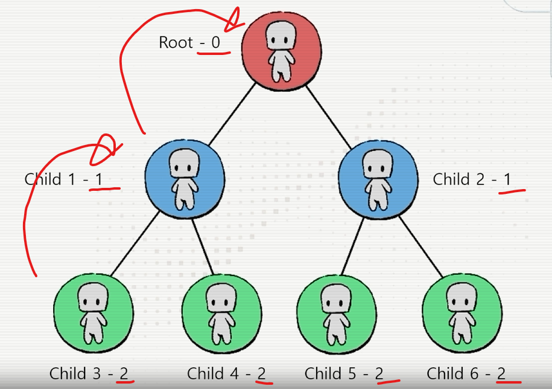

함수내부의 <code>CalcAttachDepth</code> 람다 함수를 재귀적으로 돈다.<br /><code>CalcAttachDepth</code> 에서는 그림처럼 ParentActor 포인터를 확인하면서 자기 자신에 Depth값을 매긴다.

하지만 예외의 경우가 있다.

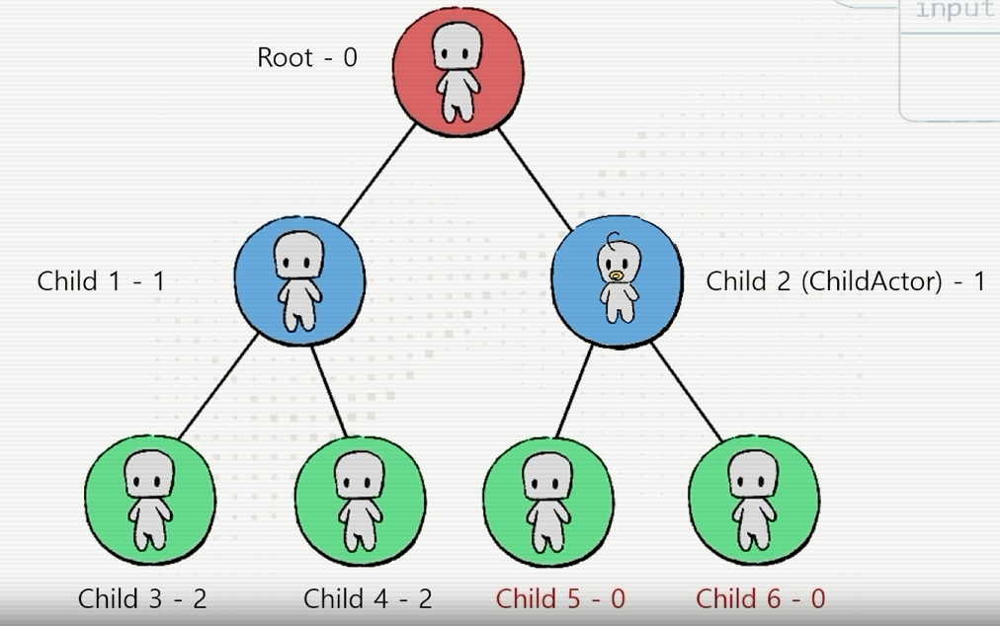

이는 자식 액터가, <b>ChildComponent로 붙인 액터일때 발생</b>한다.

이런 경우에 <b>ChildComponent에 SceneComponent로 붙인 ChildActor</b>는 <b><span>부모 Depth의 -1 값</span></b>을 가진다.

이는 <b>ChildComponent의 Actor</b>을 완전히 초기화 된 상태에서 초기화를 진행하기 위함이라고 한다. 

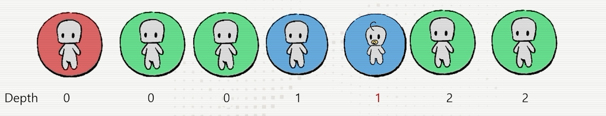

<details>
<summary><b>왜 ChildActorComp는 그 자식보다 늦게 되는가… 어려워잉</b></summary>

<b>요약</b>

- 정상적인 최초 게임 등록에서 Child2 재생성이 없다면 특수 정렬은 사실 필요 없음

<details>
<summary>최초 등록 도중 Child2 재생성이 가능한 에디터/불일치 경로를 방어하려고 특수 정렬</summary>

<b>재생성 하는 경우 </b>: 

<ul>
<li>
ChildActor 클래스가 바뀐 경우: 기존 <code>Child2</code> 클래스와 <code>ChildActorClass</code>가 달라서 재생성
</li>
<li>
<b>원본 BP의 ChildActorTemplate 프로퍼티가 바뀐 경우: 클래스가 같아도 새 템플릿 상태를 반영하기 위해 재생성 ⇒ 사실상 이게 ActorSort단계에서 Depth를 예외적으로 처리하는 이유에 대한 합당한 이유로 보인다.</b>

<ul>
<li>
즉 ChildActorClass는 그대로인데 일부 프로퍼티만 바꿔서 재등록 해야하는 경우가 있을 것이다. 
</li>
</ul>

<b>문제의 전조</b>

```txt
1. 에디터에서 패키지 로드
   - Child2, Child5 UObject는 존재
   - Child5.AttachParent = Child2.Root
   - Child2.Root.AttachChildren = []  // Transient라 비어 있음

2. ChildActorComponent::PostLoad()
   - 템플릿 변경 가능성 때문에 bNeedsRecreate = true
   - 아직 연결 정보를 캐시하지는 않음

3. Actor Sort 및 최초 등록 시작

4. ChildActorComponent::OnRegister()(Child2의 부모 액터의 컴포넌트)
   - bNeedsRecreate 확인
   - 여기서 처음 DestroyChildActor() 실행
   - 바로 이 순간 AttachChildren을 읽어 캐시 생성 시도
```

정상 순서는:

```txt
1. Child5 등록
2. Child5가 저장된 AttachParent인 OldChild2.Root를 찾음
3. OldChild2.Root.AttachChildren.Add(Child5.Root)
4. ChildActorComponent가 OldChild2.Root.AttachChildren을 캐시
5. OldChild2 파괴
6. NewChild2 생성
7. 캐시된 Child5를 NewChild2.Root에 재부착
```

반대로 ChildActorComponent가 먼저 등록되면:

```txt
1. OldChild2.Root.AttachChildren이 아직 비어 있음
UPROPERTY(ReplicatedUsing = OnRep_AttachChildren, Transient)
TArray<TObjectPtr<USceneComponent>> AttachChildren;
Transient이기 때문에 레벨 재로드시 비어있다!!
2. 빈 목록을 캐시
3. OldChild2 파괴
4. NewChild2 생성
5. Child5가 나중에 등록됨
6. Child5가 알고 있던 부모는 파괴된 OldChild2.Root
7. NewChild2.Root는 완전히 다른 객체이므로 자동으로 찾을 수 없음
```
</li>
<li></li>
</ul>

컴포넌트 등록을 위해 Actor를 정렬할 때, 부모 Actor가 ChildActor인 경우 자식 Actor의 Depth를 낮게 계산한다.

<code>UChildActorComponent</code>는 등록 과정의 특정 상황에서 자신이 관리하는 기존 ChildActor를 파괴하고 재생성할 수 있다.

재생성 후에도 외부 부착 Actor를 유지하려면, 파괴 전에 기존 ChildActor의 <code>RootComponent.AttachChildren</code>을 순회하여 외부 자식의 포인터·소켓·상대 Transform을 캐시해야 한다.

하지만 <code>AttachChildren</code>은 <code>Transient</code>이므로 패키지 로드 직후에는 비어 있다. 원본 부착 정보는 자식 쪽 <code>AttachParent</code>에만 저장되어 있다.

따라서 외부 자식 Actor가 먼저 등록되면서 자신의 <code>AttachParent</code>를 확인하고, 기존 ChildActor Root의 <code>AttachChildren</code>에 자신을 추가해야 한다.

그 후 ChildActor가 재생성되면 <code>UChildActorComponent</code>가 완성된 <code>AttachChildren</code>에서 외부 자식을 캐시하고, 새 ChildActor에 다시 부착할 수 있다.

- 저장된 인스턴스가 현재 템플릿과 달라졌을 가능성이 있는 경우: <code>PostLoad()</code>에서 보수적으로 <code>bNeedsRecreate</code> 설정<br />

### 실제 자동 경로: 에디터 <code>PostLoad</code>

패키지에서 <code>UChildActorComponent</code>가 로드될 때 다음 조건이면:

```txt
if (ChildActor && ChildActorTemplate && GetLinker())
{
    bNeedsRecreate = true;
}
```

이후 최초 컴포넌트 등록에서:

```txt
PostLoad
→ bNeedsRecreate = true
→ IncrementalUpdateComponents
→ SortActorsHierarchy
→ Root의 컴포넌트 등록
→ ChildActorComponent::OnRegister
→ DestroyChildActor()
→ CreateChildActor()
```

가 실제로 발생합니다.

<code>OnRegister()</code> 코드에서도 명시적으로 파괴 후 재생성합니다.

```txt
if (bNeedsRecreate)
{
    bNeedsRecreate = false;
    DestroyChildActor();
    CreateChildActor();
}
```

### 클래스 불일치 경로

저장된 <code>Child2</code>의 실제 클래스와 <code>ChildActorClass</code>가 다르면 최초 등록 중 재생성합니다.

```txt
if (ChildActor->GetClass() != ChildActorClass)
{
    bNeedsRecreate = true;
}
```

이는 에디터가 아니어도 가능한 경로입니다. 에셋 변경, 잘못된 직렬화 상태, 리인스턴싱 등의 결과로 발생할 수 있습니다.

### 프로그래머가 발생시키는 경로

등록 콜백 중 이미 등록된 ChildActorComponent에 다음을 호출하면 즉시 파괴·재생성합니다.

```txt
ChildActorComponent->SetChildActorClass(NewClass);
```

내부 동작은:

```txt
if (IsRegistered())
{
    DestroyChildActor();
    CreateChildActor();
}
```

</details>

- 최초 등록이 끝난 뒤 런타임 재등록에서는 이미 <code>AttachChildren</code>이 완성됐으므로 최초 정렬 순서와 무관

쭉쭉 읽자.. 읽기 힘들것임

<code>Child5</code>가 먼저 등록될 때도 <code>Child2</code>와 <code>Child2.Root</code> UObject는 이미 생성되어 있습니다. 아직 World에 등록되지 않았을 뿐입니다.

| 구분 | 일반 Actor 부모 | ChildActor 부모 |
| --- | --- | --- |
| 자식 등록 시 부모 객체 | 이미 존재 | 이미 존재 |
| 원하는 순서 | 부모 등록 → 자식 등록 | 외부 자식 등록 → ChildActor 등록 |
| 일반적인 이유 | 자식이 부모의 완성된 Transform·Socket·Tick·Physics 상태를 안전하게 사용 | 재구성 전에 부모의 <code>AttachChildren</code>을 완성해야 함 |
| 자식을 먼저 등록하면 | 부모의 World 상태가 아직 완성되지 않아 자식 <code>OnRegister()</code>가 부모 상태를 전제하면 위험 | 기본 <code>USceneComponent</code> 부착은 미등록 부모도 지원하므로 역방향 목록을 먼저 채울 수 있음 |
| 부모를 먼저 등록하면 | 정상 | ChildActor 재생성 시 외부 자식이 캐시에서 누락될 수 있음 |

일반 흐름은 다음입니다.

```txt
Parent.Root 등록
→ Parent의 Transform/Socket/Physics 상태 준비
→ Child.Root 등록
→ 준비된 Parent 상태를 사용해 부착
```

반면 ChildActor 특례는:

```txt
Child2와 Child2.Root는 이미 존재하지만 미등록
→ Child5.Root가 AttachParent로 Child2.Root를 이미 알고 있음
→ Child5.Root.OnPreRegister()
→ Child2.Root.AttachChildren에 Child5.Root 추가
→ Child2 등록 또는 재구성
→ 캐시가 AttachChildren에서 Child5를 발견
```

미등록 부모에 붙을 수 있는 이유는 <code>USceneComponent::OnPreRegister()</code>의 부착이 아직 렌더링·피직스 상태를 만드는 작업이 아니라, 주로 부모의 <code>AttachChildren</code>에 자신을 넣는 논리적 관계 복원이기 때문입니다.

```txt
Parent->AttachChildren.Add(this);
```

따라서 핵심 차이는 다음입니다.

> 일반 부모는 먼저 등록하여 완성된 부모 상태를 자식에게 제공하는 것이 안전하고, ChildActor 부모는 객체 자체는 이미 존재하므로 자식이 먼저 논리적 부착 관계를 복원할 수 있으며, 오히려 재생성 가능한 부모이기 때문에 자식을 먼저 기록해야 부착 관계를 보존할 수 있습니다.

단, 커스텀 컴포넌트의 <code>OnRegister()</code>에서 “AttachParent는 반드시 이미 등록되어 있다”고 가정하면 ChildActor 특례에서 문제가 될 수 있습니다. 엔진 기본 부착 로직은 그 가정을 하지 않습니다.

두 경우를 구분해야 합니다.

- <code>Child2(ChildActor)</code>의 <code>OnRegister()</code>가 자신의 부모인 <code>Root</code>/<code>ChildActorComponent</code>가 등록됐다고 전제하는 경우: 괜찮습니다. <code>Root(Depth 0)</code>가 <code>Child2(Depth 1)</code>보다 먼저 처리됩니다.
- <code>Child5</code>의 <code>OnRegister()</code>가 부모인 <code>Child2</code>가 이미 등록됐다고 전제하는 경우: 맞습니다. 망가질 수 있습니다. <code>Child5(Depth 0)</code>가 <code>Child2(Depth 1)</code>보다 먼저 등록되기 때문입니다.

엔진 기본 <code>USceneComponent</code>는 미등록 부모에 대한 논리적 부착을 지원하지만, 커스텀 <code>OnRegister()</code> 코드가 다음처럼 가정하면 안전하지 않습니다.

```txt
check(GetAttachParent()->IsRegistered());
```

즉, ChildActor에 붙을 수 있는 Actor의 컴포넌트는 <code>OnRegister()</code>에서 외부 AttachParent가 이미 등록됐다고 가정하면 안 됩니다.

ChildActor 특례는:

```txt
부모가 먼저 등록되어 상태가 준비되는 안전성
```

보다

```txt
ChildActor 재생성 시 외부 자식의 부착 관계가 유실되지 않는 안전성
```

을 우선한 선택입니다.

다만 “기존 보장을 포기했다”기보다는, 부모 선등록은 편의상 제공되는 일반 원칙이지 모든 <code>OnRegister()</code>에서 의존할 수 있는 절대 계약은 아닙니다. 엔진 기본 <code>USceneComponent</code>는 미등록 부모에 붙는 것을 지원합니다.

따라서 정확히는:

> ChildActor 경계에서는 부모 선등록의 편의성을 포기하고 부착 관계 보존을 우선하며, 커스텀 컴포넌트는 외부 AttachParent가 이미 등록됐다고 가정하면 안 됩니다.

> “부착된 액터가 불완전한 <code>AttachChildren</code> 상태로 등록되어서” 문제가 아니라, 부착된 액터가 아직 등록되지 않아 <code>AttachChildren</code>을 복원하기 전에 ChildActor가 재구성되는 것이 문제입니다.

부착된 액터의 등록은 문제의 원인이 아니라, <code>AttachChildren</code>을 완성하는 작업입니다.

---

## 2. 책임과 경계

부착 관계는 양방향으로 관리됩니다.

```txt
Child 5.Root.AttachParent
    → Child 2.Root

Child 2.Root.AttachChildren
    → [Child 5.Root]
```

하지만 두 정보의 저장 방식이 다릅니다.

```txt
UPROPERTY(ReplicatedUsing = OnRep_AttachParent)
TObjectPtr<USceneComponent> AttachParent;

UPROPERTY(ReplicatedUsing = OnRep_AttachChildren, Transient)
TArray<TObjectPtr<USceneComponent>> AttachChildren;
```

\[SceneComponent.h (line 108)\](F:/UE\_5.7.4/Engine/Source/Runtime/Engine/Classes/Components/SceneComponent.h:108)

핵심은 <code>AttachChildren</code>이 <code>Transient</code>라는 점입니다.

- <code>AttachParent</code>: 자식이 부모를 가리키는 원본 관계
- <code>AttachChildren</code>: 부모가 자식을 빠르게 찾기 위한 런타임 역방향 목록
- <code>AttachChildren</code>은 저장된 값을 그대로 불러오는 것이 아니라 등록 과정에서 다시 채워져야 함

따라서 레벨 로드 직후에는 다음 상태가 가능합니다.

```txt
Child5.Root.AttachParent == Child2.Root   // 존재
Child2.Root.AttachChildren == []          // 아직 복원 전
```

---

## 3. 호출 흐름

### 정상적인 복원 순서

<code>Child 5</code>의 RootComponent가 등록될 때:

```txt
Child5.Root.OnPreRegister()
    └─ AttachToParent()
         └─ AttachToComponent(Child2.Root)
              └─ Child2.Root.AttachChildren.Add(Child5.Root)
```

관련 코드:

- \[SceneComponent.cpp (line 817)\](F:/UE\_5.7.4/Engine/Source/Runtime/Engine/Private/Components/SceneComponent.cpp:817)
- \[SceneComponent.cpp (line 837)\](F:/UE\_5.7.4/Engine/Source/Runtime/Engine/Private/Components/SceneComponent.cpp:837)
- \[SceneComponent.cpp (line 2487)\](F:/UE\_5.7.4/Engine/Source/Runtime/Engine/Private/Components/SceneComponent.cpp:2487)

즉, <code>Child 5</code>가 등록돼야 부모 쪽 역방향 목록이 다음처럼 완성됩니다.

```txt
Child2.Root.AttachChildren = [Child5.Root]
```

### 잘못된 순서

ChildActor 쪽이 먼저 처리되면 다음 순서가 될 수 있습니다.

```txt
1. 레벨 로드
   Child5.AttachParent = Child2.Root
   Child2.Root.AttachChildren = []

2. Child2가 먼저 재구성됨

3. 엔진이 Child2에 붙은 외부 Actor를 캐시하려고
   Child2.Root.AttachChildren을 순회함

4. AttachChildren이 비어 있으므로 Child5를 발견하지 못함

5. 기존 Child2 또는 기존 RootComponent가 파괴됨

6. 새 Child2가 만들어짐

7. 캐시에 Child5 정보가 없으므로 새 Child2에 재부착하지 못함
```

결과적으로 <code>Child 5</code>는 이전 ChildActor의 사라진 컴포넌트를 부모로 가리키거나, 정리 과정에서 부모 없는 상태가 되어 분리됩니다.<br /><br /><code>AttachChildren</code>이 채워지기 전에 부착 정보가 <code>ComponentInstanceDataCache</code>에서 사라져 detach되는 것을 막기 위한 예외다.

ChildActorComponent는 수정·재구성 시 CA를 없애고 새로 만든다.

<b>CA가 재생성돼도, 에디터에서 만들어 둔 “X가 CA에 붙어 있는 관계”를 유지하는 것</b>이다.<br /><br />ChildActor에 부착된 액터들은 AttachChildren 리스트가 아직 완전히 채워지기 전에 등록되면, 부착 정보가 제대로 기록되지 않아 분리될 위험이<br />있으므로 반드시 먼저 등록되어야 해서 ChildActor의 자식 액터의 깊이를 일반적인 경우보다 낮게 설정하여, 등록 순서에서 먼저 처리되도록 보장

</details>

이후 <b>오름차순으로 액터를 정렬</b>하고, <b>null인 Actor을 제거</b>한다.

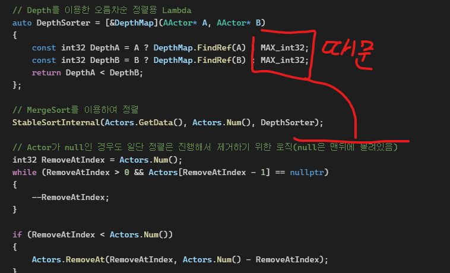

몰려있는 null들을 모아서 한번에 제거한다.

</details>

<details>
<summary><b>Level.IncrementalUpdateComponents.IncrementalRegisterComponents</b></summary>

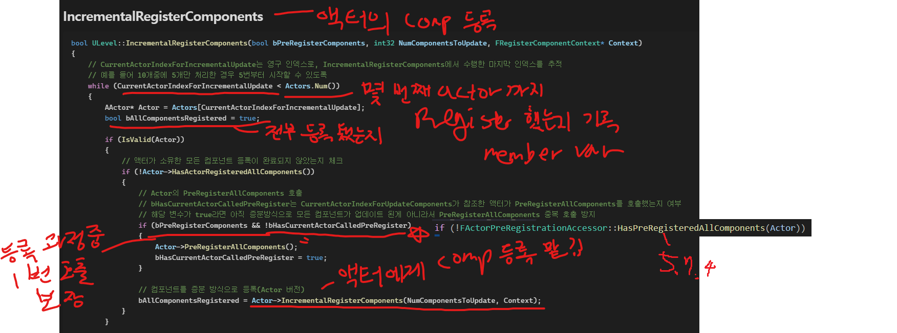<br><em>5.6이전버전 코드같다. 참고만하고 아래 사진을더 자세히 보자</em>

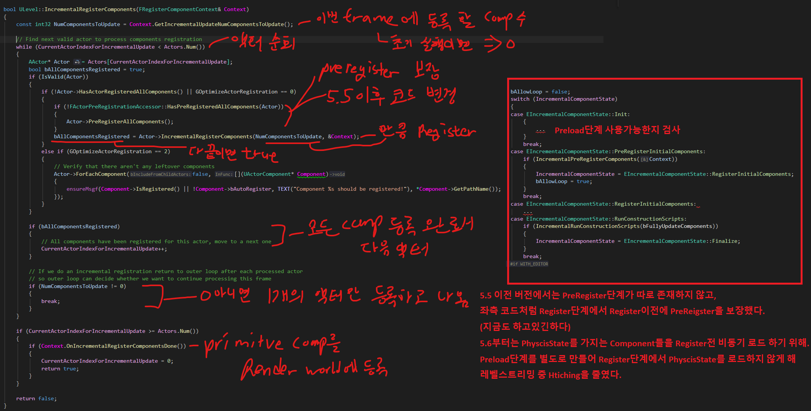

PhyscisState를 사용하는 Component의 OnRegister단계에서

<b>IncrementalComponentState관련해서 5.6버전이후 수정사항</b>

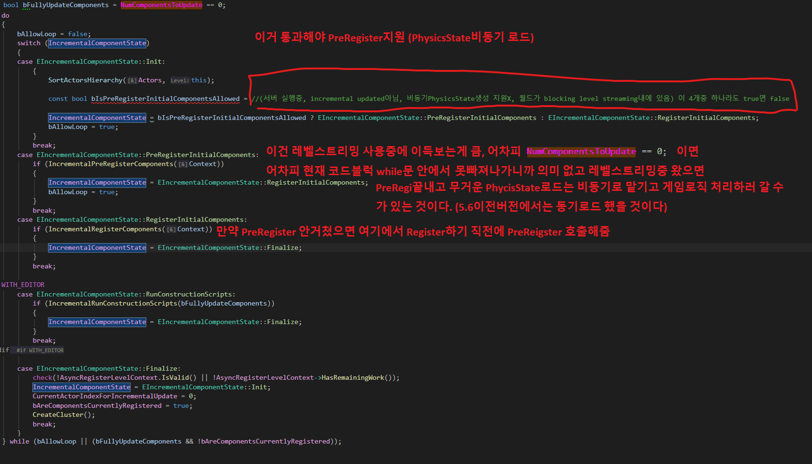<br><em>정리 : 조건 맞으면 PhysicState를 비동기 로드하고 조건 안되면 Register단계에서 CreatePhysicsState함수에서 로드됨</em>

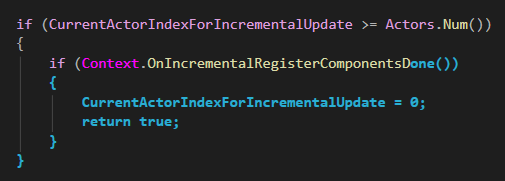

모든 액터의 컴포넌트가 등록이 완료되었을때  여기로 오는데<br />여기서 <b>PrimitiveComponent들을 RenderScene에 등록</b>한다.

여기서 모아서 처리하는 이유는 하나 완료될 때 마다 진행하면 병목현상이 발생함 효율적인 등록을 위해서 함수 내부적으로 병렬로 등록함

<b>따라서 Component는 등록될때 PhysicsState, RenderState가 같이 등록된다.</b>

<details>
<summary><b>아니 그러면 Register단계에서도 PhysicsState 비동기 로딩하면안돼요?</b></summary>

이제 정확히 이해했습니다. 제안하신 흐름은 이거죠.

```txt
PreRegister
└─ AsyncPhysics 시작

Register
├─ AsyncPhysics는 백그라운드에서 계속 실행
├─ OnRegister 실행
└─ AsyncPhysics가 끝날 때까지 Register 완료만 보류
```

결론은:

> 엔진 구조를 바꾸면 구현은 가능합니다. 하지만 <code>OnRegister()</code> 이후에 동기 <code>CreatePhysicsState()</code>를 호출한다는 사실은 <code>OnRegister()</code>와 PhysicsState 생성을 동시에 실행해도 안전하다는 근거가 아닙니다.

### 동기 경로와 제안한 경로의 차이

현재 동기 경로는:

```txt
OnRegister 시작
OnRegister 완료
PhysicsState 생성 시작
PhysicsState 생성 완료
```

입니다.

시간 관계로 쓰면:

```txt
OnRegister.End < CreatePhysicsState.Start
```

반면 제안한 경로는:

```txt
AsyncPhysics 시작
OnRegister 시작
OnRegister 완료
AsyncPhysics 완료
```

이므로:

```txt
AsyncPhysics.Start < OnRegister < AsyncPhysics.End
```

가 됩니다.

즉 현재 코드는 <b>순차 실행</b>이고, 제안은 <b>동시 실행</b>입니다.

```txt
OnRegister();
CreatePhysicsState();
```

라는 순서는 “OnRegister가 PhysicsState 없이 호출될 수 있다”는 뜻이지, “PhysicsState를 다른 스레드에서 만드는 동안 OnRegister를 호출해도 된다”는 뜻은 아닙니다.

### 실제 <code>OnRegister()</code>가 Physics 입력을 건드림

<code>UStaticMeshComponent::OnRegister()</code>를 보면:

```txt
NotifyIfStaticMeshChanged();

if (!IsPreRegistered())
{
    UpdateCollisionFromStaticMesh();
}
```

가 있습니다. \[StaticMeshComponent.cpp (line 814)\](/F:/UE\_5.7.4/Engine/Source/Runtime/Engine/Private/Components/StaticMeshComponent.cpp:814)

<code>UpdateCollisionFromStaticMesh()</code>는 Physics 비동기 작업이 참조하는 다음 데이터에 영향을 줄 수 있습니다.

- <code>StaticMesh</code>
- <code>BodySetup</code>
- <code>BodyInstance</code>
- Collision 설정

그래서 PreRegister 경로에서는 Physics 작업을 시작하기 전에 미리 실행합니다.

```txt
bool UStaticMeshComponent::ShouldIncrementalPreRegister(...)
{
    UpdateCollisionFromStaticMesh();
    return Super::ShouldIncrementalPreRegister(...);
}
```

그리고 나중의 <code>OnRegister()</code>에서는:

```txt
if (!IsPreRegistered())
{
    UpdateCollisionFromStaticMesh();
}
```

조건으로 중복 수정을 피합니다.

즉 설계 의도가 명확합니다.

```txt
Collision 입력 확정
→ Async PhysicsState 생성
→ 작업 완료
→ OnRegister
```

Physics 작업 중간에 <code>OnRegister()</code>가 실행되도록 만든 구조가 아닙니다.

핵심은 <b>같은 데이터를 건드리는 것 자체가 문제가 아니라, 읽기와 쓰기가 동시에 일어나는 게 문제</b>라는 점입니다.

<code>UpdateCollisionFromStaticMesh()</code>를 <code>CreatePhysicsState()</code>보다 먼저 호출하는 현재 동기 경로는 안전합니다.

```txt
게임 스레드
──────────────────────────────────
UpdateCollisionFromStaticMesh 시작
UpdateCollisionFromStaticMesh 완료
CreatePhysicsState 시작
CreatePhysicsState 완료
```

Physics 생성이 시작될 때 Collision 설정 변경은 이미 끝났습니다.

반면 제안하신 경로는:

```txt
게임 스레드                    백그라운드 스레드
─────────────────────────────────────────────
                              Physics 생성 시작
OnRegister 시작
Collision 데이터 변경          Collision 데이터 읽기
OnRegister 완료                Physics 생성 계속
```

이렇게 읽기와 쓰기가 겹칠 수 있습니다.

### 실제로 어떤 데이터를 변경하나

<code>UpdateCollisionFromStaticMesh()</code>는 다음을 호출합니다.

```txt
BodyInstance.UseExternalCollisionProfile(BodySetup);
```

내부에서는:

```txt
ExternalCollisionProfileBodySetup = InBodySetup;
bPendingCollisionProfileSetup = false;
LoadProfileData(false);
```

를 수행합니다. 즉 <code>FBodyInstance</code>의:

- Collision Profile
- Collision Enabled
- Object Type
- Channel Response
- 외부 <code>BodySetup</code> 포인터

등을 갱신합니다.

반면 PhysicsState 생성은 백그라운드에서 같은 <code>FBodyInstance</code>를 읽습니다.

```txt
const ECollisionEnabled::Type CollisionType =
    Instance->GetCollisionEnabled();

ActorParams.bSimulatePhysics =
    Instance->ShouldInstanceSimulatingPhysics();

Instance->BuildBodyFilterData(...);

BodySetup->AddShapesToRigidActor_AssumesLocked(...);
```

예를 들어 비동기 작업이 다음 값을 읽는 도중:

```txt
CollisionEnabled = QueryOnly
ResponseToChannels = 이전 값
```

게임 스레드가 Profile을 바꾸면 결과가:

```txt
Actor 생성 판단은 이전 CollisionEnabled 사용
Shape Filter는 새로운 ResponseToChannels 사용
```

처럼 서로 다른 시점의 설정을 섞어서 사용할 수 있습니다.

더 근본적으로 C++에서 동기화 없는 동일 메모리의 read/write는 data race라서 결과가 보장되지 않습니다.

### 현재 동기 경로

현재 Register 경로는:

```txt
OnRegister();              // Collision 설정 변경 완료
CreatePhysicsState(true);  // 그 후 설정을 읽어서 Body 생성
```

입니다.

따라서 순서는:

```txt
Collision 설정 확정
        ↓
PhysicsState 생성 시작
```

입니다.

<code>OnRegister()</code> 다음에 <code>CreatePhysicsState()</code>가 있다는 것은:

> OnRegister가 PhysicsState 생성에 사용할 입력을 변경해도 된다.

는 뜻에 가깝습니다.

반대로:

> PhysicsState 생성과 OnRegister를 동시에 실행해도 된다.

는 뜻은 아닙니다.

### 현재 비동기 PreRegister 경로

StaticMeshComponent는 비동기 작업을 시작하기 전에 Collision 설정을 미리 확정합니다.

```txt
bool UStaticMeshComponent::ShouldIncrementalPreRegister(...)
{
    UpdateCollisionFromStaticMesh();
    return Super::ShouldIncrementalPreRegister(...);
}
```

그다음:

```txt
UpdateCollisionFromStaticMesh 완료
        ↓
Async PhysicsState 시작
        ↓
Async PhysicsState 완료
        ↓
OnRegister
```

순서로 갑니다.

나중에 <code>OnRegister()</code>에서는:

```txt
if (!IsPreRegistered())
{
    UpdateCollisionFromStaticMesh();
}
```

이므로 PreRegister를 탄 Component는 Collision 설정을 다시 변경하지 않습니다.

즉 두 경로를 비교하면:

```txt
일반 동기 등록:
OnRegister에서 입력 확정 → Physics 생성

비동기 PreRegister:
PreRegister에서 입력 확정 → Physics 생성 완료 → OnRegister
```

둘 다 Physics 생성 중에는 알려진 Collision 입력을 변경하지 않습니다.

</details>

</details>

<details>
<summary><b>Actor.IncrementalRegisterComponents</b></summary>

> 컴포넌트의 계층을 어떻게 올바르게 등록하는지<br />컴포포넌트를 등록하는 함수가 뭔지 집중하자.

<b>액터의 컴포넌트를 월드에 나눠서 등록하는 함수</b>

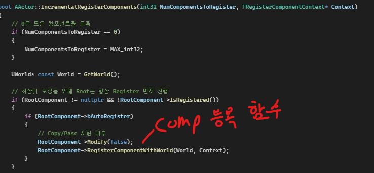<br><em>루트컴포넌트는 컴포넌트 등록과정에서 보장되어야하기때문에 가장먼저 등록한다.</em>

#### 컴포넌트 등록 과정 Flow

- <b>부모 컴포넌트 없을때</b>

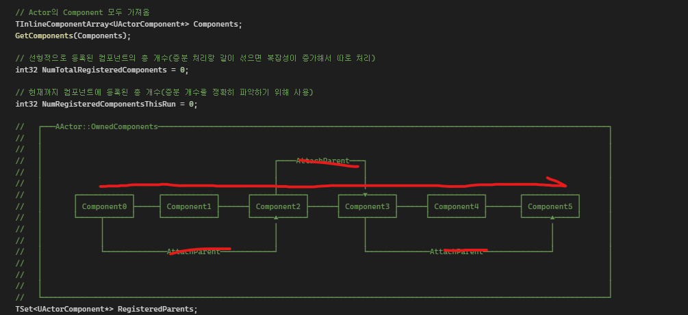

- <b>부모 컴포넌트 있을때</b>

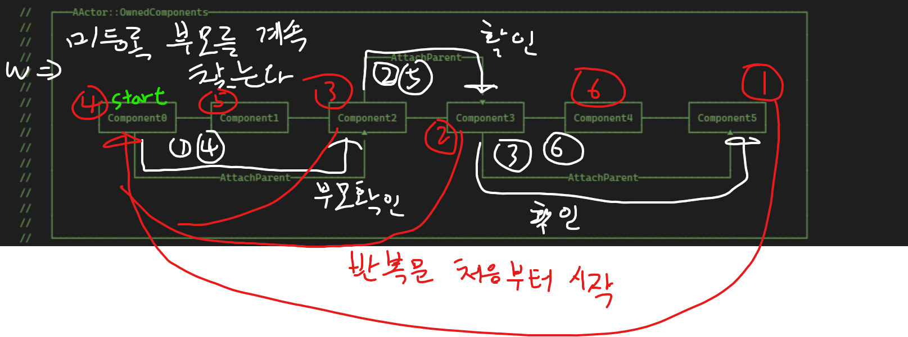

- <b>컴포넌트를 나눠서 등록하는 경우 </b>
  그냥 위 순서를 n개씩 수행한다. 

<details>
<summary><b>Flow 코드</b></summary>

```c++
// NumRegisteredComponentsThisRun < NumComponentsToRegister를 통해 증분처리 지원 
    for (int32 CompIdx = 0; CompIdx < Components.Num() && NumRegisteredComponentsThisRun < NumComponentsToRegister; ++CompIdx)
    {
         UActorComponent* Component = Components[CompIdx];
         
         if (!Component->IsRegistered() && Component->bAutoRegister && IsValidChecked(Component))
         {
            // 컴포넌트 계층을 따라 올라가며, 루트에 가장 가까운 미등록 부모 컴포넌트를 반환
            USceneComponent* UnregisteredParentComponent = GetUnregisteredParent(Component);
            if (UnregisteredParentComponent)
			{
			    bool bParentAlreadyHandled = false;
			    RegisteredParents.Add(UnregisteredParentComponent, &bParentAlreadyHandled);
			    
				// 이미 등록되어 있는 대상이라면 문제가 있음
			    if (bParentAlreadyHandled)
				{
					break;
				}
				
			    Component = UnregisteredParentComponent;
			    
			    // CompIdx를 --해서 기존 등록 대상 유지
				CompIdx--;
				
				// 부모먼저 된 경우 선형적인 구조로 한번에 계산하기 위해 -- 진행
				NumTotalRegisteredComponents--;
			}
			
			Component->Modify(false);
            Component->RegisterComponentWithWorld(World, Context);
            
            // 증분의 정확한 계산을 위해 별도로 루프 계산
            // 이번 run에 몇개나 등록할
            NumRegisteredComponentsThisRun++;
         }
         
         NumTotalRegisteredComponents++;
    }
```

</details>

---

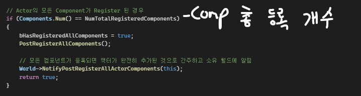

</details>

<details>
<summary><b>ActorComponent.RegisterComponentWithWorld</b></summary>

<details>
<summary><b>함수를 배우기 전 등록이라는 개념을 알고가자</b></summary>

등록은 다음 단계로 이해하면 쉽다

- <b>부모에 대한 정보를 기준으로 자식을 업데이트한다.</b>
  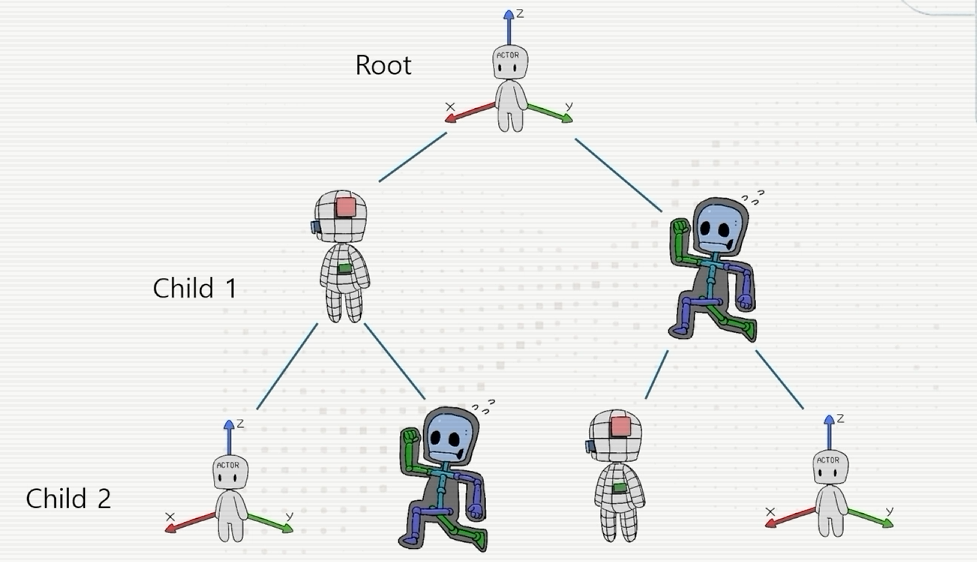

  가장 간단한 예는 Transform관계가 있겠다.

- <b>컴포넌트를 각각의 전문 월드에 등록한다.</b>
  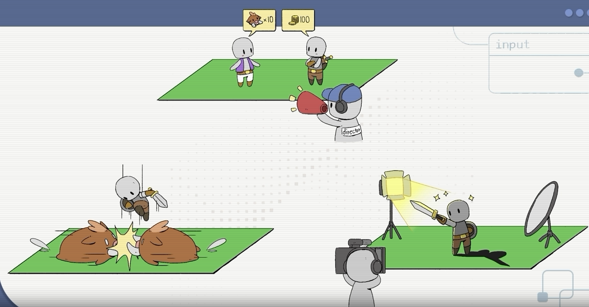

  컴포넌트들은 각각 자신의 복사본을 만들수 있고,<br />이 복본들을 필요로하는 월드에 등록을한다.

  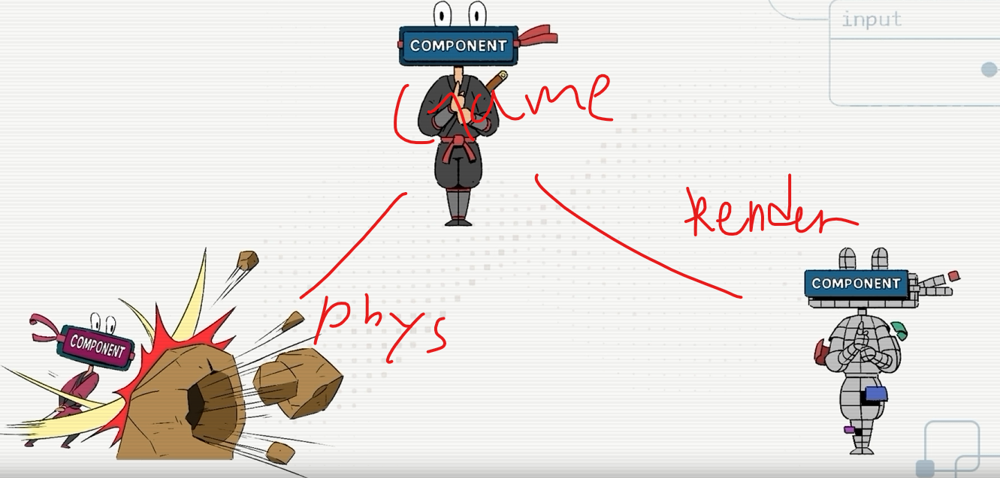

<b>이 액터의 StaticMeshComponent는 어디에 등록될까?</b>

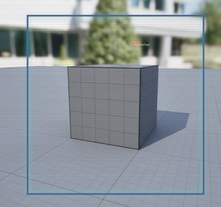

- <b>일단 게임 월드에 등록</b>된다. 애초에 게임 월드에 등록되지 않으면 좌표정보같은 기본적인 정보도 없기 때문이다.
- 메시에 있는 메시/머티리얼 정보를 사용해 <b>렌더링 씬에 등록을</b> 한다.
- 만약 물리적인 상호 작용이 필요하면? <b>피직스 씬에 등록</b>된다.

<b>그래서 왜 복사본 만들어요?</b>

당연하다 예를들어 모든 컴포넌트가 Game/Phys/Render World 쏘다니면 비효율적일 것이다.<br />그래서 필요한거만 딱딱 처리하기 위해 복사본 만드는거다

</details>

만약 컴포넌트가 런타임중에 생성되었을때

컴포넌트는 등록 과정에서 FTickTaskLevel에 본인의 틱 함수를 등록한다.

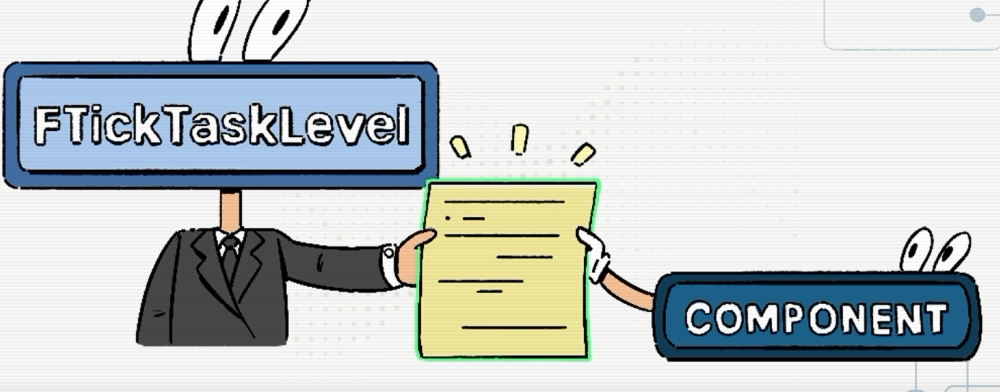

<b>코드분석</b>

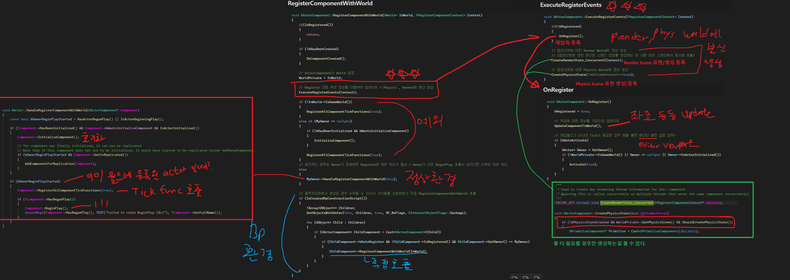

</details>

</details>
