---

게임 규모가 대형화 됨에 따라서 c++에도 모던 객체 지향 설계가 필요해졌다.

이에따라  언리얼엔진은 c++의 장점들을 가져가면서 현대 객체지향의 장점들도 챙겨가기를 원한다.

- <b>인터페이스 </b>: 객체 설계의 틀을 제공하는 추상 클래스
- <b>리플렉션 </b>: 런타임에서 객체의 구조를 파악하고 객체에 메타데이터 부여
- <b>델리게이트 </b>: 프로그램에서 발생한 이벤트를 다수의 객체에 효과적으로 전달하는데 사용

언리얼은 c++의 매크로 기능을 활용해 모던 객체지향의 기능들을 구현했다.

따라서 언리얼은 성능+유지보수 두가지의 특성을 모두 가진다.

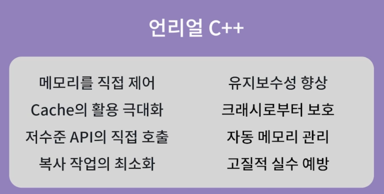

<details>
<summary>Unreal Object(객체)</summary>

언리얼 엔진이 설계한 새로운 시스템의 단위이다.

### 개요

해당 객체를 생성하기 위해서는 아래 문법을 사용한다.

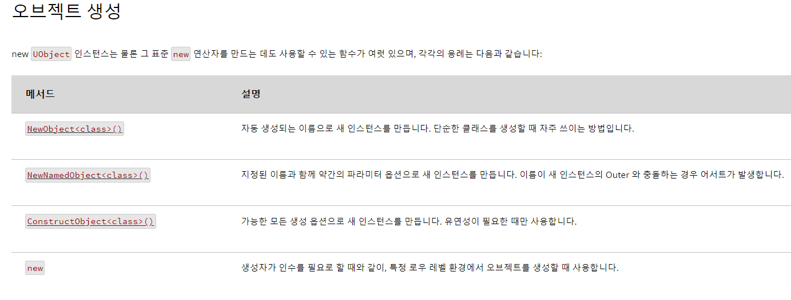

UObject를 쓰면 아래 장점들을 가져갈수있다.

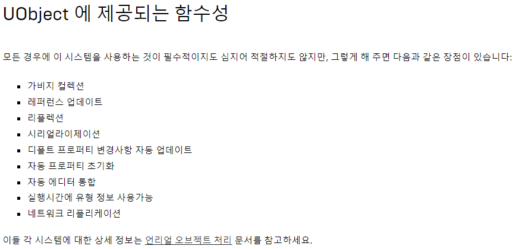

클래스를 생성하면 디폴트 헤더의 모양은 이렇게 생겼다.

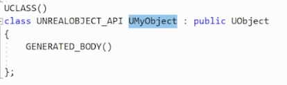

프로젝트\_API를 붙이면 언리얼의 다른 라이브러리(모듈)에서 사용할 수 있게 개방한다.

GENERATED\_BODY()의 내부를 보면

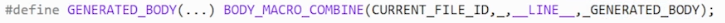

이렇게 생겼다.

BODY\_MARCO\_COMBINE 내의 인자들을 묶어 긴 문자를 만든다고 이해하면 된다.

- CURRENT\_FILE\_ID : header.generated.h 내에 기록된 정보

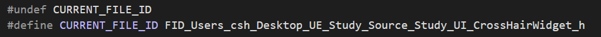

- LINE : GENERATED\_BODY()가 작성된 코드 라인
- GENERATED\_BODY : 문자 그대로 ㅇㅇ

<b>결과</b>

이런 문자열이 만들어진다.

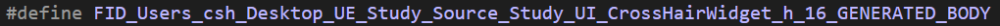

<b>정리하면</b>

모던 객체지향 기능 제공을 위한 코드들이 header.h.generated.h에 기록되고

우리의 헤더에는 GENERATED\_BODY()라는 코드로 기록된다.

### 구성

언리얼 오브젝트는 특별한 프로퍼티와 함수 지정이 가능하다.

멤버 변수 : UPROPERTY

멤버 함수 : UFUNCTION

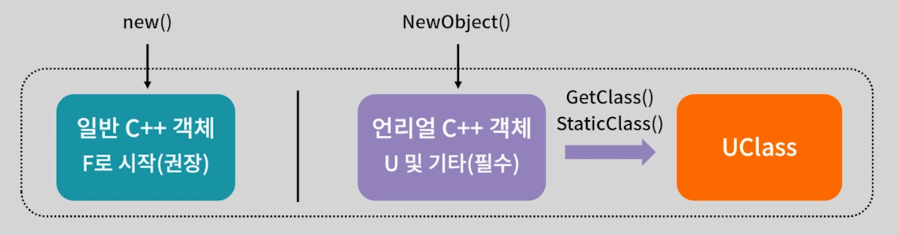

</details>

<details>
<summary><b>CDO (Class Default Object)</b></summary>

언리얼 클래스에는 CDO정보가 포함되어있다.

<b>CDO에는 언리얼 객체가 가진 기본값이 보관되는 템플릿 객체이다</b>

CDO는 한 클래스로부터 다수의 물체를 생성해 게임 콘텐츠에 배치할 때 일관성 있는 기본값을 지공하는데에 도움된다.

UClass와 CDO는 엔진 초기화 단계에서 생성된다 (디버깅 해보면 로딩창때 중단점 걸림)

따라서 게임 콘텐츠 배치때는 안심하고 쓰자

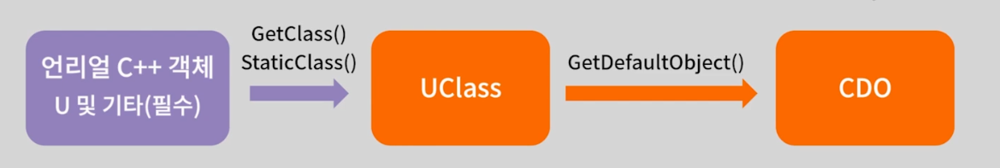

### 처리

- <b>자동 프로퍼티 초기화</b>
  UObject는 생성자 호출 전 자동으로 0으로 채워진다(모든 property에게 일어남). 이후 클래스 생성자의 커스텀 값으로 초기화가 된다.

- <b>레퍼런스 자동 업데이트</b>
  UObject는 언리얼 시스템에서 제공하는 메모리 관리의 이점을 받을 수 있다.

- [Serialization(직렬화)](%EC%A7%81%EB%A0%AC%ED%99%94-8afb86fd.md)

- <b>Serialization중에서도 DeltaSerialization을 사용하기 위함이 크다고 한다.</b>

UProperty라고 명시해둔 멤버들은 엔진에서 수정했을때 그 값이 c++상의 UClass수정 없이 저장되고 로드된다.

예를들어 엔진상에서 hp를 500으로 바꾸고 저장하면(c++에서 저장안하고)

이후 클래스의 빌드나 엔진의 재시작등이 일어나도 알아서 불러와진다.

<b>이건 네트워크 통신에서도 가능하다!!</b>

- <b>프로퍼티 값 업데이트하기</b>
  CDO가 변경되면 그 클래스의 모든 인스턴스가 로드될 때 알아서 변경된 CDO를 따른다.

  CDO 변경 되기 이전에 CDO와 다른 멤버를 가진 인스턴스가 있다면 그 인스턴스는 

  CDO변경을 따르지 않는다. (의도적으로 변경되었다고 판단)

- <b>런타임 유형 정보 및 형변환</b>
  UObject는 리플렉션 시스템의 일부임으로 항상 자신이 무슨 UClass라는걸 알고 있어서

  형변환을 실시간으로 할 수 있다. (Super클래스 같은걸 말함)

  혹여나 캐스팅에 실패했으면 null을 보장해서 우리가 안전하게 코딩 가능

</details>

<details>
<summary>언리얼 리플렉션 시스템</summary>

(프로퍼티 시스템 이라고도 한다)

언리얼 시스템의 근간을 이루는 리플렉션 시스템에 대해 알아보자<br />

리플렉션 시스템은 프로그램 실행시간에 자기 자신을 조사하는 기능이다.<br /><b>런타임 단계에서 클래스 정보를 알 수 있게해주는 것</b>

리플렉션 시스템에 보이도록 했으면 하는 유형이나 프로퍼티에 주석을 달아두면

UHT(unreal header tool)가 그 프로젝트를 컴파일할때 해당 정보를 수집한다.

```c++
// 예를들어 내가 다음과 같은 클래스를 만들었을때...
class A
{
public:
	int MemberA;
	int MemberB;
}
```

우리는 런타임중에 저 변수의 이름을 문자열로 알 수 없다.<br />하지만 그것을 알게 해주는것이 리플렉션이다<br />c++을 사용하니 컴파일러로 뭘 해주는거는 아닐거같고 매크로로 변수 이름을 복사떠서 하는게 아닐까? 싶음 

내부적으로 언리얼 헤더툴을 사용해 C#쓰고있음<br />코드 쭈르르르륵 읽다가 UPROPERTY UFUNCTION붙이면 UHT가 GeneratedBody/generated.h에 UClass라는것을 만들어서 전부 저장해놓는다

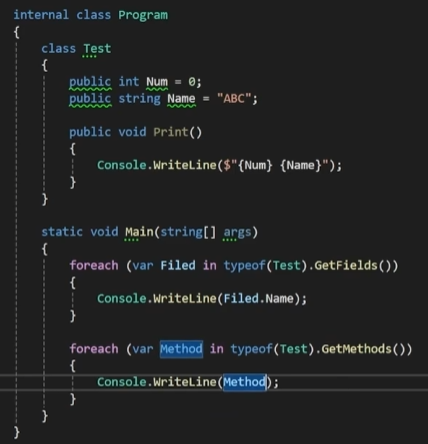

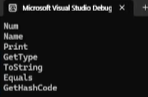

이렇게 멤버변수와 함수명이 잘 불러와진걸 확인할 수 있다.<br />GetType밑으로는 기본적으로 추가되는 함수들인걸로 보인다<br />(==연산자, 타입 형 받아오기, Class명을 String으로 바꾸는 함수로 예상된다)

(c++에서는 리플렉션이라는 개념이 없지만 좋은 기능이라 엔진에서 사용할 수 있도록 만든 것)<br />

```c++
UENUM(), UCLASS(), USTRUCT(), UFUNCTION(), UPROPERTY()
```

위의 코드들을 멤버들 위에 선언하면

<b>언리얼 엔진 시스템에서 해당 멤버들을 관리 받을 수 있다.</b>

<b>(언리얼 gc, 엔진상에서 멤버 확인 등등)</b>

<b>언리얼 프로퍼티의 계층구조</b>는 아래와 같다

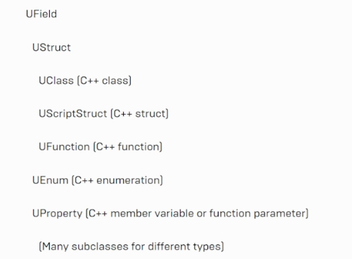

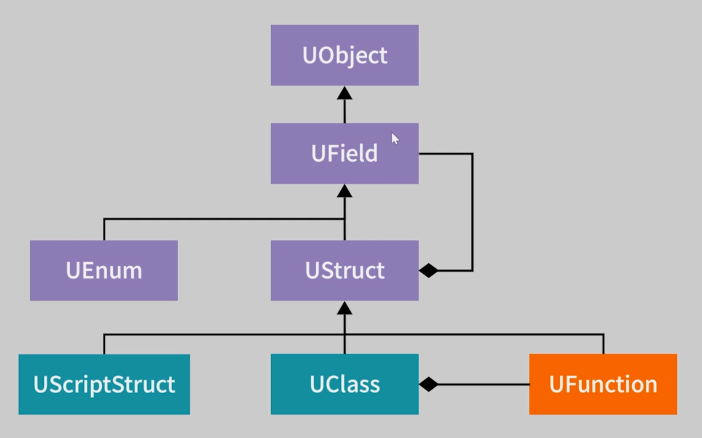

계층구조를 보면 UClass보다 UStruct가 상위 계층인데

기본적인 종합 구조체(c++클래스 구조체 함수 등등)이며 <b><u>c++구조체와 다르다.</u></b>

계층구조에 따라 UClass는 UFunction, UScriptStruct, UProperty를 포함할 수 있지만

UFunction, UScriptStruct는 UProperty만 포함이 가능하다.

UTypeName::StaticClass(), Instance->GetClass()를 사용해

내부의 정보들을 빼올 수 있다.

</details>

<details>
<summary>인터페이스</summary>

<b>인터페이스란?</b>

- 객체가 <b>반드시 구현해야 할 행동을 </b>지정하는데 활용되는 타입
- 다형성 구현과, 의존성 분리된 설계에 유용하게 활용된다.

<b>C++ 인터페이스의 특징</b>

- Java와 C#에서는 추상타입 (구현 불가) 으로만 선언이 가능하지만
  언리얼은 인터페이스에도 구현이 가능하다.

  → 전부 순수가상함수로 구현한다면 추상타입이 되긴할듯

- 인터페이스를 사용하여 다중 상속을 간편화 시킬 수 있다.
  (복잡한 클래스들을 다중상속 하게 된다면 유지보수가 어려울 수 있다)

- 언리얼에서 인터페이스를 생성하면 2개의 클래스가 생성된다.
  - <b>U로 시작하는 타입 클래스</b>
    클래스 타입 정보를 제공하는 타입 전용클래스

  - <b>I로 시작하는 인터페이스 클래스</b>
    실질적 설계 및 구현이 진행되는 부분

- 언리얼 c++ 인터페이스는 c++ 기반이기 때문에 추상타입으로 강제되지 않고
  내부 구현도 가능하다.

</details>

<details>
<summary>컴포지션</summary>

객체지향 설계에서 상속이 가진 Is-A 관계만 의존해서는 설계와 유지보수가 어렵다.

컴포지션은 객체지향 설계에서 Has-A 관계를 구현하는 방법이다.

<b>예시</b>

- person을 상속받은 student, teacher이 있다고 할 때 학교 출입증이라는 card를
  person에게 쥐어줄수 있다.

  하지만 이렇게 설계하면 person을 상속받은 학교 관계자가 아닌 class를 만들 때

  클래스 네이밍등등 설계부분에서 고쳐야할 부분이 생기게 된다.

  따라서card는 컴포지션이라는 개념으로 분류한다.

- 컴포지션을 사용하면 복합적인 기능을 가진 거대한 클래스를 효과적으로 설계가 가능하다.

컴포지션을 사용하면 모던 cpp solid 기법을 이루는데 도움이 되도록 한다.

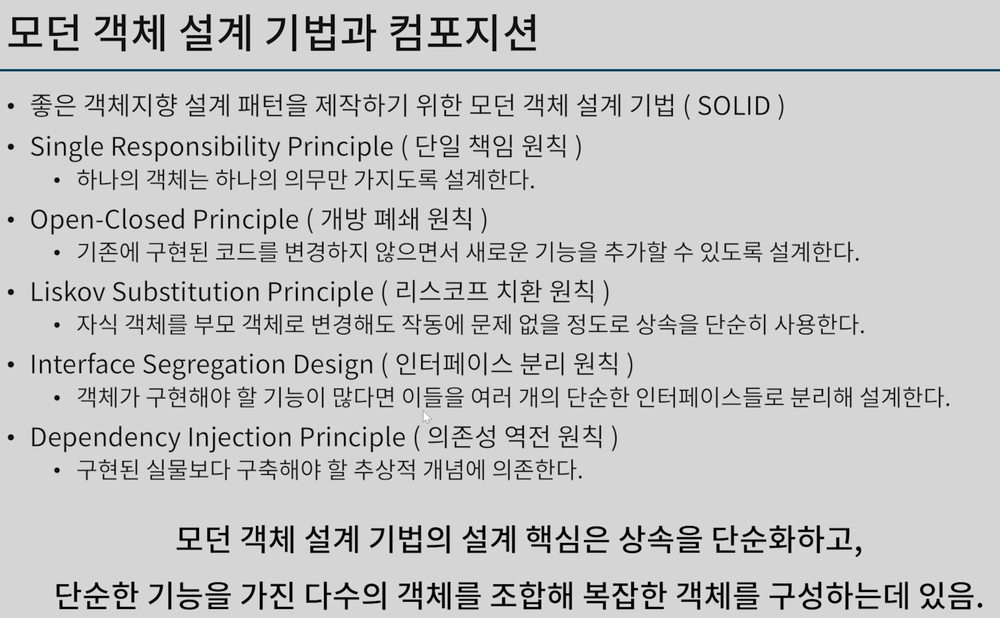

<b>언리얼 엔진의 컴포지션 구현 방법</b>

<ul>
<li>
<b>필수 포함 : </b>CDO에 미리 언리얼 오브젝트를 생성해 조합한다 
</li>
<li>
<b>선택 포함 : </b>CDO에 빈 포인터만 넣고 런타임에서 언링러 오브젝트를 생성해 조합한다.
</li>
</ul>

위 노드들이 필수 아래가 선택이다.

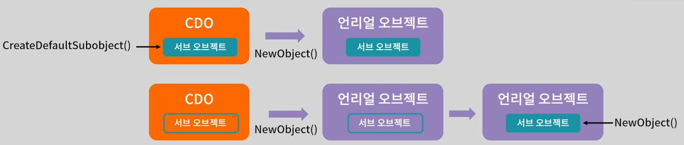

</details>

<details>
<summary>델리게이트</summary>

델리게이트를 이해하려면 느슨한 결합을 알고가야 된다고 한다.

### 강한 결합

- 클래스들이 서로 의존성을 가지는 경우를 의미한다.
  ex) 내가 만든 예제에서 person 클래스가 card(학교출입증)클래스를 사용하고 있었다

  이때 person은 card에 대한 의존성을 가진다고 한다.

  <b>만약 핸드폰에서도 인증할 수 있는 새로운 수단이 나오면??</b>

  - 기존에 구현한 자식 클래스들의 코드를 전부 수정해야한다.

### 느슨한 결합

- 강한 결합에서의 문제를 고치기 위해 나온 개념
  위 예에서 <s><b>카드</b></s>에 중점을 두는게 아니라 <b>인증이라는 수단에 중점을 두는 것이다.</b>

- 실물에 의존하지 않고 추상적 설계에 의존하라
- 인증을 처리하는 인터페이스 ICheck를 상속받은 card를 만들어서 처리한다.
  나중에 핸드폰 생기면 ICheck상속해서 핸드폰 만들면됨

<b>하지만</b>

매번 이렇게 행동마다 인터페이스 만들면 코드가 커지고 번거로워 질 수 있음

→ <b>함수를 오브젝트처럼 관리해보자!</b>

함수포인터랑 functional 있잖아요

→ 함수포인터는 복잡하고, functional은 느리다.

그래서 언리얼에서는 C#의 델리게이트 키워드를 가져왔다

- 함수를 객체처럼 다룰 수 있음
- 안정적이면서 간편한 선언

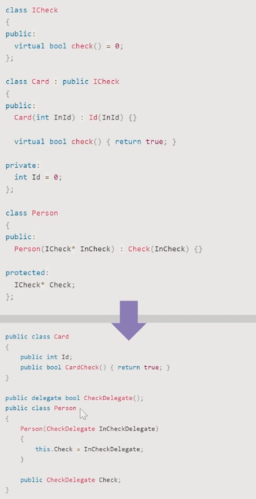

<b>페이로드 데이터</b>

- 묶는 객체에 대한 정보를 지정해서 하나의 구문으로 묶어준다.
  (그냥 문법인듯)

<b>사용 예제</b>

아무데서나 호출하기를 원하는 함수를 가진 클래스가 있다.

```c++
class FLogWriter
{
    void WriteToLog( FString );
};
```

해당 함수를 호출하려면 함수의 시그니처에 맞는 델리게이트 유형을 생성해야 한다.

```c++
DECLARE_DELEGATE_OneParam( FStringDelegate, FString ); // 델리게이트 매크로 사용!
```

사용 법칙은 아래와 같다


- <b>델리게이트 유형</b>
  - 1:1 형태로 c++만 지원시 유형은 공란으로
    DECLARE\_DELEGATE

  - 1:1 형태로 c++만 지원시 유형은 MULTICAST으로
    DECLARE\_MULTICAST\_DELEGATE

  - 1:1 형태로 블루프린트 지원시 유형은 DYNAMIC으로
    DECLARE\_DYNAMIC\_DELEGATE

  - 1:n 형태로 블프 지
    DECLARE\_DYNAMIC\_MULTICAST\_DELEGATE

- <b>함수 정보 세팅</b>
  <ul>
  <li>
  인자가 없고 반환값도 없으면 

  DECLARE\_DELEGATE
  </li>
  <li>
  인자가 하나고 반환값이 없으면 OneParam으로 지정한다.

  DECLARE\_DELEGATE\_OneParam
  </li>
  <li>
  인자가 세 개고 반환값이 있으면

  DECLARE\_DELEGATE\_RetVal\_ThreeParams

  (멀티캐스트는 반환값 지원 X)
  </li>
  <li>
  인자는 최대 9개까지 지원한다.
  </li>
  </ul>

발행 구독 디자인 패턴이란것도 알아야 된다고 한다.

아래 패턴 구현을 위해 델리게이트가 존재하는 것이기 때문

<details>
<summary>발행 구독 디자인 패턴</summary>

푸시 형태의 notification을 구현하는데 적합한 디자인 패턴

<b>발행자와, 구독자로 구분된다.</b>


이런 꼴로 생김 ㅇㅇ

- <b>콘텐츠 제작자 : </b>콘텐츠 생산
- <b>콘텐츠 발행자 : </b>콘텐츠 배포
- <b>콘텐츠 구독자 : </b>콘텐츠를 받아서 소비

제작자와 구독자가 서로를 몰라도 발행자를 통해 콘텐츠 생산, 전달, 소비가 이루어진다.

⇒ 느슨한 결합

- <b>장점</b>
  느슨한 결합

  유지보수가 쉽고 활용이 유연하며 테스트가 쉬워짐

  기능확장이 용이하고 시스템 스케일 유연하게 조절 가능

</details>

<b>델리게이트를 설계하기 위한 고려사항</b>

- <b>어떤 데이터를 전달하고 받을 것인가?</b>
  인자의 수와 각각의 타입을 설계해야 한다.

  - 몇 개의 인자를 전달할 것인가?
  - 어떤 방식으로 전달할 것인가?
  - 1:1전달
  - 1:n전달
- <b>프로그래밍 환경 설정</b>
  - c++ 프로그래밍에서만 사용할것인지
  - UFUNCTION(블루프린트 함수)와 사용할 것인지
- <b>어떤 함수와 연결할 것인가?</b>
  - 클래스 외부에 설계된 c++함수
  - 전역에 설계된 정적 함수
  - 언리얼 오브젝트의 멤버 함수 (대부분 이거씀 ㅇㅇ)

</details>

<details>
<summary>UStruct</summary>

UStruct는 언리얼의 구조체이다

<b>구조체 위에 USTRUCT() 매크로 추가하고</b>

<b>구현부 맨 위에 GENERATED\_BODY() 매크로 추가한다. (대부분)</b>

- 해당 매크로 선언해야 리플렉션, 직렬화같은 혜택 받음
- 매크로 선언했을때는 일반적인 USTRUCT가 아니라 UScriptStruct로 구현된다.
  - 제한적으로 리플렉션 지원한다
    UPROPERTY만 사용이 가능하고 UFUNCTION은 사용이 불가능하다.

구조체 안에도 UPROPERTY() 쓸 수 있다.

<b>구조체는 F로 시작하기 때문에 리플리케이션의 혜택을 받을 수 없다.</b>

<b>하지만 구조체 내 변수들은 UProperty라서 리플리케이션 가능</b>

- 굳이 리플렉션 관리 받고싶지 않으면 안해도 된다.
  <b>(UObject 멤버는 UProperty 무조건 해라!)</b>

구조체는 단순한 데이터 타입에 적합해서 복잡한 애들은 UObject, AActor 쓰자

</details>

<details>
<summary>언리얼 컨테이너</summary>

언리얼이 자체 제작해 제공하는 자료구조 라이브러리이다.

줄여서 UCL(unreal container library)라고한다.

언리얼 오브젝트를 안정적으로 지원하며 다수 오브젝트 처리에 유용하게 사용된다.

실제 게임에서는 TArray, TMap, TSet 쓴다

<b>그럼 STL 왜 안쓰고?</b>

- STL에는 기능이 너무 많아 엮여있어 컴파일 시간이 오래걸림
- 언리얼은 언리얼거에만 엮여있으니까 컴파일도 빠르고 언리얼 특화되어있음

<b>알고리즘 라이브러리</b>

Algo/\~\~\~.h 로 include 한다.

예를들어 Algo/Accumulate.h include 하면 

Algo::Accumulate(container, initvalue) 를 사용해 컨테이너 안의 값들의 합을 구할 수 있다.

Array Map Set 용도는 모두 같으나

Map과 Set은 구현방법이 상이하다.

### TArray

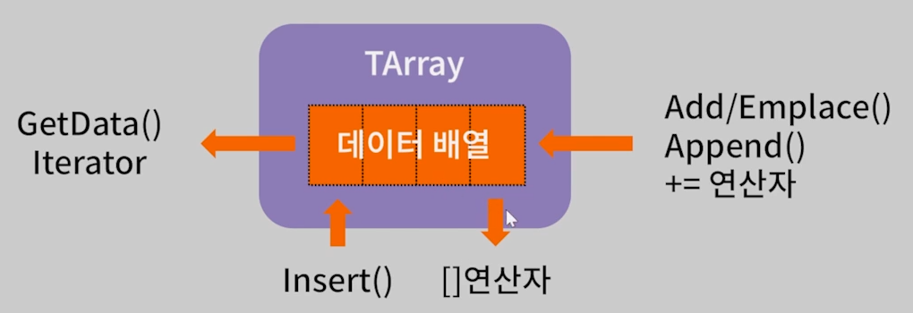

## TSet

<b>STL Set vs 언리얼 TSet</b>

<b>STL Set </b>

- 이진트리로 구성되어 있어서 정렬 지원
- 이진트리이기 때문에 메모리 구성 나쁨
- 요소 삭제시에 균형을 위한 재구성
- 자료구조 순회에 적합하지 않음

<b>언리얼 TSet</b>

- TSet은 해시테이블 형태라서 검색 빠름
- 동적 배열 형태로 데이터가 모여있음
- 따라서 순회가 빠름
- 데이터 삭제해도 재구축 X
- 동적배열에 비어있는 데이터가 있을 수 있음

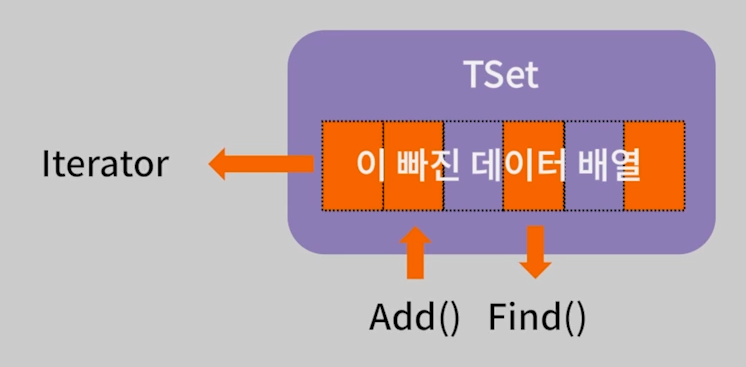

커스텀 구조체나 클래스를 TSet에 저장할 때는

value가 key로 hashing 되기 때문에 어떤 값을 해싱해줘야할지 또는 어떤 방식으로 해싱할지 정해주어야 한다.

```c++
uint32 GetTypeHash(const FCustomStruct& struct)
{
		return 	GetTypeHash(CustomStructData.Data); //Data는 int32형
}
```

### TMap

<b>STL Map vs 언리얼 TMap</b>

<b>STL Map </b>

- 이진트리로 구성되어 있어서 정렬 지원
- 이진트리이기 때문에 메모리 구성 나쁨
- 요소 삭제시에 균형을 위한 재구성
- 자료구조 순회에 적합하지 않음

<b>언리얼 TMap</b>

- TSet은 해시테이블 형태라서 검색 빠름
- 동적 배열 형태로 데이터가 모여있음
- 따라서 순회가 빠름
- 데이터 삭제해도 재구축 X
- 동적배열에 비어있는 데이터가 있을 수 있음

</details>

<details>
<summary>가비지 컬렉션</summary>

<b>GC란?</b>

- 프로그램에서 더 이상 사용하지 않는 객체를 자동으로 감지해 메모리를 회수하는 시스템
- 동적으로 생성된 모든 객체를 정보를 모아둔 저장소를 사용해 사용되지 않는 메모리 추적
- <b>마크 스윕(mark sweep) 방식의 GC</b>
  - 저장소에서 최초 검색을 시작하는 루트 객체를 표기
  - 루트 객체가 참조하는 객체를 찾아 mark 한다
  - 마크된 객체로부터 다시 참조하는 객체를 찾아 마크하고 이를 반복
  - 저장소에는 마크 된 객체와 그렇지 않은 객체로 나뉜다.
  - 마크 안된애들의 메모리를 회수한다 (sweep)

<b>언리얼의 GC</b>

- 마크 스윕 방식 자체 구축
- 지정된 주기마다 모아서 없앰 (default 60s)
  (한 번 생성된 언리얼 오브젝트는 바로 삭제가 불가능하다)

- 부하를 줄이기 위해 병렬처리, 클러스터링 등의 기능을 사용한다.

<p> </p>

언리얼에는 관리되는 모든 UObject의 정보를 저장하는 전역 변수

<b>GUObjectArray</b> 가 있다.

<b>GUObjectArray</b> 의 각 요소에는 Flag가 설정되어 있다.

<b>주요 플래그</b>

- Garbage flag : 다른 언리얼 오브젝트로부터의 참조가 없어 회수 예정인 오브젝트
- RootSet flag : 다른 언리얼 오브젝트로부터 참조가 없어도 회수되지 않는 특별한 오브젝트
  만약 시스템 내에서 계속 존재하길 원하는 오브젝트를 <b>AddToRoot 함수</b>를 호출해 플래그를 설정할 수 있다. 메모리 회수로부터의 보호를 풀려면 <b>RemoveFromRoot 함수</b>를 사용하자

  컨텐츠 오브젝트에 RootSet Flag 사용하는건 권장되지 않는다.

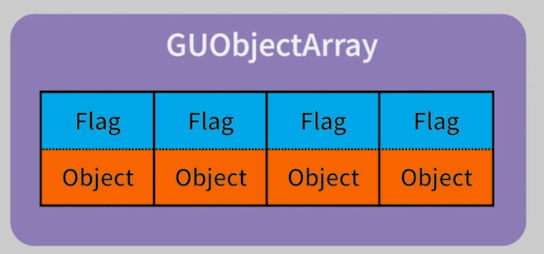

- 이 외에도 <b>UPROPERTY를 사용하면 객체가 GC에 회수되지 않는다.</b>
  만약 UPROPERTY 쓸 수 없는 상황이면 AddReferencedObject 함수를 통해 참조를 설정해라

<b>언리얼 내에서의 포인터 문제 해결</b>

c++에서는 아래 문제를 개선하기 위해 스마트포인터가 있긴하다.

- 메모리 누수
  - GC가 알아서 해준다
- 댕글린 포인터
  - 이거 확인하라고 IsValid 함수 있는거임
- 와일드 포인터
  - UPROPERTY 매크로 해주면 자동으로 nullptr로 초기화해줌

언리얼 내에서 오브젝트 포인터는 가급적 UPROPERTY쓰고 메모리는 GC가 알아서 하도록

냅둔다.

<b>언리얼 오브젝트 관리 원칙</b>

- 생성된 언리얼 오브젝트를 유지하기 위해 레퍼런스 참조 방법 설계
  - 언리얼 클래스내의 언리얼 오브젝트 : UPROPERTY사용
  - 일반 c++ 클래스내의 언리얼 오브젝트 : <b>c++클래스를 FGCObject 상속 후 구현</b>
    - AddReferencedObjects 함수를 오버라이드 한다.
      ```c++
      virtual void AddReferencedObjects(FReferenceCollector& Collector)
      {
      	if(UEObject->IsValidLowLevel())
      	{
      			Collector.AddReferencedObjects(UEObject);
      	}
      }
      ```
    - GetReferencerName 함수를 오버라이드 한다.
      ```c++
      virtual FString GetReferencerName () const override
      {
      	return TEXT("클래스명");
      }
      ```
- 생성된 언리얼 오브젝트는 강제로 지우려고 하지 말 것
  - 참조를 끊는다는 생각으로 설계하라
  - GC에게 후딱 회수하라고 시킬 수 있긴함 (ForceGarbageCollection함수)
  - 콘텐츠 제작에서 Destroy함수 쓸 수 있으나 내부 동작은 동일함 (GC에게 위임하는 것)

</details>

<details>
<summary>직렬화 (Serialization)</summary>

<b>직렬화란?</b>

- 복잡한 오브젝트 정보를 일렬로 정렬된 Byte Stream으로 변환하는 것
- 일렬로 저장된 데이터를 오브젝트로 복구하는 작업까지 포함<b>(Deserialization)</b>
- <b>장점</b>
  - 현재 프로세스 상태를 저장하고 필요한 때 복원 가능 (게임 저장)
  - 현재 객체 정보를 클립보드에 복사해 다른 프로세스에 전송 가능
  - 네트워크를 통해 현재 프로그램 상태를 다른 컴퓨터에 복원 가능 (멀티 플레이어 게임)
  - 직렬화 된 데이터는 압축, 암호화를 통해 효율적이고 안전하게 보관 가능

직렬화는 <b>일관성 있는 동작</b>을 만들기 위해 <b>다양한 상황을 고려</b>해야 한다.

- <b>데이터 레이아웃 </b>: 오브젝트가 가지고 있는 데이터를 어떤식으로 일렬로 세울지 기획 필요
- <b>이식성 </b>: 다른 시스템에 전송해도 똑같이 이식이 가능한지 고려
- <b>버전 관리</b> : 새로운 기능을 만들면 데이터 레이아웃이 바뀌어 직렬화가 무효화 될 수 있음
- <b>성능 </b>: 네트워크 비용을 줄이기 위해 어떤 데이터 형식을 사용할 것인가?
- <b>보안 </b>: 다른 사람들이 이 데이터를 봤을 때 오염이 불가능하게
- <b>에러 처리</b> : 전송 과정에서 문제가 발생할 경우 어떻게 인식하고 처리할지

언리얼에서는 <b>FArchive 클래스</b>로 직렬화 기능을 제공하고 있다.

- 메모리에 전송하는 메모리 아카이브 (FMemoryReader, FMemoryWriter)
- 파일 아카이브 (FArchiveFileReaderGeneric, FArchiveFileWriterGeneric)
- 기타 언리얼 오브젝트와 관련된 아카이브 클래스 (FArchiveUObject)
- Json 직렬화 기능도 별도 라이브러리를 통해 제공하고 있다.
  - <b>Json 직렬화</b>
    웹 환경에서 서버-클라가 데이터 주고받을 때 사용하는 텍스트 기반 데이터 포멧

  - Json 장점
    - 텍스트임에도 데이터 크기 가벼움
    - 사람이 이해하기 편함
    - 웹표준으로 널리널리 사용중
  - Json 단점
    - 지원하는 타입이 적음 (string, number, bool, null, array, object only)
      ex ) 숫자가와도 이게 int인지 long 인지 그런거 모름

    - 텍스트 형식으로만 사용 가능
      가벼운 텍스트지만 서버같은곳에서는 극한의 성능을 요구하는 바가 있기 때문에

      무겁긴함

  언리얼에서는 Json, JsonUtilities 라이브러리 사용한다.

  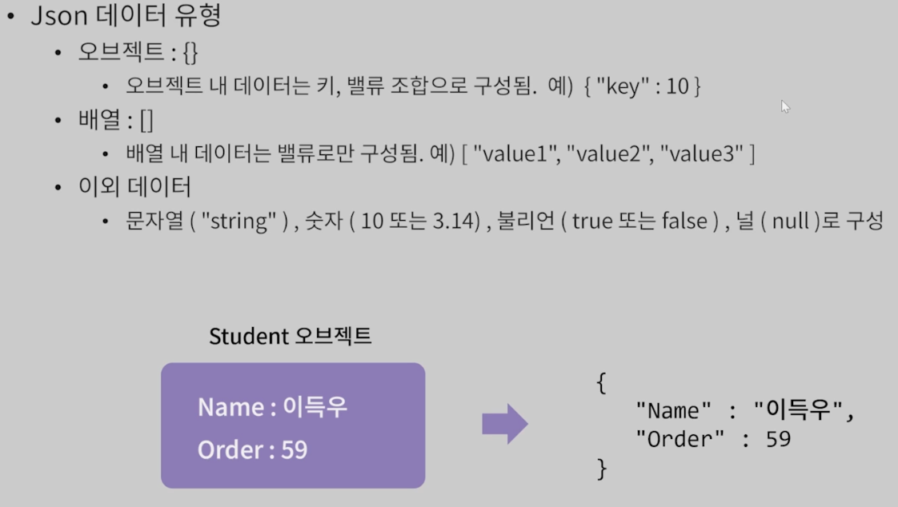

  ```c++
  #include "JsonObjectConverter.h"
  ...
  {
  	const FString JsonDataFileName(TEXT("StudentJsonData.txt"));
  	FString JsonDataAbsolutePath = FPaths::Combine(*SavedDir, *JsonDataFileName);
  	FPaths::MakeStandardFilename(JsonDataAbsolutePath);

  	// UEObj -> JsonObj
  	TSharedRef<FJsonObject> JsonObjectSrc = MakeShared<FJsonObject>();

  	// 스키마(데이터 구조)를 알아야 하기때문에 클래스 정보 넘김, 인스턴스 넘김, dest JsonObj 넘김
  	FJsonObjectConverter::UStructToJsonObject(std1->GetClass(), std1, JsonObjectSrc);
  																					// build.cs 에서 모듈 포함 가능 

  	// 빌드 오류 발생!!!
  }

  ```

  해당 코드에는 헤더만 include 되어있고 cpp파일은 모르기 때문에 라이브러리 연동해줘야한다.

  프로젝트.build.cs 파일에서 모듈(라이브러리)를 포함해야한다.

  ```c++
  PublicDependencyModuleNames.AddRange(new string[] 
  { ..., "Json", "JsonUtilities" });
  ```

</details>

<details>
<summary>언리얼 스마트 포인터</summary>

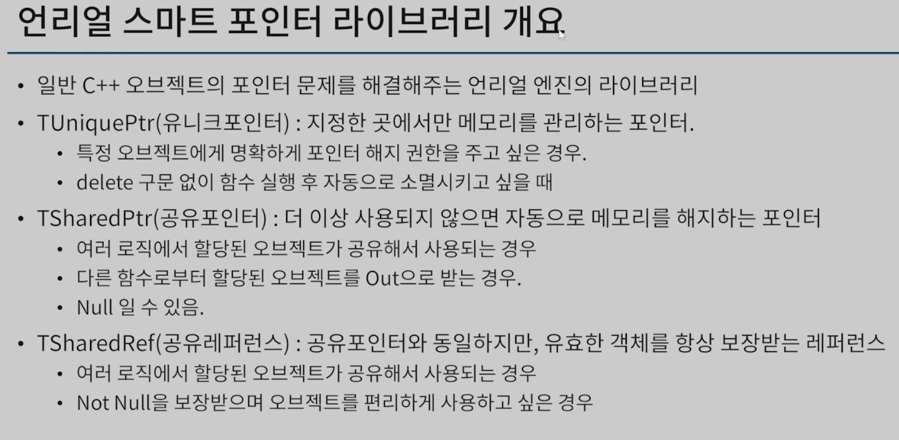

</details>

<details>
<summary>언리얼 오브젝트 패키지</summary>

단일 언리얼 오브젝트가 가진 정보는 저장할 수 있지만, 오브젝트들이 조합되어 있다면?

(우리가 관리하는 클래스 만들어도 되지만\~ 언리얼에서 제공한다.)

언리얼 오브젝트는 이를 위해 <b>UPackage 단위</b>로 언리얼 오브젝트를 관리한다.

<b>언리얼 오브젝트는 패키지는 언리얼 오브젝트를 감싼 포장 오브젝트이다.</b>

(게임 패키징, pkg 파일과는 다르다)

<b>패키지와 애셋</b>

우리가 지금까지 만들어본 모든 언리얼 오브젝트는 UPackage에 소속되어있다.

<b>애셋 : 언리얼 오브젝트 패키지의 서브 오브젝트</b>

애셋은 다시 다수의 서브 오브젝트를 가질 수 있고 이들은 패키지에 포함된다.(에디터 노출 x)

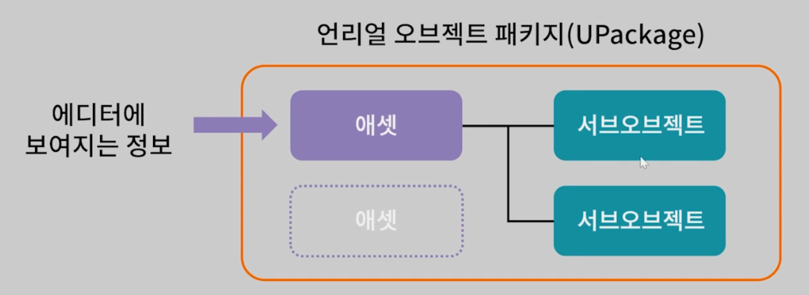

구조상 패키지는 다수의 언리얼 오브젝트를 가질 수 있지만 일반적으로는 한개만 가진다.

아래 사진의 <b><span>TopStudent가 AssetName</span></b>, <b><span>/Game/Student가 PackageName</span></b>이다.

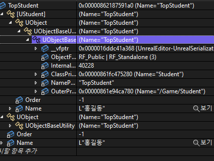

### 애셋 정보의 저장과 로딩 전략

- 게임 제작 단계에서 애셋 간의 연결 작업을 위해 직접 패키지를 불러 할당하는 작업은 부하가 크다.
  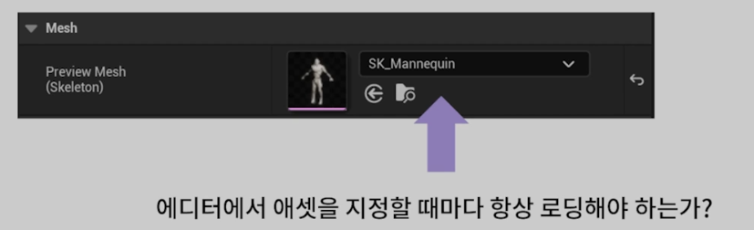

  - 애셋로딩 대신 패키지와 오브젝트를 지정한 문자열을 대체해 사용 (오브젝트 경로)
  - 오브젝트 경로값은 유일값 보장
  - 오브젝트간의 연결은 오브젝트 경로 값으로 기록 가능
- 애셋 로딩 전략
  - <b>프로젝트에서 애셋이 반드시 필요한 경우</b> : 생성자 코드에서 미리 로딩
  - <b>런타임에서 필요한 때 바로 로딩하는 경우</b> : 런타임 로직에서 정적 로딩
    - 이 경우 다른 프로세스의 실행을 막는다 (게임 멈춤)
  - <b>런타임에서 비동기적으로 로딩하는 경우</b> : 런타임 로직에서 관리자를 사용해 비동기 로딩

<b>오브젝트 경로</b>

- 패키지 이름과 애셋 이름을 한 데 묶은 문자열
- 애셋 클래스 정보는 생략 가능
- 패키지 내 데이터를 모두 로드하지 않고 오브젝트 경로를 사용해 필요 애셋만 로드가능


<a href="https://docs.unrealengine.com/4.27/ko/ProgrammingAndScripting/ProgrammingWithCPP/Assets/ReferencingAssets/">docs.unrealengine.com</a>

<b>애셋 스트리밍 관리자 (Streamable Manager)</b>

- 애셋의 비동기 로딩을 지원하는 관리자 체계
- 콘텐츠 제작과 무관한 싱글턴 클래스에 FStreamableManager를 선언해주면 좋음
  - GameInstance는 좋은 선택지
- 다수의 애셋 로딩 가능

</details>

<details>
<summary>언리얼 빌드 시스템</summary>

<b>언리얼 에디터 구성</b>

- 에디터 : 게임 제작을 위해 제공되는 응용 프로그램 (일반적으로 인식하는 엔진)
- 게임 빌드 : EXE파일과 리소스로 이루어진 독립적으로 동작하는 게임 클라이언트

에디터에서 기획과 개발을 완료하고 게임 빌드를 통해 게임을 만든다.

<b>블루프린트 프로젝트</b>

- c++ 코드가 없는 언리얼 프로젝트를 의미
- 언리얼 엔진이 제공하는 기본 기능을 활용해 게임을 제작하는 프로젝트
- 제작에 필요한 기능을 모듈이라는 단위로 제공
- 엔진의 모듈을 상속받아 블루프린트를 활용해 모든 기능과 로직 구현

프로젝트를 개발하다보면 프로젝트가 커질수록

내 프로젝트에 필요한 모듈을 설계해서 c++모듈로 만들 필요가 있다.

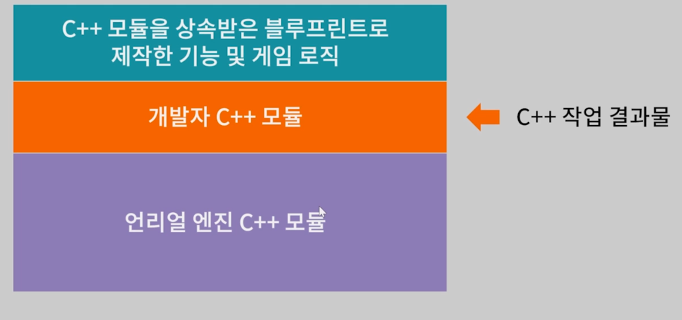

<b>언리얼 c++ 모듈</b>

- 언리얼 엔진의 소스코드는 모두 모듈 단위로 구성되어 있다.
- 모듈을 컴파일해서 에디터,게임에 제작한 로직 공급 가능

c++소스를 컴파일한 결과물은 아래와 같이 사용된다.

<b>에디터 : DLL동적 라이브러리</b>

<b>게임 : 정적 라이브러리</b>

<b>모듈 추가방법</b>

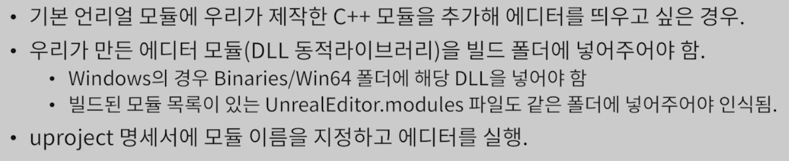

</details>

---

## 기타

<details>
<summary>프로젝트 레이어</summary>

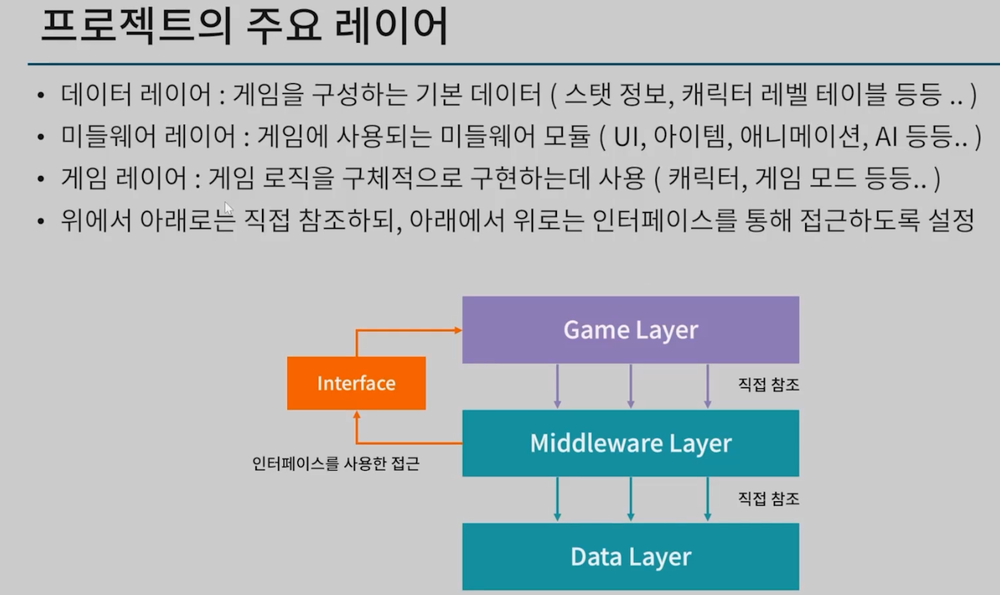

ex) 아이템을 먹었을때 캐릭터한테 특정 행동을 수행하라고 명령을 내리는 것은 인터페이스로 구현한다.

</details>

<details>
<summary>소프트레퍼런싱 vs 하드레퍼런싱</summary>

- 액터 로딩시 TObjectPtr로 선언한 멤버변수 언리얼 오브젝트도 따라 메모리에 로딩됨
  ⇒ <b>이게 하드 레퍼런싱임</b>

- 기본 클래스에 반드시 필수적인 오브젝트면 상관없지만 아이템은 먹으면 동적할당 하면 됨
- 이를 위해 필요한 데이터만 로딩하도록 TSoftObjectPtr로 선언하고 애셋 주소 문자열을 지정
- 애셋 로딩시간이 소요되긴하나 필요시에만 애셋을 로딩할수 있음

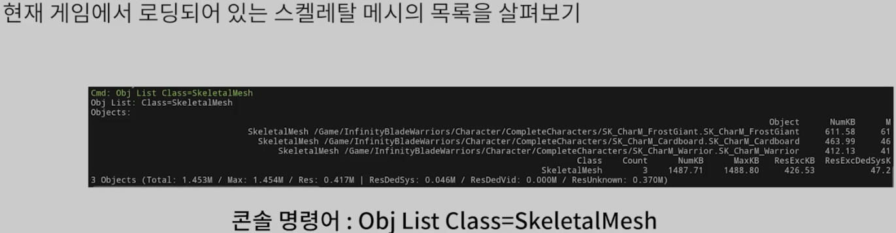

</details>
