---

### 

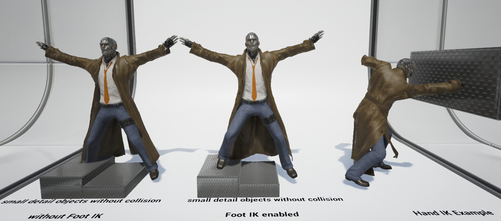

<i>왼쪽의 캐릭터는 IK 셋업을 사용하지 않은 것이고, 중간은 IK 를 사용하여 충돌하는 오브젝트에 발을 딛고 있습니다. 오른쪽은 IK 를 사용하여 캐릭터의 주먹이 움직이는 블록에 닿을 때 애니메이션을 중지시키도록 하고 있습니다.</i>

# <b>Kinematics(운동역학) 이란 ?</b>

IK를 설명하기전에 우선 애니메이션 분야에서 Kinematics(운동역학)이라는 개념이 존재한다.

모델에 리깅을 하여 관절부 움직임을 묘사함에 있어 역학관계 계산이 들어가는 것을 애니메이션 Kinematics이라고 한다.

Kinematics의 종류는 FK(Forward Kinematics), IK(Inverse Kinematic) 두 가지가 있다.

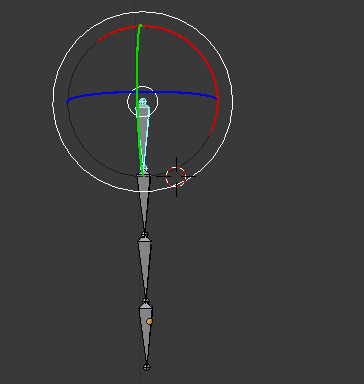 <em>FK</em>

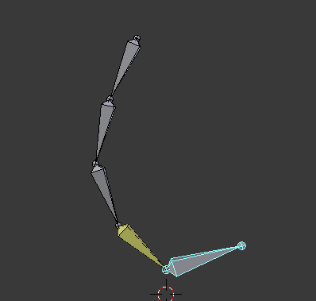 <em>IK</em>

영어 뜻과 기능을 생각하며 직역을 하면 FK는 전방 운동역학이고 IK는 역방향 운동역학이다.

쉽게 설명하자면 <b>FK</b>는 사람 관절로 주먹을 뻗는 동작이 있다고 하면 <b>어깨 -> 팔꿈치 -> 손목 </b>순으로 운동 에너지를 표현하고 <b>IK</b>는 반대로 물건을 집는 동작이면 <b>손목 -> 팔굼치 -> 어깨 </b>순으로 운동 에너지가 표현 될것이다.

언리얼 5부터는 샘플 모델에 IKBone이 내장되어있다.

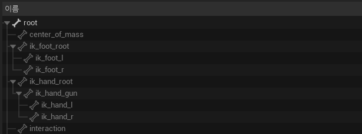

분석은 언리얼 3인칭 샘플 프로젝트와 

<a href="https://docs.unrealengine.com/4.27/ko/AnimatingObjects/SkeletalMeshAnimation/IKSetups/">docs.unrealengine.com</a>

위 문서에서 추천해준 Content Example 프로젝트를 기반으로 한다.

<b>1단계: Should Do IK Trace가 참이면 양발로 트레이스를 하고(사용자 정의 트레이스 기능을 사용하여) 트레이스 결과에서 Z 오프셋 대상을 설정합니다. Should Do IK Trace가 거짓이면 대상을 0으로 재설정합니다.</b>

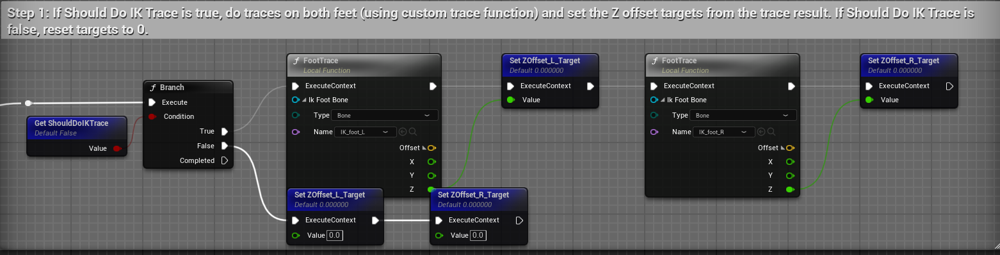

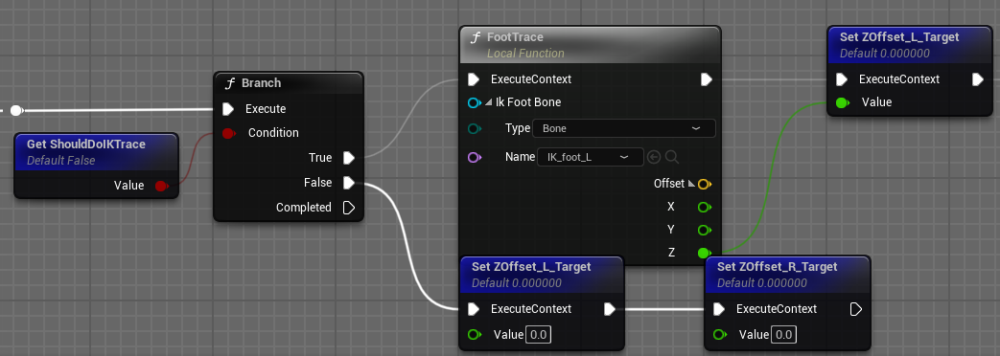

위 사진을 보면 IK 사용 플래그가 켜져있으면

<b>IK\_foot\_L Bone에 대해서 FootTrace라는 함수를 실행</b>한다 (IK\_foot\_L Bone도 마찬가지이다) 그리고 그 결과값을 ZOffset\_L\_Target이라는 변수에 저장한다.

<b>ZOffset\_L\_Target</b>은 아마 Foot\_L의 목표 Offset으로 보인다.

<b>반대로 플래그가 꺼져있으면 Offset은 0으로 간주한다.</b>

그럼 <b>FootTrace</b>함수를 보자

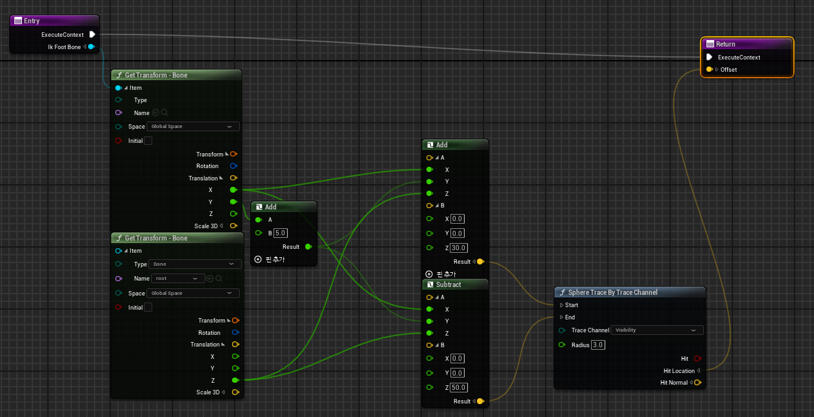

보면 Input으로 넣어준 <b>IK\_foot\_L Bone</b>의 XY와 root Bone의Z를 기준으로 연산한다. 아마 

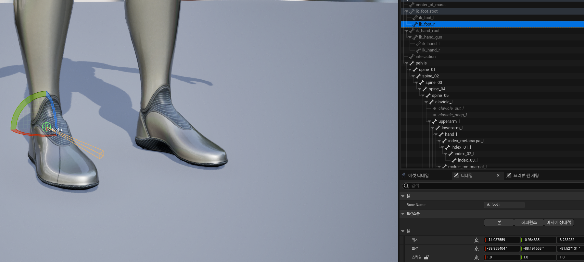

(Foot ik)

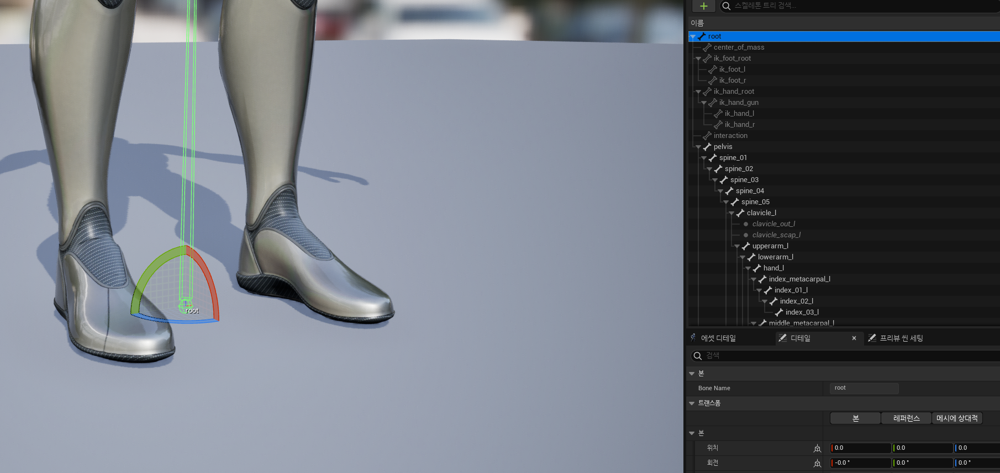

(root)

진정한 발바닥은 root이기 때문에 z는 root를 사용하는게 아닐까 싶다.

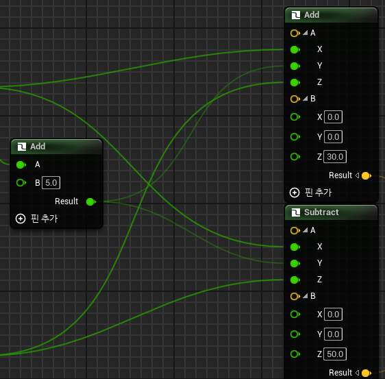

그리고 여기보면 Y에 오프셋 5를 더해주는데 왜 더하는지는 정확히 모르겠다. 왜 오른쪽으로 5만큼 움직인 값을 쓰지;;? 이럼 왼발 오른발 다르게 동작할거같기도.. 

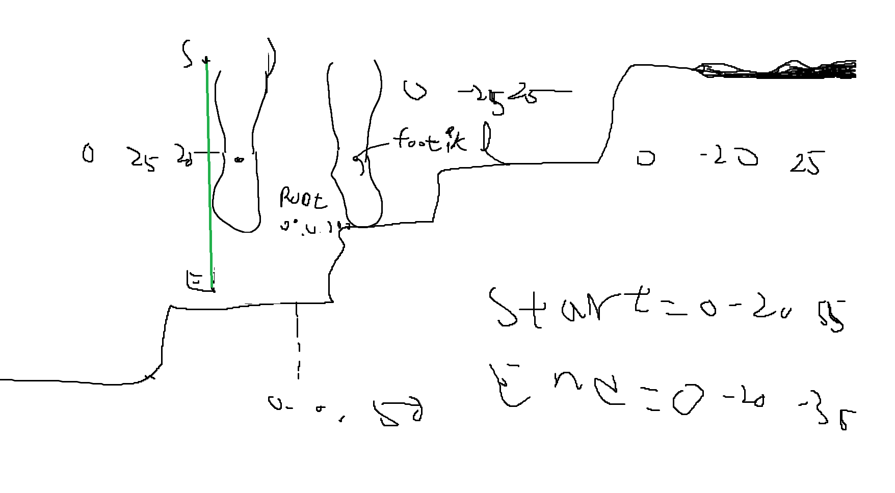

그림으로 그리면 대충 요로코롬 나올것 같긴하다.

<b>Sphere Trace의 End위치에 뭐가 걸리면 해당 값 (Offset)을 Return</b>하고 아니면 0을 Return하겠지

그리고 왜 30만큼 더해주는지도 모르겠음;; 발바닥에서 쏘는게 아니라 발바닥으로부터 30만큼 위에서 쏘는건 아직은 이해 안됨

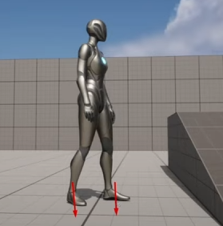

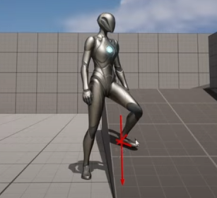

대충 이런 로직인거는 알겠음

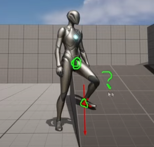

IK 관건은 이거임

내 발이 저깄고 고간이 저기있을때 <b>내 무릎은 어디에 둬야 하냐는거임</b>

<b>2단계: Z 오프셋을 목표 값을 향해 보간합니다.</b>

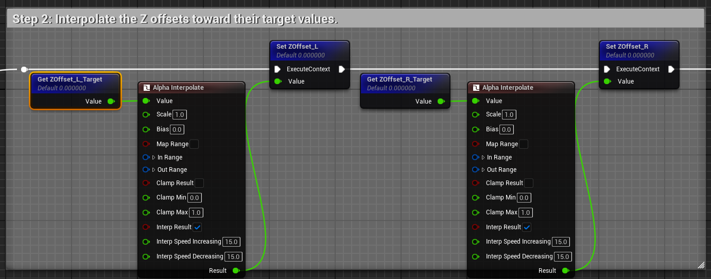

이렇게 발의 ZOffset을 TargetOffset으로 서서히 보간시켜서 움직인다.

Alpha interpolate의 멤버들

Value : 보간의 목표값

Scale : Value에 곱해지는 배수의 역할을 한다.

Bias : Value에 더해지는 값이다

Map Clamp 관련 기능은 모르겠다.

Interp Result를 끄면 값이 보간되지 않고 바로 바뀌고

맨 아래의 Speed관련된 것은 보간값이 증가하거나 줄어들때의 속도를 말한다.

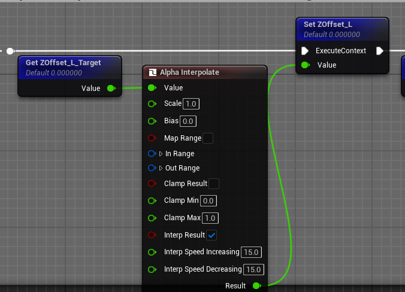

<b>3단계: 골반의 가장 낮은 발 오프셋을 사용하여 과도한 신장을 방지합니다.</b>

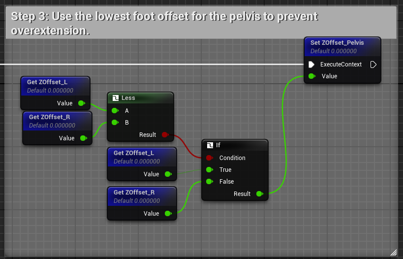

ㅎ
