<a href="https://docs.unrealengine.com/5.0/en-US/networking-and-multiplayer-in-unreal-engine/">docs.unrealengine.com</a>

---

## 개요

- <b>복잡하지만 강력하다</b>
  언리얼 네트워크 프로그래밍은 그냥 새로운 개발 방식을 배우는거랑 같다고 한다.

- <b>개발 초기단계부터 멀티플레이를 고려해서 만들어야한다.</b>
  싱글플레이로 완성한 게임을 리팩토링해서 멀티로 만드려면 싹다 뜯어고쳐야 할거임 아마도

  네트워크 속도와 안정성으로 인해 발생할 수 있는 기술적 병목 현상에도 대비할 수 없음

- <b>멀티플레이에서 잘 작동하면 싱글플레이어에서 완벽하게 동작한다.</b>

### <b>블루프린트가 아닌 C++쓰는 이유</b>

- 가상함수 활용 가능
- 제대로 된 리플리케이션 콜백 호출 가능
- 리플리케이션 조건의 세밀한 제어 가능
- 네트워크 전송 최적화 : 가벼운 데이터 설계

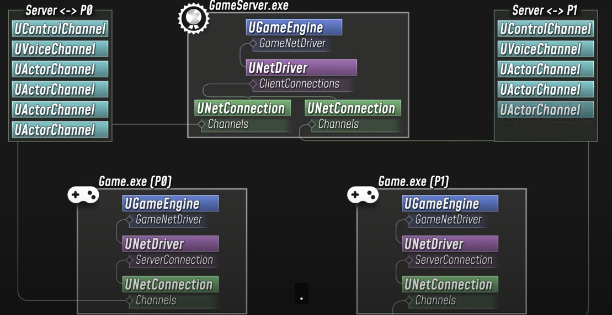

<details>
<summary>Client - Server Model</summary>

언리얼 네트워크 프로그래밍에서는 클라 - 서버 모델을 사용하고 있다.

네트워크에 있는 한 대의 컴퓨터가 <b>서버 역할</b>을 하며

<b>게임 세션을 호스팅, 다른 클라의 연결을 받는다.</b>

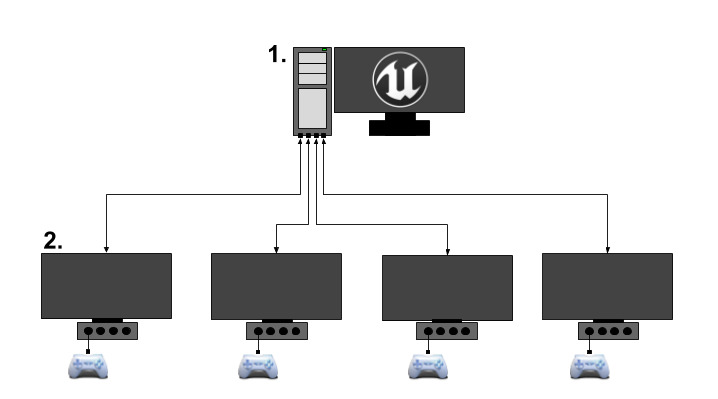

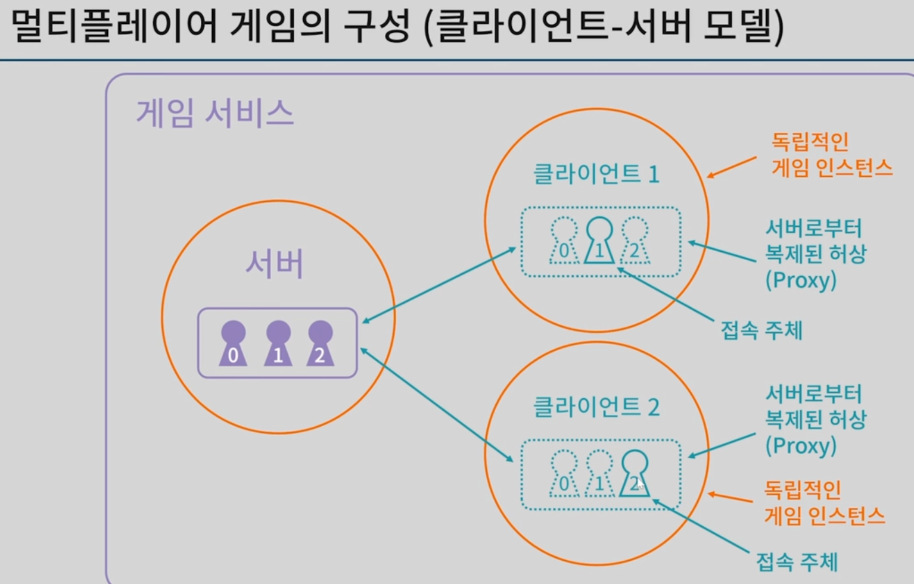

<b>서버는 연결된 각 클라들과 게임 상태 정보를 공유하고 서로 통신할 수 있는 수단을 제공한다.</b>

<b>로컬 플레이어 게임의 스탠드 얼론의 역할을 한다고 볼 수 있다. (서버만 놓고 봤을 때)</b>

<b>서버만을 믿을 수 있고, 어떤 현상이 일어날 때 반드시 서버를 통해서만 진행된다.</b>

서버는 멀티플레이어 게임이 실제로 진행되는 곳

서버에서 동작한 것이 실제 우리가 서비스하는 게임의 콘텐츠가 된다.

<b>클라이언트는 </b>각각 서버에서 자신이 <b>보유한 폰을 원격 제어</b>하여 게임 내 <b>동작을 수행하도록</b>

<b>프로시저 호출</b>을 보낸다.

렌더링까지 서버가 관여하는건 아니고 게임에 필요한 데이터들을 보내고

클라이언트에서 그 데이터들을 사용해 서버에서 일어나는 일의 근사치를 시뮬레이션 한다.

<b>로컬과 서버 로직 차이 예시</b>

<b>로컬</b>

1. <b>플레이어 1이 마우스 왼쪽 클릭</b>
   - 플레이어1의 폰이 투사체 발사 명령 받음
   - 플레이어1의 무기가 투사체 소환하고 fx sfx재생

2. <b>투사체가 앞으로 이동</b>

3. <b>플레이어1의 투사체가 플레이어 2와 충돌</b>
   - ApplyDamage → 플레이어2의 피격처리

<b>서버</b>

1. <b>플레이어 1이 마우스 왼쪽 클릭</b>
   - 플레이어1의 로컬 폰이 서버에 있는 상대 폰에게 무기 발사 명령 전달
   - 서버의 플레이어1의 무기가 투사체소환
   - 서버는 연결된 각 클라이언트에게 플레이어1의 발사체 사본을 생성하도록 지시
   - 서버에 있는 플레이어 1의 무기는 각 클라이언트에 투사체 관련 fx sfx재생

2. <b>서버에 있는 플레이어1의 투사체가 앞으로 이동</b>
   - 서버는 각 클라이언트에 플레이어 1의 투사체의 움직임을 그대로 복제하도록 지시하므로, 각 클라이언트의 플레이어1의 발사체가 이동한다.

   ( 만약 투사체의 이동을 클라에게 맡기면

   투사체의 이동방향을 마음대로 수정할 수 있을 것임)

3. <b>서버에서 플레이어1의 투사체가 플레이어 2와 충돌</b>
   - 서버에서 다른 클라이언트들에게 ApplyDamage → 플레이어2의 피격처리 정보 전달

네트워크 게임에서는 <b>각각의 플레이어가 다른 World에 존재하고 있다.</b>

플레이어1의 월드에 있는 다른 플레이어들은 단지 사본인 것이다.

<b>각 사본들은 서버에 있는 월드를 중심으로 시뮬레이션이 진행되어야 한다.</b>

모든 정보를 전송하기에는 너무 부하가 크기 때문에

게임 플레이 프로세스에 있어서 필수적인 정보들만 서버에 전달하는게 좋은 개발 방법이다.

<b>(네트워크 대역폭을 줄인다)</b>

</details>

<details>
<summary>Network Mode</summary>

네트워크 모드는 컴퓨터와 네트워크 멀티플레이어 세션과의 관계를 설명한다.

게임인스턴스는 아래 네트워크 모드들중 하나를 선택한다

<b>StandAlone </b>:  게임을 원격 클라이언트의 연결을 허용하지 않는 서버로 실행한다.

게임에 참여하는 모든 플레이어는 반드시 로컬플레이어이다. 

멀티 플레이어로 돌리려면 인풋을 여러개 꼽아야한다.

<b>Client </b>: 게임을 네트워크 멀티플레이어 세션에서 서버에 연결된 클라이언트로 실행한다

즉 서버 측 로직을 수행하지 않는다 (콘텐츠 즉 proxy만 보여주는 역할을 담당한다)

<b>Listen Server </b>: 게임을 네트워크 멀티플레이어 세션을 호스팅하는 서버로 실행한다.

원격 클라이언트의 연결을 수락하고 로컬 플레이어를 서버에 직접 배치한다.

해당 모드는 캐주얼 협동 및 경쟁 멀티플레이어에 자주 사용된다.

<b>Dedicated Server </b>: 게임을 네트워크 멀티플레이어 세션을 호스팅하는 서버로 실행한다.

원격 클라이언트의 연결을 허용하지만 로컬플레이어가 없다.

효율적인 실행을 위해 그래픽, 사운드, 입력 및 기타 플레이어 중심 기능을 삭제한다

따라서 이 모드는 더 지속적이고 안전한 대규모 멀티플레이어가 필요한 게임에서 주로 사용된다.

<details>
<summary>Listen Server</summary>

리슨 서버는 게임 어플리케이션이 있는 사용자라면 누구나 같은 컴퓨터에서 리슨 서버를 시작하고 플레이할 수 있다.

리슨 서버를 지원하는 게임에는 서버를 시작하거나 참여할 서버를 검색할 수 있는 별도의<br />게임 UI가 있는 경우가 많다.

리슨 서버를 호스팅하는 플레이어는 서버에서 직접 플레이하기 때문에 네트워크 연결을 통해 플레이해야하는 다른 플레이어보다 유리한 위치에 있어서 공정성/부정행위에 대한 우려 제기될 수 있음

또한 서버역할을 하면서 플레이어 관련 역할을 동시에 처리하게되어 추가적인 부하가 생길 수 있다.

위와같은 이유로 리슨서버는 대규모 멀티플레이어 게임에는 적합하지 않다.

</details>

<details>
<summary>Dedicated Server</summary>

데디서버는 클라우드 시스템같은게 필요하기 때문에 더 비싸고 구성이 어렵기 때문에 구성하기가 어려움이 있다. 게임에 참여하는 모든 플레이어는 별도의 컴퓨터가 필요하고 자체 네트워크 연결이 필요하다

하지만 데디서버에 참여하는 모든 플레이어는 동일한 유형의 연결로 게임을 경험하게 된다.

데디서버는 렌더링이나 로컬플레이어 관련 로직을 수행하지 않기 때문에 네트워킹에 전념할 수 있다.

따라서 보안/공정성/안정성/고성능이 필요할땐느 데디서버 쓰는게 좋다.

</details>

</details>

<details>
<summary>Connection Flow</summary>

<b>서버가 게임을 시작한 상태에서 클라이언트가 접속하는 과정</b>

멀티플레이어 게임 만들 때 처음부터 콘텐츠를 만들고 하는게 아니라

<b>클라이언트가 접속할 때 어떤 방식으로 서버가 이것을 처리하고</b>

<b>클라이언트가 그 정보를 받아서 어떻게 처리할지 설정해야한다.</b>

<details>
<summary>Login</summary>

<details>
<summary>Listen Server</summary>

<b><span>초기화 단계 (게임 서비스 준비)</span></b>

<ul>
<li>
서버를 담당할 어플리케이션을 실행되었지만 게임 시작 X
</li>
<li>
어플리케이션의 네트워크 활성화도 X (스탠드 얼론 상태) 
</li>
<li>
<b>심판역할을 담당하는 게임모드 액터만 존재</b>
</li>
</ul>

<b><span>플레이어의 로그인 (게임 서비스 준비)</span></b>

- <b>리슨서버는 서버역할을 하는 컴퓨터에서도 클라이언트로써 플레이</b>하기 때문에

게임에 참여하기위해 플레이어를 추가한다

- 정확히는 게임모드가 제공하는 로그인 과정을 통해 <b>플레이어를 대표하는 플레이어 컨트롤러(PC)</b>를 추가한다.

<b><span>리슨서버의 시작 (게임 서비스 시작)</span></b>

- <b>네트워크 기능이 켜지고 </b>어플리케이션의 네트워크모드가 <b>스탠드 얼론 → 리슨 서버로 바뀜</b>
- 클라이언트가 접속을 요청하면 서버에서는 받거나 거절 가능
- 플레이어가 접속하면 리슨서버에 PC 추가
- 서버에 있는 새로 들어온 클라이언트를 대표하는 PC를 매칭되는 클라이언트에 복제시켜줌 (게임 클라이언트와 관련된 항목들만 복제된다)

<b><span>게임의 시작</span></b>

- 게임정보를 알려주는 특별한 액터인 GameState액터를 클라이언트의 GameState에게<br />복제해준다.
- 게임이 시작할때 GameMode는 GameState→HandleBeginPlay 를 호출해서 월드의 액터들의 BeginPlay를 호출하는데
  <b>서버측 GameState의 게임이 시작되었다는 정보가 클라측의 GameState에 복제되어 반영되면 월드의 액터들의 BeginPlay를 호출한다.</b>

  따라서 클라측은 GameMode를 가지고 있지 않아도 액터들의 BeginPlay를 사용할 수 있는 것

</details>

<details>
<summary>Listen Server 코드</summary>

<details>
<summary><b>로그인 관련<br /></b></summary>

<b>AGameModeBase.h</b>

```c++
virtual void PreLogin(const FString& Options, const FString& Address, const FUniqueNetIdRepl& UniqueId, FString& ErrorMessage) override;
virtual APlayerController* Login(UPlayer* NewPlayer, ENetRole InRemoteRole, const FString& Portal, const FString& Options, const FUniqueNetIdRepl& UniqueId, FString& ErrorMessage) override;
virtual void PostLogin(APlayerController* NewPlayer) override;
virtual void StartPlay() override;
```

<b>PreLogin</b> : 클라이언트의 접속 요청을 처리

클라이언트가 접속을 요청했을때 요청을 받을지 말지 처리하는 함수

(따라서 리슨서버의 오너는 프리로그인을 진행하지 않는다)

아래처럼 에러메시지가 존재하면 요청을 거부한다.

```c++
void AABGameMode::PreLogin()
{
	Super::PreLogin(...);
	ErrorMessage = TEXT("Server is full!!");
}
```

에러메시지가 없어서 PreLogin을 통과해야 비로소 로그인이 진행된다.

```c++
void AGameModeBase::PreLoginAsync(const FString& Options, const FString& Address, const FUniqueNetIdRepl& UniqueId, const FOnPreLoginCompleteDelegate& OnComplete)
{
	FString ErrorMessage;
	PreLogin(Options, Address, UniqueId, ErrorMessage);
	OnComplete.ExecuteIfBound(ErrorMessage);
}
```

아마도 함수의 마지막줄의 FOnPreLoginCompleteDelegate에서 에러메시지가 있으면 접속을 거부하는 처리를 하는 것 으로 보인다.

접속이 거부되면 클라이언트는 스탠드얼론 상태로 존재하게 된다.

<b>Login</b> : 접속을 허용한 클라이언트에 대응하는 플레이어 컨트롤러 생성

생성한 컨트롤러를 해당 클라이언트에게 보내준다.

<b>PostLogin</b> : 플레이어 입장을 위해 플레이어에 필요한 기본 설정을 모두 마무리

플레이어 컨트롤러 이외에 게임을 시작할 수 있게 플레이어에게 필요한 속성들을 보내주는 과정

(새로 들어온 클라이언트의 컨트롤러가 PostLogin을 마치면 그 클라이언트에게 PlayerController를 넘겨주고 해당 클라이언트의 로컬에서 PlayerController의 BeginPlay를 <br />호출한다.)

<b>StartPlay</b> : 게임의 시작 지시

(게임이 시작될때 한번만 호출된다)

(예를들어 로비를 만들어서 사람이 차면 시작하는 방식이면 모든 클라이언트들이

StartPlay를 거치고 동시에 플레이어 컨트롤러의 BeginPlay를 호출할 것이다)

(우리 게임에서는 서버 엶과 동시에 시작하니까 다른 클라는 StartPlay못볼듯 하다)

<b>BeginPlay </b>: 게임 모드의 StartPlay를 통해 게임이 시작될 때 모든 액터에서 호출하는 함수

<b>AGameState.h</b>

```c++
virtual void HandleBeginPlay() override;
virtual void OnRep_ReplicatedHasBegunPlay() override;
```

<b>HandleBeginPlay </b>: GameMode가 StartPlay를 할 때 호출하는 함수

내부 코드를 보면

```c++
void AGameStateBase::HandleBeginPlay()
{
	bReplicatedHasBegunPlay = true;

	GetWorldSettings()->NotifyBeginPlay();
	GetWorldSettings()->NotifyMatchStarted();
}
```

이렇게 생겼다.

NotifyBeginPlay에서 액터들의 BeginPlay를 호출하고

NotifyMatchStarted에서 월드의 게임 시작을 알리는 듯 하다.

<b>OnRep\_ReplicatedHasBegunPlay</b> : 서버로부터 전송된 bReplicatedHasBegunPlay가 <br />로컬의(클라의)bReplicatedHasBegunPlay 변경하고 이를 감지하면 해당 함수를 실행한다.

쉽게 말해 bReplicatedHasBegunPlay는 서버에서 클라에게 게임을 시작하라는 신호이다.

얘도 내부코드를 보면

```c++
void AGameStateBase::OnRep_ReplicatedHasBegunPlay()
{
	if (bReplicatedHasBegunPlay && GetLocalRole() != ROLE_Authority)
	{
		GetWorldSettings()->NotifyBeginPlay();
		GetWorldSettings()->NotifyMatchStarted();
	}
}
```

HandleBeginPlay랑 같은 역할을 하고 있다.

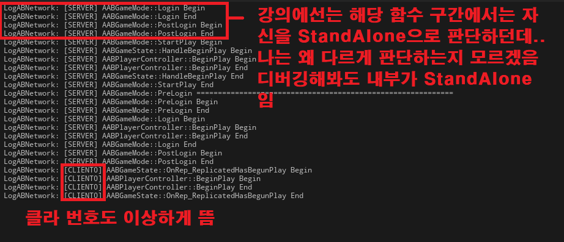

</details>

</details>

</details>

<details>
<summary>Connection</summary>

### 언리얼 엔진에서의 데이터 관리

- 네트워크에서 주고받는 데이터들은 다음과 같은 작업을 거친다.
  <b>Connection </b>: 모든 데이터들을 전달하는 네트워크 통로(통신망) 여기서 패킷을 주고받는것

  <b>Packet </b>: 네트워크를 통해 전달되는 단위 데이터. 숫자/문자로 구성

  <b>Channel </b>: 언리얼 엔진 아키텍쳐에 따라 구분된 데이터를 전달하는 논리적 통로

  <b>데이터의 용도에 따라 데이터를 구분하는 접속 단위</b>

  정리하면 데이터 패킷을 분석해 음성, 그래픽 등의 카테고리의 데이터로 라우팅한다는 말이다

  <b>1Connection : NChannel 구조</b>이다.

  <b>Connection에 의해 분석된 Data Packet은 Bunch라는 상위개념의 정보로 재구성된다.</b>

  <b>Bunch </b>: 언리얼 엔진의 아키텍쳐에 사용되는 데이터.

  <b>Bunch 정보</b>

  괄호 앞 DEFINE\_CONTROL\_CHANNEL\_MESSAGE 생략

  ```c++
  // message type definitions
  (Hello, 0, uint8, uint32, FString, uint16); // 초기 클라이언트 연결 메시지
  (Welcome, 1, FString, FString, FString); // 서버는 클라이언트에게 서버 레벨을 로드해도 괜찮다고 말합니다
  (Upgrade, 2, uint32, uint16); // 서버는 클라이언트에게 버전이 호환되지 않는다고 말합니다
  (Challenge, 3, FString); // 서버에서 무결성을 확인하기 위해 클라이언트 챌린지 문자열을 보냅니다
  (Netspeed, 4, int32); // 클라이언트에서 요청한 전송 속도 전송
  (Login, 5, FString, FString, FUniqueNetIdRepl, FString); // 게임에 참여할 수 있는 클라이언트 요청
  (Failure, 6, FString); // 연결 실패를 나타냅니다
  (Join, 9); // 최종 가입 요청(Spawn 플레이어 컨트롤러)
  (JoinSplit, 10, FString, FUniqueNetIdRepl); // 차일드 플레이어(splits 화면) 가입 요청
  (Skip, 12, FGuid); // 선택적 패키지 건너뛰기 클라이언트 요청
  (Abort, 13, FGuid); // 클라이언트가 언로드 요청으로 인해 아직 확인되지 않은 패키지를 중단했음을 서버에 알립니다
  (PCSwap, 15, int32); // 클라이언트가 서버에 Connection->Actor의 스왑을 완료했다고 말합니다
  (ActorChannelFailure, 16, int32); // 클라이언트는 서버가 보낸 Actor 채널을 열지 못했다고 서버에 말합니다(예: Actor archype을 직렬화할 수 없음)
  (DebugText, 17, FString); // 모든 클라이언트 또는 서버로 보낸 디버그 텍스트
  (NetGUIDAssign, 18, FNetworkGUID, FString); // 명시적 NetworkGUID 할당입니다. 이는 드물고 netguid가 직렬 클라이언트->서버로만 구성된 경우에만 발생합니다(이 msg는 서버->클라이언트로 이동하여 클라이언트에게 해당 경우에 사용할 ID를 알려줍니다)
  (SecurityViolation, 19, FString); // 서버는 클라이언트에게 보안을 위반하고 연결이 끊겼다고 말합니다
  (GameSpecific, 20, uint8, FString); // 처리를 위해 UGameInstance로 라우팅된 사용자 정의 게임별 메시지
  (EncryptionAck, 21);
  (DestructionInfo, 22);
  (CloseReason, 23, FString); // 클라이언트 NetConnection 닫기 이유, 분석/로깅
  (NetPing, 24, ENetPingControlMessage /* MessageType */, FString /* MessageStr */);
  ```

  <br />실제로 Input된 명령이 어떤 명령인지 파악하고 그 명령을 실제로 수행 

  하나에 명령에 대응하는 데이터 묶음 / 용도에 맞게 정돈된 데이터 묶음

  ex) 효율적인 데이터 전송을 위해 다수의 속성값을 묶어 한번에 네트워크를 보낼 때

  이 데이터 묶음을 Bunch라고 부른다.

- 데이터 통신을 관리하기 위한 대표 액터로 플레이어 컨트롤러가 주로 사용된다.
  네트워크 담당자 액터라고 보면 댐

  <b>현재 어플리케이션이 관리하고 있는 커넥션의 수만큼 만들어짐</b>

- 이러한 플레이어 컨트롤러는 각각의 커넥션에 대한 오너십을 가진다.

### <b>액터의 준비와 게임의 시작</b>

- <b>PostInitializeComponents </b>: 게임과 무관한 액터 설정의 초기화에 사용

```c++
void APlayerController::PostInitializeComponents()
{
	Super::PostInitializeComponents();

	if ( IsValid(this) && (GetNetMode() != NM_Client) )
	{
		// create a new player replication info
		InitPlayerState();
	}

//-------------------------------------------------------------------
SpawnPlayerCameraManager();
ResetCameraMode(); 

if ( GetNetMode() == NM_Client )
{
	SpawnDefaultHUD();
}

AddCheats();

bPlayerIsWaiting = true;
StateName = NAME_Spectating; // Don't use ChangeState, because we want to defer spawning the SpectatorPawn until the Player is received

}
```

코드를 보면 클라이언트가 아닌 경우에만 내부의 InitPlayerState()함수를 실행한다. 

하지만 취소선 하단의 로직은 수행해야해서 함수호출은 필요하다.

<ul>
<li>
<b>PostNetInit </b>: 원격 클라이언트에서 네트워크 관련 설정의 초기화에 사용

클라이언트가 서버에서 변경된 내용/초기화에 필요한 정보들의 수신이 마무리 되었을때 호출된다.

따라서 클라이언트에서만 호출됨

</li>
<li>
<b>BeginPlay </b>: 현재 로딩된 레벨에 대한 게임 진행에 필요한 초기화에 사용 
</li>
</ul>

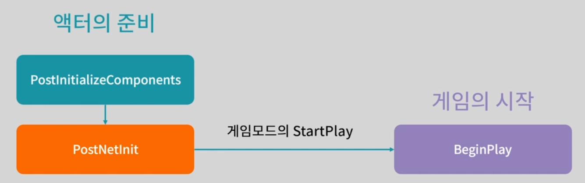

### <b>커넥션 구성</b>

언리얼엔진의 통신은 크게 HighLevel, LowLevel로 나뉜다.

<b>HighLevel</b> : <b>콘텐츠를 담당</b>하는 액터 컴포넌트 월드와 같은 속성에 관련된 상위 개념을 의미

<b>LowLevel</b> : <b>HighLevel을 네트워크를 통해 전달하기위해 만들어진 데이터 스트림</b>을 의미

ex ) 플레이어가 아이템을 습득하면 HighLevel에서는 폰의 속성값이 변경되고

이를 클라이언트에 전달하기 위해서는 지정된 규칙에 따라 데이터를 일련된 숫자의 흐름에 따라 네트워크로 전달해야한다.

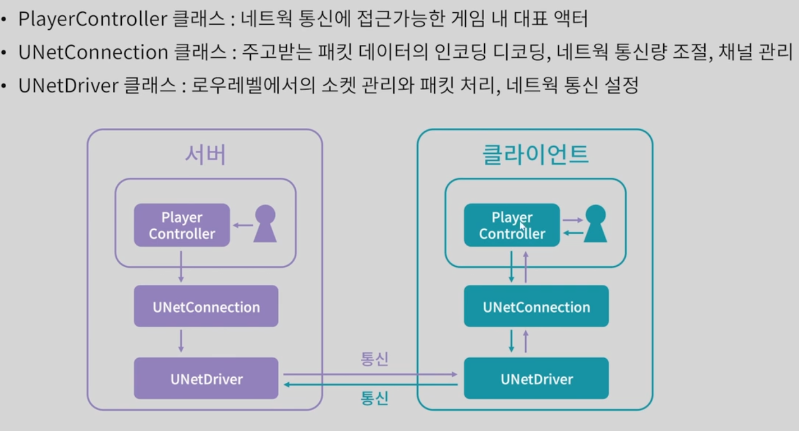

<b>UNetConnection</b> : 네트웍 통신을 담당 HighLevel 명령어를 LowLevel 데이터로 변환하는 기초작업 진행, 전체적인 과정에서 네트워크통신이 원활하게 진행되도록 대역폭, 흐름등등 조정하는 역할

<b>UNetDriver </b>: UNetConnection에서 정돈된 데이터를 실제로 네트워크에 올리는 LowLevel 기능 담당

<b>서버에서 네트워크에 데이터 올리면 클라이언트는 UNetDriver 로 이를 받아서 PlayerController까지 올리는 작업을 수행한다.</b>

### <b>서버의 NetDriver 초기화 과정</b>

- 현재 월드에 NetDriver가 있으면 클라-서버, 없으면 스탠드얼론으로 판단
  UWorld::InternalGetNetMode() 함수를 통해 NetMode가 어떻게 파악되는지 확인 가능

  ```c++
  ENetMode UWorld::InternalGetNetMode() const
  {
  	if (NetDriver != nullptr) // 통신 담당하는 NetDriver  설정되어있으면
  	{
  		const bool bIsClientOnly = IsRunningClientOnly();
  		return bIsClientOnly ? NM_Client : NetDriver->GetNetMode(); // 아래 코드블록 확인
  		// 클라 서버인지 판단해 둘중에 하나를 리턴함
  	}

  	// Use replay driver's net mode if we're in playback or ticking recording
  	if (DemoNetDriver && (DemoNetDriver->IsPlaying() || (DemoNetDriver->IsRecording() && DemoNetDriver->IsInTick())))
  	{
  		return DemoNetDriver->GetNetMode();
  	}

  	ENetMode URLNetMode = AttemptDeriveFromURL();
  #if WITH_EDITOR
  	if (WorldType == EWorldType::PIE && (URLNetMode == NM_Standalone || PlayInEditorNetMode == NM_DedicatedServer))
  	{
  		// If we're early in startup before the net driver exists and there is no URL override
  		// or this is a dedicated server, use the mode we were first created with
  		// This is required for dedicated server/listen worlds so it is correct for InitWorld
  		return PlayInEditorNetMode;
  	}
  #endif
  	return URLNetMode;
  }
  ```

  ```c++
  ENetMode UNetDriver::GetNetMode() const
  {
  	// Special case for PIE - forcing dedicated server behavior
  #if WITH_EDITOR
  	if (World && World->WorldType == EWorldType::PIE && IsServer())
  	{ // pie 상황이고 내가 서버일때 여기로 들어오는듯?
  		//@todo: world context won't be valid during seamless travel CopyWorldData
  		FWorldContext* WorldContext = GEngine->GetWorldContextFromWorld(World);
  		if (WorldContext && WorldContext->RunAsDedicated)
  		{ // 만약 월드를 데디로 플레이중이면 넷모드가 데디로된다.
  			return NM_DedicatedServer;
  		}
  	}
  #endif

  	// Normal
  	// PIE아니면 여기로 PIE여도 데디 아니면 여기로 올듯
  	// 내가 서버면서 클라이언트면 리슨서버
  	// 내가 서버면서 클라 아니면 데디서버
  	// 서버 아니면 클라
  	return (IsServer() ? (GIsClient ? NM_ListenServer : NM_DedicatedServer) : NM_Client);
  }
  ```
- 서버는 월드의 Listen함수를 호출해 NetDriver를 생성함으로써 네트워크 기능 시작
  UWorld::Listen함수를 통해 서버가 어떻게 시작되는지 살펴볼수 있음

  ```c++
  bool UWorld::Listen( FURL& InURL )
  {
  #if WITH_SERVER_CODE
  	LLM_SCOPE(ELLMTag::Networking);

  	if( NetDriver ) // 넷드라이버 이미 있으면 NetDriverAlreadyExists 실패
  	{
  		GEngine->BroadcastNetworkFailure(this, NetDriver, ENetworkFailure::NetDriverAlreadyExists);
  		return false;
  	}

  	// 넷드라이버 없으면 Create net driver.
  	if (GEngine->CreateNamedNetDriver(this, NAME_GameNetDriver, NAME_GameNetDriver))
  	{
  		NetDriver = GEngine->FindNamedNetDriver(this, NAME_GameNetDriver);
  }
  ```

### 넷드라이버의 커넥션 관리

- 넷드라이버는 넷 모드에 따라 다수의 커넥션을 관리하고 있다.
  넷드라이버가 서버냐 클라냐에 따라 다르게 동작

  <b>서버 : 넷드라이버가 다수의 클라이언트 커넥션 소유</b>

  <b>클라 : 하나의 서버 커넥션 소유</b>

  언리얼에서는 이 특성을 이용해 <b>현재 어플리케이션이 서버모드인지 클라인지 구별한다</b>.

  ```c++
  bool UNetDriver::IsServer() const
  {
  	// Client connections ALWAYS set the server connection object in InitConnect()
  	// @todo ONLINE improve this with a bool
  	return ServerConnection == NULL;
  }
  ```

  따라서 서버와 연결된 커넥션이 없으면 서버이다 ㅇㅇ

  주석으로 보면 클라는 항상 InitConnect에서 서버커넥션을 만든다고 한다. 

### <b>Connection Handshaking</b>

- 네트워크로 접속하는 두 컴퓨터가 잘 연결되었는지 확인하는 과정

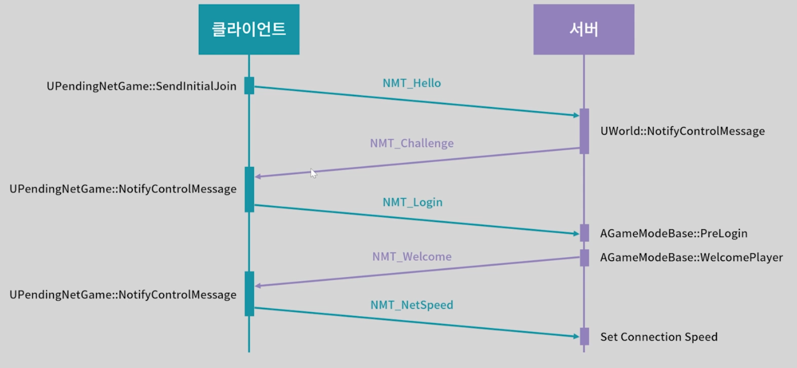

<b>커넥션 핸드셰이킹의 확인</b>

DataChannel.h : 서버와 클라이언트가 통신하는 사용하는 패킷들이 정의되어있음

UWorld::NotifyControlMessage : 서버가 패킷을 처리하는 노티파이 컨트롤 메시지

UPendingNetGame::NotifyControlMessage : 클라가 패킷 처리하는 노티파이 컨트롤 메시지<br />

ControlMessage에서 다양한 Bunch들 처리하는데 클라가Challenge 수신에 성공했을때 로그인을 시도한다. (Login Bunch 전송)<br />로그인에 성공하면 클라에게 Welcome보내고 클라가 받으면 클라가 서로의 대역폭을 조정하는 NetSpeed Bunch를 전송하게 된다.

이 모든 작업이 완료되면 Map을 로딩한다.

### Ready Game

- 커넥션을 허용하면 게임을 시작할 수 있도록 클라이언트와 서버가 준비과정을 거친다.
- <b>클라이언트 : 맵 로딩,                 서버 : 클라이언트를 대표하는 플레이어 컨트롤러 생성</b>

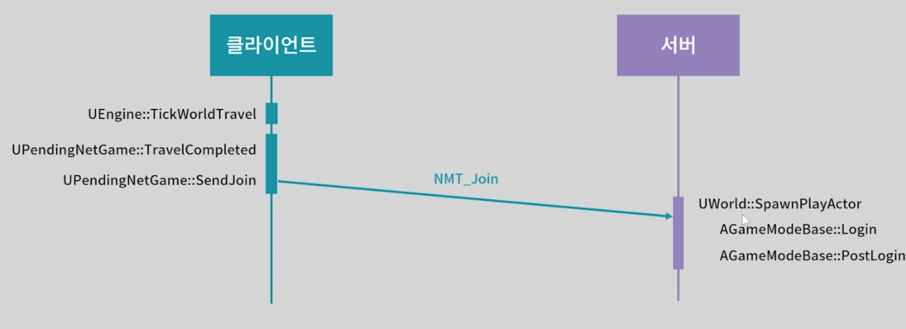

Map 로드가 끝나면 Join Bunch를 전송한다.

서버가 패킷 받으면 Actor를 생성하고 Login에서 PC(컨트롤러)를 접속시키고 PostLogin진행한다.

언리얼 네트웍 시스템 구성은 NetDriver.h의 헤더에 이쁘게 정리되어있다고 한다.

- [NetDriver.h요약](netdriver-%EC%86%8C%EC%8A%A4-%EC%9D%BD%EA%B8%B0-d05aa580.md)

</details>

<details>
<summary>Ownership</summary>

### 액터와 그 접속 소유

Connection이 생기면 PlayerController가 있고, <b>해당 PlayerController는 Connection에 소유된다.</b>

일반적으로 액터가 Connection에 소유되었는지 알아보려면, 액터의 가장 바깥쪽 Owner가 PlayerController인지 확인하고 맞았을시 그 액터 역시 PlayerController를 소유중인 Connection에 소유되어 있는 것이다.

ex ) Pawn이 PlayerController에 빙의되어있고 해당 PlayerController가 Connection에 소유중이라면 해당 Pawn도 Connection에 소유되는 것이다.

빙의가 풀리면 소유권 점유가 해제된다.

<b>Connection(접속) 소유권은 몇가지 이유로 중요하다.</b>

- RPC를 호출할때 접속소유권이 있어야한다.
  RPC는 접속 소유권에 따라서 어떤 클라이언트RPC를 실행될지 결정된다.

- 리플리케이션에 있어서 필터링 관련해서 중요해보인다
  소유권을 가진 액터에 대해서만 리플리케이션을 수행해 최적화를 하는듯

  - 액터 리플리케이션 및 접속 연관성에서도 중요하다
  - 오너가 연관된 경우의 액터 프로퍼티 리플리케이션 조건 때문이다.

### Actor와 PlayerController의 NetConnection

- 어떤 액터가 통신을 하기 위해서는 자신을 소유한 액터가 커넥션을 소유하고 있어야한다.
- 일반적으로 PC는 NC를 소유하고 있다.
- NC역시 PC를 소유하고 있다.

<b>Actor, PC, Pawn의 GetNetConnection  함수 비교</b>

```c++
UNetConnection* AActor::GetNetConnection() const
{
	// 액터에 대한소유자가 있을때 액터의 Connection을 가져온다.
	return Owner ? Owner->GetNetConnection() : nullptr;
}
```

```c++
UNetConnection* APlayerController::GetNetConnection() const
{
	// A controller without a player has no "owner"
	// 플레이어가 존재하면 실제 NC를 반환한다.
	return (Player != NULL) ? NetConnection : NULL;
}
```

```c++
class UNetConnection* APawn::GetNetConnection() const
{
	// if have a controller, it has the net connection
	// 컨트롤러 있으면 컨트롤러 넷커넥션
	if ( Controller )
	{
		return Controller->GetNetConnection();
	}
	// 아니면 액터의 넷커넥션
	return Super::GetNetConnection();
}
```

<details>
<summary>Ownership 생성 확인코드</summary>

```c++
virtual void OnPossess(APawn* PawnToPossess) override;
```

```c++
void APlayerController::OnPossess(APawn* PawnToPossess)
{
		...
		PawnToPossess->PossessedBy(this);
		...
	}
}
```

```c++
void APawn::PossessedBy(AController* NewController)
{
	SetOwner(NewController);
	
	AController* const OldController = Controller;

	Controller = NewController;
}
```

PossessedBy를 호출하면 Pawn에서 인자로 들어온 컨트롤러를 Owner로 설정한다.

<b>Actor.h </b>에 리플리케이션을 사용하고 있다.

리플리케이션을 사용해서 서버에서 복제해주기 때문에 Owner값이 동기화 된다고 한다.

```c++
UPROPERTY(ReplicatedUsing=OnRep_Owner) // Owner값 변경시OnRep_Owner호출
TObjectPtr<AActor> Owner;
```

</details>

클라측에서 Ownership을 설정해주는 것은 의미가 없다.

네트워크를 진행할 때는 서버에 있는 액터에 Owner가 설정되어야 하기 때문

</details>

<details>
<summary>ActorRole</summary>

네트워크 멀티플레이어 게임을 만들게 되면 서버-클라간의 다양한 액터가 존재하게 된다.

이러한 <b>액터들에게는 역할이 부여</b>되는데

이 액터들중 항상 <b>서버에 있는 액터만 신뢰</b>된다. (Authority 를가진다)

<b>클라이언트는 이러한 서버 액터를 복제한 것에 불과</b>하다. (Proxy라고 부른다)

따라서 게임 플레이에 영향을 미치는 게임 로직은 서버인지 파악해서 서버에서만 동작하도록 해야함

언리얼에서는 역할이라는 설정으로 액터가 신뢰할 수 있는지를 파악한다.

<b>언리얼에서는 enum 값으로 액터의 role을 기록한다.</b>

```c++
UENUM()
enum ENetRole : int
{
	/** No role at all. */
	ROLE_None,
	/** Locally simulated proxy of this actor. */
	// 액터 존재 X
	ROLE_SimulatedProxy,
	/** Locally autonomous proxy of this actor. */
	// 일방적으로 서버로부터 데이터를 수신하고 이를 반영
	ROLE_AutonomousProxy,
	/** Authoritative control over the actor. */
	// 클라의 Input정보를 서버에 보내는 능동적인 역할 일부 수행
	ROLE_Authority,
	// 서비스를 대표하는 신뢰할 수 있는 역할. 게임 로직 수행
	ROLE_MAX,
};
```

이 액터의 역할을 파악하고 사용할 수 있는 API가 있음

```c++
AActor::HasAuthority // 이 액터가 신뢰 할 수 있는지 확인
AController::IsLocalController
APawn::IsLocallyControlled

APawn::GetLocalRole();
APawn::GetRemoteRole();
```

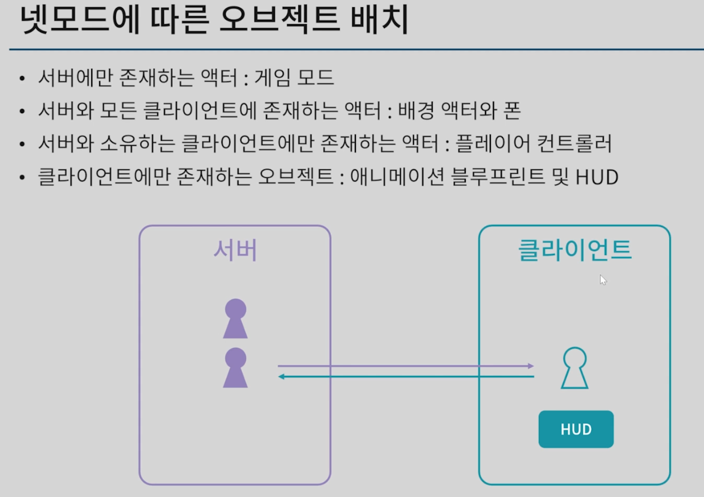

<b>서버 구동</b>

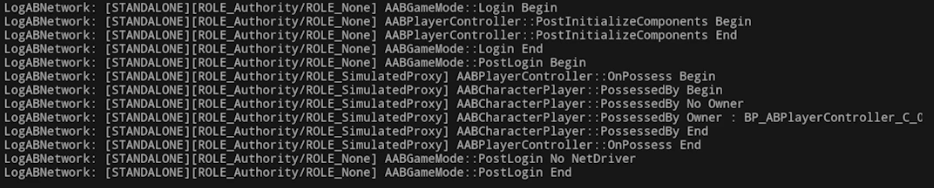

서버 역할을 하는 클라이언트는 로그인에 성공하면 RemoteRole이 None에서 Simulate로<br />바뀐다.

<b>새로운 클라이언트를 추가한다.</b>

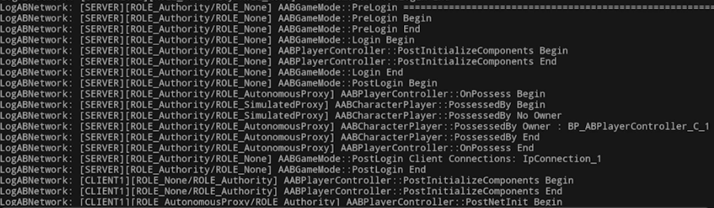

연결 후에 OnPosses로 빙의가 되고 나면 Controller는 Input을 수행하는 Autonomous가 된다.

</details>

</details>

<details>
<summary>Actor Replication</summary>

<b>액터 리플리케이션이란?</b>

Replication : 복제

- 특정 플레이어에 속한 액터의 정보를 네트워크 내 다른 플레이어에게 복제하는 작업<br />서버와 클라이언트간에 동일한 액터가 나타나도록 처리하는 기능
- 클라 - 서버 모델에서는 대부분 서버 → 클라로 전달.
  (서버만이 Authority를 가지기 때문)

  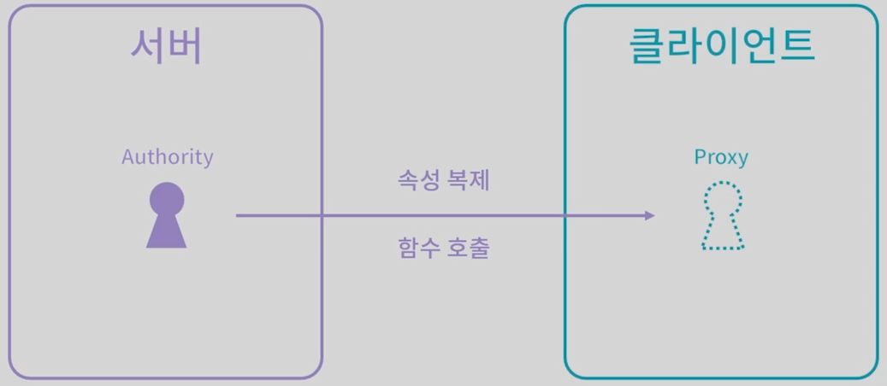
- <i><b><u>리플리케이션 방법</u></b></i>
  <details>
  <summary>  Property Replication (속성 리플리케이션)</summary>

  <b>속성 동기화 : 액터가 가지고 있는 속성을 동기화한다.</b>

  RPC보다는 반응속도가 느리지만 게임을 구성하는 주요한 속성을 확실하게 전달할 때 사용

  <b>리플리케이션 프로퍼티(속성)의 지정</b>

  1. 액터의 리플리케이션 속성을 참으로 지정한다.<br />bReplicates 속성을 true로 설정
  2. 네트워크로 복제할 액터의 속성을 키워드로 지정<br />UPROPERTY에 Replicated 키워드 설정
  3. GetLifetimeReplicatedProps 함수를 오버라이드하고 이 함수에 네트워크로 복제할 속성을 추가<br />#include “Net/UnrealNetwork.h” 추가<br />DOREPLIFETIME 매크로를 사용해 복제할 속성을 명시<br />함수 이름의 LifeTime은 액터 리플리케이션에 사용할 ActorChannel의 LifeTime을 의미한다.

  ```c++
  #include "Prop/ABFountain.h"
  #include "Components/StaticMeshComponent.h"
  #include "Net/UnrealNetwork.h"


  AABFountain::AABFountain()
  {
   ...
  	bReplicates = true;
  }

  // Called every frame
  void AABFountain::Tick(float DeltaTime)
  {
  	Super::Tick(DeltaTime);

  	if (HasAuthority()) // 리슨서버라서 클라이언트 로직과 따로 분리해야 한다.
  	{
  		AddActorLocalRotation(FRotator(0.f, RotationRate * DeltaTime, 0.f));
  		ServerRotationYaw = RootComponent->GetComponentRotation().Yaw;
  	}
  	else // 클라에서는 전송된 ServerRotationYaw를 반영해야 한다.
  	{
  		FRotator ClientRotator = RootComponent->GetComponentRotation();
  		ClientRotator.Yaw = ServerRotationYaw;
  		RootComponent->SetWorldRotation(ClientRotator);
  	}
  }

  void AABFountain::GetLifetimeReplicatedProps(TArray<FLifetimeProperty>& OutLifetimeProps) const
  {
  	Super::GetLifetimeReplicatedProps(OutLifetimeProps);

  	DOREPLIFETIME(AABFountain, ServerRotationYaw);
  }
  ```

  <b>위 코드의 문제가 뭐냐 하면 프로퍼티 업데이트를 매 틱마다 해주고 있다.</b>

  - 매 프레임마다 실행되는 틱의 코드가 방대해짐
  - 상대방의 네트워크 전송 주기가 틱보다 느리면 쓰잘때기없는 틱의 호출로 손해를 본다.
  - 따라서 콜백함수를 사용하여 클라이언트에 속성이 복제될 때 호출되도록 처리한다.
    1. 클라이언트에 속성이 복제될 때 콜백함수가 호출되도록 구현
       - UPROPERTY의 Replicated 키워드를 ReplicatedUsing 키워드로 변경
       - ReplicatedUsing에 호출할 콜백 함수 지정
       - 호출될 콜백 함수는 UFUNCTION으로 선언해야함
    2. 콜백 함수의 구현
       - 일반적으로 OnRep\_의 접두사를 가지는 이름 규칙을 지님
       - 콜백 함수는 서버가 아닌 클라에서만 호출됨

  <b>AFountain.h</b>

  ```c++
  UFUNCTION()
  void OnRep_ServerRotationYaw();

  UPROPERTY(ReplicatedUsing = OnRep_ServerRotationYaw) // 함수 이름 지정
  float ServerRotationYaw;
  ```

  <b>AFountain.cpp</b>

  ```c++
  void AABFountain::OnRep_ServerRotationYaw()
  {
  	FRotator ClientRotator = RootComponent->GetComponentRotation();
  	ClientRotator.Yaw = ServerRotationYaw;
  	RootComponent->SetWorldRotation(ClientRotator);
  }
  ```

  일련의 작업들은 채널의 Open 이후에 수행된다.

  ```c++
  void AABFountain::OnActorChannelOpen(FInBunch& InBunch, UNetConnection* Connection)
  {
  	AB_LOG(LogABNetwork, Log, TEXT("Begin"));
  	Super::OnActorChannelOpen(InBunch, Connection); // Actor쪽에는 구현되어있지 않은데 PlayerController쪽에는 구현이 되어있음 혹시나해서~
  	AB_LOG(LogABNetwork, Log, TEXT("End"));

  	// InBunch : 들어오는 데이터, LowLevel로 들어가게 되면 IPNetDriver라는 GameNetDriver를 통해 패킷 정보가 전달
  	// Connection : 채널을 관리하는 담당자

  	// ActorLevel 에서는 Connection에 대해서 Bunch정보를 해석해 어떤 Replication을 작업하는지 명령을 받고 수행한다.
  }
  ```

  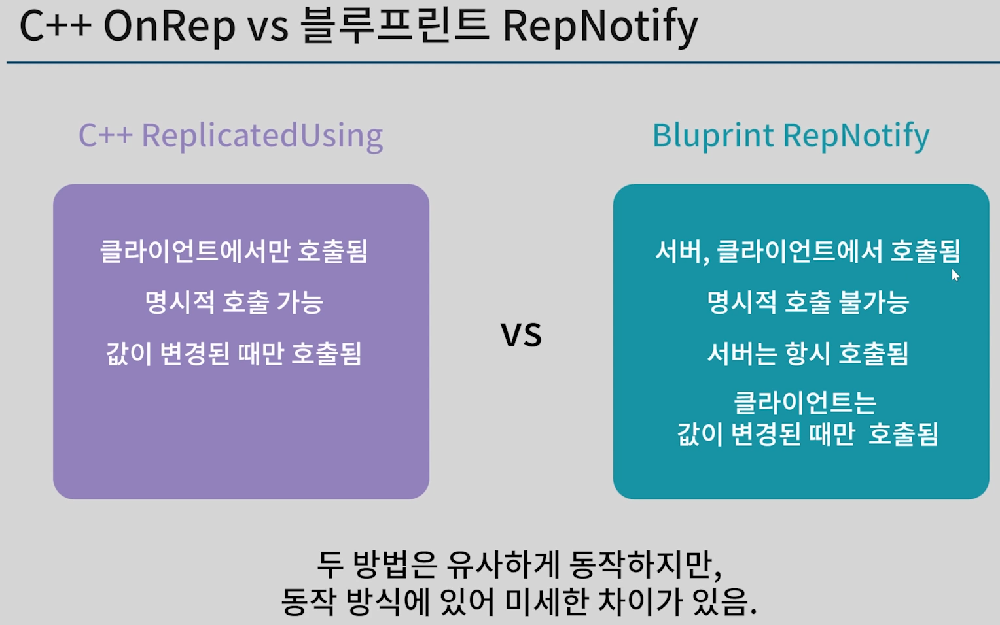

  블프에서는 서버측에 HasAuthority써서 분리해야함<br />암튼 딱 봐도 C++이 나음

  <details>
  <summary>  조건식 프로퍼티 리플리케이션</summary>

  <b>프로퍼티는 일단 리플리케이션에 등록되면 해제시킬 수 없다.<br /></b>(최적화 때문이라고 한다. 가급적 많은 정보를 구워넣어서, 같은 프로퍼티 세트에 대해 다수의 접속에서 작업물 공유의 이점을 활용할 수 있도록 하기 위함이라는데 일단 뭔말인지는 모름)

  그럼 등록된 프로퍼티는 미세조정이 불가능하냐?

  이를 위해 나온게 조건형 프로퍼티이다.

  기본적으로 프로퍼티 값이 바뀌지 않으면 리플리케이션을 진행하지 않는다.<br />여기서 더 세밀한 제어를 위해 부가적인 조건을 추가시킬수 있는<br />매크로(DOREPLIFETIME\_CONDITION)가 있다.

  간단한 사용법 예제

  ```c++
  void AActor::GetLifetimeReplicatedProps( TArray< FLifetimeProperty > & OutLifetimeProps ) const
  {
      DOREPLIFETIME_CONDITION( AActor, 
  		ReplicatedMovement,
  		 COND_SimulatedOnly );
  }
  ```

  조건 매크로에 전달된 <b>COND\_SimulatedOnly</b>플래그는 프로퍼티의 리플리케이션<br />여부를 고려하기도 전에 추가 검사를 하도록 한다.

  이 플래그는 SimulatedProxy플래그를 가진 클라이언트에만 전송을 하기 때문에<br />대역폭을 줄일 수 있다.

  이 뿐만 아니라 이 프로퍼티를 받지 않는 클라이언트의 경우,서버가 클라의 로컬<br />사본을 덮어쓰지 않는다는 장점도 있다.

  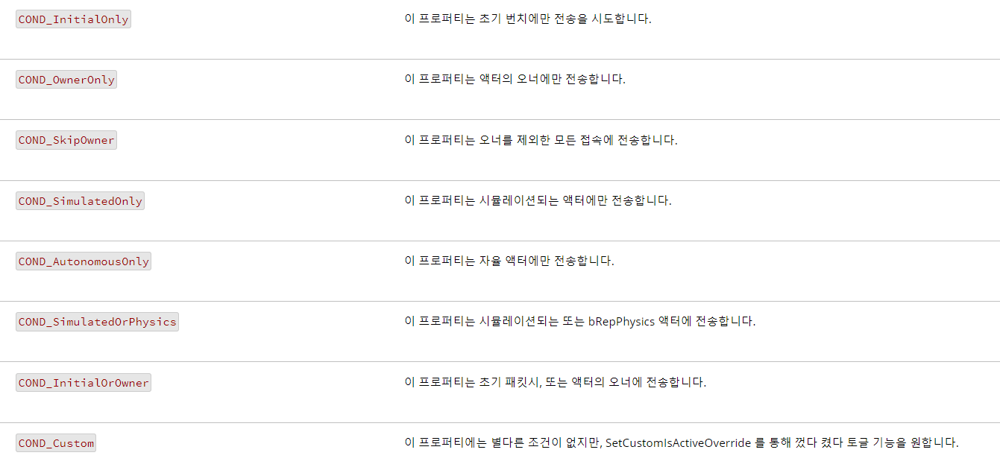

  이 뿐만 아니라 원하는 맞춤형 조건을 사용해서 프로퍼티 제어 시기를 완벽하게<br />제어가 가능하다. (DOREPLIFETIME\_ACTIVE\_OVERRIDE 매크로를 사용한다.)

  ```c++
  void AActor::PreReplication( IRepChangedPropertyTracker & ChangedPropertyTracker )
  {
      DOREPLIFETIME_ACTIVE_OVERRIDE( AActor, 
  			ReplicatedMovement, 
  			bReplicateMovement );
  }
  ```

  이경우 bReplicateMovement가 True일때만 ReplicatedMovement프로퍼티를<br />리플리케이트 한다.

  <u>아니 그럼 이거만 쓰면 되는거 아니에요?<br /></u>그러면 안되는 2가지 이유가 있다.

  - 맞춤형 조건 값이 많이 바뀐다면 오히려 느려질 수 있다.
  - Connection별로 변경 가능한 조건은 사용할 수 없다.

  </details>

  </details>

  <details>
  <summary>  RPC (Remote Procedure Call) (함수 리플리케이션)</summary>

  확인용 표

  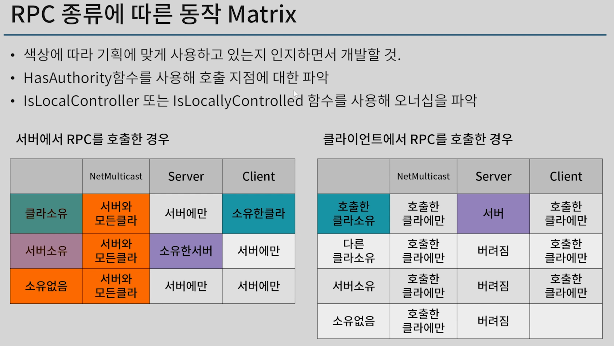

  서버와 클라이언트가 네트워크를 통해 즉각적으로 명령을 주고받을 때 사용

  - 원격 프로시저 호출의 약자
  - 원격 컴퓨터에 있는 함수를 호출할 수 있도록 만든 통신 프로토콜
  - 네트워크 멀티플레이어에서 서버와 클라이언트간에 <b>빠르게 </b>행동을 명령하고 정보를 주고받는데 사용<br />(이 기능의 주요 용도는 속성상 장식이나 휘발성인 비신뢰성 게임플레이 이벤트를 위한 것입니다. 이는 사운드 재생, 파티클 스폰, 액터의 핵심적인 기능과는 무관한<br /><b>일시적 효과와 같은 작업을(Cosmetic)</b> 하는 이벤트를 포함합니다. 기존에 이러한<br />유형의 이벤트는 종종 액터 프로퍼티를 통해 리플리케이트되고는 했습니다.)
  - 언리얼 엔진에서 클라에서 서버로 명령을 내리는 유일한 수단<br />(Ownership을 가지는 액터만 가능하다)

  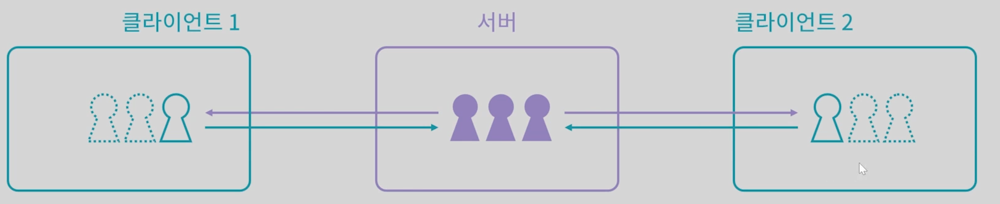

  <b>Movement Replication </b>: RPC의 대표적 예시

  RPC사용시 Ownership 작동 방식을 이해해 두는 것이 중요하다<br />(대부분의 RPC 실행 장소를 결정하기 때문)

  <b>RPC 사용하기</b>

  함수를 RPC 로 선언하려면 <code>UFUNCTION</code> 선언에 <code>Server</code>, <code>Client</code>, <code>NetMulticast</code> 키워드를 붙여주기만 하면 됩니다.<br />(5.0 이후에는 <code>reliable</code>, <code>unreliable</code>이냐를 설정해주는 키워드를 붙여야한다.<br />이전에는 unreliable이 기본값이였는데 생략이 가능한데 지금은 안댐)

  <b>요건 및 주의사항</b>

  RPC 의 정상 작동을 위해 충족시켜야 하는 요건이 몇 가지 있습니다:

  1. <b>Actor 에서 호출되어야 합니다.</b>
  2. <b>Actor 는 반드시 replicated 여야 합니다.</b>
  3. <b>ClientRPC</b> 의 경우, 해당 <b>Actor를 소유하고 있는 클라에서만 함수가 실행</b>됩니다.
  4. <b>ServerRPC</b> 의 경우, <b>클라는 RPC 가 호출되는 Actor 를 소유해야</b> 합니다.
  5. <b>Multicast RPC 는 예외</b>입니다:
     - 서버에서 호출되는 경우, 서버에서는 로컬에서 실행될 뿐만 아니라 현재 연결된 모든 클라이언트에서도 실행됩니다.
     - 클라이언트에서 호출되는 경우, 로컬에서만 실행되며, 서버에서는 실행되지 않습니다.
     - 현재 멀티캐스트 이벤트에 대해 단순한 스로틀 조절 메카니즘이 있습니다. 멀티캐스트 함수는 주어진 액터의 네트워크 업데이트 기간동안 두 번 이상 리플리케이트되지 않습니다. 장기적으로 크로스 채널 트래픽 관리 및 스로틀 조절 지원을 개선시킬 계획입니다.

  다음 표는 호출 액터의 소유권(가장 왼쪽 열)에 따라 주어진 유형의 RPC 실행 위치를 나타냅니다.

  <b>기본적인 RPC 종류</b>

  - <b>함수를 서버에서 호출되지만 클라이언트에서 실행되는 RPC</b>
    ```c++
    UFUNCTION( Client )
    void ClientRPCFunction();
    ```
  - <b>함수를 클라이언트에서 호출되지만 서버에서 실행되는 RPC</b>
    ```c++
    UFUNCTION( Server )
    void ServerRPCFunction();
    ```
  - <b>서버에서 호출된 다음 서버는 물론 현재 연결된 모든 클라이언트에서도 실행되도록 처리하는 RPC<br /></b>(MulticastRPC는 클라에서도 호출이 가능하지만 이 경우 로컬에서만 실행된다)
    ```c++
    UFUNCTION( NetMulticast )
    void NetMulticastRPCFunction();
    ```

  <b>RPC 실행 위치</b>

  <b>신뢰성</b>

  <code>reliable</code>, <code>unreliable</code> 명시해라

  ```c++
  UFUNCTION( Client, Reliable )
  void ClientRPCFunction();
  ```

  이런식으로 ㅇㅇ

  반드시 전달되어야 하는 명령이면 <code>reliable</code>을 명시해주고

  아니면 가급적 <code>unreliable</code> 을 사용하는게 좋다.

  <b>Unreliable</b> : RPC 호출을 보장하지 않는 옵션 (빠르다)<br />캐릭터의 이동같은 게임플레이에 중요하지 않거나 매우 자주 호출되는 함수 로직처리를 할 때 사용하면 된다.

  <b>Reliable </b>: RPC 호출을 보장해주는 추가 옵션 (정말 필요할 때만 사용한다)<br />해당 키워드를 사용하면 성공적으로 수신될 때까지 큐에 남아 있다<br />게임플레이에 중요하지만, 그렇게 자주 호출되지 않는 콜리전 이벤트, 무기 발사 시작 또는 종료, 액터 스폰 등의 함수에 사용된다.

  <aside class="callout">

  <b>Reliable </b>함수를 과도하게 사용하면 해당 함수의 큐가 오버플로우될 수 있습니다. 그러면 강제로 접속이 끊어집니다. 프레임 단위로 리플리케이티드 함수를 호출할 경우에는 함수를 비신뢰성으로 만들어야 합니다. 플레이어 입력에 바인딩된 신뢰성 함수가 있다면, 플레이어가 해당 함수를 호출할 수 있는 빈도를 제한해야 합니다.

  </aside>

  <b>WithValidation </b>: 서버에서 검증 로직을 추가로 구현할 때 추가하는 옵션

  <b>키워드 정리</b>

  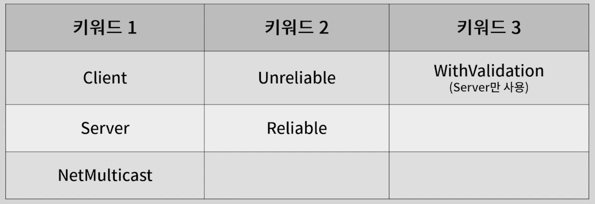

  <b>인증</b>

  악성 데이터/입력 감지를 위한 관문 역할을 위해 RPC 에 인증(validation) 함수를 추가하는 기능. <b>(ServerRPC에서 사용한다 다른데에서 사용 가능하긴 한데 굳이 ㅇㅇ)</b><br />RPC 에 대한 <b>인증 함수</b>가 <b>악성 파라미터를 감지</b>한 경우, 해당 <b>RPC 를 호출한 클라이언트/서버 연결을 끊도록 시스템에 알린다는 </b>개념입니다.

  RPC 에 대해 인증 함수를 선언하려면, <code>UFUNCTION</code> 선언문에 <code>WithValidation</code> 키워드를 추가해 주기만 하면 됩니다.

  ```c++
  UFUNCTION( Server, WithValidation )
  void SomeRPCFunction( int32 AddHealth );
  ```

  Implementation 함수 옆 어딘가에 Validate 함수를 넣어주면 됩니다.

  ```c++
  bool SomeRPCFunction_Validate( int32 AddHealth )
  {
      if ( AddHealth > MAX_ADD_HEALTH )
      {
          return false;     // This will disconnect the caller
      }
      return true;          // This will allow the RPC to be called
  }

  void SomeRPCFunction_Implementation( int32 AddHealth )
  {
      Health += AddHealth;
  }
  ```

  <details>
  <summary>  <b>ClientRPC</b></summary>

  ClientRPC를 사용하면 서버는 특정 클라에만 명령을 내릴 수 있다.<br />(하나의 클라에만 적용되는 RPC라는 뜻)

  이를 위해서 클라의 커넥션을 소유한 액터의(Ownership을 사용한다 <code>Actor::GetNetConnection</code>) RPC를 사용해야 한다.

  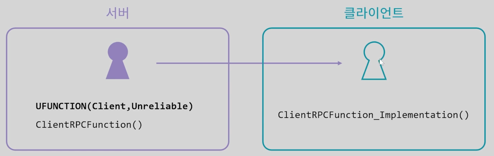

  서버는 클라의 커넥션을 소유하고 있는 액터와 이를 복제한 <b>Proxy액터</b>가 있다.

  서버에서 ClientRPCFunction을 호출하면 자동으로 서버가 클라에게 해당 명령을<br />전송하고 명령을 받은 클라이언트는 \_Implementation이라는 이름이 붙은 함수의<br />구현부를 실행한다.

  </details>

  <details>
  <summary>  <b>ServerRPC</b></summary>

  ClientRPC와는 반대로 클라에서 서버로 호출하는 RPC<br />따라서 구현부는 서버측에 작성되어있다.

  서버쪽에서 클라의 명령을 검증할 수 있는 함수를 구현할 수 있다.

  이 RPC도 당연히 서버와의 Connection을 가지는 액터를 사용해야 한다.

  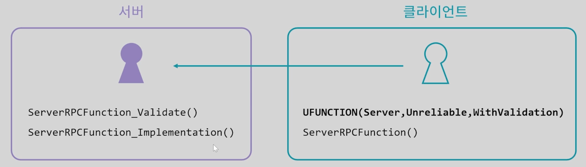

  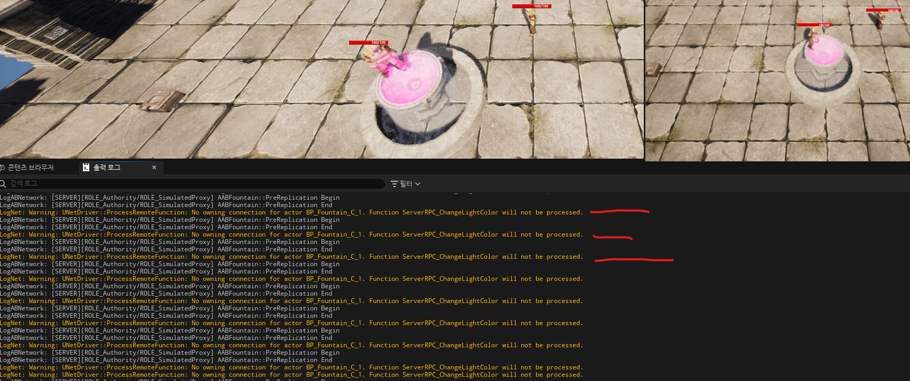

  분수대측에서 분수대의 Light 색상을 변경하는 ServerRPC함수를 호출했을때의 결과이다.<br />Client는 분수대에 대한 Ownership을 가지고 있지 않기 때문에 해당 오류가 발생하고 함수가 실행되지 않는다.

  따라서 게임 실행될때 오너쉽 설정해줘야한다.

  ```c++
  // 클라 추가
  for(FConstPlayerControllerIterator iter = GetWorld()->GetPlayerControllerIterator(); iter; ++iter)
  {
  				APlayerController* PlayerController = iter->Get();
  				if (PlayerController && !PlayerController->IsLocalPlayerController())
  				{
  					SetOwner(PlayerController);
  					break;
  				}
  }
  ```

  EngineUtils라는 헤더를 포함하면 이런 것도 가능하다.

  ```c++
  for (APlayerController* PlayerController : TActorRange<APlayerController>(GetWorld()))
  {
  	if (PlayerController && !PlayerController->IsLocalPlayerController())
  	{
  		SetOwner(PlayerController);
  		break;
  	}
  }
  ```

  </details>

  <details>
  <summary>  <b>NetMulticastRPC</b></summary>

  서버를 포함해 모든 플레이어게 명령을 보내는 RPC

  프로퍼티 리플리케이션과 유사하게 동작한다.<br />다른 RPC와는 다르게 Ownership으로 동작하는게 아니라 Relevancy기반으로 동작한다. (Connection을 소유하지 않아도 이 명령을 쓸 수 있다는 뜻)

  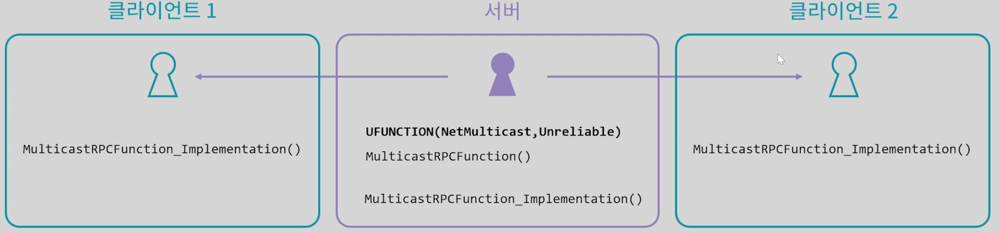

  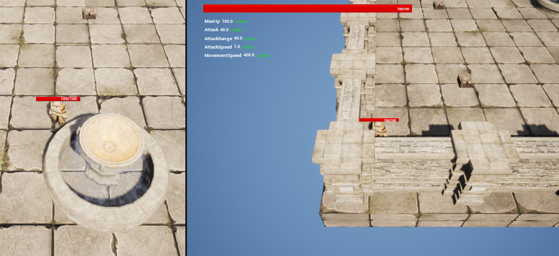

  MulticastRPC는 연관성으로 동작하기 때문에 연관성을 벗어나면

  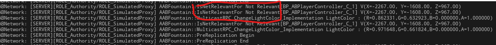

  연관성 없다면서 RPC 실행 안된다.

  </details>

  <b>주의 및 참고할점</b>

  - <b>기본 리플리케이티드 액터 체크리스트<br /></b>액터를 복제하기 위해서는 아래의 내용을 따라야 한다.
    - 액터의 리플리케이트됨(Replicated) 세팅을 True로 설정합니다.
    - 리플리케이티드 액터가 이동해야 하면, 무브먼트 리플리케이트(Replicates Movement)를 True로 설정합니다.
    - 리플리케이티드 액터를 스폰하거나 소멸할 때, 서버에서 해야 합니다.
    - 게임플레이에 필수적인 변수들을 리플리케이트 한다.
    - 언리얼 엔진의 사전 제작 무브먼트 컴포넌트(Movement Components)는 이미 리플리케이션용으로 구축되어 있으므로, 가급적 사용합니다.
    - 서버-오소리티 모델을 사용한다면, 플레이어가 수행할 수 있는 모든 새로운 액션은 서버 함수가 트리거하도록 해야 합니다
  - <b>네트워크 팁</b>
    <ul>
    <li>
    RPC나 리플리케이티드 블루프린트 함수는 최대한 적게 사용합니다. 대신 RepNotify를 사용할 수 있다면, 그렇게 해야 합니다.
    </li>
    <li>
    멀티캐스트 함수는 세션에 접속된 각 클라이언트에 대해 추가 네트워크 트래픽을 생성하므로 특히 사용을 자제합니다.
    </li>
    <li>
    리플리케이트되지 않은 함수가 서버에서만 실행된다는 것을 보장할 수 있다면, 서버 전용 로직을 서버 RPC에 꼭 포함하지 않아도 됩니다.<b><br />즉 서버RPC 로직에 서버에서 실행되는함수를 과도하게 넣을필요 없다.</b> 
    </li>
    <li>
    신뢰성 RPC를 플레이어 입력에 바인딩할 때는 신중하게 결정합니다. 플레이어는 매우 빠르게 반복해서 버튼을 누르므로 신뢰성 RPC의 큐가 오버플로우됩니다. 플레이어가 이를 활성화할 수 있는 빈도를 어떻게든 제한해야 합니다.
    </li>
    <li>
    게임이 틱에서처럼 RPC나 리플리케이티드 함수를 매우 자주 호출한다면, 이를 비신뢰성으로 만들어야 합니다.
    </li>
    <li>
    일부 함수는 게임플레이 로직에 대한 응답으로 호출한 다음 RepNotify에 대한 응답으로 호출하여 클라이언트와 서버가 병렬 실행하게 함으로써 재활용할 수 있습니다.<b><br />즉 c++ 에서 RepNotify를 사용하면 클라에서만 호출되는데 서버에서도 호출되도록 명시적으로 설정할 수 있다는 것</b>
    </li>
    <li>
    액터의 네트워크 역할을 확인하여 <code>ROLE_Authority</code> 인지 아닌지 알 수 있습니다. 이는 서버와 클라이언트 양쪽에서 활성화되는 함수 실행을 필터링하는 데 유용한 방법입니다.<br /><b>즉 서버클라 둘 다 실행되는 함수에서는 </b><code>HasAuthority</code><b>함수를 사용해서 필터링해라\~ 라는 것</b>
    </li>
    <li>
    폰이 C++의 <code>IsLocallyControlled</code> 함수나 블루프린트의 Is Locally Controlled 함수를 사용하여 로컬로 제어되는지 확인할 수 있습니다. 이는 소유 클라이언트와의 관련 여부에 따라 실행을 필터링하는 데 유용합니다.<br /><b>즉 Ownership은 </b><code>IsLocallyControlled</code> <b>써서 확인하자 </b>
    </li>
    <li>
    생성 중에는 폰에 할당된 컨트롤러가 없을 수 있으므로 생성자 스크립트에서는 <code>IsLocallyControlled</code> 를 사용하지 않도록 합니다.<br /><b>즉 생성자에서 </b><code>IsLocallyControlled</code> <b>쓰지마라</b>
    </li>
    </ul>

  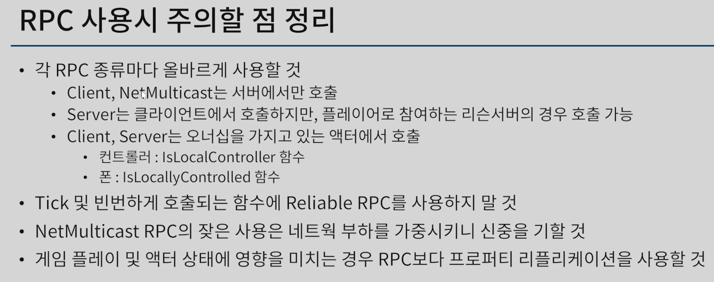

  </details>

  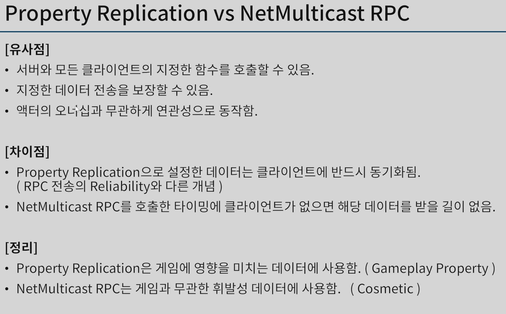

<b>기본 액터의 로딩</b>

- 리플리케이션 작업이 진행되기 위해서는 네트워크로 데이터를 전송해줘야 한다.
- 사용자들이 전부다 슈퍼광랜 쓰는거 아니니까 최악의 경우를 가정해서 작업해야한다.<br />즉 데이터 전송량을 최소화 하는게 중요하다는 것이다.
- 위와 같은 이유 때문에 기본 배경에 관련된 액터는 맵을 통해 클라 스스로 로딩하도록 되어있다.
- 언리얼은 위를 구현하기 위해 <b>고정으로 제공하는 액터와 동적으로 생성하는 액터로 레벨을 구성하는 액터를 구별</b>한다.
  - 이를 구분하기 위해서 모든 액터는 NetLoadOnClient 속성을 가지고 있다.
  - <b>고정 제공 액터 </b>: 레벨을 구성하는 배경 액터 (NetLoadOnClient == true)
    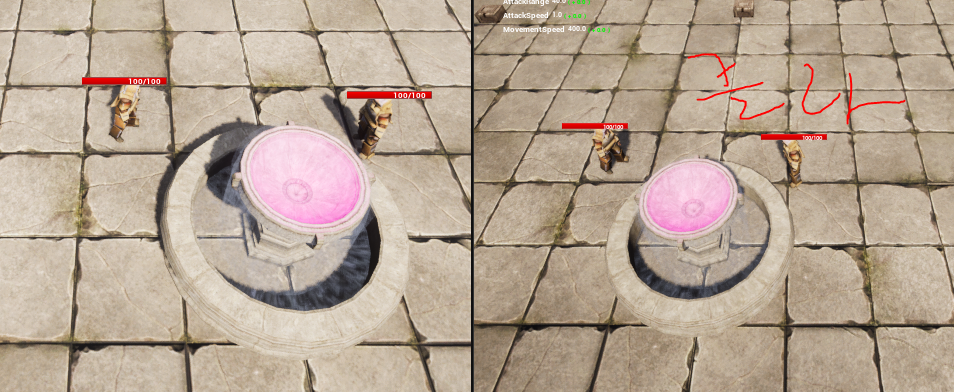
  - <b>동적 생성 액터</b> : 플레이어 컨트롤러와 폰 (NetLoadOnClient == false)
    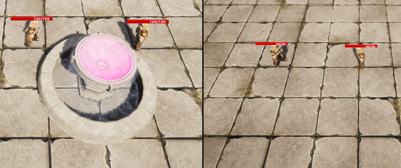

<b>액터의 리플리케이션 설정</b>

- 고정으로 보여지는 액터 중, 게임 중 변경 사항이 발생하는 액터는 그 값을 전달해야 한다.
  - 예를들어 분수대의 위치가 이동했으면 그 값을 전달해야함
- 네트워크 데이터를 최소화하기 위해 변경 사항을 보내기보다, 변경을 유발한 속성 값을 전달한다.
  - 예를들어 분수대가 이동했으면 분수대의 transform을전부 복사해서 보내는게 아니라<br />Vector3 데이터랑 위치 이동이라는 플래그만 보내는식으로 한다는 말인듯
- 이를 위해 액터의 Replicates 옵션을 체크한다.
  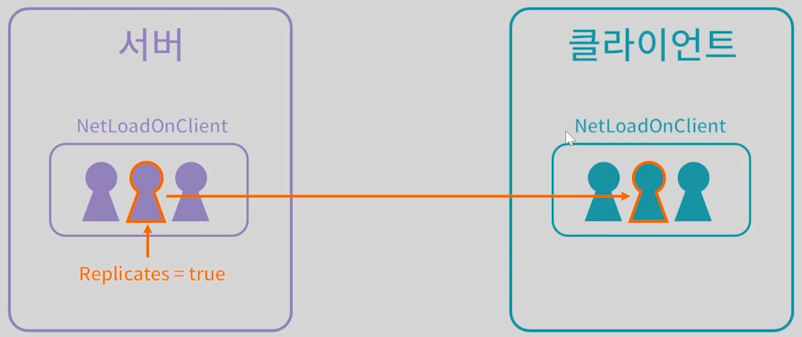

  정리하면 속성값 변경에 대해 클라이언트가 변경을<b> 스스로 처리</b>할 수 있도록<br /><b>데이터 기반으로 설계하는 것이 중요하다.</b>

<b>액터 리플리케이션의 빈도</b>

- 클라이언트와 서버간에 진행되는 통신 빈도
- NetUpdateFrequency : 리플리케이션 빈도의 최대치 설정
  - 1초당 몇 번 리플리케이션 시도할지 지정한 값
  - 기본값은 100. 즉 이론적으로 서버는 1/100초 간격으로 리플리케이션 시도
- 네트워크 빈도는 최대치일 뿐 이를 보장하지는 않음
  - 서버 TickRate에 따라 리플리케이션 발생하지만 서버 성능 구리면 ㅇㅇ
  - 서버 성능이 네트워크 빈도보다 낮으면 서버의 성능으로 복제됨
  - 데디서버는 그래픽 기능없으니까 성능 굿

<b>주요 액터에 설정된 빈도 값</b>

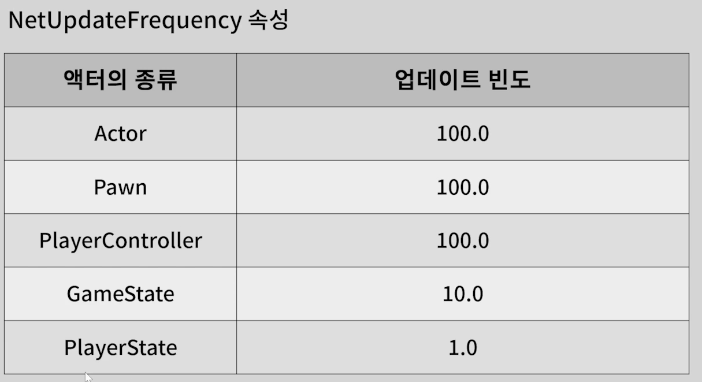

<b>네트워크 데이터 줄이기</b>

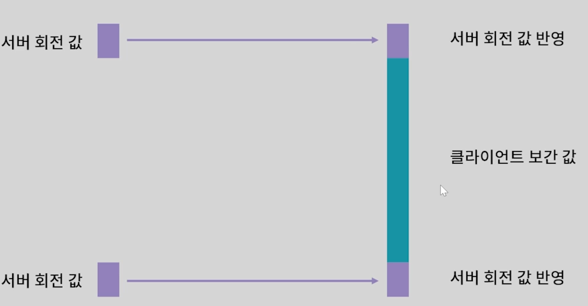

<b>업데이트 빈도를 낮추고 그렇게 생긴 빈 공간을 보간해서 예측한다.</b>

아래는 보간 예시 코드이다.

```c++
// Called every frame
void AABFountain::Tick(float DeltaTime)
{
	Super::Tick(DeltaTime);

	if (HasAuthority())
	{
		AddActorLocalRotation(FRotator(0.0f, RotationRate * DeltaTime, 0.0f));
		ServerRotationYaw = RootComponent->GetComponentRotation().Yaw;
	}
	else
	{
		ClientTimeSinceUpdate += DeltaTime;
		if (ClientTimeBetweenLastUpdate < KINDA_SMALL_NUMBER)
		{
			return;
		}

		// 다음 패킷 받을때의 최종Yaw값 예측		
		const float EstimateRotationYaw = ServerRotationYaw + RotationRate * ClientTimeBetweenLastUpdate;
		// 서버가 안정적이면 다음 패킷 받을때쯤엔 1정도가 나올것
		const float LerpRatio = ClientTimeSinceUpdate / ClientTimeBetweenLastUpdate;

		FRotator ClientRotator = RootComponent->GetComponentRotation();
		const float ClientNewYaw = FMath::Lerp(ServerRotationYaw, EstimateRotationYaw, LerpRatio);
		ClientRotator.Yaw = ClientNewYaw;
		RootComponent->SetWorldRotation(ClientRotator);
	}
}

void AABFountain::OnRep_ServerRotationYaw() // 레플리케이션 함수
{
	FRotator NewRotator = RootComponent->GetComponentRotation();
	NewRotator.Yaw = ServerRotationYaw;
	RootComponent->SetWorldRotation(NewRotator);

	ClientTimeBetweenLastUpdate = ClientTimeSinceUpdate;
	ClientTimeSinceUpdate = 0.f;
}
```

우리가 이렇게 고정으로 빈도를 제공하는 것 외에도

적응형으로 알잘딱으로 빈도를 줄여주는

<b>적응형 네트워크 업데이트 (Adaptive Network Update) </b>라는게 있다.

<b>적응형 네트워크 업데이트</b>

- 유의미한 업데이트가 없으면 스스로 파악해 빈도를 줄여서 부하를 줄이는 기법
- MinNetUpdateFrequency : 리플리케이션 빈도의 최소치 설정을 사용<br />기본값은 2이다.
- 최소 값과 최대 값 사이에서 현재 액터에 맞는 최적의 전송 타이밍 설정
- 이를 사용하기 위해서는 직접 활성화 시켜줘야한다.

<b>리플리케이션의 연관성 설정</b>

<details>
<summary>연관성</summary>

<b>연관성 이란?</b>

- 서버의 관점에서 클라이언트의 커넥션에 관련된 액터인지 확인하는 작업이다.
  즉 클라별로 필요한 액터 정보들만 보내기 위해서 클라와 연관성이 있는<br />액터들을(액터 세트) 취합하는 작업

- 예를들어 배틀로얄장르에서 겁나 멀리 떨어진 액터들의 정보는 굳이 받을 필요가 없다.
- 언리얼 네트워크에서 상당한 대역폭 최적화가 일어난다
- 완벽하지는 않지만 플레이어에게 영향을 끼칠 수 있는 액터 세트를 제대로 추정해 낼 수 있도록 디자인 되어있다.

<b>연관성에 관련된 다양한 속성</b>

클라에게 연관있는 액터세트를 취합할때 가장 중요하게 고려할 것중 하나는<br />클라이언트 카메라의 가시성일 것이다.

이를 위해 언리얼에서는 화면의 관점에서 Viewer와 ViewTarget을 따로 정의했다.

<b>연관성 판별을 위한 특별한 액터의 정의<br />아래 있는애들이면 무조건 연관성 있다고 판단한다.</b>

- <b>Viewer </b>: 클라이언트의 커넥션을 담당하는 플레이어 컨트롤러를 가리킴
- <b>ViewTarget </b>: 플레이어 컨트롤러가 빙의한 폰
- <b>Instigator</b> : 나에게 대미지를 가한 액터 (리플레이같은거 보여준다고 생각하자)

즉 View와 ViewTarget역할을 수행하는 액터는 Client와 연관이 있다고 판별한다.

<b>오너의 정의</b>

- 액터를 소유하는 액터. 최상단의 소유 액터를 의미

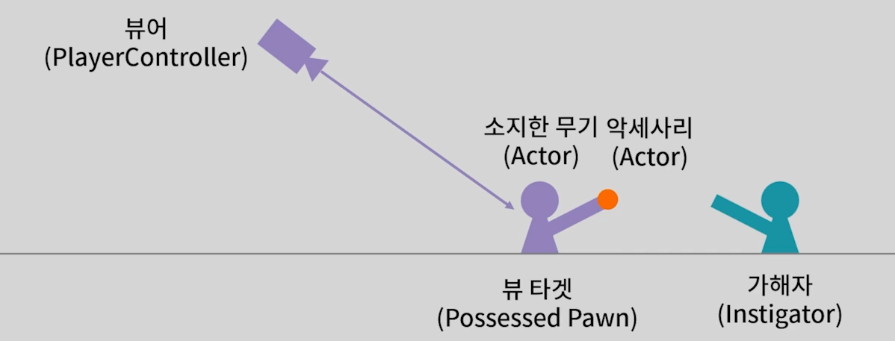

<b>연관성의 점검</b>

- 서버에서는 틱마다 모든 커넥션과 액터에 대해 연관성을 점검한다.<br />따라서 부하가 겁나 크다
  이를 위해 서버는 각 커넥션에 대응하는 클라이언트의 뷰어를 중심으로 관련있는 액터들을 모은다.

- 클라의 뷰어와 관련있고 뷰어와의 일정 거리 내에 있는 액터를 파악
  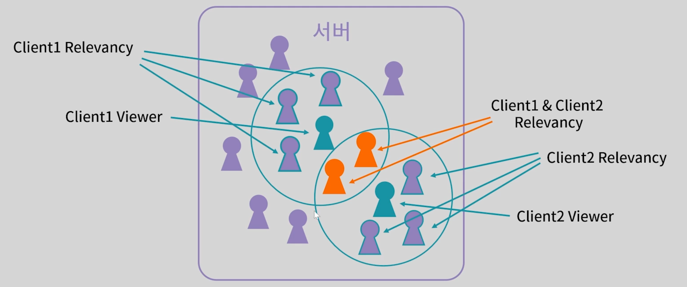
- 해당 액터 묶음의 정보를 클라에게 전송

따라서 서버의 부하를 줄이기 위해 각 액터들은 필요한 만큼의 연관성을 가지는게 좋음

<b>액터 속성에 따른 연관성 판정을 위한 속성</b>

- <b>AlwaysRelevant </b>: 항상 커넥션에 대해 연관성을 가짐 (GameState, PlayerState)
- <b>NetUseOwnerRelevancy </b>: 자신의 연관성은 오너의 연관성으로 판단함<br />ex) 시야에 안보이는 장치에 장착된 무기가 있을 때<br />무기에 대해서 연관성을 파악하는 것이 아니라 무기를 소유한 장치에 대해 연관성을 파악하면 됨
- <b>OnlyRelevantToOwner</b> : 오너에 대해서만 연관성을 가짐<br />Viewer나 ViewTarget을 Owner로 하지 않으면 연관성에서 제외시키는 옵션<br />ex) 카메라나 내가 조종하는 캐릭터와 연관이 없으면 클라쪽에 보내지 않도록 설정하고 싶을 때가 있음
- <b>NetCullDistance </b>:뷰어와의 거리에 따라 연관성 여부를 결정<br />(연산량을 줄이기 위해서 제곱된 값으로 설정되어있음 따라서 실 측정치는 루트 씌워)

뭐 암튼 연관성 늘리면 부하 커지니까 알잘딱 구현하라고 <b>IsRelevantFor이라는 가상함수 </b>만들어놓았다.

<details>
<summary><b>언리얼 내 액터의기본 연관성 판단</b></summary>

```c++
bool AActor::IsNetRelevantFor(const AActor* RealViewer, const AActor* ViewTarget, const FVector& SrcLocation) const
{
	if (bAlwaysRelevant || IsOwnedBy(ViewTarget) || IsOwnedBy(RealViewer) || this == ViewTarget || ViewTarget == GetInstigator())
	{
		return true;
	}
	else if (bNetUseOwnerRelevancy && Owner)
	{
		return Owner->IsNetRelevantFor(RealViewer, ViewTarget, SrcLocation);
	}
	else if (bOnlyRelevantToOwner)
	{
		return false;
	}
	else if (RootComponent && RootComponent->GetAttachParent() && RootComponent->GetAttachParent()->GetOwner() && (Cast<USkeletalMeshComponent>(RootComponent->GetAttachParent()) || (RootComponent->GetAttachParent()->GetOwner() == Owner)))
	{
		return RootComponent->GetAttachParent()->GetOwner()->IsNetRelevantFor(RealViewer, ViewTarget, SrcLocation);
	}
	else if(IsHidden() && (!RootComponent || !RootComponent->IsCollisionEnabled()))
	{
		return false;
	}

	if (!RootComponent)
	{
		UE_LOG(LogNet, Warning, TEXT("Actor %s / %s has no root component in AActor::IsNetRelevantFor. (Make bAlwaysRelevant=true?)"), *GetClass()->GetName(), *GetName() );
		return false;
	}

	return !GetDefault<AGameNetworkManager>()->bUseDistanceBasedRelevancy ||
			IsWithinNetRelevancyDistance(SrcLocation);
}
```

</details>

</details>

<details>
<summary>우선권</summary>

서버와 클라간의 통신 대역폭은 물리적으로 한정되어있다.<br />클라가 접속할 때마다 서버는 접속한 클라에게 통신 자원을 나눠서 분배한다.<br />따라서 클라가 많아지면 서버는 클라에게 필요한 정보를 모두 보내지 못할 수 있다.

이를 완화하기 위해 나온게 <b>우선권</b>이다.

<b>클라들에게 우선적으로 보내야할 액터들을 정하도록 설계했다.</b>

모든 액터들은 NetPriority라는 값이 있어서 이걸로 우선권을 결정한다.

<b>NetPriority가 높을수록 우선권이 높은거다</b>

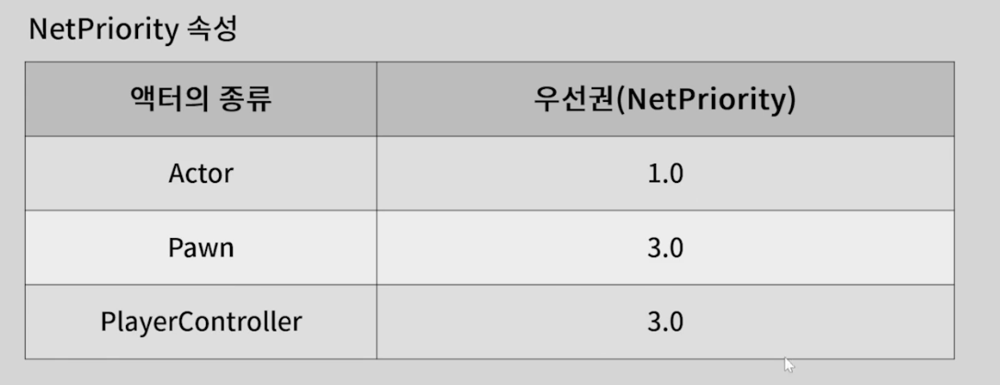

언리얼 엔진에서는 액터의 게임플레이 중요도에 따라 대역폭을 적절히 분배해준다.

즉 우선권 값이 높을수록 서버의 Tick을 더 많이 점유할 수 있기 때문에 대역폭을 많이 받는다.

언리얼 문서를 보면 우선권이 2.0인 액터는 1.0인 것 보다 정확히 두 배의 빈도로 업데이트 될 것이라고 한다.

그렇다고해서 우선권과 관련해서 중요한 것은 비율이기 때문에<br />우선권을 높인다고 해서 네트워크 퍼포먼스가 올라가지는 않는다.

<b>우선권 설정 로직</b>

- <b>액터의 우선권은 </b><b><code>Actor::GetNetPriority()</code></b><b> 가상함수를 사용해서 계산된다.</b>
- <b>업데이트 받지 못하는 경우를 피하기 위해 함수 내에서 NetPriority에 액터의 지난번<br />리플리케이션 이후 경과시간을 곱해준다.<br />(즉 경과시간이 길수록 우선권이 높아질 것이다.)</b>
- 최종 우선권 값을 사용해 클라에 보낼 액터 목록을 정리한다.
- 네트워크가 포화상태가 될 때까지 정렬된 순서대로 리플리케이션을 수행한다.
- 네트워크가 포화되면 해당 액터는 다음 서버 틱으로 넘어간다.
- 이 외의 추가적인 조정이 들어간다.
  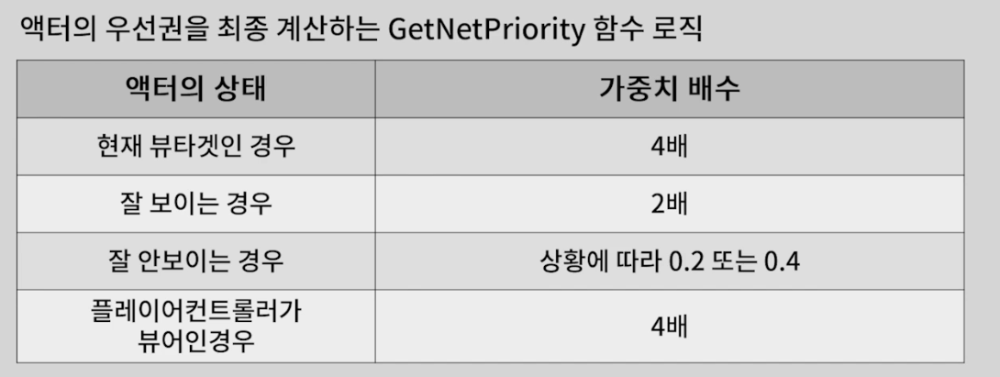

  ```c++
  float AActor::GetNetPriority(const FVector& ViewPos, const FVector& ViewDir, AActor* Viewer, AActor* ViewTarget, UActorChannel* InChannel, float Time, bool bLowBandwidth)
  {
  	if (bNetUseOwnerRelevancy && Owner)
  	{
  		// If we should use our owner's priority, pass it through
  		return Owner->GetNetPriority(ViewPos, ViewDir, Viewer, ViewTarget, InChannel, Time, bLowBandwidth);
  	}

  	if (ViewTarget && (this == ViewTarget || GetInstigator() == ViewTarget))
  	{
  		// If we're the view target or owned by the view target, use a high priority
  		Time *= 4.f;
  	}
  	else if (!IsHidden() && GetRootComponent() != NULL)
  	{
  		// If this actor has a location, adjust priority based on location
  		FVector Dir = GetActorLocation() - ViewPos;
  		float DistSq = Dir.SizeSquared();

  		// Adjust priority based on distance and whether actor is in front of viewer
  		if ((ViewDir | Dir) < 0.f)
  		{
  			if (DistSq > NEARSIGHTTHRESHOLDSQUARED)
  			{
  				Time *= 0.2f;
  			}
  			else if (DistSq > CLOSEPROXIMITYSQUARED)
  			{
  				Time *= 0.4f;
  			}
  		}
  		else if ((DistSq < FARSIGHTTHRESHOLDSQUARED) && (FMath::Square(ViewDir | Dir) > 0.5f * DistSq))
  		{
  			// Compute the amount of distance along the ViewDir vector. Dir is not normalized
  			// Increase priority if we're being looked directly at
  			Time *= 2.f;
  		}
  		else if (DistSq > MEDSIGHTTHRESHOLDSQUARED)
  		{
  			Time *= 0.4f;
  		}
  	}

  	return NetPriority * Time;
  }
  ```

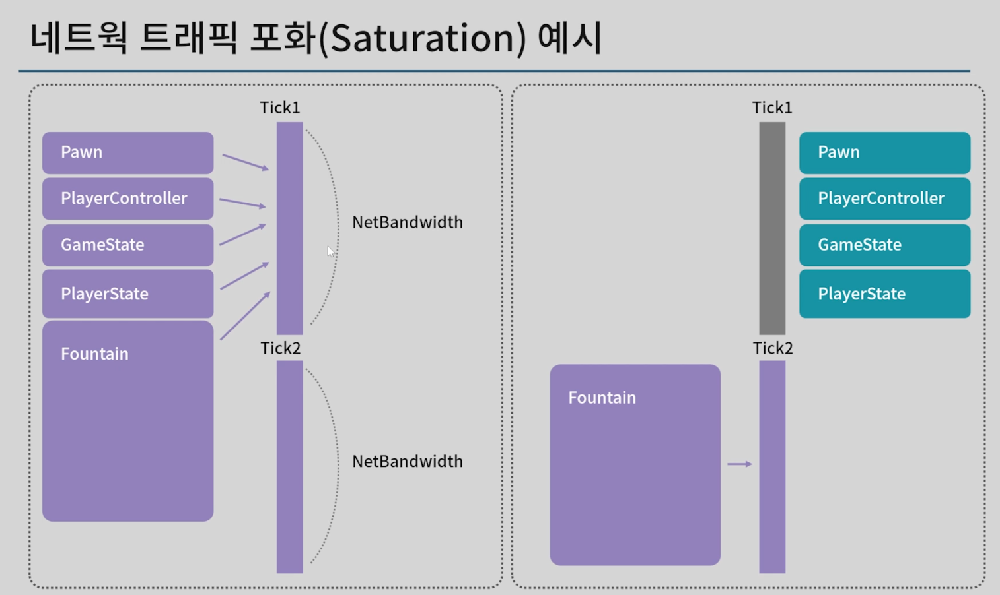

그림을 보면 Fountain은 Tick1의 대역폭 부족으로 처리되지 못했다.<br />그래서 다음Tick에서 우선권을 가지고 처리될 필요가 있다.

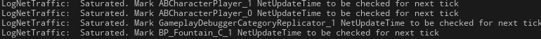

포화되면 이런 로그 뜬다.

</details>

<details>
<summary>액터의 휴면상태</summary>

언리얼에서는 액터 리플리케이션 전송을 최소화 하기 위해 연관성과 더불어서

휴면상태(Dormancy)라는 속성을 제공한다.

액터가 휴면상태라면 연관성이 있더라도 RPC를 수행하지 않는다.

- 언리얼 엔진에서 지정한 휴면 상태
  <ul>
  <li>
  DORM\_Never : 액터는 휴면이 없음
  </li>
  <li>
  DORM\_Awake : 액터는 깨어나 있음
  </li>
  <li>
  DORM\_DormantAll : 액터는 언제나 휴면상태. 필요시에 깨울 수 있음
  </li>
  <li>
  DORM\_DormantPartial : 특정 조건을 만족할 경우에만 리플리케이션수행
  </li>
  <li>
  DORM\_Initial : 액터를 휴면상태로 시작하고 필요한 때 깨우도록 설정할 수 있음<br />속성 리플리케이션에 사용시에는 DORM\_Initial만 고려함 
  </li>
  </ul>

</details>

<details>
<summary><b>Actor Replication LowLevel Flow</b></summary>

액터 리플리케이션 대부분은 <code>UNetDriver::ServerReplicateActors</code> 안에서 일어납니다.

서버는 각 <b>클라이언트에 연관성이 있다고 결정내린 액터 전부를 수집</b>하고<br />각 클라들은 <b>지난 번 업데이트된 이후 변경된 프로퍼티가 있으면 전송</b>하는 곳이다.

- <code>AActor::NetUpdateFrequency</code> - 액터가 얼마나 자주 리플리케이트되는지 결정하는 데 사용됩니다.
- <code>AActor::PreReplication</code> - 리플리케이션 발생 전 호출됩니다.
- <code>AActor::bOnlyRelevantToOwner</code> - 이 액터가 오너에게만 리플리케이트되는 경우 true 입니다.
- <code>AActor::IsRelevancyOwnerFor</code> - bOnlyRelevantToOwner = true 일 때 연관성 결정을 위해 호출됩니다.
- <code>AActor::IsNetRelevantFor</code> - bOnlyRelevantToOwner = false 일 때 연관성 결정을 위해 호출됩니다.

- <b>HighLevel Flow</b>
  - 현재 리플리케이션중인 액터 각각에 대해 루프를 돌린다.
    - 액터가 휴면 상태인지(<code>DORM_Initial</code>) 알아낸 다음, 휴면상태면 continue
    - NetUpdateFrequency값을 검사해서 업데이트 주기가 아니면 건너뛴다.
    - 소유권 체크가 통과하면( <code>AActor::bOnlyRelevantToOwner</code> 가 true면)<br />해당 액터 connection의 Viewer가 <code>AActor::bOnlyRelevantToOwner</code> 을 호출하여<br />액터 소유 접속에 연관성 검사를 한다.<br />연관성이 있으면 owned relevant 목록에 추가
      - 이 경우 해당 액터는 하나의 접속에만 전송
    - 이러한 초기 검사를 통과한 액터에 대해 <code>AActor::PreReplication</code> 호출
      - 접속에 대해 프로퍼티를 리플리케이트 시킬지 결정하는 곳이다.<br />여기에 <code>DOREPLIFETIME_ACTIVE_OVERRIDE</code> 이거 쓰라고 한다.
    - 위의 작업을 모두 통과하면 considered 목록에 추가한다.
  - considered목록이 만들어지면 각 클라 접속에 대해 루프를 돌린다.
    - 휴면상태인지 알아냄
    - 아직 채널이 없으면
      - 액터가 들어있는 레벨을 클라가 로드했는지 확인
        - 안됐으면 continue
      - 접속에 대해 <code>AActor::IsNetRelevantFor</code> 을 호출해 액터가 연관성 있는지 알아냄
        - 연관성 없으면 continue
    - 위에서 접속에 관련이 있는 액터 목록을 만들어지면.
    - 액터를 우선권 순으로 정렬
    - 각 정렬된 액터들에 대해 루프돌면서 리플리케이션 진행 조건들 체크한다.
      - 접속이 액터가 들어있는 레벨을 로드하지않은 경우 채널을 닫고 continue
      - 1초마다 <code>AActor::IsRelevancyOwnerFor</code> 호출하면서 액터가 접속에 연관성이<br />있는지 알아냄
      - 5초 동안 연관성 없으면 채널 닫음
      - 연관성 있고 열린 채널이 없으면, 채널 열어줌
      - 일정 시점에 이 접속이 포화된다면
        - 나머지 액터에 대해 루프
          - 1초 미만 연관성이 있다면 다음 Tick에 강제 업데이트
          - 그렇지 않으면 <code>AActor::IsNetRelevantFor</code> 을 호출해 다음 Tick에<br />업데이트 할지 확인
      - 다 통과했으면 <code>UChannel::ReplicateActor</code> 호출하여 액터를 connection에<br />리플리케이트
- <b>접속에 액터 리플리케이트 하기</b>
  액터와 그 모든 컴포넌트를 접속에 리플리케이트 하는 주역은 <code>UChannel::ReplicateActor</code> 이다. 해당 함수 흐름을 보자

  - 액터 채널이 열린 이후 첫 번째 업데이트인지 확인
    - true면 필요한 구체적인 정보를(초기 위치, 회전 등) serialize
  - 이 connection이 액터를 소유하는지 확인
    - 소유 안하고 있으면 ActorRole이 Autonomous에서 Simulated로 강등
  - 이 액터의 변경된 프로퍼티를 리플리케이트
  - 각 컴포넌트의 변경된 프로퍼티를 리플리케이트
  - 삭제된 컴포넌트에 대해 특수한 삭제명령
- <b>그림 설명 및 정리</b>

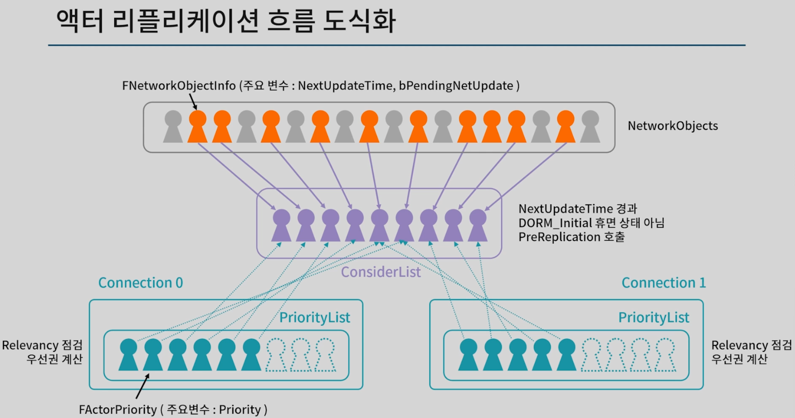

<b>서버는 아래 일련의 과정을 매 Tick마다 수행한다.</b>

<ol>
<li>
네트워크로 업데이트할 액터의 목록을 만든다. (NetworkObjects)<br />서버는 매틱 이 액터들을 클라로 전송하는데<br />각 액터의 정보는 FNetworkObjectInfo 구조체에 정리되어 있다.<br /><b>NextUpdateTime </b>: 다음에 전송할 시간을 지정할 변수<br />(Frequency와 관련있다.)<br /><b>bPendingNetUpdate </b>: 전송되었는지 확인<br />(포화상태일때 패킷을 못보냈을때 check된다 우선권과 연관있다)
</li>
<li>
위 설명처럼 리플리케이트가 가능한(클라에 보낼 수 있는 조건을 만족하는) 액터들을<br />모아놓는다 (considerlist)
</li>
<li>
considerlist내의 액터들은 전송할 준비가 되면 <code>PreReplication</code>함수를 호출한다. 
</li>
<li>
각 클라이언트의 Viewer 정보를 참고하여 considerlist로부터 각 Viewer와 연관성이 있는 액터 묶음을 만들어준다.
</li>
<li>
우선권을 사용해서 해당 액터 묶음을 정렬한 PriorityList를 만든다.<br />(FActorPriority를 사용)<br />FActorPriority는 우선권과 관련한 필드와 FNetworkObjectInfo 정보를 담는 필드로 구성되어있다.
</li>
<li>
 우선권 리스트에 따라 클라에게 액터들을 보낸다

1. 클라에 보내다가 네트워크 상태가 포화되면 FNetworkObjectInfo의 bPendingNetUpdate를 활성화 해서 다음 서버 틱에 참고하도록 처리한다.
</li>
</ol>

</details>

</details>

<details>
<summary>Actor Component Replication</summary>

주로 리플리케이션의 주체는 Actor이지만 언리얼에서는 액터가 소유하는 다양한 UObject에<br />대해 리플리케이션 진행이 가능하다.

액터가 소유하는 다양한 UObject 즉 Actor에 종속된 Object들을 Subobject라고 부른다.

- 액터 컴포넌트 리플리케이션 설정
  - 리플리케이션 지정 : <code>SetIsReplicated(true)</code>
  - 리플리케이션이 준비되면 호출되는 이벤트 함수 : <code>ReadyForReplication</code>

  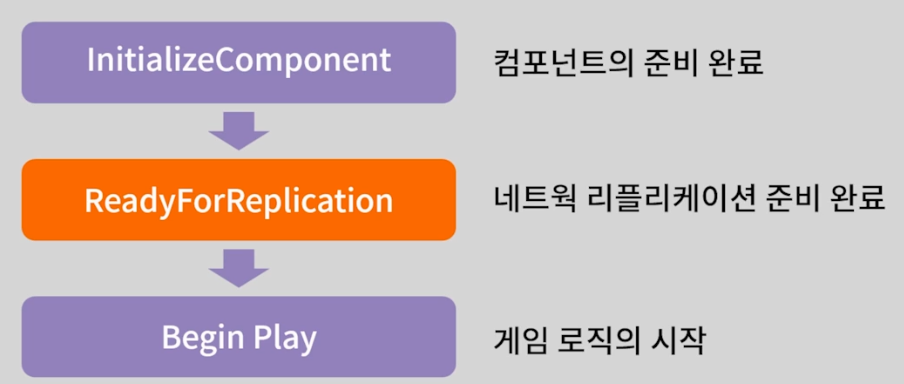

</details>

<details>
<summary><b>네트워크 멀티플레이어의 구현</b></summary>

- 클라이언트의 명령은 ServerRPC를 사용한다.
- 중요한 게임 플레이 판정은 서버에서 처리한다.
- 게임 플레이에 영향을 주는 중요한 저보는 프로퍼티 리플리케이션을 사용한다.<br />(클라의 접속이 끊어졌다가 다시 연결되었을때 다시 값세팅을 위해 등등)
- 클라의 시각적인 효과는 ClientRPC와 MulticastRPC를 사용한다.

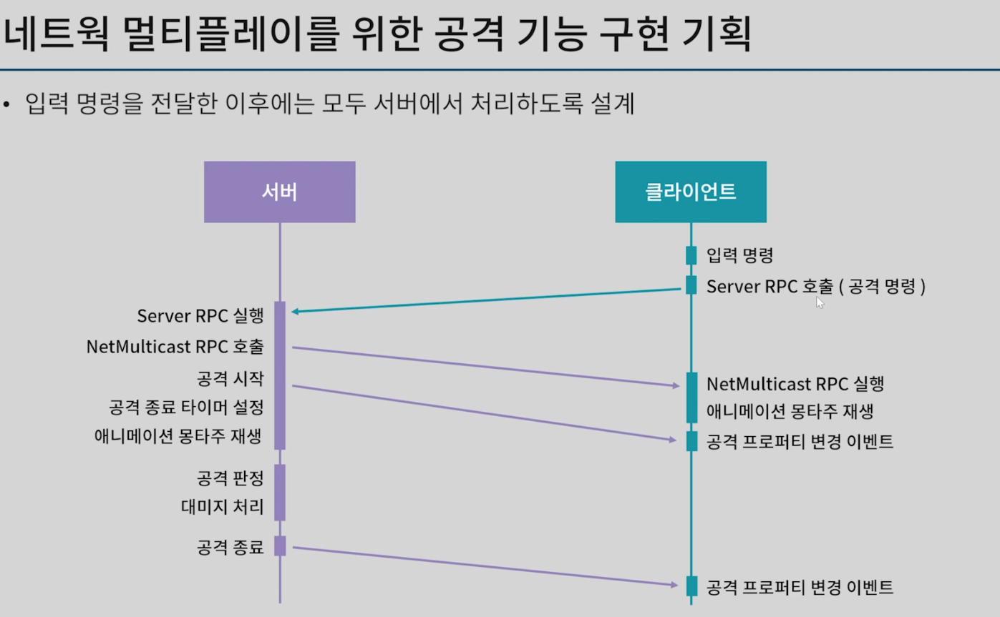

</details>
