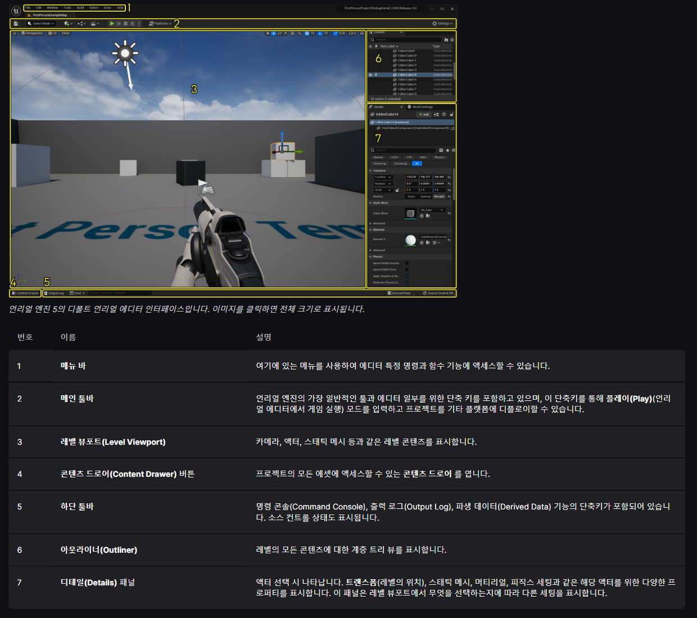
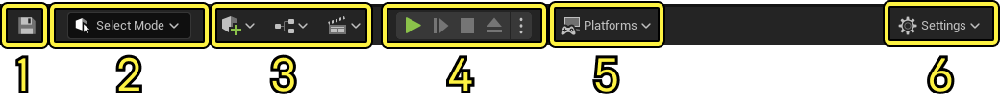

---

<details>
<summary>언리얼 에디터 인터페이스</summary>



<details>
<summary>메인 툴바</summary>



### <b>1. 저장 버튼</b>

이 버튼을 클릭하여 현재 열려 있는 레벨을 저장합니다.

### <b>2. 모드 선택</b>

레벨에서 콘텐츠를 편집하기 위해 다른 모드 간에 빠르게 변환하기 위한 단축 키를 포함하고 있습니다.

- 선택 편집(Select Editing)
- 랜드스케이프 편집(Landscape Editing)
- 폴리지 편집(Foliage Editing)
- 메시 페인팅(Mesh Painting)
- 프랙처 편집(Fracture Editing)
- 브러시 편집(Brush Editing)

### <b>3. 콘텐츠 단축키</b>

레벨 에디터에서 일반적인 타입의 콘텐츠를 추가 및 열기 위한 단축키를 포함하고 있습니다.

<table>
<tr>
<td>
<b>바로가기</b>
</td>
<td>
<b>설명</b>
</td>
</tr>
<tr>
<td>
<b>생성(Create)</b>
</td>
<td>
일반 에셋 목록에서 선택하여 레벨에 빠르게 추가합니다. 이 메뉴를 통해 <b>액터 배치(Place Actors)</b> 패널에 액세스할 수도 있습니다.
</td>
</tr>
<tr>
<td>
<b>블루프린트(Blueprints)</b>
</td>
<td>
블루프린트를 생성하고 액세스합니다.
</td>
</tr>
<tr>
<td>
<b>시네마틱(Cinematics)</b>
</td>
<td>
레벨 시퀀스 또는 마스터 시퀀스 시네마틱을 생성합니다.
</td>
</tr>
</table>

### <b>4. 플레이 모드 컨트롤</b>

에디터에서 게임을 실행하기 위한 플레이, 건너뛰기, 중지, 탈출 등의 단축키 버튼이 포함되어 있습니다.

### <b>5. 플랫폼 메뉴</b>

데스크톱, 모바일 또는 콘솔과 같은 다른 플랫폼으로 프로젝트를 환경설정, 준비 및 디플로이하는 데 사용할 수 있는 일련의 옵션들을 포함하고 있습니다.

### <b>6. 세팅</b>

언리얼 에디터, 레벨 에디터 뷰포트 및 게임 동작에 대한 다양한 세팅을 포함하고 있습니다.

</details>

<details>
<summary>레벨 뷰포트</summary>

현재 열려있는 레벨의 콘텐츠를 표시합니다. 언리얼 엔진에서 프로젝트를 열 때 프로젝트의 기본 레벨이 레벨 뷰포트에서 디폴트로 열립니다. 여기에서 게임 환경, 제품 시각화 앱 등 활성 레벨에 대한 콘텐츠를 확인 및 편집할 수 있습니다.

레벨 뷰포트는 일반적으로 두 가지 방법으로 레벨의 콘텐츠를 표시합니다.

- <b>원근(Perspective)</b> 은 다른 각도에서 뷰포트의 콘텐츠를 보기 위해 탐색할 수 있는 3D 뷰입니다.
- <b>직교(Ortographic)</b> 는 주요 축(X, Y 또는 Z) 중 하나를 내려다보는 2D 뷰입니다.


</details>

</details>

<details>
<summary>언리얼 엔진 개요</summary>

## <b>프로젝트</b>

- 프로젝트는 게임의 모든 콘텐츠를 담고있다.
- 프로젝트에는 Material, Blueprint등 하드디스크상의 여러 폴더를 포함한다.
- 에디터의 콘텐츠 브라우저를 확인함으로 하드디스크의 프로젝트 폴더와 동일한 디렉터리 구조 확인이 가능하다.
- 모든 프로젝트에는 .uproject파일이 있고, 원하는대로 생성이 가능하고, 병렬 작업도 된다.
- <b>프로젝트의 생성</b>
  1. 로직 구현 방식에 선택<br />블루프린트 vs c++/블루프린트 중에 고르게 된다.
  2. 타깃 플램폼 선택<br />데스크톱일지 모바일일지 선택한다.
  3. 퀄리티 프리셋<br />2번의 타깃 플랫폼을 바탕으로 최대 퀄리티 레벨을 설정한다.<br />PC면 Maximum, 모바일이면 Scalable이 권장된다.
  4. 시작용 콘텐츠<br />언리얼에서 제공하는 기본 리소스들을 사용할지 선택한다.
  5. 레이트레이싱 활성화 여
- <b>커스텀 템플릿 생성</b>
  당연하게도 템플릿 기능을 사용하면 기존의 기능들을 새로운 프로젝트에 빠르게 이식이 가능하다.

  1. 전체 프로젝트 폴더를 엔진 설치 폴더의 <code>Template</code> 로 복사한다.
  2. <code>프로젝트폴더\Config\DefaultGame.ini</code> 파일을 연다. <br />그리고 <b>ProjectName </b>변수를 추가하거나 업데이트 한다. <br />(해당 변수는 새로운 언리얼엔진 프로젝트 생성시 템플릿 생성화면에 보이는 이름이다)
     ```javascript
     // 예시
     [/Script/EngineSettings.GeneralProjectSettings]
     ProjectID=E6468D0243A591234122E38F92DB28F4
     ProjectName=MyTestTemplate
     ```
  3. 엔진 설치 폴더에서 <code>Templates\TP_FirstPerson\Config\</code> 로 이동한다.<br /><code>TemplateDefs.ini</code> 파일을 <code>[ProjectName]\Config</code> 폴더에 복사합니다.<br /><br />

## <b>블루프린트</b>

<ul>
<li>
언리얼의 비주얼스크립팅 시스템이다
</li>
<li>
노드 기반의 인터페이스를 사용해 에디터 내의 게임플레이를 완성한다.
</li>
<li>
OOP기반 클래스 또는 오브젝트를 정의할 수도 있다.
</li>
<li></li>
</ul>

</details>
