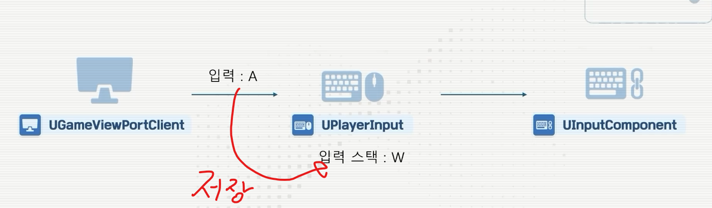
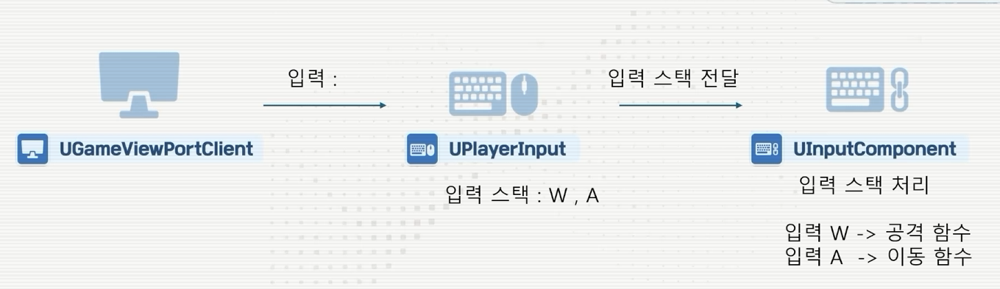
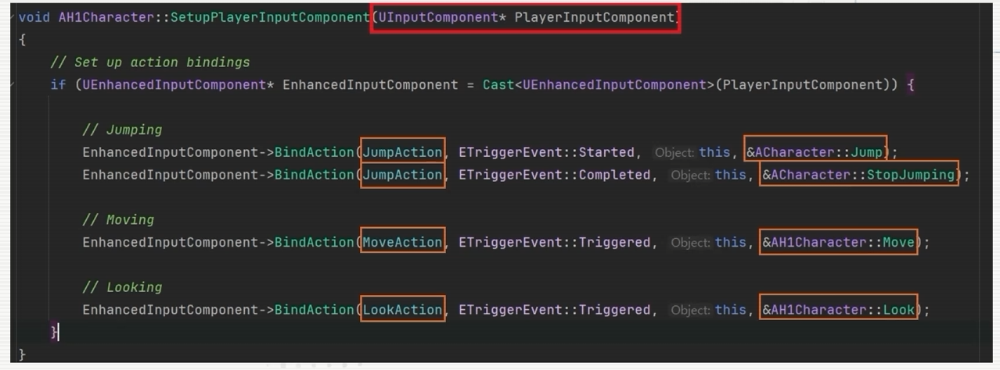
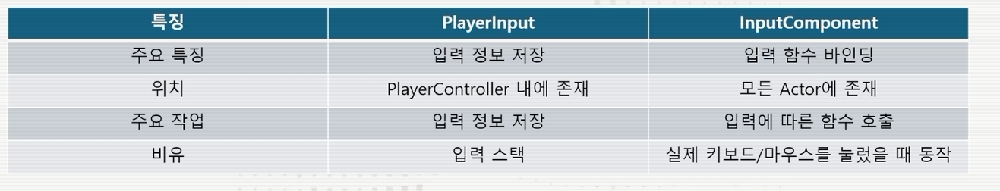
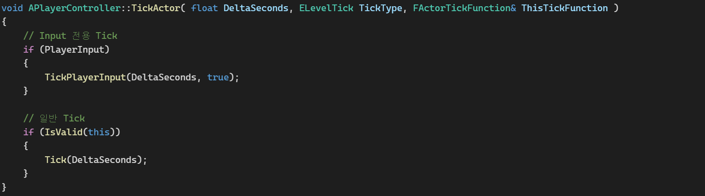
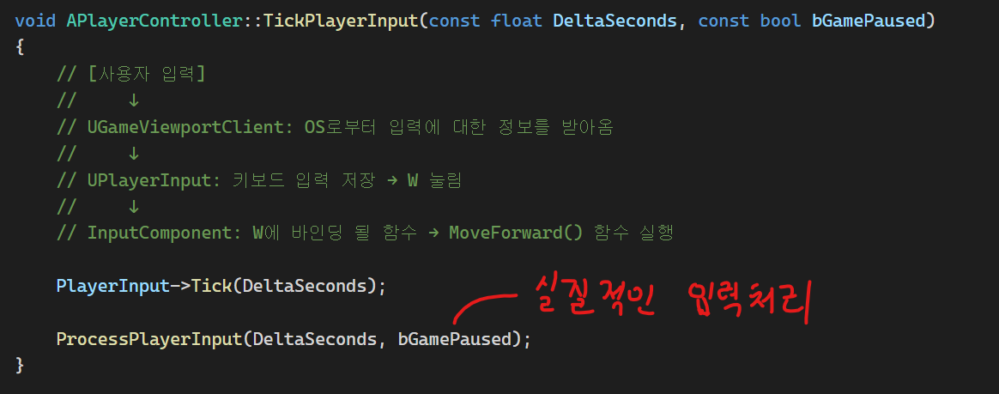
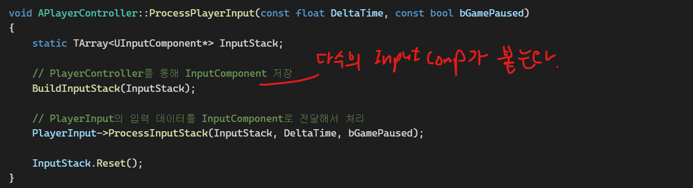
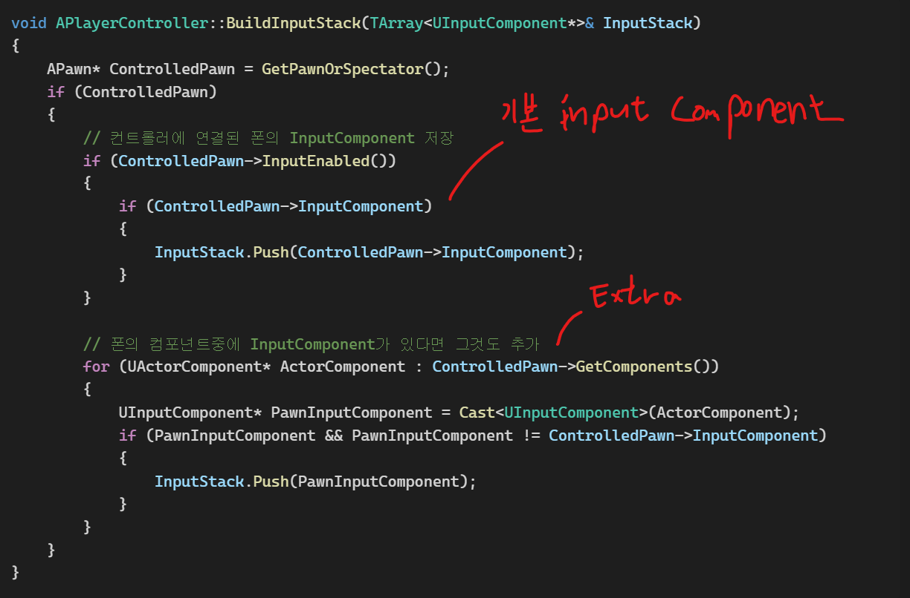
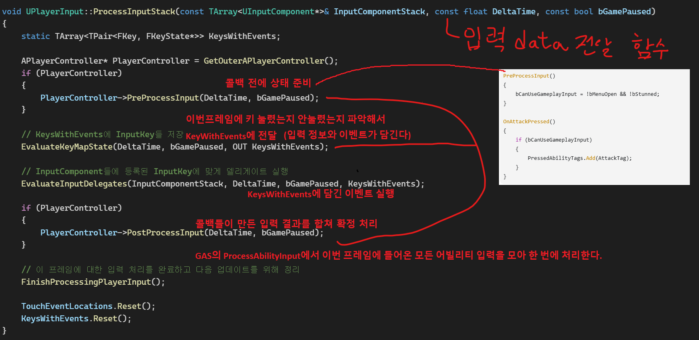
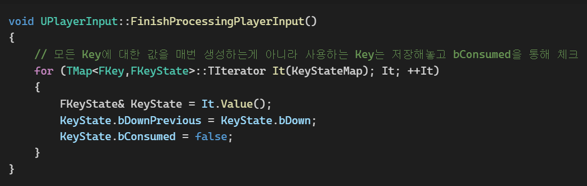

---

<b>언리얼엔진에서의 입력 시스템 흐름</b>

<b>모든 액터는 InputComponent를 가질 수 있다. (어? Pawn이 가져야하는거 아니에요?? ⇒ 아니다. InputComponent는 인풋을 받았을때 함수를 처리하는 역할을 하는거지 Input을 받는 주체가 아니기 때문에 굳이 PC에 종속될 필요가 없다.)</b>

바인딩은 보통 이렇게 이루어진다.

---

<b>APlayerController::TickActor \~\~</b>

 <em>KeyStateMap에 사용하는 키들이 캐싱된다. bConsumed변수로 사용되었는지 아닌지 여부를 남긴다.</em>

