<a href="https://docs.unrealengine.com/4.27/ko/ProductionPipelines/Localization/Overview/">docs.unrealengine.com</a>

<a href="https://velog.io/@borakim96/Unreal-Locationlization-현지화-적용">velog.io</a>

간단한 국제화 현지화 차이 (언리얼 문서에서는 국제화도 같이 다룬다) 

<b>국제화</b>는 다양한 국가의 수많은 고객이 쉽게 적응할 수 있는 제품을 개발하는 것 <b>현지화</b>는 해당 제품을 가져와 하나의 특정 시장에 특화되도록 만드는 것

즉 국제화는 전세계의 고객에 필요로 하는 제품을 개발하는것이고 현지화는 그 제품을 해당 지역의 문화와 상황에 맞추어 해당 지역에 적응시키는 것

언리얼의 현지화 시스템은 "텍스트" 유형을 중심으로 하는 반면,  국제화 지원은 [유니코드용 국제 구성요소 ](http://site.icu-project.org/)(ICU) 라이브러리를 활용한다.

ICU 및 현지화 지원

ICU 는 오랜 기간 바탕을 둔 견고한 국제화 라이브러리로, UE4 에서는 이를 사용하여 문화권(컬처) 관련 데이터의 취급 또는 처리하고 있으며, 여기에는 다음과 같은 사항이 포함됩니다.

- 플랫폼/OS 의 현재 컬처를 구합니다.
- 컬처를 예비 전환하는 우선순위를 처리합니다.
- 올바른 포맷의 (백분율과 통화 포함) 숫자, (시간대 데이터 포함) 날짜와 시간을 처리합니다.
- 컬처에 따른 올바른 숫자 복수 표현을 (텍스트 포매팅 도중) 처리합니다. (역주: 한국어의 경우 종성에 따른 조사를 처리하는 명령도 (hpp) 있습니다.)
- 텍스트의 유니코드 호환 변환을 (예: ToUpper, ToLower) 처리합니다.
- 텍스트의 유니코드 호환 비교와 정렬(collation)을 처리합니다.
- 유니코드 호환 [경계 분석 ](http://userguide.icu-project.org/boundaryanalysis)(글자, 단어, 줄바꿈)을 처리합니다.
- 유니코드 호환 양방향 (BiDi) 텍스트 감지를 처리합니다.

ICU 작동을 위해 필요한 컬처 관련 데이터는 ICU 자체 외부에 저장되며, UE4 는 프로젝트 크기를 최소화하기 위해 대략적인 데이터 세트를 제공합니다.

- 영어 (\~1.77MB)
- EFIGS - 영어, 프랑스어, 이탈리아어, 독일어, 스페인어 (\~2.38MB)
- EFIGSCJK - 영어, 프랑스어, 이탈리아어, 독일어, 스페인어, 중국어, 일본어, 한국어 (\~5.99MB)
- CJK - 중국어, 일본어, 한국어 (\~5.16MB)
- 모두 (\~15.3MB)

어느 것을 선택할지는 프로젝트를 현지화하려는 지역에 따라 달라지며, 이 선택은 프로젝트 세팅에서 설정할 수 있습니다. 자세한 정보는 [현지화 데이터 패키지 ](https://docs.unrealengine.com/4.27/ko/ProductionPipelines/Localization/Overview/#%ED%98%84%EC%A7%80%ED%99%94%EB%8D%B0%EC%9D%B4%ED%84%B0%ED%8C%A8%ED%82%A4%EC%A7%80)부분을 참고하세요.

---

게임에서 다국 언어를 지원하려면 어찌해야할까 모든 언어 버전의 위젯을 만들고 설정을 변경할때마다 새로 실행되는 위젯을 새로 패키징한다는 것은 너무 번거로운 작업이고 게임 파일 관리에서도 불편하다고 생각한다.

이런 문제 해결하기 위해 보통 현지화작업이라는게 있다고 한다.

---

<b>언리얼에서는 이 현지화 작업을 툴로 전부 제공한다.</b>

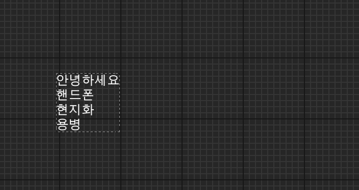

해당 위젯을 가지고 있는 게임을 외국에서 플레이했을때 영어로 나오는 편이 좋을 것이다.

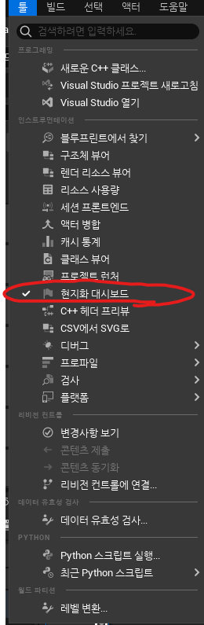

해당 메뉴 클릭한다.

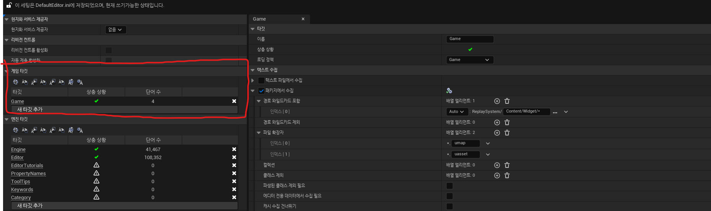

게임타겟과 엔진타겟이 있는게 패키징할 게임의 번역을 원하는 것이니 게임을 타겟으로 설정한다.

(해외 팀원과 협업하려면 엔진타겟을 선택한후 프로젝트 파일을 배포하나? 보다)

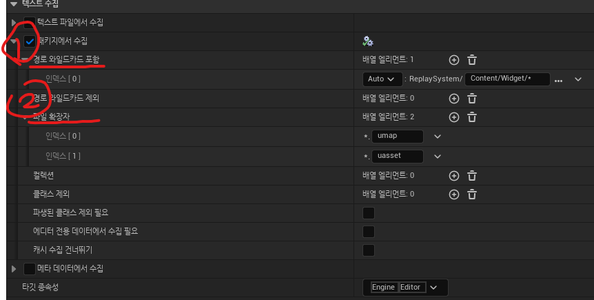

<b>1번의 경로 와일드카드탭</b>에서 텍스트를 수집할 폴더를 설정한다. 공식 문서를 확인해보면 폴더내의 모든 FText를 수집하는 것으로 보인다.

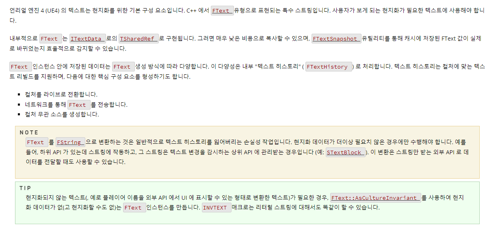

<b>2번의 파일확장자</b>에서 텍스트를 수집할 확장자를 선택한다.  

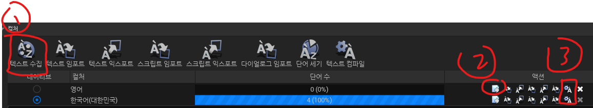

맨 하단으로 내려가면 컬처탭이 있다. <b>1번의 텍스트 수집</b>을 클릭하면 위에서 설정한 필터에 따라 폴더, 확장자 내의 텍스트를 수집한다. <b>2번의 번역 편집</b>을 클릭하면 수집된 텍스트에 대해 번역을 설정한다. 위의 작업을 마치고 <b>3번의 번역 컴파일</b>을 클릭후 에디터를 재시작한다.

<b>텍스트 수집</b>

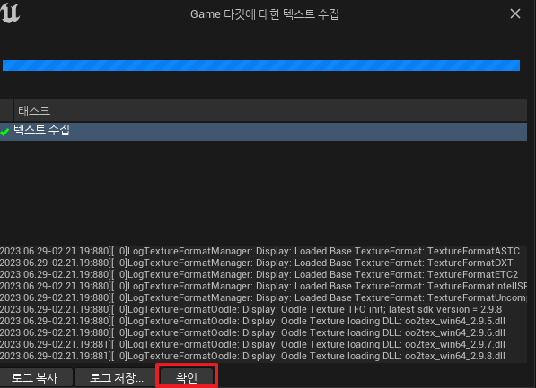

완료되면 확인 누르고 나오면된다.

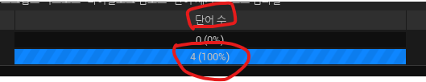

수집이 완료되면 위젯 내의 텍스트 4개가 수집됐다고 나온다.

<b>번역 편집</b>

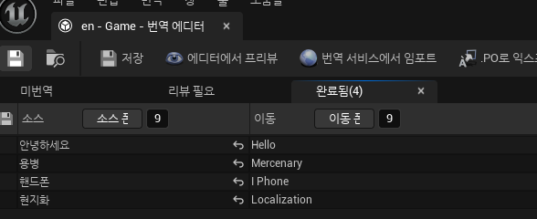

왼쪽 한글은 위젯에 적었던 텍스트가 수집된 것이고 오른쪽의 영어는 내가 직접 적은것이다. 원래는 미번역 탭에 있는데 다 번역해서 완료됨으로 넘어간것

현지화가 잘 됐는지 에디터에서 확인이 가능하다.

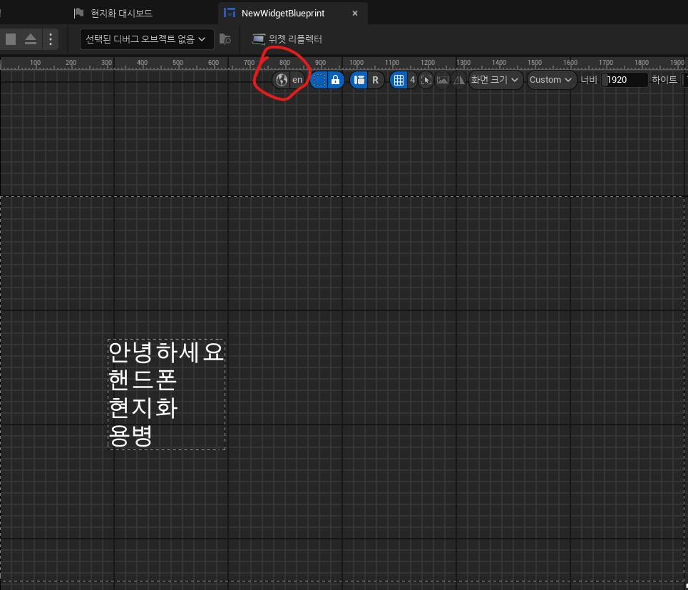

이렇게 한글로 작성된 위젯을 표시한 국가 설정 탭에서 영어로 바꿔 실행하면

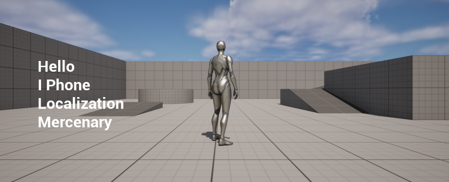

설정한대로 영어로  번역되서 출력한다.

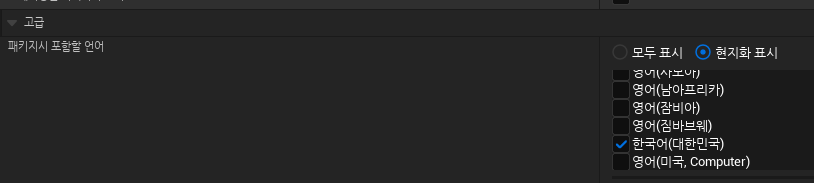

프로젝트 설정 → 패키징 → 고급 → 패키지시 포함할 언어에서 설정했던 언어들 설정후 패키징하면 현지화 데이터를 같이 패키징이 가능하다.

런타임중에

SetCurrentculture함수로 현지화 설정변경이 가능하다고 한다.
