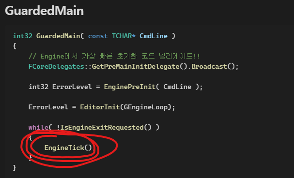
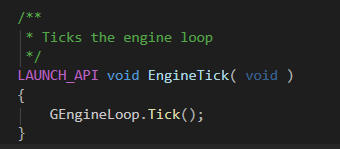
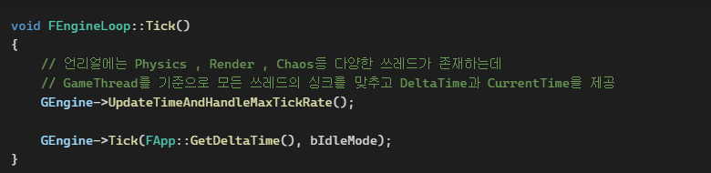
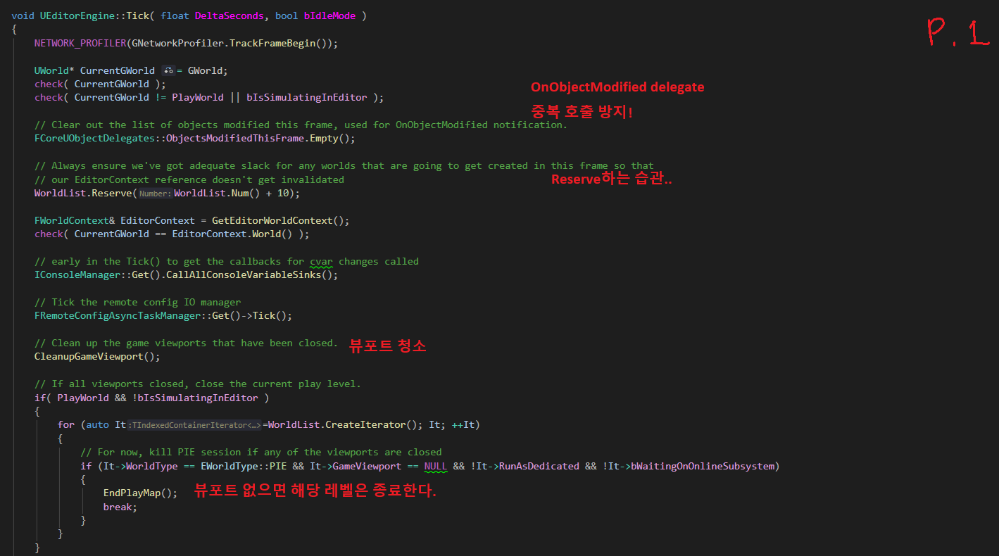
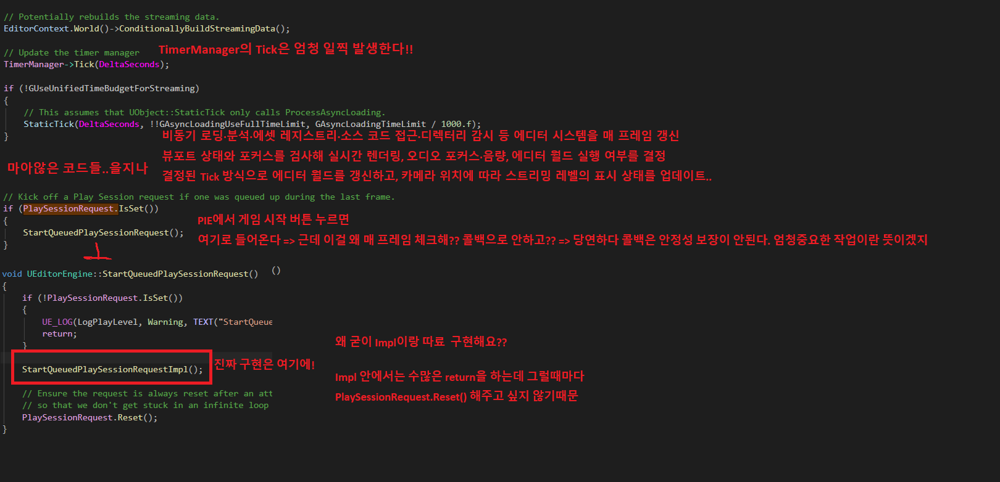
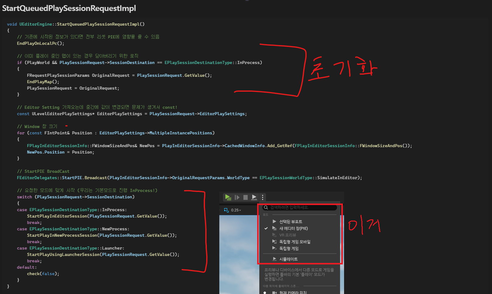
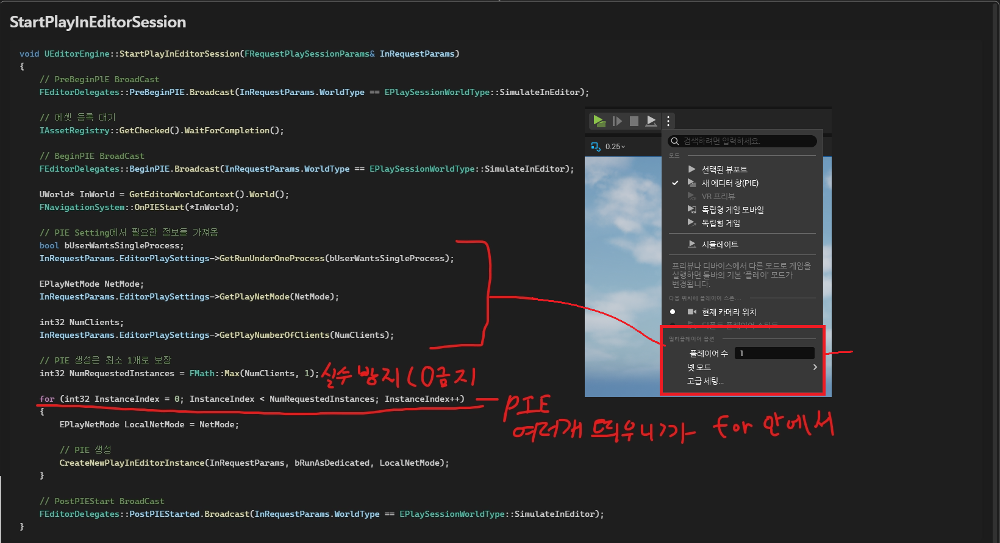
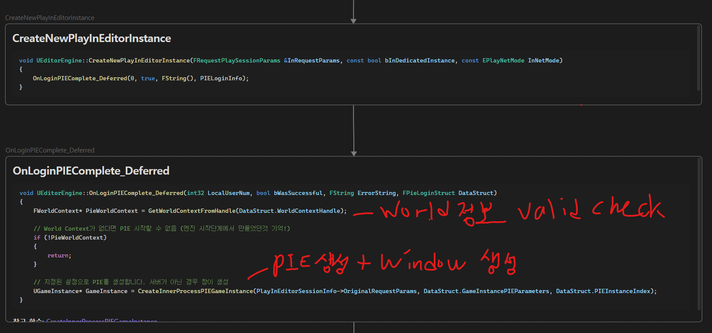

엔진의 Tick

---

<code>UpdateTimeAndHandleMaxTickRate</code>은 내 엔진에서 썼던 TimeManager이랑 비슷한 역할을 한다.

 

EditorEngine.Tick

<b>UEditorEngine::StartQueuedPlaySessionRequestImpl 여기서 PIE(월드)에대한 초기화와 시작이 일어난다.</b> 

