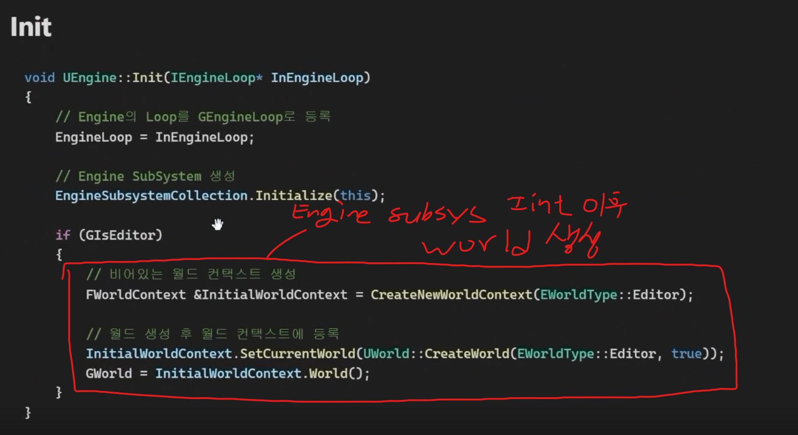
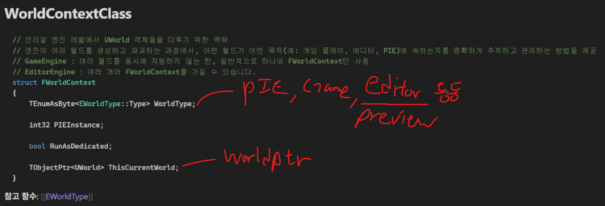
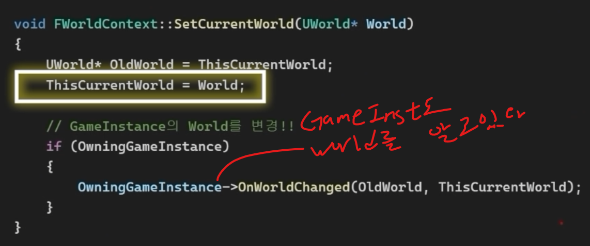

<details>
<summary>엔진 초기화 : (GuardedMain.EditorInit 내부)</summary>

### 이제 <b>엔진을 초기화</b>하자



엔진을 생성할때는 기본적으로 1개의 World가 생긴다.<br />엔진을 처음 키면 나오는 뷰포트가 아마 그 월드일 것이다.

<br><em>여기 보면 WorldList에 월드를 배열로 관리하는것을 볼 수가 있다.그렇다는것은 Engine은 여러개의 월드를 가지고 있을 수 있다는걸 예상이 가능하다.</em>

<b>WorldContext</b>는 월드가 <b>어떤 목적</b>으로 만들어져있는지, 어떤 <b>월드를 알고있는지</b>가 정의된다

사진에는 없지만 WorldContext는

```c++
UPROPERTY()
TObjectPtr<class UGameViewportClient> GameViewport;

UPROPERTY()
TObjectPtr<class UGameInstance> OwningGameInstance;
[NOTION_TOKEN]
```



World생성 후 Worldptr세팅하고 보유중인 GameInstance가 참조중인 World를 교체해준다.

<aside class="callout">

<b>하지만 이 단계에서는 GameInstance가 생성이 안됐으니까 저기 안걸릴듯 함</b>

</aside>

이제 World 생성 과정을 알아보자

</details>
