<a href="https://www.notion.so/3b38338216a880dcb01be147392f5bf5">프레임워크란?</a> <br />위 문서에 따르면 Tick은 클래스들이 생성되어 있어야된다. 그러니까 클래스 생성부터 알아보자

---

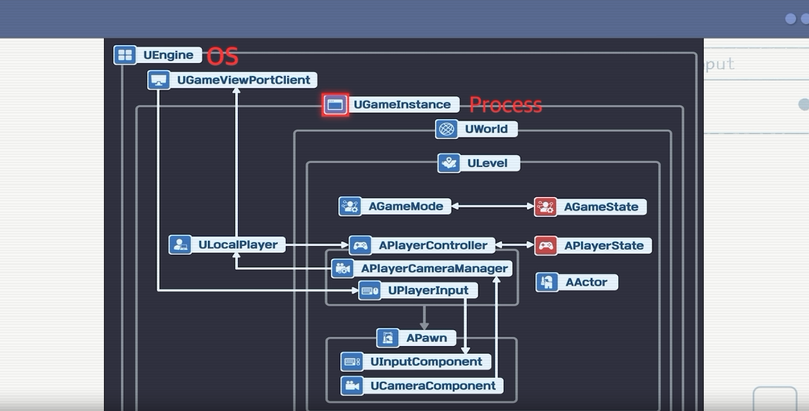

<details>
<summary>UObject</summary>

<blockquote>

언리얼 엔진 내에서 관리할 클래스의 최상위 클래스 

</blockquote>

</details>

<details>
<summary>UEngine</summary>

> UEngine클래스는 UE의 <b>운영체제</b>이다.

UEngine는 UE시스템 전체의 관리자

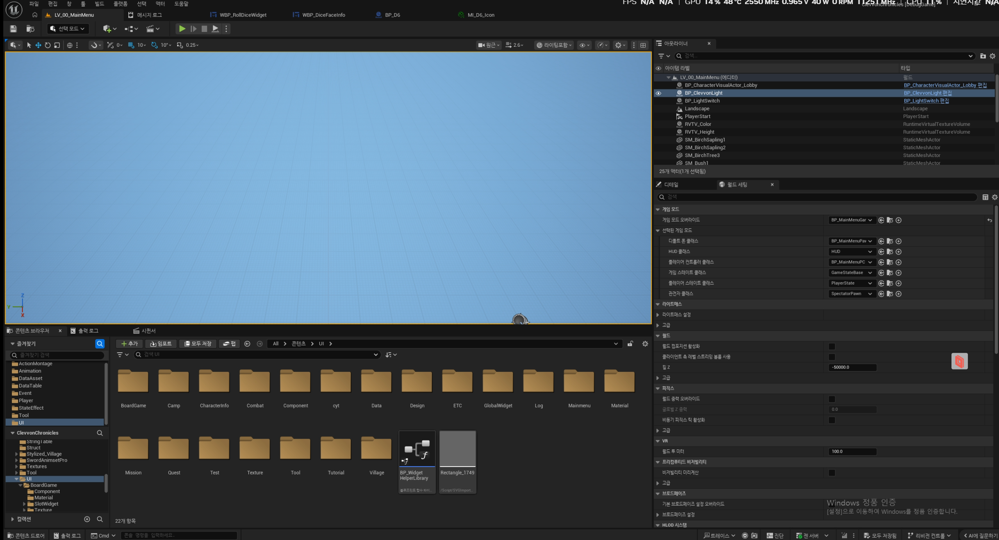

이 화면은 UEngine을 상속받은 UEditorEngine클래스로 생성된 화면이다.<br />UEngine은 UE에서 일어나는 모든 일을 관리한다.

</details>

<details>
<summary>UGameInstnace</summary>

> UGameInstnace클래스는 <b>Engine</b>의 <b>Process</b>이다.

Engine이 UE시스템 전체의 관리자였다면 GameInstance는 <b>게임의 관리자</b>이다.

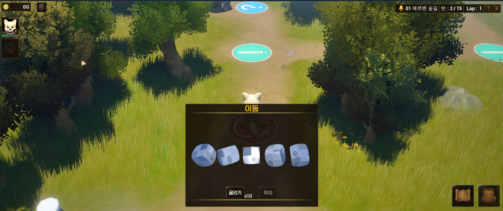

이 화면은 GameInstance가 담당하는 게임플레이 화면이다.<br />

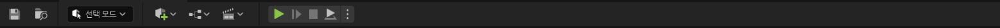

PIE 뷰포트 상단바인데 저기서 실행버튼을 누르면 <b>GameInstance가 하나 생기는 것</b>이다.<br />반대로 실행 후 게임을 끄면 해당 게임을 끄는 것이다 ⇒ <b>엔진에는 아무런 영향이 없다!</b>

만약 Engine과 Game이 한몸이었다면 게임 끌때마다 엔진도 다시 켰어야 했을 것

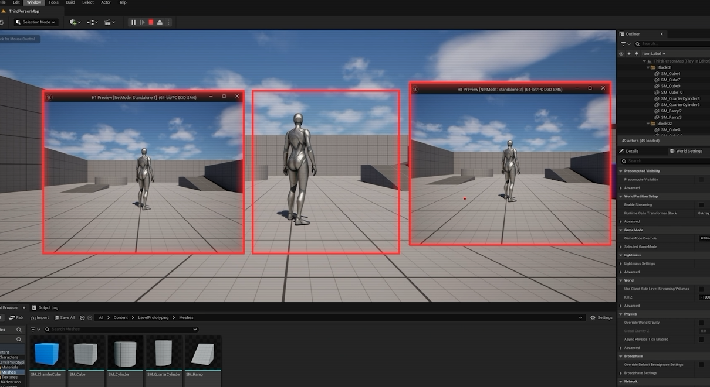<br><em>윈도우가 프로그램을 한번에 여러개 킨것처럼 GameInstnace가 3개가 켜져있는 상황이다.</em>

<aside class="callout">

근데 이게 왜? 당연한거 아니야?

</aside>

맞워요 그런데 이게 왜 중요하냐면\~\~<br />만약 int a = 10이라는 변수를 Engine에 선언했다고 해보자

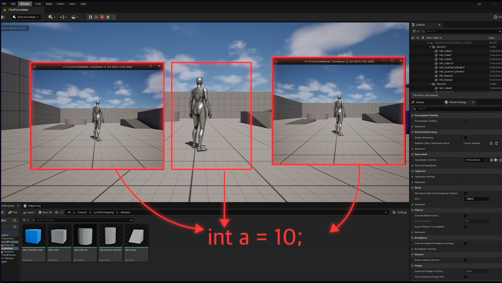

그럼 이렇게 쓰레드마냥 한 변수를 여러 게임에서 접근이 가능한 것이다.<br />편의성도 있지만 엔진단을 구분이 명확하지 않으면 이런 문제가 생길 수 있다.

그래서 쉽게 말하면

<b>엔진에는 엔진기능! 게임인스턴스에는 게임기능!</b>을 넣는다는 뜻

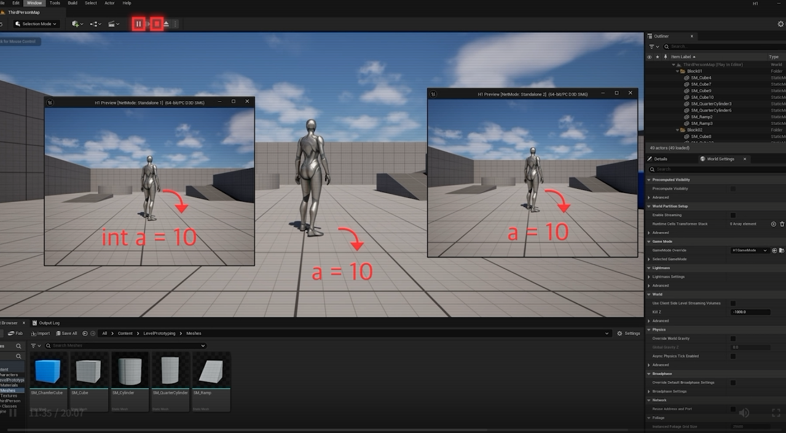

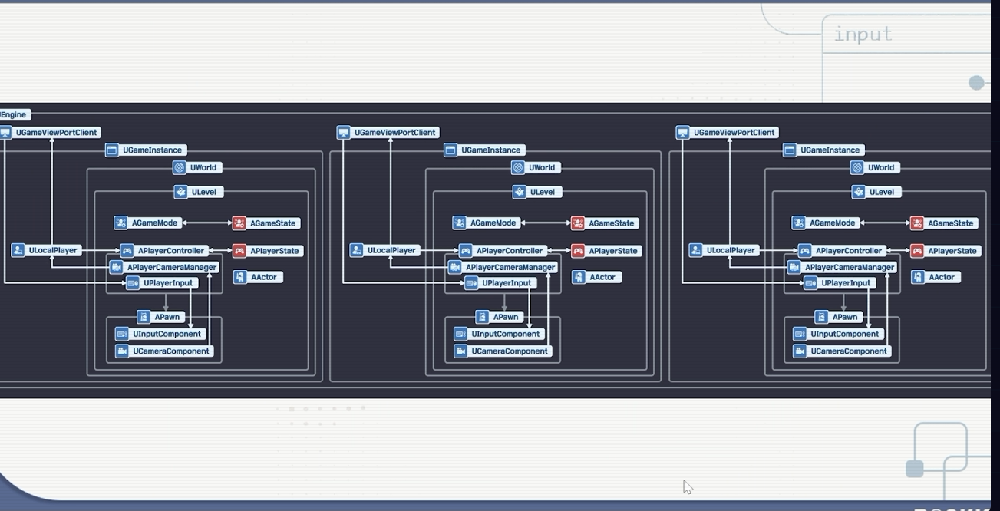

PIE를 여러개 키면 이렇게 된다.

</details>

<details>
<summary>UWorld</summary>

> UWorld클래스는 <b>게임 속의 지구</b>이다.

<b>월드 안에는 여러개 레벨이 존재 가능하다.</b>

단 PersistenceLevel은 단 하나만 존재 가능하고, 다른 레벨들은 로드되거나 언로드 된다고해서 월드의 생명주기에 영향을 미치지 않는다.

---

<b>언리얼 게임 월드 내 로직은 하나의 씬에서 처리되지 않는다.</b>

우리가 영화를 찍는다고할때 한개의 세트장에서 기획부터 촬영, 특수효과, 편집까지 다 한다고 생각해보자

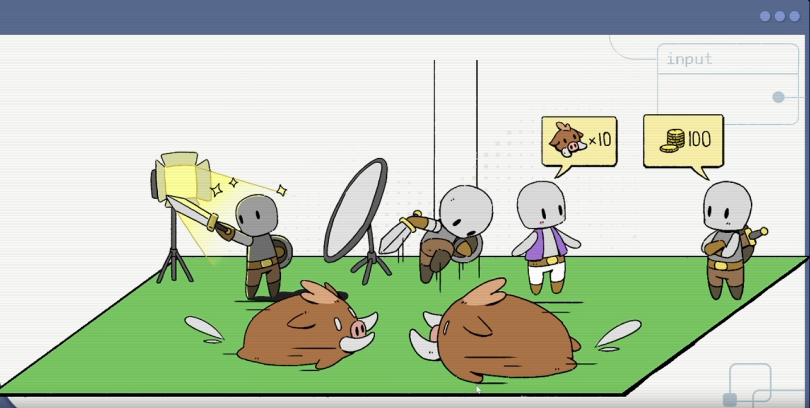

그래서 이렇게 메인세트장, 전투 세트장, vfx세트장등을 나눠서 처리한다.

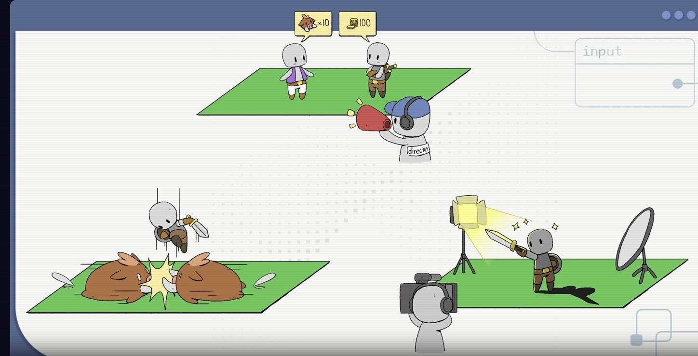

언리얼도 이렇게 세트장들이 나누어져있다. (다양한 역할의 World들이 있다.)

언리얼의 <b>메인 세트장은 Game World</b>라고 부른다.<br />게임의 흐름, 행동 규칙등 게임의 모든것을 총괄하는 월드이다.

<b>물리적인 연산</b>이 이루어지는 <b>Physics Scene</b>가 있다.<br />엔진 내에서 이루어지는 모든 물리연산은 이곳에서 이루어지고 <b><span>연산량이 가장 높다</span></b>.

게임의 모든 그래픽적인 요소와 플레이어의 화면에 보여줄것을 그려내는 <b>Render Scene</b>가 있다.

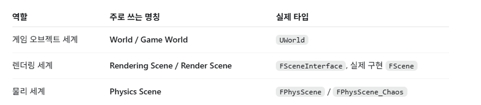

각 세트장에는 Staff들이 필요하다. 

- Game World에서는 감독
- PhysicsWorld에서는 물리 연산하는 Staff
- Render World에서는 씬을 촬영하는 Staff이 필요할 것이다.

이 <b>Staff들을 Thread</b>라고 부른다.

즉 쓰레드가 GameWorld에서는 감독으로 일하고, 다른월드에서는 그 월드에 맞는 일을하게 된다.

<aside class="callout">

만약 쓰레드가 혼자서 각 Wolrd들을 방문하면서 일을 처리한다면??

</aside>

⇒ 당연히 일손이 부족할 것이고 Cpu처리 속도가 떨어지게 될 것이다

그래서 각 World에 전용 쓰레드들을 배치한다.

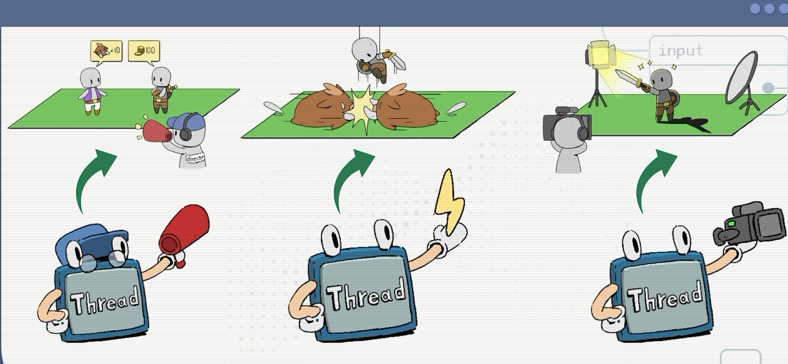

즉 <b>언리얼 엔진은 멀티쓰레드 환경</b>으로 돌아간다는 것이다.

</details>

<details>
<summary>ULevel</summary>

> ULevel클래스는 <b>지구 속의 나라</b>이다.

여담이지만 예전에는 최적화를 위해서 Static한 Object들만 모아놓은 Level과 Dynamic한 Object들만 모아놓은 Level을 따로 관리해서 최적화를 했다는데 (Static한애들은 Light같은거 bake했겠지)

<b>요즘엔 WorldPartition을 사용</b>하는 방식을 더 자주사용한다 (얘가 패러다임을 많이 바꿨다고 함)

</details>

<details>
<summary>AActor</summary>

> <b>World에 배치할 수 있는 최소단위</b>

UObject는 Transform정보가 없어서 World에 배치할 수 없고, World의 생명주기와도 무관하다<br />UObject는 자신의 모습을 스스로 형상화 할 수 없다

AActor클래스는 World의 생명주기와 연관되어있고, Transform 정보가(SceneComponent) 있으니까 월드에 배치할 수 있다. 

<b>개념적으로만 보면 그냥 Actor은 UObject에 SceneComponent를 붙인것이다.</b>

SceneComponent계열은 Transform정보를 가지고 있어서 Actor의 RootComponent로 사용이 가능하고, 없는경우 엔진에서 강제로 SceneComponent를 만들어서 Root로 설정한다.

이 <b>AActor를 상속받으면 클래스 접두사에 A를 붙인다</b>.

</details>

<details>
<summary>AGameMode</summary>

> <b>World의 관리자</b>이다.

보통 게임의 규칙을 담당하는 클래스로 알고있는데 그건 클라이언트 구현단위에서의 관점이고<br />엔진에서는 <b>World의 관리자 역할</b>을 하고있다. (애초에 규칙은 관리자만 정할 수 있다.)

그렇기 때문에 <b>본인이 생성된 World에서만 관리될 수 있도록 Actor형태로 존재</b>한다.

GameMode는 월드에 단일 객체로 존재한다<br />만약 서버가 있으면  Host의 월드만 이 GameMode를 가지고 있다.

</details>

<details>
<summary>AGameState</summary>

> GameState는 <b>게임의 상태</b>이자 GameMode정보 전달자이다.

이 개념 이해를 위해서는 Dedicate개념을 알아야한다 

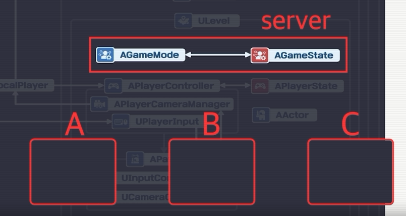

위에서 말했듯이 GameMode는 Server에만 존재한다. 그럼 Client들은 어떻게 게임 규칙을 알 수 있을까?<br /><br />이 문제를 GameState가 해결한다.<br /><b>GameState는 Host</b>에 존재하고 <b>Client들은 그것의 복제본을 소유</b>한다.

- 서버 GameState: 실제 상태를 변경하는 권한을 가짐
- 클라이언트 GameState: 서버로부터 복제된 상태를 읽고 UI 등에 사용

왜냐하면 <b>GameMode는 관리자</b>인데 각 클라이언트에서 GameMode에 접근해 수정할수 있으면 모든 클라이언트가 관리자가 되어버린다.

GameState에서 Replication을 킨 프로퍼티들은 Client들의 GameState로 복제된다.

</details>

<details>
<summary>APlayerController</summary>

> World세상의 나를 대변한다.

APlayerController는 형태가 없지만 ‘<i><b>World</b></i>’세상의 나를 대변하기위해 Actor를 상속받는다. 

왜 이름이 컨트롤러냐? ⇒ 우리 게임할때도 컨트롤러만으로는 아무것도 할 수 없잖아 그래서 내가 어떤걸 조종할래! 라고 설정하고 그걸 컨트롤 하는것이다.

UE에서는 APlayerController가 <b>조종하고싶은 대상의 최소 단위를 APawn</b><br />APawn을 <b>선택(빙의)하는 행위를 Possess</b>라고 한다.

따라서 Controller는 Pawn과 종속이 깊다는것을 알 수 있다.

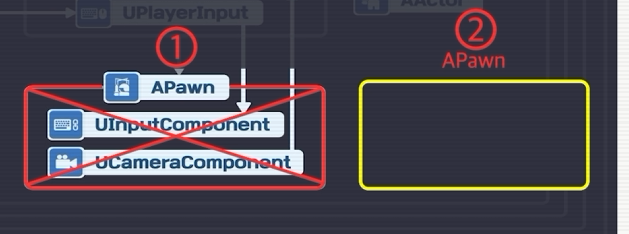

사진처럼 Pawn1,2가 있을때 Controller는 Pawn만 갈아타는 방식으로 빙의 대상을 바꿀 수 있다.

<details>
<summary>APlayerCameraManager (Pawn → Controller)</summary>

UCameraComponent에게 데이터를 받는다.

Pawn에는 자식으로 Camera들이 붙어있을것이다.<br />그럼 플레이어 화면에는 어떤 Pawn의 카메라로 화면을 렌더링 할 것인가???

답은 간단하다 : 빙의중인 Pawn의 Camera로 렌더링하면 된다.

<aside class="callout">

그럼 왜? Pawn으로부터 데이터를 받을까?

</aside>

이것에대한 답변도 간단하다.

Pawn에 붙어있는 카메라의 Transform이나 연출같은건 무궁무진 할 것이다.<br />근데? 이것을 Controller가 다 들고있는거는 상상하고 싶지 않다;;

</details>

<details>
<summary>UPlayerInput (Controller → Pawn)</summary>

> <b>게임의 매 틱마다 Input을 했다는 사실을 알려준다.</b>

UInputComponent에게 데이터를 넘겨준다.

이것도 당연하다.

맥크리는 좌클릭때 총을 쏠 것이고, 스타크래프트는 좌클릭때 오브젝트을 선택할 것이다.

이건 Controller가 아니라 Pawn마다 다른 데이터이다.<br />따라서 Controller의 PlayerInput은 Pawn의 InputComponent에 어떤 함수들이 바인딩 되어있는지 알 필요가 없다.

InputComponent에 어떤 키를 눌렀는지만 알려주면 그 이후는 Component가 알아서 일 할 것이다.

</details>

</details>

<details>
<summary>APlayerState</summary>

> PlayerState는 <b>플레이어의 상태</b>이자 PlayerController정보 전달자이다

얘도 네트워크 게임에서 사용되는 내용이다.

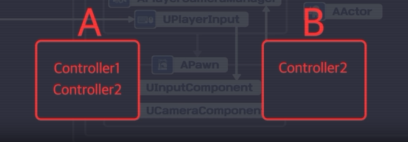

사진같은 상황은 있을수는 있지만 일반적이지는 않다.<br />왜냐하면 이럼 2번컨트롤러가 A와 B를 같이 움직일것이다.

그래서 <b>네트워크상에서는 상대방의 Controller으로의 접근을 막아</b>놨을 것이다.<br />(Private한 데이터는 Controller에 Public한 데이터는 ReadOnly로 PlayerState에)<br />하지만 <b>B는 A의 Hp와 Mp를 알아야 </b>UI에 해당 정보들을 띄울 수 있을 것이다.

이때 사용되는게 <b>PlayerState</b>이다. 

싱글에서는 딱히 쓸 일 없당

</details>

<details>
<summary>APawn</summary>

> APawn은 <b>Controller에게 빙의되서 조종당하는</b> Actor이다.

<details>
<summary>UCameraComponent (Pawn → Controller)</summary>

APlayerCameraManager에게 데이터를 넘겨준다.

</details>

<details>
<summary>UInputComponent (Controller → Pawn)</summary>

> <b>Input과 함수를 Bind한다.</b>

UPlayerInput에게 데이터를 받는다. 

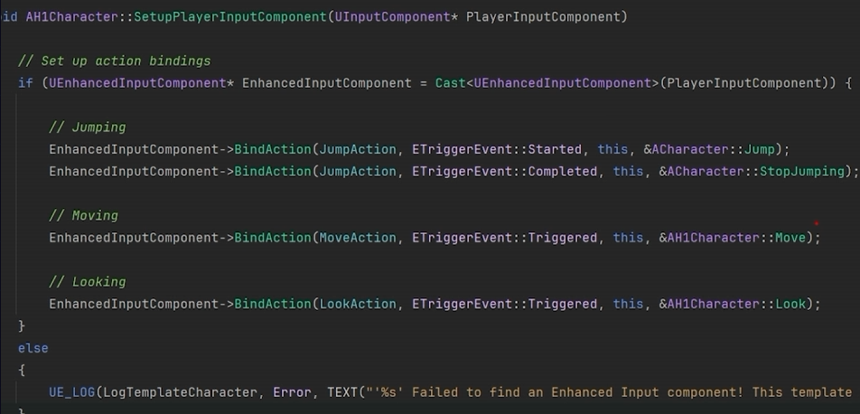<br><em>함수와 바인딩하는 코드…</em>

</details>

</details>

<details>
<summary>ULocalPlayer</summary>

> 진짜 나 자신!

얘는 액터가 아니다! ⇒ <b>월드의 생명주기와 무관</b>하다!<br />PlayerController도 나 자신을 대변하지만 PC는 월드가 바뀌면 재생성된다.

로컬플레이어는 GameInstance간 나를 대변한다.

즉 LocalPlayer는 Engine Level, PlayerController는 World Level이다.

</details>

<details>
<summary>UGameViewportClient</summary>

> <b>게임 화면이 표시되는 뷰포트와 엔진 사이의 관리자/중계자</b>

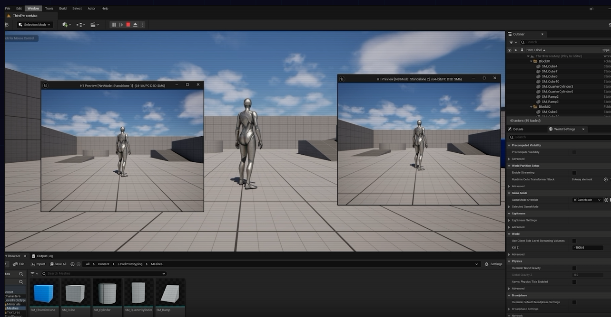

말그대로 뷰포트를 담당한다. 모니터라고 부르는게 맞는거같음

그런데 렌더링만 한다는것은 아니고 멀티플랫폼에서의 인풋, 사운드 등의 처리를 한다고한다.

#### Input (<b>UGameViewportClient → ULocalPlayer → UPlayerInput)</b>

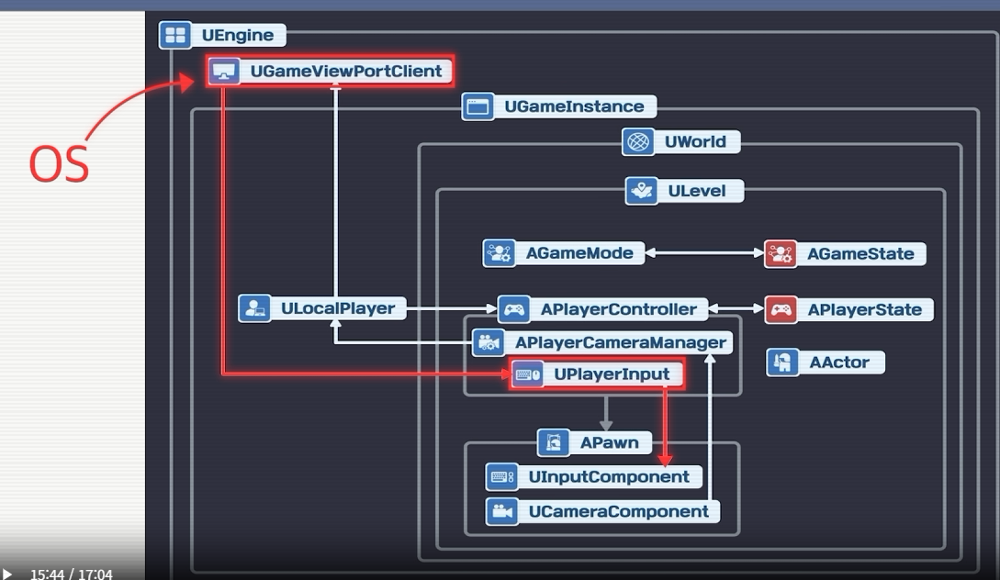

예를들어 키보드 W를 누르면<br />→ 운영체제 → 언리얼 게임 Window → UGameViewportClient → PlayerController → 캐릭터가 앞으로 이동

#### Rendering (<b>UCameraManager → ULocalPlayer → UGameViewportClient )</b>

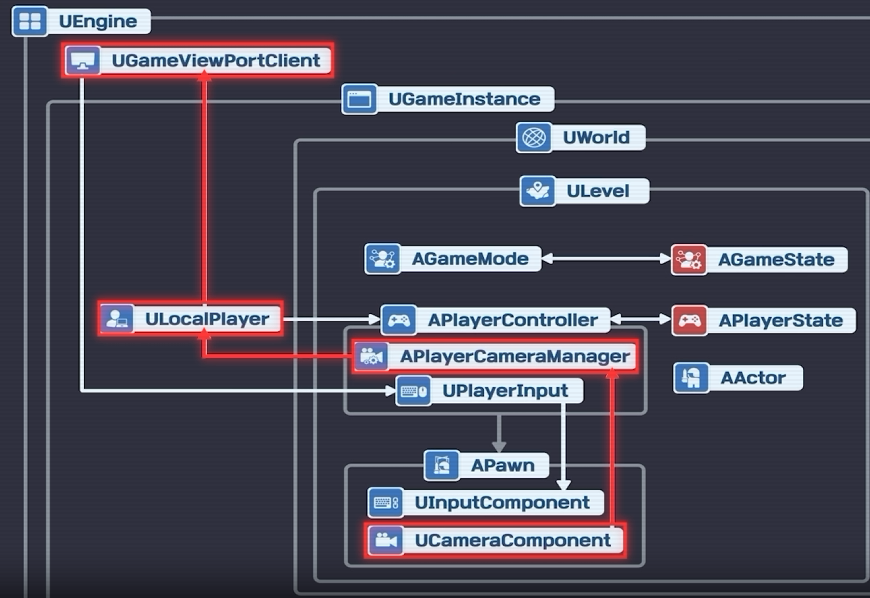

</details>

---

## 추가 메모

<details>
<summary>CameraComponent → GameViewportClient 과정</summary>

<blockquote>

<code>UCameraComponent</code>가 화면을 직접 그리는 것이 아니다.

카메라 후보 정보를 만들고, <code>UPlayerCameraManager</code>가 최종 카메라를 확정한다.

<code>ULocalPlayer</code>가 그 카메라를 실제 화면 크기에 맞는 렌더링 데이터로 바꾸고,

<code>UGameViewportClient</code>가 모든 플레이어의 화면을 모아서 렌더러에 넘긴다.

</blockquote>

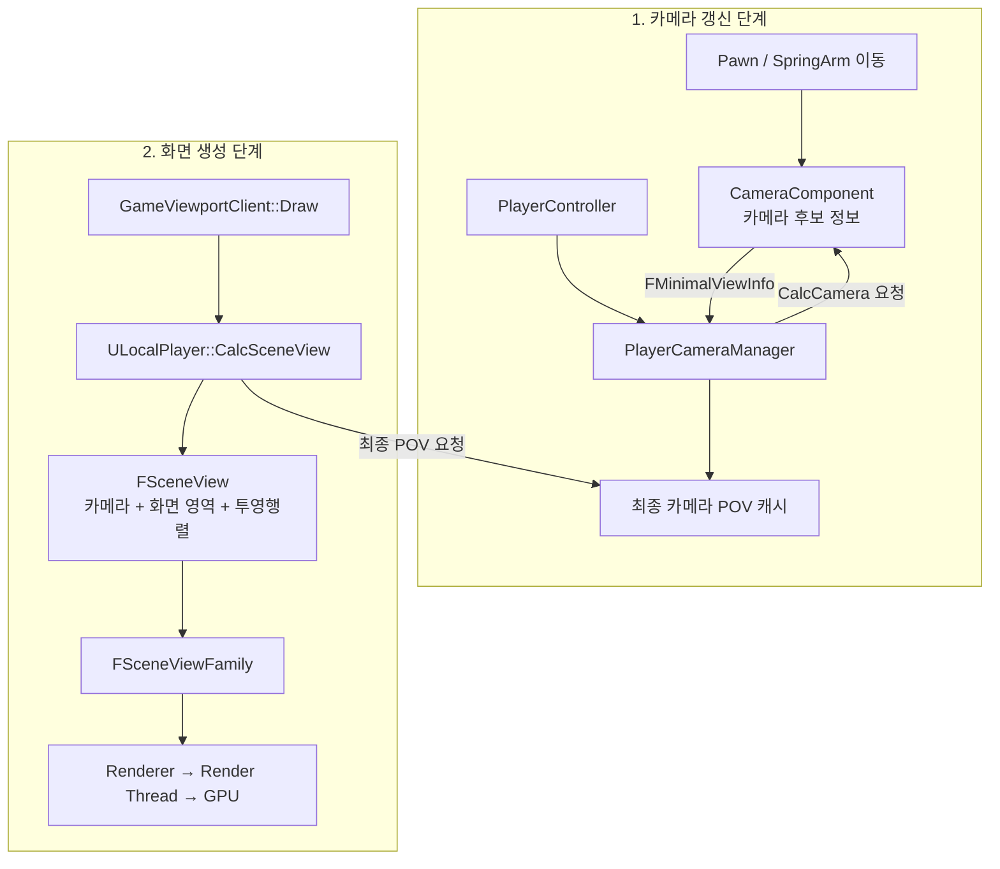

## 1. <code>UCameraComponent</code>가 하는 일

<code>CameraComponent</code>는 쉽게 말하면 <b>카메라의 위치와 렌즈 설정을 보관하는 부품</b>

<details>
<summary><b>FMinimalViewInfo</b> (위치 회전 시야각 등 카메라 뷰 정보를 담는다)</summary>

```c++
카메라 위치
카메라 회전
FOV
원근/직교 투영 방식
종횡비
Ortho Width
Post Process 설정 등등

USTRUCT(BlueprintType)
struct FMinimalViewInfo
{
	GENERATED_USTRUCT_BODY()

	/** Location */
	UPROPERTY(EditAnywhere, BlueprintReadWrite, Category=Camera)
	FVector Location;

	/** Rotation */
	UPROPERTY(EditAnywhere, BlueprintReadWrite, Category=Camera)
	FRotator Rotation;

	/** The horizontal field of view (in degrees) in perspective mode (ignored in orthographic mode). */
	UPROPERTY(EditAnywhere, BlueprintReadWrite, Category=Camera)
	float FOV;

	/** The originally desired horizontal field of view before any adjustments to account for different aspect ratios */
	UPROPERTY(Transient)
	float DesiredFOV;

	/** The horizontal field of view (in degrees) used for primitives tagged as "IsFirstPerson". */
	UPROPERTY(EditAnywhere, BlueprintReadWrite, Category = Camera)
	float FirstPersonFOV;

	/** The scale to apply to primitives tagged as "IsFirstPerson". This is used to scale down primitives towards the camera such that they are small enough not to intersect with the scene. */
	UPROPERTY(EditAnywhere, BlueprintReadWrite, Category = Camera)
	float FirstPersonScale;

	/** The desired width (in world units) of the orthographic view (ignored in Perspective mode) */
	UPROPERTY(EditAnywhere, BlueprintReadWrite, Category=Camera)
	float OrthoWidth;

	/** Option for the Ortho camera to automatically calculated the near/far plane */
	UPROPERTY(EditAnywhere, BlueprintReadWrite, Category=Camera)
	bool bAutoCalculateOrthoPlanes;

	/** Manually adjusts the planes of this camera, maintaining the distance between them. Positive moves out to the farplane, negative towards the near plane */
	UPROPERTY(EditAnywhere, BlueprintReadWrite, Category = Camera)
	float AutoPlaneShift;

	/** Adjusts the near/far planes and the view origin of the current camera automatically to avoid clipping and light artefacting*/
	UPROPERTY(EditAnywhere, BlueprintReadWrite, Category = Camera)
	bool bUpdateOrthoPlanes;

	/** If UpdateOrthoPlanes is enabled, this setting will use the cameras current height to compensate the distance to the general view (as a pseudo distance to view target when one isn't present) */
	UPROPERTY(EditAnywhere, BlueprintReadWrite, Category = Camera)
	bool bUseCameraHeightAsViewTarget;

	/** The near plane distance of the orthographic view (in world units) */
	UPROPERTY(Interp, EditAnywhere, BlueprintReadWrite, Category=Camera)
	float OrthoNearClipPlane;

	/** The far plane distance of the orthographic view (in world units) */
	UPROPERTY(Interp, EditAnywhere, BlueprintReadWrite, Category=Camera)
	float OrthoFarClipPlane;

	/** The near plane distance of the perspective view (in world units). Set to a negative value to use the default global value of GNearClippingPlane */
	UPROPERTY(Interp, EditAnywhere, BlueprintReadWrite, Category=Camera)
	float PerspectiveNearClipPlane;

	// Aspect Ratio (Width/Height)
	UPROPERTY(EditAnywhere, BlueprintReadWrite, Category=Camera)
	float AspectRatio;

	// Aspect ratio axis constraint override
	TOptional<EAspectRatioAxisConstraint> AspectRatioAxisConstraint;

	// If bConstrainAspectRatio is true, black bars will be added if the destination view has a different aspect ratio than this camera requested.
	UPROPERTY(EditAnywhere, BlueprintReadWrite, Category=Camera)
	uint32 bConstrainAspectRatio:1; 

	// If bUseFirstPersonParameters is true, FirstPersonFOV and FirstPersonScale should be applied to primitives tagged as "IsFirstPerson".
	UPROPERTY(EditAnywhere, BlueprintReadWrite, Category = Camera)
	uint32 bUseFirstPersonParameters : 1;

	// If true, account for the field of view angle when computing which level of detail to use for meshes.
	UPROPERTY(EditAnywhere, AdvancedDisplay, BlueprintReadWrite, Category=CameraSettings)
	uint32 bUseFieldOfViewForLOD:1;

	// The type of camera
	UPROPERTY(EditAnywhere, BlueprintReadWrite, Category=Camera)
	TEnumAsByte<ECameraProjectionMode::Type> ProjectionMode;

	/** Indicates if PostProcessSettings should be applied. */
	UPROPERTY(BlueprintReadWrite, Category = Camera)
	float PostProcessBlendWeight;

	/** Post-process settings to use if PostProcessBlendWeight is non-zero. */
	UPROPERTY(BlueprintReadWrite, Category = Camera)
	struct FPostProcessSettings PostProcessSettings;

	/** Off-axis / off-center projection offset as proportion of screen dimensions */
	UPROPERTY(Transient, VisibleInstanceOnly, BlueprintReadWrite, Category = Camera)
	FVector2D OffCenterProjectionOffset;

	/** Optional transform to be considered as this view's previous transform */
	TOptional<FTransform> PreviousViewTransform;

	/** Resolution fraction that scales with the amount of overscan added to the view */
	UPROPERTY(EditAnywhere, BlueprintReadWrite, Category=Camera)
	float OverscanResolutionFraction;
	
	/** The fraction between 0.0 and 1.0 of the view to crop to during the final post process upscale, with 1.0 meaning no crop */
	UPROPERTY(EditAnywhere, BlueprintReadWrite, Category=Camera, meta=(ClampMin=0.0, UIMin=0.0, ClampMax=1.0, UIMax=1.0))
	float CropFraction;

	/**
	 * Experimental: The fraction for each edge between 0.0 and 1.0 of the view to crop to during the final post process upscale, with 1.0 meaning no crop.
	 * By convention, X is the left edge, Y is the right edge, Z is the top edge, and W is the bottom edge. Stacks with uniform CropFraction.
	 */
	UPROPERTY(EditAnywhere, BlueprintReadWrite, Category=Camera, meta=(ClampMin=0.0, UIMin=0.0, ClampMax=1.0, UIMax=1.0))
	FVector4f AsymmetricCropFraction;
	
private:
	/** The amount of overscan that has been applied to the view's frustum, with 0.0 meaning no overscan and 1.0 meaning 100% overscan */
	float Overscan;

	/**
	 * Experimental: The amount of asymmetric overscan that has been applied to the view's frustum, with 0.0 meaning no overscan and 1.0 meaning 100% overscan.
	 * By convention, X is the left overscan, Y is the right overscan, Z is the top overscan, and W is the bottom overscan. Stacks with uniform Overscan.
	 */
	FVector4f AsymmetricOverscan;
	
	// Only used for Ortho camera auto plane calculations, tells the Near plane of the extra distance that needs to be added.
	FVector CameraToViewTarget;
}
```

</details>

<b>CameraManager가 이 데이터를 가져와서 사용합니다</b>.

## 2. <code>APlayerCameraManager</code>가 하는 일

<code>PlayerCameraManager</code>는 <b>해당 플레이어가 이번 프레임에 실제로 사용할 최종 카메라를 결정</b>합니다.

일반적으로 <code>PlayerController</code> 하나마다 <code>PlayerCameraManager</code> 하나가 있습니다.

주요 역할은 다음과 같습니다.

```txt
현재 ViewTarget 결정
CameraComponent의 기본 카메라 정보 가져오기
카메라 전환 블렌딩
Camera Shake 적용
Camera Modifier 적용
FOV 변경
Post Process 혼합
최종 위치와 회전 확정
최종 POV 캐싱
```

매 프레임 액터들의 Tick이 끝난 뒤 대략 다음 순서로 호출됩니다.

```txt
// 호출 스택이다.
APlayerController::UpdateCameraManager()
→ APlayerCameraManager::UpdateCamera()
→ APlayerCameraManager::UpdateViewTarget()
→ ViewTarget Actor::CalcCamera()
→ UCameraComponent::GetCameraView()
```

<code>PlayerCameraManager::UpdateCamera()</code>는 다른 액터의 Tick이 끝난 뒤 매 프레임 호출됩니다.

### 🤨CameraComponent가 항상 사용되는 것은 아님

보통 ViewTarget Actor의 활성화된 CameraComponent를 찾지만 예외도 있습니다.

```txt
Actor가 CalcCamera()를 직접 오버라이드
CameraComponent가 없는 Actor 사용
특수 카메라 시스템 사용
시네마틱 카메라 사용
```

즉, 정확한 구조는:

```txt
PlayerCameraManager
→ ViewTarget Actor에게 카메라 계산 요청
→ Actor가 CameraComponent를 사용할 수도 있음
```

## 3. <code>ULocalPlayer</code>가 하는 일

<code>ULocalPlayer</code>는 <b>최종 카메라 정보를 실제 화면에 맞는 렌더링 뷰로 변환</b>합니다.

다음 둘은 서로 다른 개념입니다.

```txt
PlayerController
= 월드 안에서 플레이어를 조종하는 Actor

ULocalPlayer
= 이 컴퓨터에서 플레이 중인 로컬 플레이어 객체
```

<code>ULocalPlayer</code>는 다음 관계를 연결합니다.

```txt
PlayerController의 카메라
↕
게임 창 안에서 해당 플레이어가 사용할 화면 영역
```

렌더링할 때 <code>UGameViewportClient</code>가 다음과 비슷한 함수를 호출합니다.

```txt
LocalPlayer->CalcSceneView(
    ViewFamily,
    ViewLocation,
    ViewRotation,
    Viewport,
    ViewDrawer,
    StereoViewIndex
);
```

<code>ULocalPlayer::CalcSceneView()</code>는 다음 작업을 합니다.

1. PlayerController/PlayerCameraManager에서 최종 POV를 가져옵니다.
2. 자신에게 할당된 화면 영역을 계산합니다.
3. 화면 종횡비를 계산합니다.
4. FOV와 화면 크기를 이용해 투영행렬을 만듭니다.
5. 최종 <code>FSceneView</code>를 생성합니다.

### 왜 CameraManager가 직접 하면 안 될까?

CameraManager는 카메라의 위치와 렌즈 정보는 알지만, 그 카메라가 게임 창의 어느 부분에 표시될지는 모릅니다.

예를 들어 2인 분할 화면이라면:

```txt
전체 게임 창: 1920 × 1080

LocalPlayer 0: 왼쪽 960 × 1080
LocalPlayer 1: 오른쪽 960 × 1080
```

두 플레이어의 CameraManager는 각자의 최종 카메라를 계산합니다.

하지만 화면을 어디에 배치할지는 <code>UGameViewportClient</code>와 <code>ULocalPlayer</code> 영역입니다.

```txt
CameraManager
= 어디에서 어느 방향으로 볼 것인가?

ULocalPlayer
= 그 장면을 화면의 어느 영역에 어떤 투영으로 표시할 것인가?
```

## 4. <code>UGameViewportClient</code>가 하는 일

<code>UGameViewportClient</code>는 <b>게임 창 전체의 렌더링을 지휘하는 관리자</b>입니다.

일반적으로 게임 인스턴스 하나당 하나가 존재합니다.

매 프레임 <code>UGameViewportClient::Draw()</code>에서 대략 다음 작업을 수행합니다.

```txt
1. 현재 게임 창의 크기 확인
2. 분할 화면 배치 계산
3. FSceneViewFamily 생성
4. 각각의 ULocalPlayer에게 FSceneView 생성 요청
5. 모든 FSceneView를 FSceneViewFamily에 추가
6. 렌더러에 ViewFamily 전달
7. HUD, Canvas, 디버그 표시 등을 처리
```

대략적인 코드 형태로 표현하면 다음과 같습니다.

```txt
void UGameViewportClient::Draw(
    FViewport* Viewport,
    FCanvas* SceneCanvas)
{
    LayoutPlayers();

    FSceneViewFamilyContext ViewFamily(...);

    for (ULocalPlayer* LocalPlayer : LocalPlayers)
    {
        FSceneView* View =
            LocalPlayer->CalcSceneView(
                &ViewFamily,
                ViewLocation,
                ViewRotation,
                Viewport,
                nullptr,
                INDEX_NONE
            );

        // 생성된 View는 ViewFamily에 포함됨
    }

    FinalizeViews(&ViewFamily, PlayerViewMap);

    Renderer->BeginRenderingViewFamily(
        SceneCanvas,
        &ViewFamily
    );
}
```

실제 구현은 더 복잡하지만 역할을 이해하기에는 이 형태가 핵심입니다.

</details>

---

## 정리

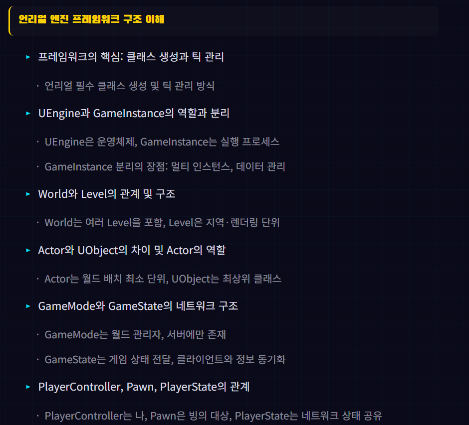
