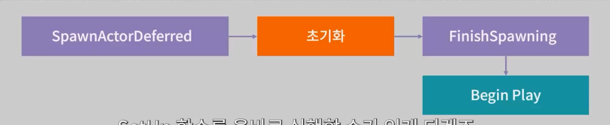

- [언리얼 프로젝트 폴더 구성](%ED%94%84%EB%A1%9C%EC%A0%9D%ED%8A%B8-%ED%8F%B4%EB%8D%94-%EA%B5%AC%EC%A1%B0-d92f8436.md)

- [헤더 참조 최소화](%ED%97%A4%EB%8D%94-%EC%9D%98%EC%A1%B4%EC%84%B1-%EC%A4%84%EC%9D%B4%EA%B8%B0-126ae805.md)

- [컴포넌트 종류](%EC%94%AC-%ED%94%84%EB%A6%AC%EB%AF%B8%ED%8B%B0%EB%B8%8C-%EC%BB%B4%ED%8F%AC%EB%84%8C%ED%8A%B8-3b783382.md)

<b>언리얼 엔진에서 제공하는 싱글톤 클래스</b>

- <b>게임 인스턴스 </b>: 보통 컨텐츠에 사용하기 보다는 어플리케이션 데이터를 관리하는 용도로 사용<b> </b>
- 애셋 매니저
- 게임플레이 관련 액터 (게임 모드, 게임 스테이트)
  <b>게임모드 </b>: 전체 게임(멀티플레이 포함)에서 단 하나만 존재하는 싱글톤 클래스

- <b>프로젝트에 싱글톤으로 등록한 언리얼 오브젝트</b> : 보통 컨텐츠에 사용

SpawnActor대신 SpawnActorDeferred를 사용하면

BeginPlay이전에 특정 로직을 시행할 수 있다.

FinishSpawning을 호출해야지 BeginPlay로 넘어간다.



로그찍기 매크로

앵간치 인클루드 받는 헤더에 선언하자

```c++
#define LOG_NETMODEINFO ((GetNetMode() == ENetMode::NM_Client) ? *FString::Printf(TEXT("CLIENT%d"), GPlayInEditorID) : ((GetNetMode() == ENetMode::NM_Standalone) ? TEXT("STANDALONE") : TEXT("SERVER"))) 
																																																	// 몇번재 클라인지      // 클라가 아니고 스탠드얼론도 아니면                             얘는 서버임
#define LOG_CALLINFO ANSI_TO_TCHAR(__FUNCTION__) // 어느 클래스의 어떤 함수 몇번줄에서 실행되었는지 받아옴

#define AB_LOG(LogCat, Verbosity, Format, ...) UE_LOG(LogCat, Verbosity, TEXT("[%s] %s %s"), LOG_NETMODEINFO, LOG_CALLINFO, *FString::Printf(Format, ##__VA_ARGS__))
															// 이 가변인자가 ##__VA_ARGS__에 들어감																		

DECLARE_LOG_CATEGORY_EXTERN(LogABNetwork, Log, All); // 나만의 로그 카테고리 생성
// cpp에 아래코드 넣어줘야함
DEFINE_LOG_CATEGORY(LogABNetwork);
```
