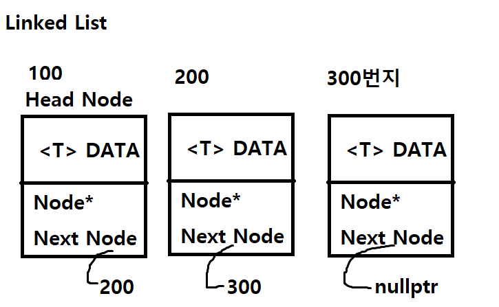
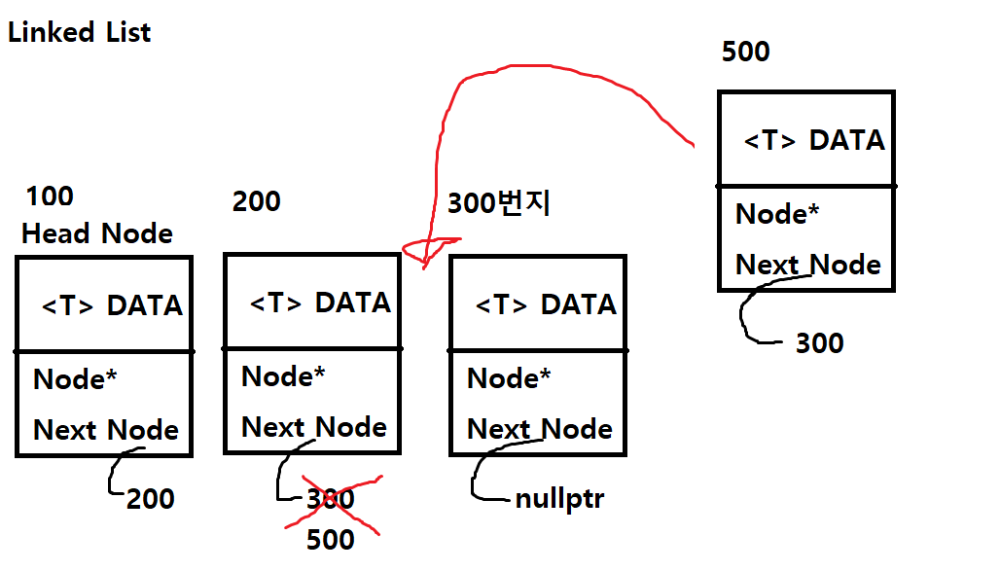
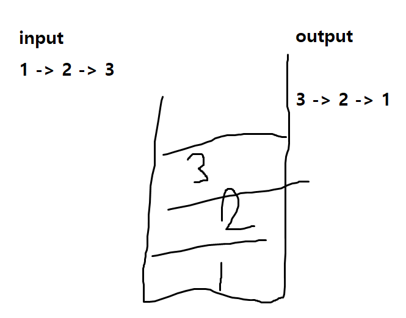

# <b>LinkedList</b>

- <b>장점 </b>: 추가 삽입 삭제가 빈번하게 일어날때 배열보다 유리함
             (배열은 idx에 삽입 삭제하려면 idx뒤의 배열을 전부 밀거나 땡겨와야함)

- <b>단점</b> : 한방향으로만 가서 end node에서 가까운 데이터 사용할수록 불리
            중간에서 이전으로 가고싶으면 처음부터 다시 순회해야함

### <b>구조</b>

이런 구조라서 데이터를 추가하거나 삭제할때

중간에 하나 삽입하고 <b>가리키는 노드만 바꾸면 됨</b>

### <b>노드 중간삽입</b>

위의 단점을 해결한것이 이름하야

### <b>양방향 LinkedList</b>

Node에 <b>이전 노드를 가리키는</b> <b>PrevNode 추가</b>

<b>동적할당을 해제할때</b>

- 노드를 순차적으로 해제후 ⇒ 링크드 리스트의 메모리를 해제한다.

# Stack

- 데이터가 늦게들어온놈이 먼저나간다.
  (1,2,3,4,5 들어가면 5,4,3,2,1 순으로 빠져나감)

- <b>후입선출</b>

