---

### <b>오일러 각도</b>

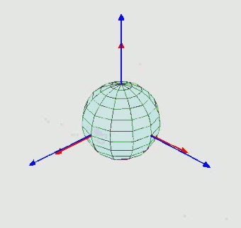

<ul>
<li>
세 개의 회전축만 있으면 회전을 통해 원하는 좌표계로 바꿀 수 있다.
</li>
<li>
세 개의 회전 행렬(XYZ)을 만들어서 곱해주면 원하는 회전이 될 것이다. 
</li>
</ul>

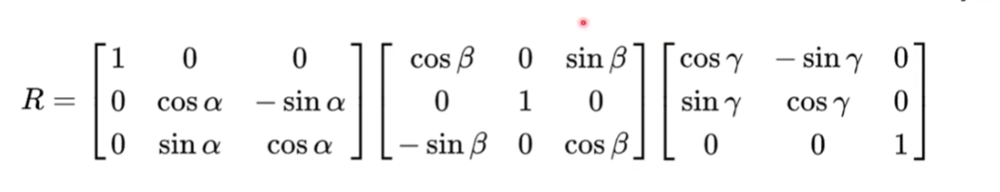

<b>오일러 각도의 문제점은 이 식에서 들어난다</b>

회전 변환의 대상 행렬 M이 있으면

M \* RX \* RY \* RZ를 수행하게 되는데

M \* RX 까지는 문제가 없으나 RY를 곱해줄 때 RX로 회전 된 상태에서 다시 회전을 시켜주는 것이기 때문에

위의 움짤처럼 기저 자체가 바뀌어 버린다.

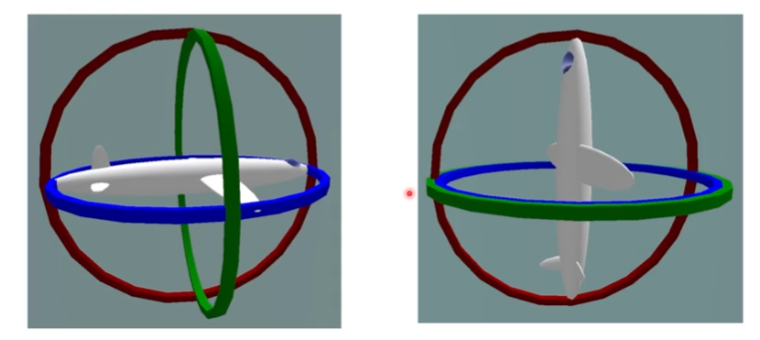

이렇게 두 기저가 겹쳐버리면 오브젝트는 한 방향으로의 회전이 잠기는

<b>짐벌 락 현상이 발생한다.</b>

<video controls preload="metadata" src="../media/7fe3932a86f97c8f455d.mp4"></video> <a href="../media/7fe3932a86f97c8f455d.mp4">2023-10-20_15-46-57.mkv</a>

그림에서는 front  == up인 현상이라 오른쪽이라는 개념이 모호해졌다

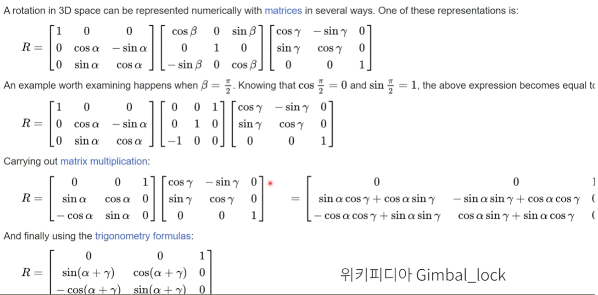

위 사진의 2번째 식처럼 어느 한 회전의 각도가 90도면 (그림에서는 Y축 회전)

한쪽방향으로의 회전이 고정되어버린다.

(예전 fps게임에서 정확히 하늘을보면 시점이 마구 뒤틀리는 현상을 경험한적이 있음)

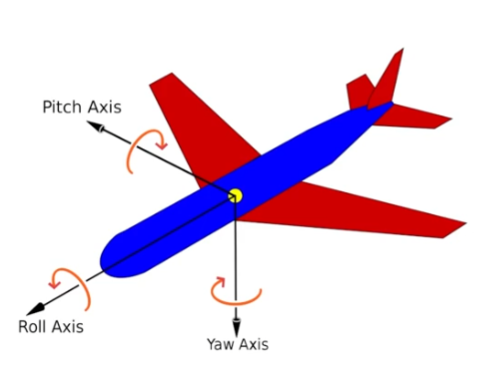

### 쿼터니언

- 하나의 회전 축에 대한 회전 각도로 표현한다.
  (3차원 회전을 숫자 4개로 표현한다. 따라서 한국어로 사원수라고 부른다.)

  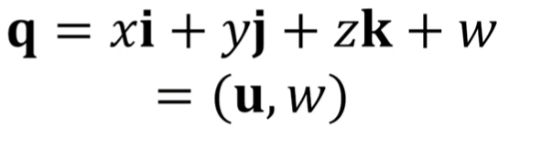
- 우리가 사용하는 회전 행렬과 호환되게 개발한다.
  우리가 사용하는 그래픽스 파이프라인은 행렬 계산에 유리하기 때문

- 회전의 보간에 유리하다.

<b>쿼터니언의 구성</b>

위 식의 i,j,k는 허수이고, x,y,z,w는 실수이다.

허수부를 하나로 묶어서 u라고 표기하기도 한다.

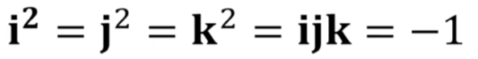

따라서 해당 식이 성립한다.

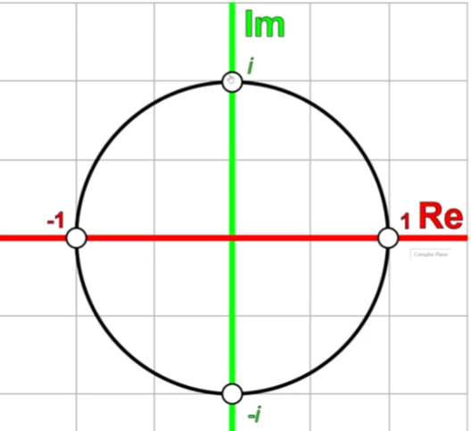

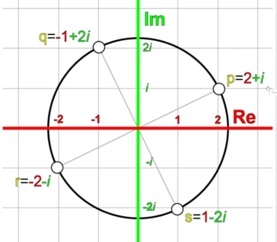

그림1

- 이런 좌표 평면이 있다고 할 때 실수 1에 i를 곱하면 i가 된다.
  따라서 i를 곱한다는 것은 실수축 위의 한 점을 i만큼 회전시킨다고 이해할 수 있다.

그림2

- 그림1의 성질과 복소수의 제곱이 -1인 성질을 이용해
  그림2처럼 표현할 수 있다.

---

아래 그림은 3차원의 회전(+ 실수부 해서 4처원)을 2차원으로 표현한 것이다.

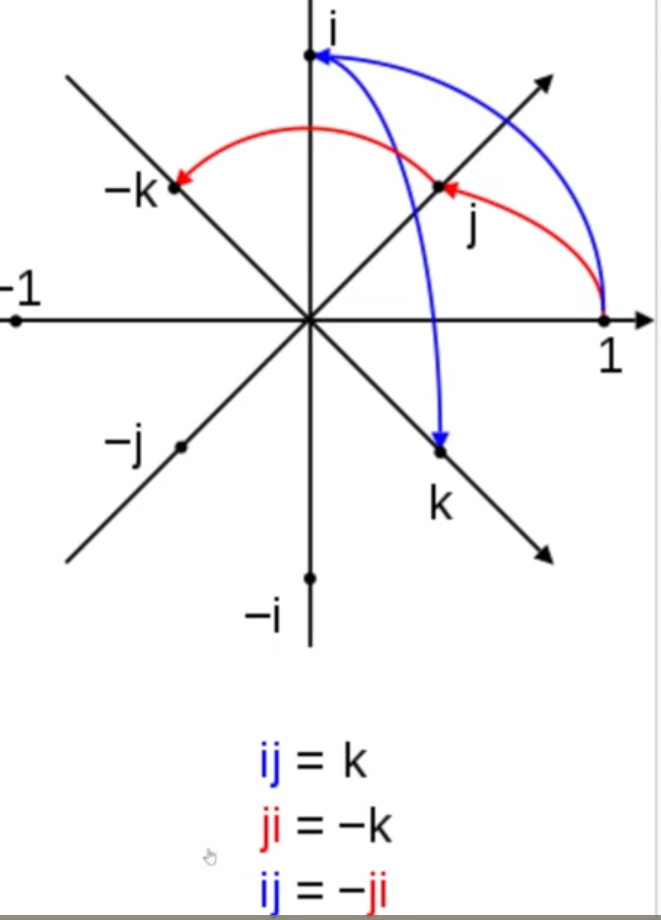

---

<b>사용</b>

벡터 v를 회전축 n에 대해 d만큼 회전시키고 싶다면

방법 a.

1. 벡터 v를 쿼터니언으로 만든다
   쿼터니언 p = (v, 0)

2. 회전축 n과 d를 이용해 회전 표현하는 쿼터니언을 만든다.
   q = (n.sin(d/2), cos(d/2))

3. Conjugate(짝) 쿼터니언을 만든다
   q\*  =  (-nsin(d/2), cos(d/2))

4. p를 회전시킨다.
   p’ = (v’, 0) = qpq\*

방법 b.

쿼터니언 q로부터 회전 행렬을 만들어서 사용한다.

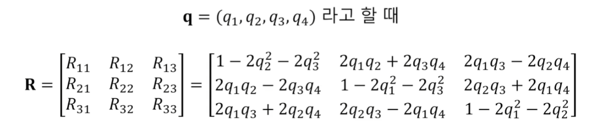

<b>쿼터니언의 연산</b>

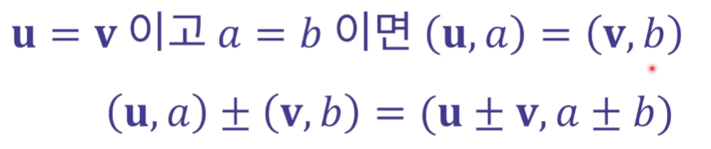

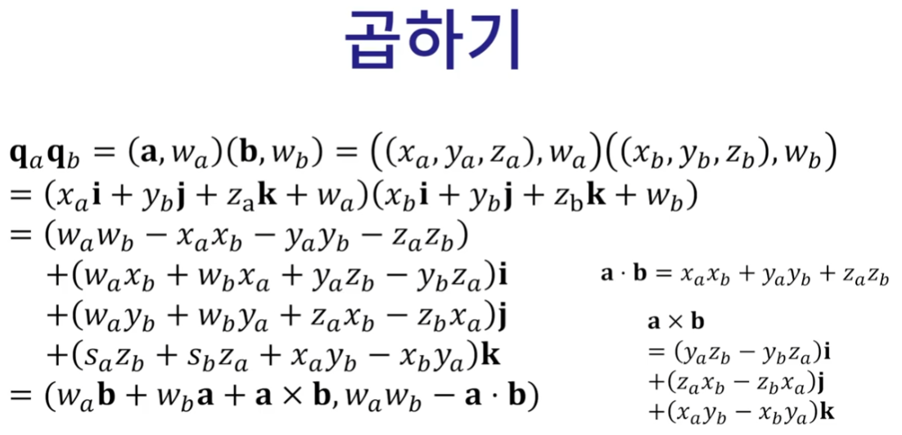

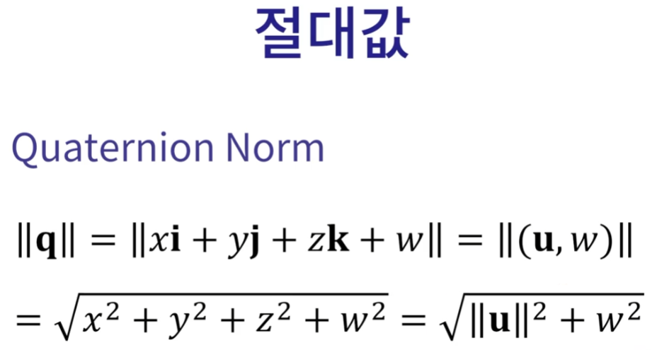

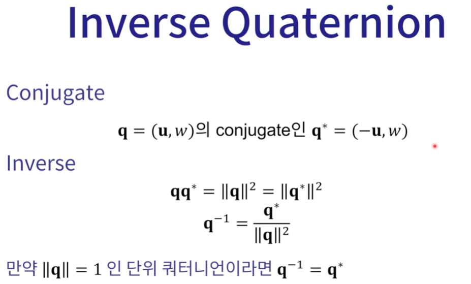

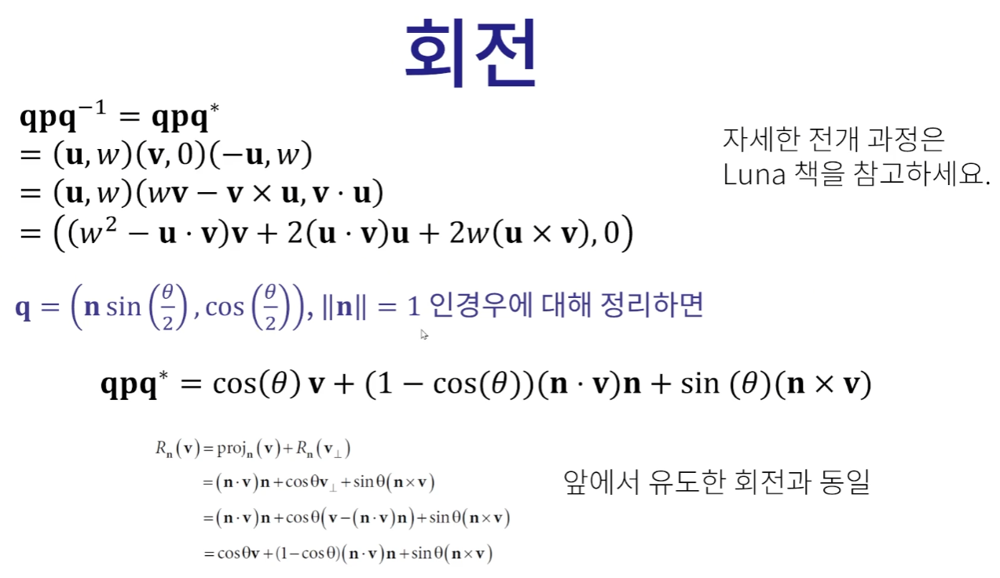
