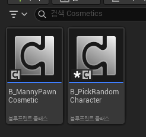
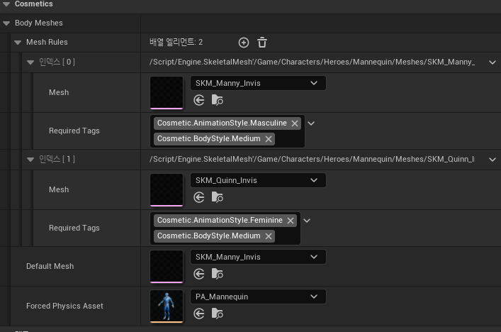
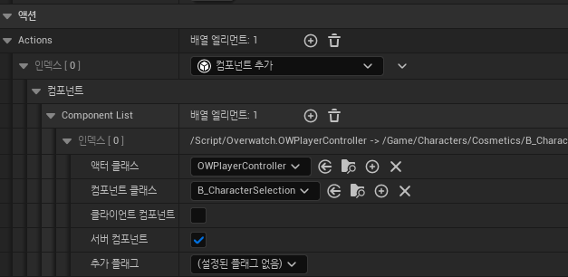
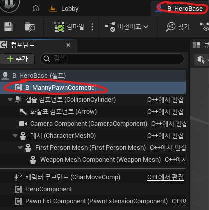
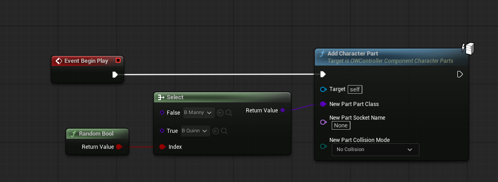

---

Cosmetic은 말그대로 치장이라는 의미로 사용된다.

Pawn에 붙는 메시/무기 스킨등을 변경하는데 사용한다고 한다.

---

이를 위해서 <code>UOWPawnComponent_CharacterParts</code>, <code>UOWControllerComponent_CharacterParts</code> 가 사용된다.

#### <b>UOWControllerComponent\_CharacterParts </b>

<code>UOWControllerComponent_CharacterParts</code> 는 <code>TArray&lt;FOWControllerCharacterPartEntry&gt;</code> 를 멤버로 갖는다.

<details>
<summary><b>FOWControllerCharacterPartEntry (파츠데이터와, Handler Wrapper)</b></summary>

```c++
// 컨트롤러 컴포넌트에서 요청한 캐릭터 파츠
USTRUCT()
struct FOWControllerCharacterPartEntry
{
	GENERATED_BODY()

	FOWControllerCharacterPartEntry()
	{}

public:
	// 이 항목이 나타내는 캐릭터 파츠
	UPROPERTY(EditAnywhere, meta=(ShowOnlyInnerProperties))
	FOWCharacterPart Part;

	// 이미 Pawn에 적용되었을 때의 핸들
	// 핸들러가 있으면 나중에 ValidCheck이나 값 조회할때 편하다. 언리얼에서 자주 사용한느 패턴이니 학습하면 좋음
	FOWCharacterPartHandle Handle;

	// 이 파츠의 출처
	ECharacterPartSource Source = ECharacterPartSource::Natural;
};

```

</details>

<details>
<summary><b>FOWCharacterPart (실제 파츠 데이터)</b></summary>

```c++
// 캐릭터 파츠 요청

USTRUCT(BlueprintType)
struct FOWCharacterPart
{
	GENERATED_BODY()

	// 스폰할 파츠
	// 언리얼에서는 메시 하나하나를 파츠로 보기보다는
	// 하나의 액터 프리팹을 파츠로 생각한다. (이는 블루프린트 친화성때문이라고 생각한다)
	// CC에서의 VisualComponents를 생각해보면 편할거같다 (이렇게 액터로 빼면 더 좋았을듯)
	UPROPERTY(EditAnywhere, BlueprintReadWrite)
	TSubclassOf<AActor> PartClass;

	// 파츠를 부착할 소켓입니다. 없을 수도 있습니다.
	UPROPERTY(EditAnywhere, BlueprintReadWrite)
	FName SocketName;

	// 파츠의 Primitive 컴포넌트 충돌 처리 방식
	UPROPERTY(EditAnywhere, BlueprintReadWrite)
	ECharacterCustomizationCollisionMode CollisionMode = ECharacterCustomizationCollisionMode::NoCollision;

	// 충돌 모드를 무시하고 다른 파츠와 비교합니다.
	static bool AreEquivalentParts(const FOWCharacterPart& A, const FOWCharacterPart& B)
	{
		return (A.PartClass == B.PartClass) && (A.SocketName == B.SocketName);
	}
};

```

</details>

---

Cosmetic은 게임 규칙이라기보다는 "Pawn을 어떻게 보이게 할 것인가"에 가까운 영역이다.

그래서 라이라식 구조에서는 Cosmetic 상태를 Pawn 내부에 직접 하드코딩하지 않고, <b>Controller가 원하는 파츠 목록을 들고 있다가 현재 Possess 중인 Pawn에 적용</b>하는 식으로 나눈다.

쉽게 말하면

- Controller 쪽 : 플레이어가 어떤 외형을 쓰고 싶은지 기억
- Pawn 쪽 : 지금 화면에 붙어야 하는 파츠 액터를 실제로 스폰/제거
- FastArray : 서버가 정한 파츠 목록을 클라이언트에 효율적으로 복제
- Cosmetic Tag : 붙은 파츠들을 보고 바디 메시/애니 레이어를 고르는 기준

---

<b>큰 흐름</b>

현재 Cosmetic 흐름의 핵심은 이거다.

```txt
ControllerComponent_CharacterParts
    -> PawnComponent_CharacterParts
        -> FOWCharacterPartList (FastArray Replication)
            -> FOWAppliedCharacterPartEntry
                -> UChildActorComponent로 실제 Part Actor 스폰
                    -> Part Actor의 GameplayTag를 모아 BodyMesh/AnimLayer 선택
```

왜 이렇게 하냐

→ Pawn은 리스폰, possession 변경, 관전, 캐릭터 교체 등으로 바뀔 수 있다.

하지만 플레이어가 선택한 스킨/파츠 요청은 Pawn보다 오래 살아야 할 수 있다.

그래서 <b>요청 목록은 ControllerComponent가 들고</b>, <b>현재 Pawn에 실제로 붙는 시각화는 PawnComponent가 담당</b>한다.

---

<b>FOWCharacterPartHandle</b>

```c++
USTRUCT(BlueprintType)
struct FOWCharacterPartHandle
{
    GENERATED_BODY()

    void Reset()
    {
        PartHandle = INDEX_NONE;
    }

    bool IsValid() const
    {
        return PartHandle != INDEX_NONE;
    }

private:
    UPROPERTY()
    int32 PartHandle = INDEX_NONE;

    friend FOWCharacterPartList;
};
```

이 핸들은 "내가 추가한 파츠를 나중에 제거하기 위한 표식"이다.

<code>FOWCharacterPart</code> 자체를 비교해서 제거할 수도 있지만, 같은 클래스/소켓의 파츠가 여러 번 추가되거나 출처가 다르면 애매해질 수 있다.

그래서 Add할 때 <code>PartHandleCounter</code>로 핸들을 만들고, Remove할 때 이 핸들을 기준으로 제거한다.

중요한 점은 <code>PartHandle</code>이 <code>private</code>이고 <code>FOWCharacterPartList</code>만 friend라는 것이다.

즉 아무나 핸들 값을 조작하지 못하고, 리스트만 핸들 생성/해석을 담당한다.

---

<b>FOWCharacterPart</b>

```c++
USTRUCT(BlueprintType)
struct FOWCharacterPart
{
    GENERATED_BODY()

    UPROPERTY(EditAnywhere, BlueprintReadWrite)
    TSubclassOf<AActor> PartClass;

    UPROPERTY(EditAnywhere, BlueprintReadWrite)
    FName SocketName;

    UPROPERTY(EditAnywhere, BlueprintReadWrite)
    ECharacterCustomizationCollisionMode CollisionMode = ECharacterCustomizationCollisionMode::NoCollision;
};
```

<code>FOWCharacterPart</code>는 실제로 붙일 외형 하나에 대한 데이터이다.

여기서 Mesh를 직접 들고 있지 않고 <code>TSubclassOf&lt;AActor&gt;</code>를 들고 있다는 점이 포인트다.

왜 Actor냐

→ Cosmetic Part가 단순 SkeletalMesh 하나일 수도 있지만, 파티클, 사운드, 추가 컴포넌트, GameplayTag, Blueprint 로직을 같이 들 수 있다.

메시 경로 하나만 들면 확장성이 약한데, Actor 클래스로 빼두면 디자이너가 Blueprint로 파츠 프리팹처럼 다룰 수 있다.

<code>SocketName</code>은 이 파츠가 Pawn의 어느 소켓에 붙을지 결정한다.

무기, 등 장식, 머리 장식 같은 것들이 모두 같은 시스템을 탈 수 있다.

---

<b>UOWControllerComponent\_CharacterParts</b>

```c++
UCLASS(meta = (BlueprintSpawnableComponent))
class UOWControllerComponent_CharacterParts : public UControllerComponent
{
    GENERATED_BODY()

protected:
    UPROPERTY(EditAnywhere, Category=Cosmetics)
    TArray<FOWControllerCharacterPartEntry> CharacterParts;
};
```

ControllerComponent는 실제 스폰된 Actor를 들고 있지 않는다.

대신 "이 Controller가 현재 Pawn에 적용하고 싶은 파츠 요청 목록"을 들고 있다.

```c++
void UOWControllerComponent_CharacterParts::BeginPlay()
{
    Super::BeginPlay();

    if (HasAuthority())
    {
        if (AController* OwningController = GetController<AController>())
        {
            OwningController->OnPossessedPawnChanged.AddDynamic(this, &ThisClass::OnPossessedPawnChanged);

            if (APawn* ControlledPawn = GetPawn<APawn>())
            {
                OnPossessedPawnChanged(nullptr, ControlledPawn);
            }
        }

        ApplyDeveloperSettings();
    }
}
```

서버 권한에서만 <code>OnPossessedPawnChanged</code>를 구독한다.

Cosmetic은 시각 요소지만, "어떤 파츠가 적용되었는가"라는 durable 상태는 서버가 정해야 한다.

클라이언트가 마음대로 파츠를 붙이면 다른 클라이언트와 상태가 달라질 수 있기 때문.

```c++
void UOWControllerComponent_CharacterParts::OnPossessedPawnChanged(APawn* OldPawn, APawn* NewPawn)
{
    if (UOWPawnComponent_CharacterParts* OldCustomizer = OldPawn ? OldPawn->FindComponentByClass<UOWPawnComponent_CharacterParts>() : nullptr)
    {
        for (FOWControllerCharacterPartEntry& Entry : CharacterParts)
        {
            OldCustomizer->RemoveCharacterPart(Entry.Handle);
            Entry.Handle.Reset();
        }
    }

    if (UOWPawnComponent_CharacterParts* NewCustomizer = NewPawn ? NewPawn->FindComponentByClass<UOWPawnComponent_CharacterParts>() : nullptr)
    {
        for (FOWControllerCharacterPartEntry& Entry : CharacterParts)
        {
            if (!Entry.Handle.IsValid() && Entry.Source != ECharacterPartSource::NaturalSuppressedViaCheat)
            {
                Entry.Handle = NewCustomizer->AddCharacterPart(Entry.Part);
            }
        }
    }
}
```

이 함수가 핵심이다.

Pawn이 바뀌면 예전 Pawn에서는 파츠를 제거하고, 새 Pawn에는 다시 적용한다.

그래서 코스메틱 요청은 Controller에 남아있고, 실제 스폰된 파츠는 Pawn 생명주기에 맞춰 갈아탄다.

굳 포인트

→ 리스폰이 들어와도 ControllerComponent의 <code>CharacterParts</code>는 유지되고, 새 Pawn에 다시 Add된다.

---

<b>ECharacterPartSource</b>

```c++
enum class ECharacterPartSource : uint8
{
    Natural,
    NaturalSuppressedViaCheat,
    AppliedViaDeveloperSettingsCheat,
    AppliedViaCheatManager
};
```

파츠가 어디서 왔는지 기록하는 값이다.

<code>Natural</code>은 원래 적용되어야 하는 파츠이고, Cheat 관련 값들은 개발 중 외형 테스트용이다.

왜 Source가 필요하냐

→ 치트로 파츠를 갈아끼울 때 원래 파츠를 정말 삭제해버리면 복구가 어렵다.

그래서 원래 파츠는 <code>NaturalSuppressedViaCheat</code> 상태로 억제만 해두고, 치트가 꺼지면 다시 적용할 수 있게 만든다.

현재 코드에서는 <code>ApplyDeveloperSettings</code> 내부가 주석 처리되어 있어서 개발자 설정 적용은 아직 실제 동작하지 않는 상태로 보인다.

하지만 구조 자체는 Lyra의 개발 편의 장치까지 고려한 흔적이다.

---

<b>UOWPawnComponent\_CharacterParts</b>

PawnComponent는 실제 시각화 담당이다.

```c++
UCLASS(meta=(BlueprintSpawnableComponent))
class UOWPawnComponent_CharacterParts : public UPawnComponent
{
    GENERATED_BODY()

private:
    UPROPERTY(Replicated, Transient)
    FOWCharacterPartList CharacterPartList;

    UPROPERTY(EditAnywhere, Category=Cosmetics)
    FOWAnimBodyStyleSelectionSet BodyMeshes;
};
```

<code>CharacterPartList</code>는 복제되는 목록이고, <code>BodyMeshes</code>는 현재 붙은 파츠 태그를 보고 Pawn의 기준 Mesh를 고르는 규칙이다. Lyra 예제 기준으로 이 Mesh는 보이는 전신 Mesh가 아니라 <code>SKM_Manny_Invis</code> 같은 Invisible Mesh다.

실제로 파츠 추가하는 로직이다.

```c++
void UOWControllerComponent_CharacterParts::AddCharacterPartInternal(const FOWCharacterPart& NewPart, ECharacterPartSource Source)
{
// AddDefaulted_GetRef은 디폴트 값을 Emplace하고 반환합니다.
	FOWControllerCharacterPartEntry& NewEntry = CharacterParts.AddDefaulted_GetRef();
	NewEntry.Part = NewPart;
	NewEntry.Source = Source;

	if (UOWPawnComponent_CharacterParts* PawnCustomizer = GetPawnCustomizer())
	{
		if (NewEntry.Source != ECharacterPartSource::NaturalSuppressedViaCheat)
		{
		// AddDefaulted_GetRef을 함으로써 실제로 월드폰에 추가한다.
			NewEntry.Handle = PawnCustomizer->AddCharacterPart(NewPart);
		}
	}
}

...
FOWCharacterPartHandle UOWPawnComponent_CharacterParts::AddCharacterPart(const FOWCharacterPart& NewPart)
{
	return CharacterPartList.AddEntry(NewPart);
}

FOWCharacterPartHandle FOWCharacterPartList::AddEntry(FOWCharacterPart NewPart)
{
	FOWCharacterPartHandle Result;
	Result.PartHandle = PartHandleCounter++; // 핸들값 부여

// Authoriy가 있을때만 Entires에 추가해준다. (외형은 공통적으로 보여야하기때문에 서버에서 관리한다)
	if (ensure(OwnerComponent && OwnerComponent->GetOwner() && OwnerComponent->GetOwner()->HasAuthority()))
	{
		FOWAppliedCharacterPartEntry& NewEntry = Entries.AddDefaulted_GetRef();
		NewEntry.Part = NewPart;
		NewEntry.PartHandle = Result.PartHandle;
	
	 // 실제 액터 생성하고 
		if (SpawnActorForEntry(NewEntry))
		{
			OwnerComponent->BroadcastChanged();
		}

		MarkItemDirty(NewEntry);
	}

	return Result;
}


```

```c++
UOWPawnComponent_CharacterParts::UOWPawnComponent_CharacterParts(const FObjectInitializer& ObjectInitializer)
    : Super(ObjectInitializer)
{
    SetIsReplicatedByDefault(true);
}
```

```c++
void UOWPawnComponent_CharacterParts::GetLifetimeReplicatedProps(TArray< FLifetimeProperty >& OutLifetimeProps) const
{
    Super::GetLifetimeReplicatedProps(OutLifetimeProps);

    DOREPLIFETIME(ThisClass, CharacterPartList);
}
```

PawnComponent 자체가 replicated이고, 그 안의 <code>FOWCharacterPartList</code>가 FastArray로 복제된다.

서버가 Add/Remove하면 클라이언트는 변경분만 받아서 파츠 Actor를 스폰/제거한다.

---

<b>FOWAppliedCharacterPartEntry</b>

```c++
USTRUCT()
struct FOWAppliedCharacterPartEntry : public FFastArraySerializerItem
{
    GENERATED_BODY()

private:
    UPROPERTY()
    FOWCharacterPart Part;

    UPROPERTY(NotReplicated)
    int32 PartHandle = INDEX_NONE;

    UPROPERTY(NotReplicated)
    TObjectPtr<UChildActorComponent> SpawnedComponent = nullptr;
};
```

이 구조체는 Pawn에 실제 적용된 파츠 한 칸이다.

- <code>Part</code> : 복제되어야 하는 파츠 데이터
- <code>PartHandle</code> : 서버에서 제거할 때 쓰는 핸들, 복제 안함
- <code>SpawnedComponent</code> : 각 클라이언트에서 실제로 만든 ChildActorComponent, 복제 안함

왜 <code>SpawnedComponent</code>를 복제하지 않냐

→ 스폰된 시각 Actor는 각 클라이언트가 자기 월드에서 만들어야 한다.

서버가 만든 컴포넌트 포인터를 클라이언트에 보내는 게 아니라, 서버는 "무슨 파츠가 필요하다"만 복제하고 클라이언트가 그걸 보고 로컬로 스폰한다.

---

<b>FOWCharacterPartList</b>

```c++
USTRUCT(BlueprintType)
struct FOWCharacterPartList : public FFastArraySerializer
{
    GENERATED_BODY()

    bool NetDeltaSerialize(FNetDeltaSerializeInfo& DeltaParms)
    {
        return FFastArraySerializer::FastArrayDeltaSerialize<FOWAppliedCharacterPartEntry, FOWCharacterPartList>(Entries, DeltaParms, *this);
    }

private:
    UPROPERTY()
    TArray<FOWAppliedCharacterPartEntry> Entries;
};
```

FastArray는 "배열 전체를 매번 복제"하지 않고, 바뀐 Entry만 복제하기 위한 언리얼 패턴이다.

Cosmetic처럼 파츠가 하나씩 추가/제거되는 데이터에 잘 맞는다.

```c++
void FOWCharacterPartList::PostReplicatedAdd(const TArrayView<int32> AddedIndices, int32 FinalSize)
{
    bool bCreatedAnyActors = false;
    for (int32 Index : AddedIndices)
    {
        FOWAppliedCharacterPartEntry& Entry = Entries[Index];
        bCreatedAnyActors |= SpawnActorForEntry(Entry);
    }

    if (bCreatedAnyActors && ensure(OwnerComponent))
    {
        OwnerComponent->BroadcastChanged();
    }
}
```

복제로 새 Entry가 들어오면 <code>PostReplicatedAdd</code>에서 실제 Actor를 만든다.

제거되면 <code>PreReplicatedRemove</code>에서 Actor를 제거한다.

변경되면 기존 Actor를 제거하고 다시 만든다.

```c++
void FOWCharacterPartList::PreReplicatedRemove(const TArrayView<int32> RemovedIndices, int32 FinalSize)
{
    for (int32 Index : RemovedIndices)
    {
        FOWAppliedCharacterPartEntry& Entry = Entries[Index];
        DestroyActorForEntry(Entry);
    }
}
```

왜 이렇게 하냐

→ 네트워크 상태와 시각 Actor의 생명주기를 FastArray 콜백에 붙이면, 복제 결과와 화면 상태가 같이 움직인다.

따로 Tick에서 동기화할 필요가 없다. 딸깍 끝.

---

<b>SpawnActorForEntry</b>

```c++
bool FOWCharacterPartList::SpawnActorForEntry(FOWAppliedCharacterPartEntry& Entry)
{
    if (ensure(OwnerComponent) && !OwnerComponent->IsNetMode(NM_DedicatedServer))
    {
        if (Entry.Part.PartClass != nullptr)
        {
            if (USceneComponent* ComponentToAttachTo = OwnerComponent->GetSceneComponentToAttachTo())
            {
                UChildActorComponent* PartComponent = NewObject<UChildActorComponent>(OwnerComponent->GetOwner());

                PartComponent->SetupAttachment(ComponentToAttachTo, Entry.Part.SocketName);
                PartComponent->SetChildActorClass(Entry.Part.PartClass);
                PartComponent->RegisterComponent();

                Entry.SpawnedComponent = PartComponent;
                return true;
            }
        }
    }

    return false;
}
```

DedicatedServer에서는 스폰하지 않는다.

서버는 Cosmetic Actor를 볼 필요가 없고, 충돌도 기본값이 <code>NoCollision</code>이기 때문에 서버 성능을 아끼는게 맞다.

<code>UChildActorComponent</code>를 쓰는 이유는 파츠를 Actor 프리팹처럼 붙이기 위함으로 보인다.

부착 대상은 Character면 <code>GetMesh()</code>, 아니면 RootComponent다.

```c++
USceneComponent* UOWPawnComponent_CharacterParts::GetSceneComponentToAttachTo() const
{
    if (USkeletalMeshComponent* MeshComponent = GetParentMeshComponent())
    {
        return MeshComponent;
    }
    else if (AActor* OwnerActor = GetOwner())
    {
        return OwnerActor->GetRootComponent();
    }
    else
    {
        return nullptr;
    }
}
```

Character는 보통 소켓이 SkeletalMesh에 있으니까 Mesh에 붙이고,

일반 Pawn/Actor면 RootComponent에 붙인다.

이렇게 해두면 Character 전용 시스템으로 고정되지 않는다.

---

<b>GameplayTag 기반 BodyMesh 선택</b>

파츠 Actor가 <code>IGameplayTagAssetInterface</code>를 구현하고 있으면, PawnComponent는 붙은 파츠들의 태그를 모을 수 있다.

```c++
FGameplayTagContainer FOWCharacterPartList::CollectCombinedTags() const
{
    FGameplayTagContainer Result;

    for (const FOWAppliedCharacterPartEntry& Entry : Entries)
    {
        if (Entry.SpawnedComponent != nullptr)
        {
            if (IGameplayTagAssetInterface* TagInterface = Cast<IGameplayTagAssetInterface>(Entry.SpawnedComponent->GetChildActor()))
            {
                TagInterface->GetOwnedGameplayTags(Result);
            }
        }
    }

    return Result;
}
```

이 태그를 기준으로 BodyMesh를 고른다.

```c++
USkeletalMesh* FOWAnimBodyStyleSelectionSet::SelectBestBodyStyle(const FGameplayTagContainer& CosmeticTags) const
{
    for (const FOWAnimBodyStyleSelectionEntry& Rule : MeshRules)
    {
        if ((Rule.Mesh != nullptr) && CosmeticTags.HasAll(Rule.RequiredTags))
        {
            return Rule.Mesh;
        }
    }

    return DefaultMesh;
}
```

<code>BroadcastChanged</code>에서 이 규칙을 사용한다.

```c++
void UOWPawnComponent_CharacterParts::BroadcastChanged()
{
    if (USkeletalMeshComponent* MeshComponent = GetParentMeshComponent())
    {
        const FGameplayTagContainer MergedTags = GetCombinedTags(FGameplayTag());
        USkeletalMesh* DesiredMesh = BodyMeshes.SelectBestBodyStyle(MergedTags);

        MeshComponent->SetSkeletalMesh(DesiredMesh, true);

        if (UPhysicsAsset* PhysicsAsset = BodyMeshes.ForcedPhysicsAsset)
        {
            MeshComponent->SetPhysicsAsset(PhysicsAsset, true);
        }
    }

    OnCharacterPartsChanged.Broadcast(this);
}
```

여기서 중요한 점은 파츠 Actor가 실제 보이는 외형을 담당하고, 그 Actor의 Cosmetic Tag가 Pawn MeshComponent의 기준 Mesh 선택에 영향을 준다는 것이다.

Lyra의 Manny 예제에서는 <code>B_Manny</code> Actor가 <code>SKM_Manny</code>를 실제로 렌더링하고, <code>Cosmetic.AnimationStyle.Masculine</code>, <code>Cosmetic.BodyStyle.Medium</code> 태그를 제공한다. <code>BodyMeshes</code>는 이 태그를 보고 Pawn의 <code>MeshComponent</code>를 <code>SKM_Manny_Invis</code>로 맞춘다. 즉 보이는 Mesh를 중복으로 고르는 게 아니라, 보이는 Cosmetic Actor와 호환되는 숨김 기준 Mesh를 고르는 구조다.

---

<b>Animation 선택 구조체</b>

```c++
USTRUCT(BlueprintType)
struct FOWAnimLayerSelectionEntry
{
    GENERATED_BODY()

    UPROPERTY(EditAnywhere, BlueprintReadWrite)
    TSubclassOf<UAnimInstance> Layer;

    UPROPERTY(EditAnywhere, BlueprintReadWrite, meta=(Categories="Cosmetic"))
    FGameplayTagContainer RequiredTags;
};
```

<code>FOWAnimLayerSelectionSet</code>은 CosmeticTags에 맞는 AnimLayer를 고르는 규칙이다.

현재 PawnComponent에서 직접 쓰고 있지는 않지만, 구조상 Cosmetic 파츠에 따라 애니 레이어를 바꿀 수 있게 둔 데이터로 보인다.

```c++
TSubclassOf<UAnimInstance> FOWAnimLayerSelectionSet::SelectBestLayer(const FGameplayTagContainer& CosmeticTags) const
{
    for (const FOWAnimLayerSelectionEntry& Rule : LayerRules)
    {
        if ((Rule.Layer != nullptr) && CosmeticTags.HasAll(Rule.RequiredTags))
        {
            return Rule.Layer;
        }
    }

    return DefaultLayer;
}
```

<code>RequiredTags</code>가 모두 있으면 해당 Rule을 선택하고, 없으면 Default로 간다.

즉 Cosmetic 파츠가 애니메이션에도 영향을 줄 수 있게 만들어둔 구조다.

왜 이렇게 하냐

→ 외형만 바뀌는 게 아니라, 장비/몸체/스킨에 따라 필요한 애니메이션 레이어가 달라질 수 있다.

이걸 캐릭터 클래스 분기로 처리하면 영웅/스킨/장비 조합이 늘어날 때 코드가 터진다.

태그 규칙으로 빼두면 데이터 추가로 확장 가능하다.

---

<details>
<summary><b>Cosmetic 적용 과정정리</b></summary>

1. 서버에서 <code>UOWControllerComponent_CharacterParts::AddCharacterPart</code> 호출
2. ControllerComponent가 <code>FOWControllerCharacterPartEntry</code>를 추가하고 현재 Pawn의 <code>UOWPawnComponent_CharacterParts</code>를 찾음
3. PawnComponent가 <code>FOWCharacterPartList::AddEntry</code>로 적용 목록에 Entry 추가
4. 서버에서는 <code>MarkItemDirty</code>로 FastArray 복제 변경 표시
5. 클라이언트는 <code>PostReplicatedAdd</code> 콜백을 통해 <code>SpawnActorForEntry</code> 실행
6. DedicatedServer가 아니면 <code>UChildActorComponent</code>를 만들고 <code>PartClass</code> Actor를 소켓에 부착
7. 파츠 변경 후 <code>BroadcastChanged</code> 호출
8. 붙은 파츠 Actor들의 GameplayTag를 모아서 <code>BodyMeshes.SelectBestBodyStyle</code>로 바디 메시 선택
9. 메시/물리 에셋 적용 후 <code>OnCharacterPartsChanged</code> 브로드캐스트
10. Pawn이 바뀌면 ControllerComponent가 이전 Pawn에서 제거하고 새 Pawn에 다시 적용

</details>

---

<b>라이라는 왜 이렇게 개발했을까</b>

이 구조는 단순히 스킨 붙이려고 복잡하게 만든 게 아니라, 아래 문제들을 동시에 풀려고 만든 구조로 보인다.

1. <b>Pawn 생명주기와 Player 선택 상태 분리</b>

Pawn은 죽거나 리스폰되면 바뀐다.

하지만 플레이어가 선택한 외형은 계속 유지되어야 한다.

그래서 ControllerComponent가 요청을 들고 PawnComponent가 실제 적용만 한다.

1. <b>서버 권한과 클라이언트 시각화 분리</b>

서버는 어떤 파츠가 적용되었는지만 결정한다.

클라이언트는 복제된 목록을 보고 자기 월드에 Cosmetic Actor를 만든다.

DedicatedServer에서는 <code>SpawnActorForEntry</code>가 스폰하지 않으므로 서버 비용도 줄인다.

1. <b>Actor 프리팹 기반 확장</b>

파츠를 Mesh 하나로 고정하지 않고 Actor Class로 만들면 Blueprint, Niagara, Audio, GameplayTag 같은 추가 요소를 같이 담을 수 있다.

스킨이 단순 메시 교체를 넘어갈 때 유리하다.

1. <b>FastArray로 효율적인 복제</b>

파츠 목록은 배열인데, 전체를 매번 복제할 필요는 없다.

FastArray를 쓰면 추가/제거된 Entry만 복제하고, 그 콜백에서 스폰/제거를 맞출 수 있다.

1. <b>GameplayTag로 조합 규칙 처리</b>

붙은 파츠들이 태그를 제공하고, 그 태그를 보고 BodyMesh/AnimLayer를 선택한다.

즉 "이 파츠면 이 메시" 같은 분기를 코드에 박지 않고 데이터 규칙으로 빼는 구조다.

쉽게 정리하면

→ Controller는 요청을 기억하고, Pawn은 현재 몸에 붙이고, FastArray는 네트워크 변경을 전달하고, GameplayTag는 파츠 조합 결과를 해석한다.

각자 할 일만 한다. 이게 라이라식 느낌이다.

---



ControllerComp와 PawnComp를 BP로 만든다 <br />(Manny는 PawnComp, PickRandom은 ControllerComp다)

DefaultMesh는 본정보만 들고있는 안보이는 Mesh, 남캐 여캐는 태그로 애니메이션 스타일을 분리한걸 볼 수 있다.



<b>ExperienceDefinition에는 ControllerComponent를 추가한다.</b>



<b>Pawn은 우리가 사용할 Pawn에 추가를한다.</b>



어? 왜  ControllerComp는 Experience에서 장착하는데<br />Hero에 PawnCosmetic은 <b>Experience에서 AddComponent로 추가 안하고 BP에 직접 추가</b>해요?

<aside class="callout">

<i>ControllerComponent는 Experience 규칙이고, PawnComponent\_CharacterParts는<br />Pawn 몸체 규칙이다.</i>

<i>그래서 B\_CharacterSelection은 Experience에서 붙이고, MannyCosmetic같은 실제 외형 적용자는 Pawn에 붙이는 것이 자연스럽다.</i>

</aside>

<h2 color="gray_bg">
<b>1. Experience가 관리해야 하는 것</b>
</h2>

OWController에 B\_CharacterSelection을 붙이는 것은 <b>이번 Experience의 플레이 규칙</b>이다.

예를 들어:

<ul>
<li color="gray_bg">
ExperienceA는 B\_CharacterSelection을 사용한다.
</li>
<li color="gray_bg">
ExperienceB는 B\_PickRandomCharacter를 사용할 수 있다.
</li>
<li color="gray_bg">
다른 Experience는 아예 캐릭터 선택 기능이 없을 수도 있다.
</li>
</ul>

즉, Controller에 어떤 선택 기능이나 요청 기능을 붙일지는 <b>이번 판을 어떻게 조립할 것인가</b>의 문제다.

---

<h2 color="green_bg">
<b>2. Pawn이 관리해야 하는 것</b>
</h2>

반대로 Hero가 MannyCosmetic을 써야 하고, Animal이 AnimalCosmetic을 써야 하는 것은 Experience 규칙이 아니다.

이건 Pawn 타입의 몸체 규칙이다.

<ul>
<li color="green_bg">
Hero는 Hero의 메시 구조를 가진다.
</li>
<li color="green_bg">
Animal은 Animal의 메시 구조를 가진다.
</li>
<li color="green_bg">
각 Pawn은 서로 다른 소켓, 바디 스타일, PhysicsAsset, Cosmetic 규칙을 가질 수 있다.
</li>
<li color="green_bg">
Experience가 바뀌어도 Hero의 몸체 규칙은 Hero에 속한다.
</li>
</ul>

따라서 실제 CharacterParts 적용 컴포넌트와 Mesh 선택 규칙은 Pawn이 소유하는 것이 맞다.

---

<h2 color="yellow_bg">
<b>3. Experience에 전부 넣으면 생기는 문제</b>
</h2>

만약 모든 Cosmetic 컴포넌트와 Mesh 참조를 Experience에 몰아넣는다면, 실제로 사용하지 않는 Pawn의 외형 데이터까지 Experience가 알게 된다.

예를 들어 어떤 Experience에서 Animal을 한 마리도 소환하지 않는다고 해도, Experience가 AnimalCosmetic을 직접 참조하고 있다면 Animal 관련 외형 데이터가 로드 체인에 딸려올 수 있다.

이건 두 가지 문제가 있다.

<ul>
<li color="yellow_bg">
Experience가 Pawn별 몸체 규칙까지 알아야 한다.
</li>
<li color="yellow_bg">
실제로 쓰지 않는 Cosmetic 참조가 불필요하게 따라올 수 있다.
</li>
</ul>

---

## <b>책임 분리 요약</b>

| <b>대상</b> | <b>책임</b> | <b>예시</b> |
| --- | --- | --- |
| Experience | 이번 판에서 어떤 기능을 켤지 결정 | B\_CharacterSelection, B\_PickRandomCharacter |
| ControllerComponent | 플레이어의 선택/요청 목록 관리 | 선택한 캐릭터 파츠 요청 |
| PawnComponent\_CharacterParts | 실제 Pawn 몸체에 파츠 적용 | Mesh, Socket, BodyStyle, PhysicsAsset |
| Pawn | 자기 몸의 외형 규칙 소유 | Hero는 Manny, Animal은 Animal |

아무튼.. 

---

<b>B\_PickRandomCharacter</b> 구현부



이런식으로 BeginPlay에서 AddCharacterPart해주면 해당 파츠들이 추가가 된다. 

---

## Lyra 기준 BodyMeshes / TaggedActor 정리 메모

결론: Lyra의 Manny 예제에서 <code>B_Manny</code>는 이미 보이는 <code>SKM_Manny</code> 메시를 가진 Cosmetic Actor이고, <code>BodyMeshes.MeshRules</code>는 보이는 메시를 다시 고르는 규칙이 아니다. <code>BodyMeshes</code>는 Pawn의 <code>MeshComponent</code>를 <code>SKM_Manny_Invis</code> 같은 숨김 기준 Mesh로 맞추는 규칙이다.

```txt
B_Manny
- ChildActorComponent로 Pawn에 붙는 Cosmetic Actor
- 실제 보이는 Mesh: SKM_Manny
- StaticGameplayTags:
  - Cosmetic.AnimationStyle.Masculine
  - Cosmetic.BodyStyle.Medium
```

```txt
PawnComponent_CharacterParts.BodyMeshes
- RequiredTags:
  - Cosmetic.AnimationStyle.Masculine
  - Cosmetic.BodyStyle.Medium
- Mesh:
  - SKM_Manny_Invis
```

흐름:

```txt
ControllerComponent가 AddPart(B_Manny)
↓
Pawn에 ChildActorComponent로 B_Manny가 붙음
↓
B_Manny의 SKM_Manny가 실제 화면에 보임
↓
CollectCombinedTags가 B_Manny의 StaticGameplayTags를 수집
↓
BodyMeshes가 태그를 보고 Pawn MeshComponent를 SKM_Manny_Invis로 변경
```

따라서 <code>TaggedActor</code>가 필요한 이유는 <code>B_Manny</code> 같은 Cosmetic Actor가 자기 <code>AnimationStyle / BodyStyle</code>을 알려주기 위해서다. <code>MeshRule</code>은 그 태그를 보고 보이는 메시가 아니라 Pawn의 숨김 기준 Mesh를 선택한다.

오버워치식으로 적용하면:

```txt
B_Tracer_Punk
- 실제 보이는 전신 Cosmetic Actor
- Mesh: SKM_Tracer_Punk
- StaticGameplayTags:
  - Cosmetic.AnimationStyle.Tracer
  - Cosmetic.BodyStyle.Small
```

```txt
BP_Tracer 또는 HeroBase의 PawnComponent_CharacterParts.BodyMeshes
- RequiredTags:
  - Cosmetic.AnimationStyle.Tracer
  - Cosmetic.BodyStyle.Small
- Mesh:
  - SKM_Tracer_Invis
```

무기 스킨은 같은 방식으로 <code>WeaponSocket</code>에 붙는 별도 Part Actor가 실제 무기 Mesh를 보여주면 된다.

```txt
B_Tracer_GoldenWeapon
- Socket: WeaponSocket
- 실제 보이는 무기 Mesh 보유
- 필요하면 Cosmetic.Weapon.Golden 태그 제공
```

책임 분리:

- <code>B_Tracer_Punk</code>: 실제 보이는 스킨 Actor
- <code>AOWTaggedActor / StaticGameplayTags</code>: 이 Actor의 BodyStyle / AnimationStyle 제공
- <code>BodyMeshes.MeshRules</code>: Pawn MeshComponent를 호환되는 Invisible Mesh로 설정
- <code>Pawn MeshComponent</code>: 렌더링용 본체가 아니라 기준 Skeleton / PhysicsAsset / 소켓 / 애니메이션 호환 기준

주의: <code>BodyMeshes</code>에 <code>SKM_Tracer_Punk</code> 같은 보이는 스킨 메시를 넣는 설명은 Lyra Manny 예제 기준으로는 틀리다. Lyra 예제에서는 <code>SKM_Manny_Invis</code>, <code>SKM_Quinn_Invis</code>처럼 보이지 않는 기준 Mesh를 넣는다.

---

- [FFastArraySerializer와 Cosmetic 파츠 복제](ffastarrayserializer%EC%99%80-cosmetic-%ED%8C%8C%EC%B8%A0-%EB%B3%B5%EC%A0%9C-35683382.md)
