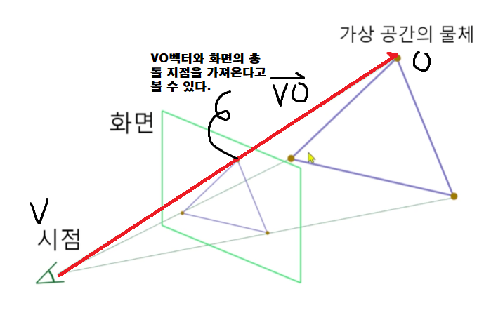
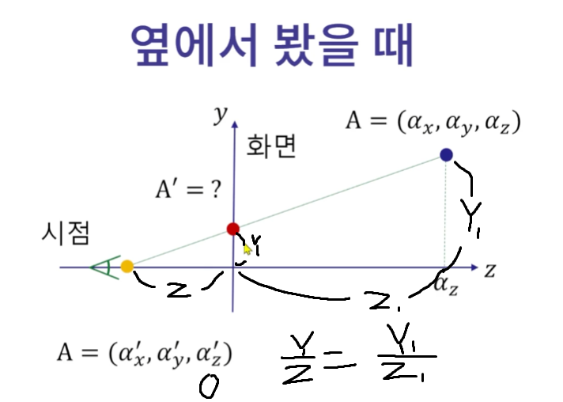
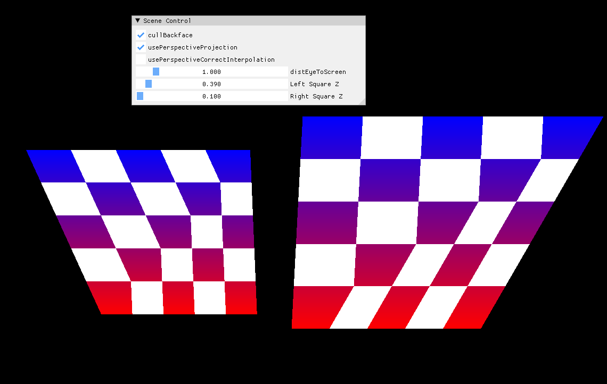
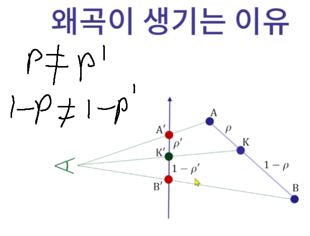
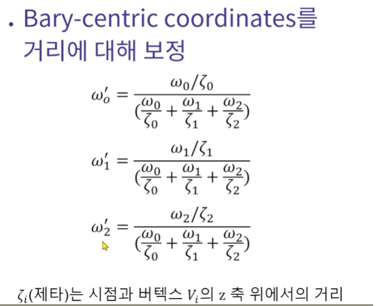
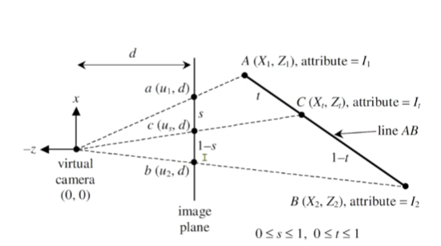
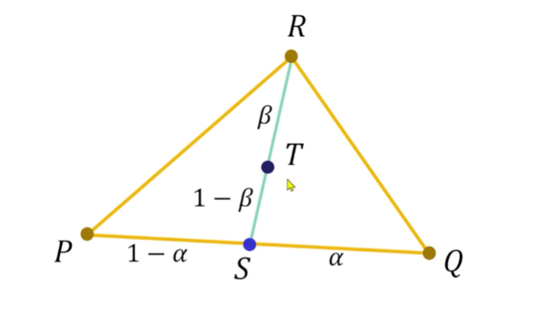
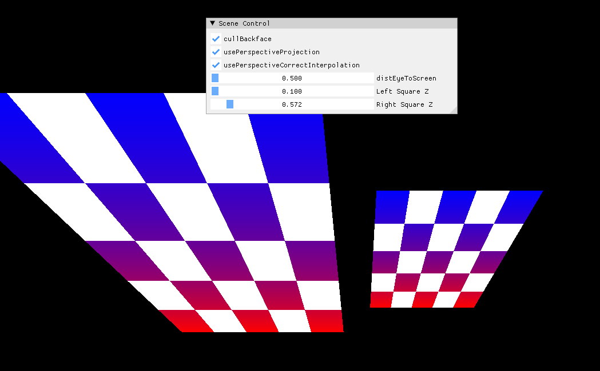

---

Raytracing 에서는 우리는 스크린에 ray를 쐈을대 <b>가상 공간의 물체에 부딪히면 그 픽셀의 색을 가져왔음</b>

Rasterizatoin 에서는 <b>가상 공간의 물체를 화면에 투영</b> 시키는것임.

사진2의 방법을 사용해 비례식으로다가 점 A를 구할 수 있다.

하지만 이렇게 투영만 시키면 왜곡이 생긴다.

투영이후에 정점사이의 픽셀의 색상값을 구할 때 투영 된 상태의 좌표에서 보간을 한다.

하지만 우리가 원하는 형태는 3차원 공간에서의 오브젝트의 형태이다. 

(orthographic projection에서는 p == p’이기때문에 똑바로 나오는 것

그래서 따로 후보정을 해주어야 한다.

이렇다고 하는데..

아래 링크에 설명되있다고는 한다.

// Perspective-Correct Interpolation // 논문 // [https://www.comp.nus.edu.sg/\~lowkl/publications/lowk\_persp\_interp\_techrep.pdf](https://www.comp.nus.edu.sg/~lowkl/publications/lowk_persp_interp_techrep.pdf) // 해설글 // [https://www.scratchapixel.com/lessons/3d-basic-rendering/rasterization-practical-implementation/perspective-correct-interpolation-vertex-attributes](https://www.scratchapixel.com/lessons/3d-basic-rendering/rasterization-practical-implementation/perspective-correct-interpolation-vertex-attributes) // OpenGL 구현 // [https://stackoverflow.com/questions/24441631/how-exactly-does-opengl-do-perspectively-correct-linear-interpolation](https://stackoverflow.com/questions/24441631/how-exactly-does-opengl-do-perspectively-correct-linear-interpolation)

<b>간단하게 정리하면</b>

우린 a랑 b는 알아서 s와 1-s를 구할 수 는 있지다. s와 t가 같다고 가정하면 위처럼 왜곡이 생긴다.

정확한 점 c를 구하기 위해 정확한 점C를 투영시켜야 한다.

여기서는 C를 직접 계산하지 않고 t를 유도해낸다.

논문에서는 s와 Z12를 이용해 t를 구하고 그 t를 이용해 실제 3차원 공간의 Zt를 구한다.

A와 B를 interporation해서 C의 정확한 좌표를 구하고

아래의 2중 iterporation으로 s(T)를 구할 수 있다고 한다.

우리는 t와 1-t를 모른다.

