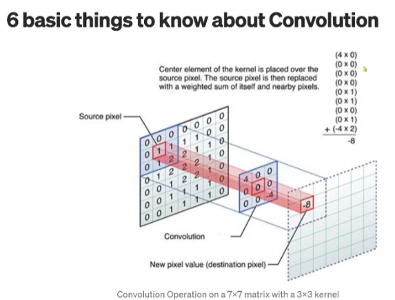
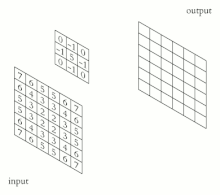

---

- 이미지에서의 커널은 이미지 필터링을 위해 사용하는 정방행렬을 의미한다.
  filter나 window라고 부르기도 한다.

- <b>kernel</b>을 이미지의 모든 픽셀에 적용시키는 과정을 <b>Convolution</b>이라고 부른다.
- <b>이미지 필터링은 </b>원본 이미지를 kernel로 convolution해서 원하는 이미지를 얻는 것을 의미한다.
  

  이렇게 2차원 배열에서 매칭되는 값을 곱하고 한 픽셀의 결과를 만든다.

  

  행렬의 크기가 옆으로 삐져나와서 원본 이미지에는 없는 부분과 계산해야 할 때는

  가장 가까이 있는 픽셀의 값을 가져와서 계산한다.
