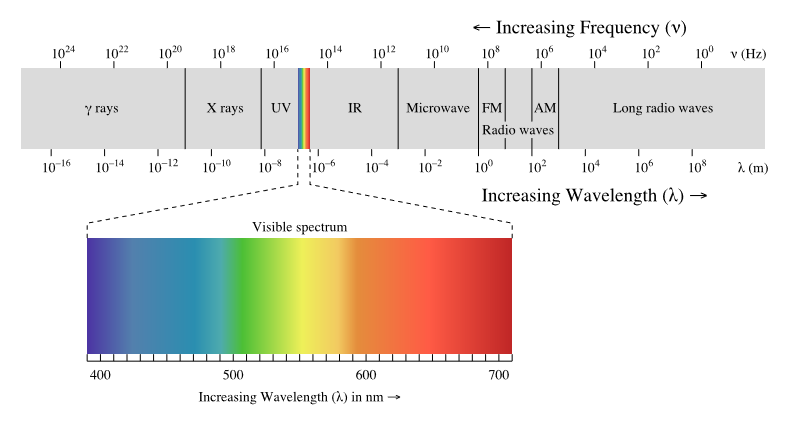

---

빛은 기본적으로 전자기파라고 할 수 있다.

전자기파란 전자기적 과정에 의해 발생하는 에너지이다.

쉽게 말해 파동의 형태로 발산되는 에너지라는 것이다.

빛이라는 것은 수소 원자같이 개별적으로 셀 수 있는게 아니라

<b>파장이 다른 여러 가지 전자기파로 구성되어 있다.</b>

 <em>요론 느낌으로 말이다</em>

(파장의 차이에 따라 광도측정과 방사 측정의 차이를 만든다)

우리의 눈 속에는 원추세포와 간상세포가 있다.

- <b>원추세포</b>
  <b>색상을 감지</b>한다

  원추세포 내에는 <b>cone 세포</b>라는게 있는데 얘네는 <b>R G B를 감지하는 세포</b>들이다.

  - 이러한 이유로 우리는 RGB채널을 사용하자고 약속한 것이다.
- <b>간상세포</b>
  <b>명암을 감지</b>한다.

  원추세포보다 압도적으로 많다 (원추세포 : 600만개 간상세포 : 9000만개)

  - 따라서 인간은 색보다 명암의 감지에 민감하다.
