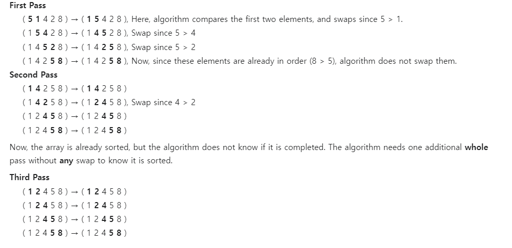
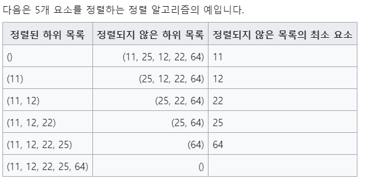
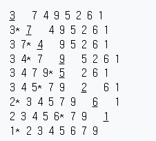
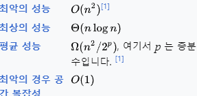
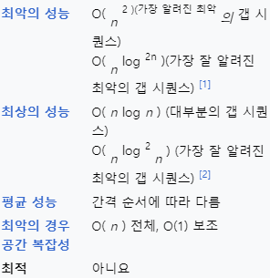

인벤토리는 아이템 데이터를 들고있는 기능만 있어도 되지만<br />아이템이 많은 경우에는 필터링 기능이 들어가야 할 것이다.

필터링을 사용하면 필터링 내용대로 정렬도 추가로 일어나게 될 것인데

인벤토리에서는 어떤 정렬을 사용해야 효율적일지 생각해본다

---

<details>
<summary><b>비효율적 정렬</b></summary>

### 버블정렬



버블정렬은 효율이 좋지 않은 알고리즘으로 유명하다.<br />스왑이 일어나지 않을때까지 0번인덱스부터 마지막 인덱스까지 검사한다.<br />O(n\^2)로 비효율적이라고 생각하기에 넘어감

## 선택정렬



선택정렬은 데이터를 순회하며 기준에 맞게 하나씩 뽑아 새로운 정렬된 데이터를 만든다.<br />선택정렬도 최악의경우 마찬가지로 O(n\^2)라서 패스

## 삽입정렬



삽입정렬은 O(n\^2)이지만 위의 2개의 알고리즘보단 효율적이다<br />코드도 3줄로 간단해서 작은 데이터 정렬시에는 유용하게 사용된다

선택정렬과 비슷하지만 선택정렬은 정렬되지 않은 부분에서 가장 최적의 데이터를 찾기 위해<br />모든 데이터를 항상 찾아야하는데 삽입정렬은 정렬된 데이터 수만큼의 데이터만 검사하면 된다.  

</details>

## CombSort



<b>Bubble Sort의 단점인 거북이 데이터를 개선하고자 gap을 1보다 크게 설정.<br />gap만큼 차이나는 두 숫자를 비교하여 두 수의 정렬 순서가 맞지 않는 경우 교환(swap)하는 정렬.</b>

<aside class="callout">

Bubble Sort의 거북이 데이터(turtle data)란?<br />Bubble Sort 실행 시, 오른쪽에서 왼쪽으로 매우 느리게 제 위치로 이동하는 작은 데이터들

</aside>

<b>Gap</b>

- 비교하는 두 데이터의 거리. (Bubble Sort에서의 gap은 1임)
- 각 Pass가 진행됨에 따라 <i>k만큼</i> gap을 줄여감gap의 크기: \[<b>n/k</b>, <b>n/k\^2</b>, <b>n/k\^3</b>, ... , <b>1</b>\]<br /><b>권장되는 k 값: 1.3</b>
- gap의 크기에 따라 Comb Sort의 효율성이 달라짐

<details>
<summary><b>코드</b></summary>

```javascript
void swap(int* a, int* b){
    int tmp = *a;
    *a = *b;
    *b = tmp;
}


void combSort(int array[], int n){
    float shrink = 1.3;

    int sorted = 0;
    int gap = n;

    while(!sorted){
        gap = floor(gap/shrink);
        if(gap <= 1){
            gap = 1;
            sorted = 1;
        }

        for(int i=0; i+gap<n; i++){
            if(array[i] > array[i+gap]){
                swap(array[i], array[i+gap]);
                sorted = 0;     // gap이 1일 때 정렬이 끝나지 않은 상황. 다시 한번 sort하기 위한 설정
            }
        }
    }
}

```

</details>

## ShellSort



위의 빗정렬이 버블소트 개선시킨거라면 쉘소팅은 선택정렬 개선시킨 것

- 정렬할 배열을 일정한 간격(Gap)으로 나눈다.<br />간격은 처음에는 배열의 크기를 반으로 나눈 값이나, 일반적으로는 이전 간격을 절반으로 나눈 값으로 시작
- 각 부분 배열에 대해 삽입 정렬을 수행한다.<br />이때, 간격만큼 떨어진 요소들을 서로 비교하며 정렬
- 간격을 점점 줄여가며 간격이 1이 될 때까지 반복

<details>
<summary><b>코드</b></summary>

```javascript
#include <stdio.h>
void ShellSort(int a[], int n) {
	int i, j, key, t;
	for (t = n / 2; t >= 1; t /= 2) {
		for (i = t; i < n; i++) {
			key = a[i];
			for (j = i - t; j >= 0; j-=t) {
				if (key >= a[j]) break;
				a[j + t] = a[j];
			}
			a[j + t] = key;
		}
	}
}
int main(void) {
	int a[] = { 18, 26, 14, 7, 9, 36, 25, 17, 30, 29 };
	int i, n = sizeof(a) / sizeof(int);
	printf("정렬 전 : ");
	for (i = 0; i < n; i++) printf(" % d ", a[i]);
	ShellSort(a, n);
	printf("\n삽입 정렬 후 : ");
	for (i = 0; i < n; i++) printf(" % d ", a[i]);
	return 0;
}
```

</details>

QuickSort, IntroSort가 가장 빠르나

재귀로 구현되어있어 Macro사용으로는 적절하지 못하다.<br />따라서 매크로 쓸거면 Comb나 Shell 쓸거면 Quick쓰는게 나아보인다.
