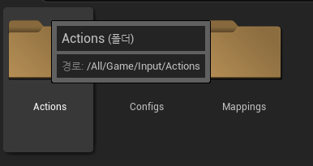
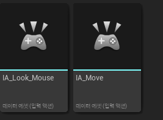
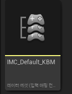
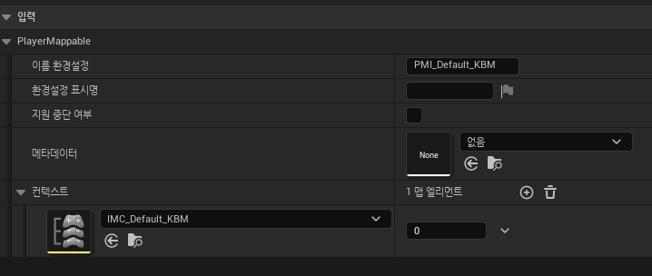
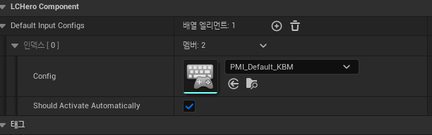

라이라는 인풋을 어떻게 처리하고 있을지 알아보자

---

<b>사전 세팅</b>







- 플레이어 매핑 기능 입력 환경설정

<br><em>IMC들을 추가시켜서 추가시킨 IMC들의 전환을 편하게 하게 해주는 에셋이다. (현재는 지원안함)Lyra에서는 GameFeature을 사용해서 해당 기능을 구현하였으나 GameFeature은 추후에 진행하기에 우선 이 기능 사용</em>

이후 InputConfig에서 사용할 InputTag 추가

```c++
void FLCGameplayTags::AddAllTags(class UGameplayTagsManager& Manager)
{
	/**
	 * GameFrameworkComponentManager init state tags
	 */
	...
	/**
	 * EnhancedInput Tags
	 */
	AddTag(InputTag_Move, "InputTag.Move", "");
	AddTag(InputTag_Look_Mouse, "InputTag.Look.Mouse", "");
}
```

```c++
USTRUCT()
struct FLCMappableConfigPair
{
	GENERATED_BODY()
public:
	FLCMappableConfigPair() = default;

	UPROPERTY(EditAnywhere)
	TSoftObjectPtr<UPlayerMappableInputConfig> Config;

	UPROPERTY(EditAnywhere)
	bool bShouldActivateAutomatically = true;
};

class LYRACLONE_API ULCHeroComponent : public UPawnComponent, public IGameFrameworkInitStateInterface
{
	GENERATED_BODY()
	...
	UPROPERTY(EditAnywhere)
	TArray<FLCMappableConfigPair> DefaultInputConfigs;
};

```

이렇게 추가한 PMI를 가지고있는 <code>MappableConfigPair</code>구조체를 만들<br /> Pawn의 HeroComponent에 넣어준다.



---

<b>InputConfig<br /></b>InputConfig 클래스는 InputTag로 InputAction을 불러오는 역할을 수행한다.

```c++
Header
// GameplayTag와 InputAction을 연결하는 Wrapper구조체
USTRUCT(BlueprintType)
struct FLCInputAction
{
	GENERATED_BODY()
public:
	UPROPERTY(EditDefaultsOnly, BlueprintReadOnly)
	TObjectPtr<const UInputAction> InputAction = nullptr;

	UPROPERTY(EditDefaultsOnly, BlueprintReadOnly, Meta = (Categories = "InputTag"))
	FGameplayTag InputTag;
};


UCLASS()
class LYRACLONE_API ULCInputConfig : public UDataAsset
{
	GENERATED_BODY()
public:
	ULCInputConfig(const FObjectInitializer& ObjectInitializer);

	const UInputAction* FindNativeInputActionForTag(const FGameplayTag InputTag, bool bLogNotFound = true) const;
	const UInputAction* FindAbilityInputActionForTag(const FGameplayTag InputTag, bool bLogNotFound = true) const;

	/*
	 * Member variables
	 */
	UPROPERTY(EditDefaultsOnly, BlueprintReadOnly, Meta = (TitleProperty = "InputAction"))
	TArray<FLCInputAction> NativeInputActions;

	UPROPERTY(EditDefaultsOnly, BlueprintReadOnly, Meta = (TitleProperty = "InputAction"))
	TArray<FLCInputAction> AbilityInputActions;
};

cpp
const UInputAction* ULCInputConfig::FindNativeInputActionForTag(const FGameplayTag InputTag, bool bLogNotFound) const
{
	// NativeInputActions를 순회하며 Input으로 들어온 InputTag가 있는지 체크한다.
	// - 있으면 그에 따른 InputAction을 반환하지만 없다면 그냥 nullptr 반환
	for (const FLCInputAction& Action : NativeInputActions)
	{
		if (Action.InputAction && (Action.InputTag == InputTag))
		{
			return Action.InputAction;
		}
	}
	if (bLogNotFound)
	{
		UE_LOG(LogLC, Error, TEXT("Can't find NativeInputAction for InputTag [%s] on InputConfig [%s]."), *InputTag.ToString(), *GetNameSafe(this));
	}
	return nullptr;
}
```

---

<b>LCInputComponent<br /></b>InputComponent에서는 <b>InputConfig에서 InputAction을 Tag로 찾아온 뒤</b> 해당 <b>InputAction에 함수와 트리거 이벤트들을 바인딩</b>한다.

```c++
UCLASS()
class LYRACLONE_API ULCInputComponent : public UEnhancedInputComponent
{
	GENERATED_BODY()
public:
	ULCInputComponent(const FObjectInitializer& ObjectInitializer);


	/*
	 * Member Methods
	 */
	template <class UserClass, typename FuncType>
	void BindNativeAction(const ULCInputConfig* InputConfig, const FGameplayTag& InputTag, ETriggerEvent TriggerEvent, UserClass* Object, FuncType Func, bool bLogIfNotFound = true);
};

// InputConfig에서 InputAction을 Tag로 찾아온 뒤 해당 InputAction에 함수와 트리거 이벤트들을 바인딩한다.
template <class UserClass, typename FuncType>
void ULCInputComponent::BindNativeAction(const ULCInputConfig* InputConfig, const FGameplayTag& InputTag,
	ETriggerEvent TriggerEvent, UserClass* Object, FuncType Func, bool bLogIfNotFound)
{
	check(InputConfig);

	if (const UInputAction* IA = InputConfig->FindNativeInputActionForTag(InputTag, bLogIfNotFound))
	{
		BindAction(IA, TriggerEvent, Object, Func);
	}
}
```

PawnData는 Camera뿐만 아니라 Input정보도 가지고 있어야 하므로<br /><b>InputConfig도 추가</b>

```c++
UCLASS()
class LYRACLONE_API ULCPawnData : public UPrimaryDataAsset
{
	GENERATED_BODY()
	
public:
	ULCPawnData(const FObjectInitializer& ObjectInitializer = FObjectInitializer::Get());
	/*
		어떤 폰을 생성할지
		입력은 어떻게 받을지
		스킬은 어떻게 쓸지등의 정보를 가진다.	
	*/

	UPROPERTY(EditDefaultsOnly, BlueprintReadWrite, Category = "LC|Pawn")
	TSubclassOf<APawn> PawnClass;

	UPROPERTY(EditDefaultsOnly, BlueprintReadOnly, Category = "LC|Camera")
	TSubclassOf<class ULCCameraMode> DefaultCameraMode;

	UPROPERTY(EditDefaultsOnly, BlueprintReadOnly, Category = "LC|InputConfig")
	TObjectPtr<class ULCInputConfig> InputConfig;
	
};

```

---

<code>ULCHeroComponent::HandleChangeInitState</code> 에서 Input도 초기화

```c++
void ULCHeroComponent::HandleChangeInitState(UGameFrameworkComponentManager* Manager, FGameplayTag CurrentState,
	FGameplayTag DesiredState)
{
	...
		if (ALCPlayerController* LCPC = GetController<ALCPlayerController>())
		{
			if (nullptr != Pawn->InputComponent)
			{
				InitializePlayerInput(Pawn->InputComponent);
			}
		}
}

```

<code>InitializePlayerInput</code>함수

```c++
void ULCHeroComponent::InitializePlayerInput(UInputComponent* PlayerInputComponent)
{
	check(PlayerInputComponent);

	APawn* Pawn = GetPawn<APawn>();
	if (!Pawn)
	{
		return;
	}

	// Localplayer을 가져오기 위함
	const APlayerController* PC = GetController<APlayerController>();
	check(PC);

	// EnhancedInputLocalPlayerSubsystem을 가져오기 위함
	const ULocalPlayer* LP = PC->GetLocalPlayer();
	check(LP);

	UEnhancedInputLocalPlayerSubsystem* SubSystem = LP->GetSubsystem<UEnhancedInputLocalPlayerSubsystem>();
	check(SubSystem);

	// EnhancedInputLocalPlayerSubsystem의 MappingContext를 비워준다.
	SubSystem->ClearAllMappings();

	// PawnExtensionComponent -> PawnData - >InputConfig 존재 유무 판단.
	if (ULCPawnExtensionComponent* PawnExtensionComponent = ULCPawnExtensionComponent::FindPawnExtensionComponent(Pawn))
	{
		if (const ULCPawnData* PawnData = PawnExtensionComponent->GetPawnData<ULCPawnData>())
		{
			if (const ULCInputConfig* InputConfig = PawnData->InputConfig)
			{
				const FLCGameplayTags GameplayTags = FLCGameplayTags::Get();

				// HeroComponent가지고 있는 InputMapping Context를 순회하며 EnhancedInputLocalPlayerSubsystem에 추가
				for (const FLCMappableConfigPair& Pair : DefaultInputConfigs)
				{
					if (Pair.bShouldActivateAutomatically)
					{
						FModifyContextOptions Options = {};
						Options.bIgnoreAllPressedKeysUntilRelease = false;

						// 내부적으로 Input Mapping Context를 추가한다.
						SubSystem->AddPlayerMappableConfig(Pair.Config.LoadSynchronous(), Options);
					}
				}
				ULCInputComponent* LCIC = CastChecked<ULCInputComponent>(PlayerInputComponent);
				{
					LCIC->BindNativeAction(InputConfig, GameplayTags.InputTag_Move, ETriggerEvent::Triggered, this ,&ThisClass::Input_Move, false);
					LCIC->BindNativeAction(InputConfig, GameplayTags.InputTag_Look_Mouse, ETriggerEvent::Triggered, this ,&ThisClass::Input_LookMouse, false);
				}

			}
		}
	}
}
```

보통 input과 action은 Actor에다가 추가하는 방식이였는데 InputConfig만 수정하여 그에 맞는 액션을 바인딩하는 방식이기 때문에 종속성이 매우 떨어진다.

예를들어 탱크A와 탱크B가 있는데 이때 기존이라면 종속성을 떨어트리기 위해<br />탱크A,B가 탱크Base를 상속받고 Base에 기본 탱크 이동 뭐 이런식으로 해야했는데 이젠 InputConfig딸깍 끝이다.
