---

만약 메르시를 플레이한다고 할 때 지팡이 들었을때랑 총들었을때랑 애니메이션이 다르게 동작해야한다.<br />타 fps나 rpg에서도 마찬가지일거고

Cosmetic : 메시<br />Equipment : 애니메이션

아래 구조를 보면, Cosmetic에서의 패턴과 완전히 동일한 것을 확인할 수 있다.<br />아마 장착할 Equipment에 세팅해놓은 Tag를 Rule에 설정해놓은 Tag와 비교해서 Tag가 일치하면 해당<br />AnimInstance로 장착하는 것이라고 생각한다. 

```c++
USTRUCT(BlueprintType)
struct FOWAnimLayerSelectionEntry
{
	GENERATED_BODY()

	// 태그가 일치할 때 적용할 레이어
	UPROPERTY(EditAnywhere, BlueprintReadWrite)
	TSubclassOf<UAnimInstance> Layer;

	// 필요한 코스메틱 태그입니다. 모두 있어야 일치로 간주합니다.
	UPROPERTY(EditAnywhere, BlueprintReadWrite, meta=(Categories="Cosmetic"))
	FGameplayTagContainer RequiredTags;
};

USTRUCT(BlueprintType)
struct FOWAnimLayerSelectionSet
{
	GENERATED_BODY()
		
	// 적용할 레이어 규칙 목록입니다. 처음 일치한 규칙을 사용합니다.
	UPROPERTY(EditAnywhere, BlueprintReadWrite, meta=(TitleProperty=Layer))
	TArray<FOWAnimLayerSelectionEntry> LayerRules;

	// LayerRules 중 일치하는 항목이 없을 때 사용할 레이어
	UPROPERTY(EditAnywhere, BlueprintReadWrite)
	TSubclassOf<UAnimInstance> DefaultLayer;

	// 규칙에 따라 가장 적합한 레이어를 선택합니다.
	TSubclassOf<UAnimInstance> SelectBestLayer(const FGameplayTagContainer& CosmeticTags) const;
};
```

그래서 Lyra에서는 캐릭터의 애니메이션이 장착한 장비에 따라 달라진다고 판단해 Equipment는 Animation과 묶어놓은듯 하다. (특히 Weapon)

```c++
/** EquipmentInstance를 무기 용도로 확장한 런타임 인스턴스다. */
UCLASS()
class OVERWATCH_API UOWWeaponInstance : public UOWEquipmentInstance
{
	GENERATED_BODY()

protected:
	/** 장착 중 사용할 애니메이션 레이어 선택 규칙 */
	UPROPERTY(EditAnywhere, BlueprintReadOnly, Category = Animation)
	FOWAnimLayerSelectionSet EquippedAnimSet;

	/** 비장착 상태에서 사용할 애니메이션 레이어 선택 규칙 */
	UPROPERTY(EditAnywhere, BlueprintReadOnly, Category = Animation)
	FOWAnimLayerSelectionSet UnequippedAnimSet;
};

```

---

Weapon을 메시용 실제 액터와 인스턴스로 구분해서 처리한다.<br />캐릭터의 B\_Manny와 B\_MannyCosmetic과 같은 관계라고 보면 된다.<br />(하지만 EquipmentInstance는 Component는 아니고 UObject상속이다)

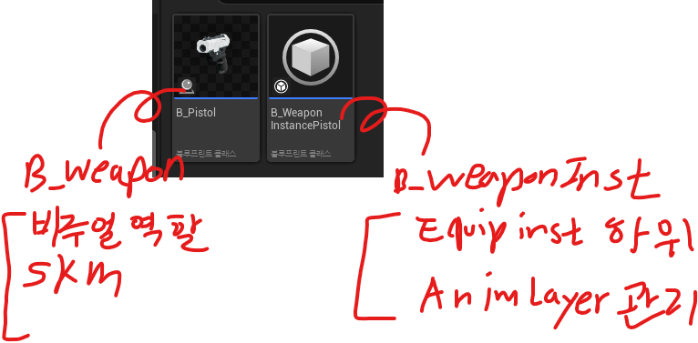

---

이런 느낌으로 사용한다. (위 코스메틱, 아래 무기)

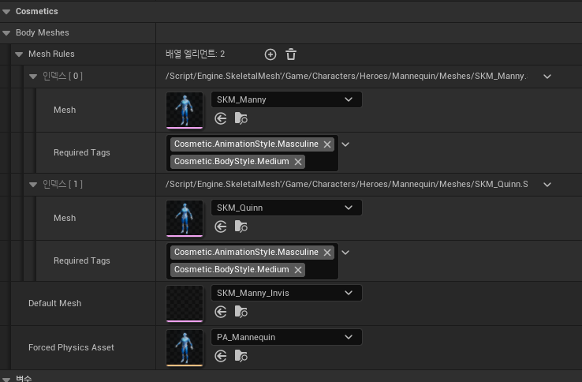

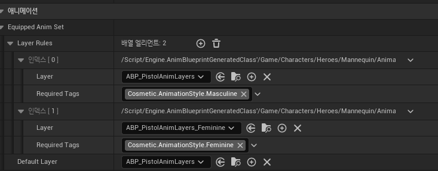

---

---

Equipment와 Inventory의 관계

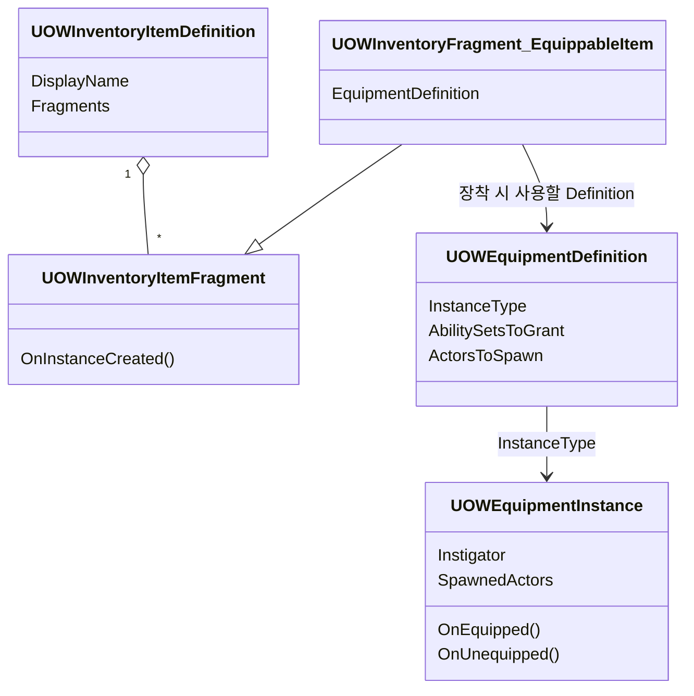

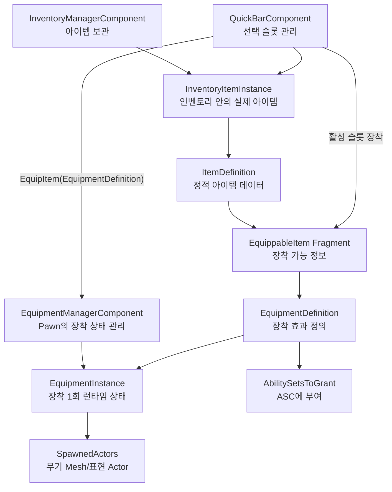

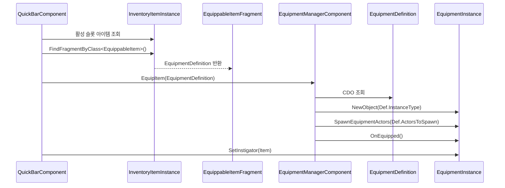

---

---

이 부분은 먼저 책임을 쪼개서 보면 이해가 훨씬 쉽다.

결론부터 보면 <code>Inventory</code>, <code>QuickBar</code>, <code>Equipment</code>는 같은 장비 시스템처럼 보이지만 실제로는 서로 다른 생명주기를 맡고 있다.

- <b>Inventory</b> : 플레이어가 가진 아이템과 스택 수를 보관한다.
- <b>QuickBar</b> : Controller가 현재 어떤 슬롯을 선택했는지 보관한다.
- <b>Equipment</b> : Pawn에 실제로 장착된 런타임 장비를 보관한다.

왜 이렇게 하냐

→ 인벤토리 아이템을 들고 있다는 사실과, 현재 슬롯을 선택했다는 사실과, Pawn에 무기 Actor/Ability가 붙어있다는 사실은 수명이 다르기 때문이다.

플레이어는 respawn해도 아이템을 유지할 수 있지만, Pawn에 붙은 무기 Actor는 Pawn 생명주기를 따라가야 한다. 그래서 라이라는 이걸 한 객체에 몰아넣지 않고 나눠둔 것으로 보인다. 굳.

---

<b>큰 흐름</b>

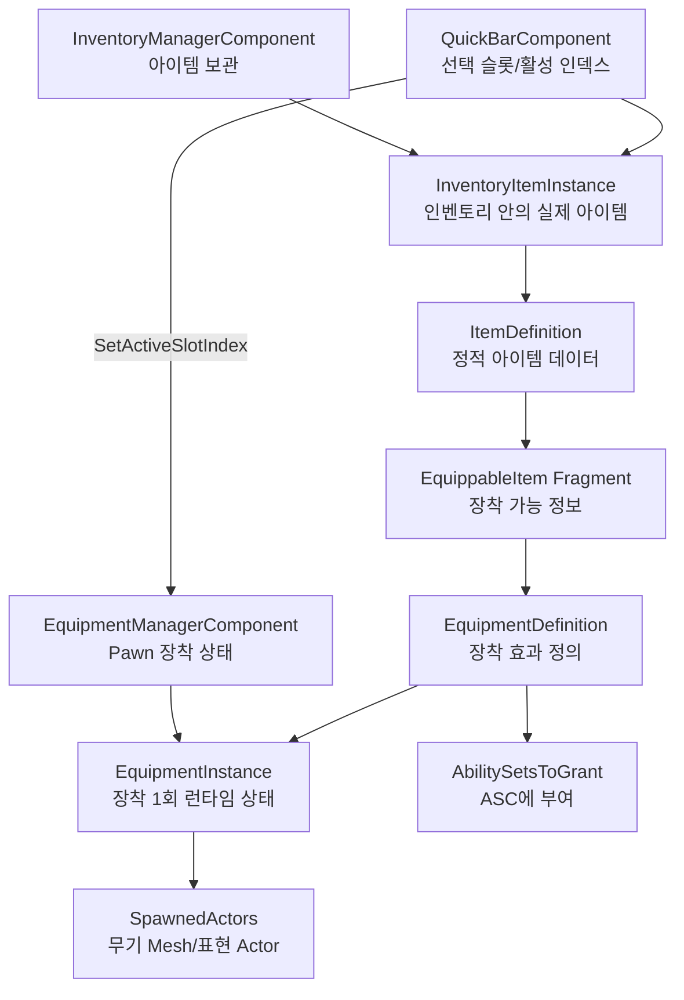

여기서 핵심은 <code>QuickBarComponent</code>가 장비를 직접 스폰하지 않는다는 점이다.

<code>QuickBar</code>는 슬롯 선택까지만 하고, 실제 장착은 Pawn의 <code>EquipmentManagerComponent</code>에게 넘긴다.

---

<b>Inventory 쪽 역할</b>

<code>UOWInventoryManagerComponent</code>

```c++
UPROPERTY(Replicated)
FOWInventoryList InventoryList;
```

인벤토리의 최상위 owner다.

현재 코드 주석처럼 <code>PlayerController</code> 같은 Actor에 붙어서 플레이어 소유 아이템을 복제하는 용도로 보인다.

<code>FOWInventoryList</code>

```c++
bool NetDeltaSerialize(FNetDeltaSerializeInfo& DeltaParms)
{
    return FFastArraySerializer::FastArrayDeltaSerialize<FOWInventoryEntry, FOWInventoryList>(Entries, DeltaParms, *this);
}
```

아이템 목록을 <code>FastArray</code>로 복제한다.

아이템이 하나 추가/삭제/변경될 때 전체 배열을 매번 통째로 보내는 게 아니라, Entry 단위 델타를 보내기 위한 구조다.

<code>FOWInventoryEntry</code>

```c++
UPROPERTY()
TObjectPtr<UOWInventoryItemInstance> Instance = nullptr;

UPROPERTY()
int32 StackCount = 0;

UPROPERTY(NotReplicated)
int32 LastObservedCount = INDEX_NONE;
```

Entry는 <code>아이템 인스턴스 + 스택 수</code>를 가진다.

<code>LastObservedCount</code>는 복제된 클라이언트에서 변화량을 계산하기 위한 관찰값이고, 실제 복제 데이터는 아니다.

왜 이렇게 하냐

→ UI는 “현재 몇 개가 되었는지”뿐 아니라 “몇 개 늘거나 줄었는지”도 알고 싶다. 그래서 <code>OldCount</code>, <code>NewCount</code>, <code>Delta</code>를 만들어 <code>OnInventoryChanged</code>로 뿌린다.

```c++
void FOWInventoryList::BroadcastChangeMessage(FOWInventoryEntry& Entry, int32 OldCount, int32 NewCount) const
{
    FOWInventoryChangeMessage Message;
    Message.InventoryOwner = OwnerComponent;
    Message.Instance = Entry.Instance;
    Message.NewCount = NewCount;
    Message.Delta = NewCount - OldCount;
    OwnerComponent->BroadcastChangeMessage(Message);
}
```

결과

→ Widget이나 MVVM 쪽은 Inventory를 직접 소유하지 않고, 변화 메시지만 관찰하면 된다.

---

<b>ItemDefinition / Fragment / ItemInstance</b>

<code>UOWInventoryItemDefinition</code>

```c++
UPROPERTY(EditDefaultsOnly, BlueprintReadOnly, Category = Display)
FText DisplayName;

UPROPERTY(EditDefaultsOnly, BlueprintReadOnly, Category = Display, Instanced)
TArray<TObjectPtr<UOWInventoryItemFragment>> Fragments;
```

정적 데이터다.

아이템 이름, 장착 가능 여부, 초기 스탯 같은 “아이템 타입 자체의 설명”을 갖는다.

<code>UOWInventoryItemFragment</code>

```c++
virtual void OnInstanceCreated(UOWInventoryItemInstance* Instance) const {}
```

아이템 정의의 확장 포인트다.

중앙 Inventory 코드에 <code>if 이 아이템은 무기면</code>, <code>if 이 아이템은 소모품이면</code> 같은 분기를 계속 추가하지 않고, Fragment 타입을 붙이는 식으로 확장한다.

<code>UOWInventoryFragment_SetStats</code>

```c++
void UOWInventoryFragment_SetStats::OnInstanceCreated(UOWInventoryItemInstance* Instance) const
{
    for (const TPair<FGameplayTag, int32>& ItemStat : InitialItemStats)
    {
        Instance->AddStatTagStack(ItemStat.Key, ItemStat.Value);
    }
}
```

아이템이 생성될 때 초기 StatTag를 ItemInstance에 넣는다.

예를 들어 탄약 수, 내구도, 레벨 같은 작은 상태를 GameplayTag stack으로 표현할 수 있다.

<code>UOWInventoryFragment_EquippableItem</code>

```c++
UPROPERTY(EditAnywhere, Category = Equipment)
TSubclassOf<UOWEquipmentDefinition> EquipmentDefinition;
```

이 아이템이 장착 가능한 아이템인지 알려주는 Fragment다.

InventoryItem이 직접 Equipment 로직을 들고 있는 게 아니라, “장착하면 어떤 EquipmentDefinition을 사용할지”만 연결한다.

<code>UOWInventoryItemInstance</code>

```c++
UPROPERTY(Replicated)
FOWGameplayTagStackContainer StatTags;

UPROPERTY(Replicated)
TSubclassOf<UOWInventoryItemDefinition> ItemDef;
```

인벤토리에 들어간 실제 아이템이다.

Definition은 정적 데이터고, Instance는 런타임 상태다.

왜 이렇게 하냐

→ 같은 <code>RifleDefinition</code>으로 만든 아이템이라도 한 개는 탄약 30, 다른 한 개는 탄약 12일 수 있다. 그래서 런타임 값은 Definition이 아니라 Instance가 들고 있어야 한다.

---

<b>QuickBar 쪽 역할</b>

<code>UOWQuickBarComponent</code>

```c++
UPROPERTY(ReplicatedUsing = OnRep_Slots)
TArray<TObjectPtr<UOWInventoryItemInstance>> Slots;

UPROPERTY(ReplicatedUsing = OnRep_ActiveSlotIndex)
int32 ActiveSlotIndex = INDEX_NONE;

UPROPERTY()
TObjectPtr<UOWEquipmentInstance> EquippedItem;
```

QuickBar는 <code>ControllerComponent</code>다.

즉 Pawn이 아니라 Controller가 “몇 번 슬롯을 선택했는지”를 갖는다.

여기서 <code>Slots</code>는 InventoryItemInstance를 참조하고, <code>ActiveSlotIndex</code>는 현재 선택된 슬롯이다.

<code>EquippedItem</code>은 QuickBar가 마지막으로 장착 요청해서 받은 EquipmentInstance를 기억한다.

```c++
void UOWQuickBarComponent::SetActiveSlotIndex_Implementation(int32 NewIndex)
{
    UnequipItemInSlot();
    ActiveSlotIndex = NewIndex;
    EquipItemInSlot();
    OnRep_ActiveSlotIndex();
}
```

슬롯을 바꾸면 먼저 기존 장비를 해제하고, 활성 인덱스를 바꾼 다음, 새 슬롯 아이템을 장착한다.

```c++
const UOWInventoryFragment_EquippableItem* EquipInfo = SlotItem->FindFragmentByClass<UOWInventoryFragment_EquippableItem>();
if (!EquipInfo || !EquipInfo->EquipmentDefinition)
{
    return;
}

EquippedItem = EquipmentManager->EquipItem(EquipInfo->EquipmentDefinition);
```

여기가 Inventory와 Equipment가 만나는 지점이다.

QuickBar는 아이템 인스턴스에서 <code>EquippableItem</code> Fragment를 찾고, 거기에 있는 <code>EquipmentDefinition</code>을 Pawn의 EquipmentManager에게 넘긴다. 딸깍 끝.

중요한 점

→ QuickBar가 <code>UOWEquipmentDefinition</code>을 직접 ItemDefinition에서 꺼내긴 하지만, 실제 장착 효과/Actor/Ability 처리는 하지 않는다. 이 선을 지키는 게 구조적으로 중요하다.

---

<b>Equipment 쪽 역할</b>

<code>UOWEquipmentManagerComponent</code>

```c++
UPROPERTY(Replicated)
FOWEquipmentList EquipmentList;
```

Pawn이 현재 장착 중인 EquipmentInstance 목록을 소유한다.

Inventory나 Controller가 아니라 PawnComponent인 이유는 실제 장비 Actor와 Ability 부여가 Pawn의 AvatarActor 생명주기와 붙어있기 때문이다.

<code>FOWEquipmentList::AddEntry</code>

```c++
const UOWEquipmentDefinition* EquipmentCDO = GetDefault<UOWEquipmentDefinition>(EquipmentDefinition);
TSubclassOf<UOWEquipmentInstance> InstanceType = EquipmentCDO->InstanceType;

FOWAppliedEquipmentEntry& NewEntry = Entries.AddDefaulted_GetRef();
NewEntry.EquipmentDefinition = EquipmentDefinition;
NewEntry.Instance = NewObject<UOWEquipmentInstance>(OwnerComponent->GetOwner(), InstanceType);
```

장착할 때 Definition의 CDO를 읽고, 거기에 지정된 InstanceType으로 런타임 인스턴스를 만든다.

Outer가 <code>OwnerComponent-&gt;GetOwner()</code>니까 실제로는 Pawn 아래에 EquipmentInstance가 붙는 구조다.

<code>FOWAppliedEquipmentEntry</code>

```c++
UPROPERTY()
TSubclassOf<UOWEquipmentDefinition> EquipmentDefinition;

UPROPERTY()
TObjectPtr<UOWEquipmentInstance> Instance = nullptr;

UPROPERTY(NotReplicated)
FOWAbilitySet_GrantedHandles GrantedHandles;
```

Entry는 장착 1건의 상태다.

중요한 건 <code>GrantedHandles</code>가 <code>NotReplicated</code>라는 점이다.

왜 이렇게 하냐

→ AbilitySet 부여/회수는 서버 권한으로 처리해야 하고, 해제할 때 정확히 회수하려면 서버가 핸들을 들고 있어야 한다. 클라이언트에 복제할 필요는 없다.

```c++
AbilitySet->GiveAbilitySystem(AbilitySystemComponent, &NewEntry.GrantedHandles, NewEntry.Instance);
NewEntry.Instance->SpawnEquipmentActors(EquipmentCDO->ActorsToSpawn);
```

장착 시점에 두 가지가 일어난다.

1. ASC에 AbilitySet을 부여한다.
2. EquipmentInstance가 표현용 Actor를 스폰한다.

즉 <code>EquipmentDefinition</code>은 “무엇을 줄지”를 선언하고, <code>EquipmentList/EquipmentInstance</code>가 “이번 장착에서 실제로 적용된 상태”를 들고 있는 구조다.

---

<b>EquipmentDefinition / EquipmentInstance</b>

<code>UOWEquipmentDefinition</code>

```c++
UPROPERTY(EditDefaultsOnly, Category = Equipment)
TSubclassOf<UOWEquipmentInstance> InstanceType;

UPROPERTY(EditDefaultsOnly, Category = Equipment)
TArray<TObjectPtr<const UOWAbilitySet>> AbilitySetsToGrant;

UPROPERTY(EditDefaultsOnly, Category = Equipment)
TArray<FOWEquipmentActorToSpawn> ActorsToSpawn;
```

정적 장비 데이터다.

이 장비를 장착하면 어떤 Instance 타입을 만들지, 어떤 AbilitySet을 줄지, 어떤 Actor를 붙일지 선언한다.

<code>UOWEquipmentInstance</code>

```c++
UPROPERTY(ReplicatedUsing = OnRep_Instigator)
TObjectPtr<UObject> Instigator;

UPROPERTY(Replicated)
TArray<TObjectPtr<AActor>> SpawnedActors;
```

장착 1회에 대한 런타임 상태다.

<code>Instigator</code>는 이 장비가 어떤 InventoryItemInstance에서 왔는지 연결해준다.

<code>SpawnedActors</code>는 실제 월드에 스폰된 무기 Mesh/표현 Actor 목록이다.

```c++
AActor* NewActor = World->SpawnActorDeferred<AActor>(SpawnInfo.ActorToSpawn, FTransform::Identity, OwningPawn);
NewActor->FinishSpawning(FTransform::Identity, true);
NewActor->AttachToComponent(AttachTarget, FAttachmentTransformRules::KeepRelativeTransform, SpawnInfo.AttachSocket);
SpawnedActors.Add(NewActor);
```

여기서 장비 Actor를 실제로 Pawn에 붙인다.

Character면 Mesh에 붙이고, 일반 Pawn이면 RootComponent에 붙이는 방식이다.

왜 <code>EquipmentInstance</code>를 Actor로 안 만들고 UObject로 만들었을까

→ 장비의 게임플레이 상태와 표현 Actor를 분리하려는 의도로 보인다.

무기 Mesh Actor는 단순 표현일 수 있고, Ability 부여/애니메이션/입력 피드백/스폰된 Actor 목록 같은 런타임 상태는 <code>EquipmentInstance</code>가 관리한다.

이러면 무기 종류별 로직은 <code>UOWWeaponInstance</code>처럼 Instance subclass로 확장할 수 있다.

---

<b>WeaponInstance는 Equipment의 구체 타입</b>

<code>UOWWeaponInstance</code>

```c++
virtual void OnEquipped() override;
virtual void OnUnequipped() override;

FOWAnimLayerSelectionSet EquippedAnimSet;
FOWAnimLayerSelectionSet UnequippedAnimSet;
```

현재 코드에서는 Weapon이 EquipmentInstance를 상속해서 장착/해제 이벤트, 발사 시간, 입력 장치 피드백, 애니메이션 레이어 선택을 들고 있다.

```c++
TSubclassOf<UAnimInstance> UOWWeaponInstance::PickBestAnimLayer(bool bEquipped, const FGameplayTagContainer& CosmeticTags) const
{
    const FOWAnimLayerSelectionSet& SetToQuery = bEquipped ? EquippedAnimSet : UnequippedAnimSet;
    return SetToQuery.SelectBestLayer(CosmeticTags);
}
```

이전에 Cosmetic에서 봤던 <code>FOWAnimLayerSelectionSet</code>을 그대로 사용한다.

즉 Cosmetic 태그와 Weapon 상태를 조합해서 적절한 AnimLayer를 고르는 방향이다.

결과

→ “메르시가 지팡이를 들었을 때 / 총을 들었을 때 애니메이션이 달라진다”는 요구는 <code>WeaponInstance</code> 쪽에서 풀 수 있다.

Inventory는 이걸 몰라도 된다.

---

<details>
<summary><b>장착 과정정리</b></summary>

1. 서버에서 <code>UOWInventoryManagerComponent::AddItemDefinition()</code>이 호출된다.
2. <code>FOWInventoryList::AddEntry()</code>가 <code>UOWInventoryItemInstance</code>를 만든다.
3. ItemDefinition의 Fragment들이 <code>OnInstanceCreated()</code>로 초기 런타임 값을 넣는다.
4. QuickBar에 해당 ItemInstance가 들어간다.
5. 플레이어가 슬롯을 선택하면 <code>UOWQuickBarComponent::SetActiveSlotIndex()</code> 서버 RPC가 돈다.
6. QuickBar는 기존 <code>EquippedItem</code>을 <code>EquipmentManager-&gt;UnequipItem()</code>으로 해제한다.
7. 새 슬롯의 ItemInstance에서 <code>UOWInventoryFragment_EquippableItem</code>을 찾는다.
8. Fragment의 <code>EquipmentDefinition</code>을 Pawn의 <code>UOWEquipmentManagerComponent::EquipItem()</code>에 넘긴다.
9. EquipmentManager는 <code>FOWEquipmentList::AddEntry()</code>로 <code>UOWEquipmentInstance</code>를 만든다.
10. EquipmentDefinition에 적힌 AbilitySet을 ASC에 부여한다.
11. EquipmentInstance가 장비 Actor를 Pawn에 붙인다.
12. QuickBar는 반환된 EquipmentInstance에 <code>SetInstigator(SlotItem)</code>을 호출한다.

</details>

---

<b>라이라는 왜 이렇게 개발했을까</b>

이 구조는 “한 플레이어가 아이템을 가진다”와 “현재 Pawn이 장비를 들고 있다”를 분리하려고 만든 구조로 보인다.

- Inventory는 플레이어 소유 데이터다.
- QuickBar는 입력/선택 상태다.
- Equipment는 Pawn에 적용된 게임플레이 효과다.
- EquipmentInstance는 장착 1회 동안 생기는 런타임 상태다.
- EquipmentDefinition과 ItemDefinition은 에디터에서 세팅하는 정적 데이터다.
- Fragment는 아이템 기능을 중앙 분기 없이 늘리기 위한 확장 포인트다.

이렇게 해두면 좋은 점이 있다.

1. Pawn이 바뀌어도 Inventory 개념은 유지할 수 있다.
2. 장착 해제 시 AbilitySet과 Actor를 정확히 회수할 수 있다.
3. UI는 Inventory/QuickBar 변경 메시지만 보면 되고, gameplay source of truth가 되지 않는다.
4. 새 아이템 기능은 Fragment로, 새 장비 동작은 EquipmentInstance subclass로 늘릴 수 있다.
5. 네트워크에서는 InventoryList/EquipmentList가 FastArray로 델타 복제되고, ItemInstance/EquipmentInstance는 replicated subobject로 복제된다.

한마디로

→ <code>InventoryItemInstance</code>는 “내가 가진 물건”, <code>EquipmentInstance</code>는 “지금 Pawn에 적용된 장착 상태”다.

이 둘을 QuickBar가 연결해주는 구조라고 보면 된다.

---

<b>현재 코드에서 더 보면 좋은 지점</b>

현재 <code>QuickBar</code>는 <code>Slots</code> 배열 자체를 일반 replicated array로 들고 있고, <code>InventoryList</code>/<code>EquipmentList</code>는 FastArray다.

슬롯 수가 작아서 QuickBar는 단순 배열로 충분하다고 본 것 같다.

또 <code>EquipmentManagerComponent::UninitializeComponent()</code>에서 모든 장비를 복사본으로 모은 뒤 <code>UnequipItem()</code>을 호출한다.

```c++
TArray<UOWEquipmentInstance*> AllEquipmentInstances;
for (const FOWAppliedEquipmentEntry& Entry : EquipmentList.Entries)
{
    AllEquipmentInstances.Add(Entry.Instance);
}

for (UOWEquipmentInstance* EquipmentInstance : AllEquipmentInstances)
{
    UnequipItem(EquipmentInstance);
}
```

왜 복사본을 만들까

→ <code>UnequipItem()</code> 과정에서 <code>EquipmentList</code>가 수정되기 때문이다. 순회 중 배열을 직접 바꾸면 iterator 문제가 생길 수 있어서 먼저 스냅샷을 만든다.

이런 자잘한 부분이 Lyra식 구조에서 꽤 중요하다.

장착/해제는 단순히 Mesh 보이기/숨기기가 아니라 Ability 회수, Actor Destroy, replicated subobject 제거까지 같이 묶인 생명주기이기 때문이다.

---

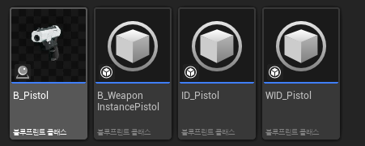

- <b>B\_Pistol </b>: <i>\[액터 상속\]</i> 실제 메시를 가지는 액터 (별다른 라이라 관련 프로퍼티도 없고 비주얼 그 자체)
- <b>B\_WeaponInstancedPistol </b>: <i>\[RangedWeaponInstance 상속\]</i><br /><b>RangedWeaponInstance</b>은 <i>\[UOWWeaponInstance, IOWAbilitySourceInterface 상속\] <br /></i>장착된 무기의 런타임 상태 (CSGO로 치면 현재 초탄인지 몇번째 반동 패턴인지 등등)
  
- <b>ID\_Pistol </b>: <i>\[InventoryItemDefinition 상속\]<br /></i>인벤토리에 표시될 데이터 (아이템 이름 ,초기 탄약 수, Fragments)
  - <b>Fragment : InventoryItemDefinition에 붙는 기능조각<br /></b>Ex) Equipment면 장착가능해야하고 Consumable이면 소모가 가능해야함
    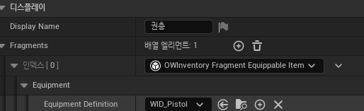
- <b>WID\_Pistol </b>: <i>\[EquipmentDefinition 상속\]<br /></i>장착 정보를 보관한다.<br />장착하면 만들 EquipmentInstance 타입, 장착시 생기는 Ability, 소환할 액터<br />이런것들을 담고있다.

즉 EquipmentInstance선택하면 나머지들은 알아서 선택된다고 생각하면됨

<aside class="callout">

InventoryItemDefinition = 상품 정보<br />InventoryItemInstance = 내 가방 안의 실제 물건<br />EquipmentDefinition = 착용 설명서/장착 패키지<br />EquipmentInstance = 지금 몸에 장착된 실제 상태

</aside>

---

<b>정리</b>

1. PC에 붙어있는 InventoryManagerComponent에서 인벤토리에 있는 아이템들(InventoryItemDefinition)을 AddItemDefinition으로 아이템 추가
2. 인자로 들어온 ItemDefinition을 ItemInstance에 담아서 캐싱함 (실제 인스턴스로 만든다)
3. 퀵바 컴포넌트에서 장비 아이템들을 아이템슬롯에 순서대로 등록
4. 0번 인스턴스를 Active처리
   ```c++
   void UOWQuickBarComponent::SetActiveSlotIndex_Implementation(int32 NewIndex)
   {
   	if (!Slots.IsValidIndex(NewIndex) || ActiveSlotIndex == NewIndex)
   	{
   		return;
   	}

   	UnequipItemInSlot();
   	ActiveSlotIndex = NewIndex;
   	EquipItemInSlot();
   	OnRep_ActiveSlotIndex();
   }
   ```

   이때 <code>EquipItemInSlot</code> 안에서 해당 아이템의 Fragment가 Equipment면<br />Fragment에서 EquipmentDefinition(무기면 WID)을 가져와서 장착한다.<br />아이템은 WID에서 설정해준대로 정착이 된다.<br />사진을 보면 소환할 메쉬랑 소켓등이 있다. 

   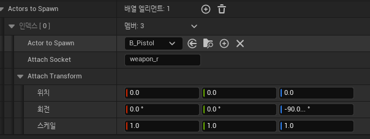
5. 무기를 장착하고 나면 해당 무기는 Pawn의 CosmeticTag를 가져와<br />해당 Tag랑 맞는 애니메이션을 선택해서 재생하게된다.
   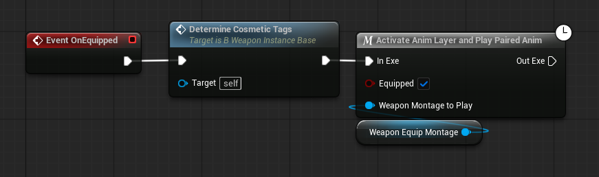<br><em>Pawn에 붙어 있는 CharacterPart들의 GameplayTag를 전부 합쳐서 반환</em>

   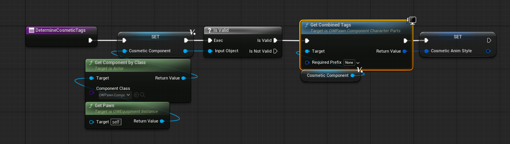<br><em>WeaponInstance 안에 있는 Anim Layer 선택 규칙에서, 현재 코스메틱 태그에 맞는 Anim Blueprint Layer 클래스를 고름 [참고](%EC%9E%A5%EB%B9%84%EC%99%80-%EC%9D%B8%EB%B2%A4%ED%86%A0%EB%A6%AC-35c83382.md)</em>

   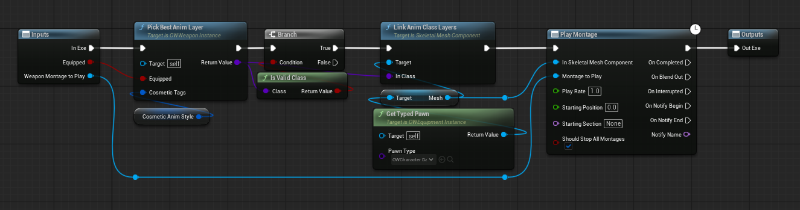<br><em>선택된 Anim Layer 클래스를 현재 캐릭터 Mesh의 Animation Blueprint에 동적으로 연결</em>

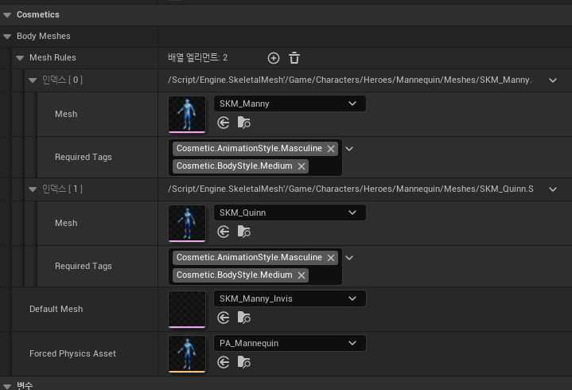<br><em>ManeequinnCosmetic</em>

위 사진들을 보면 맞는 태그를 확인할 수 있다.

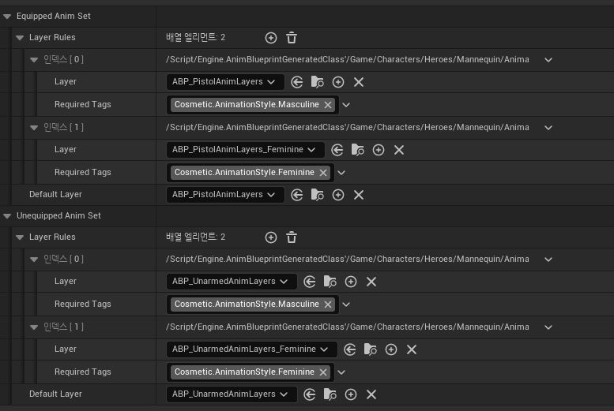<br><em>WeaponInstancePistol</em>

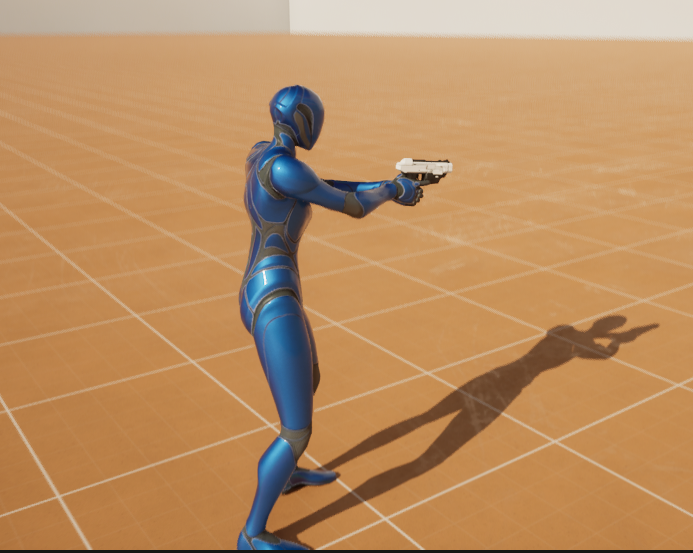


---

---

결론부터 말하면, 여기서 “상태를 가진다”는 뜻은 <b>무기 Blueprint에 적혀 있는 고정 설정값이 아니라, 플레이 중 그 무기 인스턴스가 현재 기억하고 있는 값</b>을 가진다는 뜻입니다.

가장 쉬운 예시는 이것입니다.

<pre><code>double TimeLastEquipped = 0.0;
double TimeLastFired = 0.0;
float CurrentHeat = 0.0f;
float CurrentSpreadAngle = 0.0f;
bool bHasFirstShotAccuracy = false;</code></pre>

이 값들은 “무기 종류의 설정”이 아니라 “지금 이 플레이어가 들고 있는 이 무기의 현재 상황”입니다.

예를 들어 같은 권총을 두 명이 들고 있다고 해보겠습니다.

<pre><code>Player A의 PistolInstance
- TimeLastEquipped = 10.0
- TimeLastFired = 12.5
- CurrentHeat = 4.0
- CurrentSpreadAngle = 3.2
- bHasFirstShotAccuracy = false

Player B의 PistolInstance
- TimeLastEquipped = 20.0
- TimeLastFired = 0.0
- CurrentHeat = 1.0
- CurrentSpreadAngle = 0.5
- bHasFirstShotAccuracy = true</code></pre>

둘 다 “같은 권총 Definition”을 쓰지만, 현재 상황은 다릅니다.

A는 방금 연사해서 탄 퍼짐이 커졌고, B는 가만히 조준 중이라 첫 발 정확도가 살아 있을 수 있습니다. 이 “개별 현재값”이 상태입니다.

UOWWeaponInstance가 가진 상태 예시는 이쪽입니다.

<pre><code>double TimeLastEquipped;
double TimeLastFired;
TSet&lt;FInputDevicePropertyHandle&gt; DevicePropertyHandles;</code></pre>

의미는 이렇습니다.

| <b>변수</b> | <b>쉬운 의미</b> |
| --- | --- |
| TimeLastEquipped | 이 무기를 언제 장착했는지 |
| TimeLastFired | 이 무기를 마지막으로 언제 발사했는지 |
| DevicePropertyHandles | 장착 중 켜둔 입력 장치 피드백을 나중에 끄기 위한 손잡이 |

즉 WeaponInstance는 “이 무기가 현재 장착 중인지, 최근 사용됐는지, 장착 중 켜둔 피드백이 무엇인지”를 기억합니다.

UOWRangedWeaponInstance는 더 게임플레이적인 상태를 가집니다.

<pre><code>double LastFireTime;
float CurrentHeat;
float CurrentSpreadAngle;
bool bHasFirstShotAccuracy;
float CurrentSpreadAngleMultiplier;
float StandingStillMultiplier;
float JumpFallMultiplier;
float CrouchingMultiplier;</code></pre>

예시로 보면 더 쉽습니다.

1. 플레이어가 총을 장착합니다.
   - CurrentHeat가 초기값으로 세팅됩니다.
   - CurrentSpreadAngle도 초기 퍼짐값으로 계산됩니다.
2. 플레이어가 발사합니다.
   - AddSpread()가 호출된다고 가정하면
   - CurrentHeat가 올라갑니다.
   - CurrentSpreadAngle도 커집니다.
   - 결과적으로 다음 탄은 더 퍼집니다.
3. 플레이어가 잠깐 기다립니다.
   - Tick()에서 UpdateSpread()가 돌면서
   - CurrentHeat가 서서히 내려갑니다.
   - CurrentSpreadAngle도 다시 작아집니다.
4. 플레이어가 가만히 서서 조준합니다.
   - StandingStillMultiplier, AimingMultiplier가 유리한 값으로 이동합니다.
   - 모든 조건이 맞으면 bHasFirstShotAccuracy = true가 됩니다.
   - 이때 GetCalculatedSpreadAngleMultiplier()는 0.0f를 반환해서 첫 발은 퍼짐 없이 나가게 됩니다.

반대로 “상태가 아닌 것”은 이런 값들입니다.

<pre><code>float SpreadExponent = 1.0f;
FRuntimeFloatCurve HeatToSpreadCurve;
float SpreadRecoveryCooldownDelay = 0.0f;
int32 BulletsPerCartridge = 1;
float MaxDamageRange = 25000.0f;
FRuntimeFloatCurve DistanceDamageFalloff;
TMap&lt;FGameplayTag, float&gt; MaterialDamageMultiplier;</code></pre>

이건 “이 무기는 원래 어떤 특성을 가지는가”에 가까운 설정값입니다.

예를 들면 “이 총은 heat가 5일 때 spread가 몇 도인가”, “거리 10000cm에서 데미지가 얼마나 줄어드는가”, “헤드 재질이면 배율이 얼마인가” 같은 규칙입니다.

짧게 구분하면 이렇게 보시면 됩니다.

<pre><code>설정값:
이 무기 종류가 원래 어떻게 동작해야 하는가

상태값:
지금 이 무기 한 자루가 플레이 중 어떤 상황인가</code></pre>

그래서 WeaponInstance / RangedWeaponInstance가 필요한 이유는, 같은 무기 Definition을 쓰더라도 플레이어마다, 장착 순간마다, 발사 타이밍마다 현재값이 달라지기 때문입니다.
