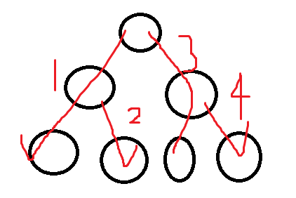

### <b>재귀함수</b>

함수 내에서 <b>자기 자신</b>을 호출하는 함수

→ 함수 탈출하는 코드를 만들지 않으면 <b>가상 메모리에 할당된 Stack 메모리</b>가 꽉찰때까지 선언해서 <b>StackOverflow</b>발생

<b>함수를 탈출할때는 들어온함수 역순으로 return함</b>

ex) recurse()함수가 재귀함수가 3번째에서 return을 만나면

recurse\_1 → recurse\_2 → recurse\_3 → recurse\_2 → recurse\_1 이런순으로

재귀함수는 이렇게 <b>순회</b> 할때 사용

이렇게 밑으로 내려가기만 하면서 순회하는 방식을

<b>DFS (Depth First Search) - 깊이 우선 탐색이라고 한다.</b>

<b>경우의수 문제나 트리 문제 풀때는</b>

<b>재귀함수를 사용하자!</b>
