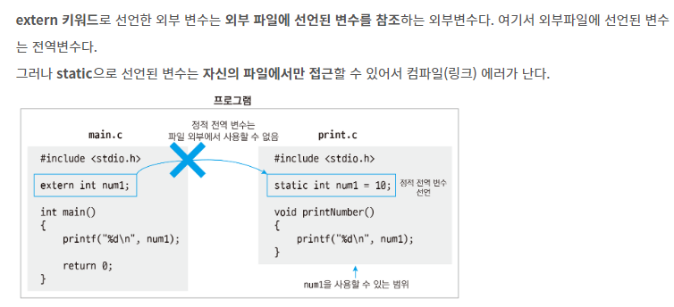

<a href="http://chfhrqnfrhc.tistory.com/entry/전역변수와-전적변수">chfhrqnfrhc.tistory.com</a>

---

<b>해당 변수들은 프로그램 종료시까지 메모리에 존재한다.</b>

<b>전역변수와 정적변수의</b> <b>사용</b> <b>메모리 영역</b>

<ul>
<li>
<b>bss영역과 data영역</b>을 사용한다. <a href="bss%EC%99%80-%EB%8D%B0%EC%9D%B4%ED%84%B0-%EC%84%B8%EA%B7%B8%EB%A8%BC%ED%8A%B8-bfa0254d.md">BSS, Data 영역 (세그먼트)</a> 

초기화 하기 전에는 bss 영역, 초기화 후에는 data영역을 사용하게 된다.

- <i><b><span>단! 수식이나 함수에 의해 초기화 된 경우 bss영역을 사용한다.</span></b></i>
- <i><b>정적변수는 초기화하지 않고, 이후 사용되지도 않을경우 메모리가 할당되지 않는다.</b></i>

</li>
</ul>

### 전역변수

- 스코프 (코드블럭) 밖에서도 접근이 가능하다.
- <b>Extern 키워드를 사용해</b> 다른 어떤 파일에서도 접근이 가능하다.
  - <b><code>extern</code></b><b> </b>키워드는<b> 해당변수가 외부에 선언되어 있음을 알리는</b> 키워드다.
    선언에서의 <b><code>extern</code></b><b> </b>키워드는 생략이 가능하다. 

    <b>file1.cpp</b>

    ```c++
    int globalVariable = 0; // 전역변수 선언 
    void main()
    {
    		return 0;
    }
    ```

    <b>file2.cpp</b>

    ```c++
    #include "file1.cpp"
    extern int globalVariable; // 외부 전역변수를 선언

    int main() {
        // globalVariable 사용
        return 0;
    }
    ```

    <a href="https://code4human.tistory.com/128">code4human.tistory.com</a>

### <b>정적변수</b>

- 범위가 <b>코드블럭</b> 및 <b>파일 단위라서 </b>해당 파일 및 해당 코드블럭에서만 접근이 가능하다.
  접근을 위해서는 Getter Setter을 사용함.

  - Extern 키워드를 붙여도 범위가 파일 스코프이기 때문에 접근이 불가능하다.

  ```c++
  void doSomething()
  {
  	static int a = 1;
  	++a;
  	cout << a << endl;
  }
  ```

  - doSomething 함수 밖에서는 static 변수 a에 접근할 수 없다.

<ul>
<li>
재선언 하더라도 해당 변수의 메모리의 위치는 고정되어있기 때문에 새로 선언하는 것이 아니라

해당 메모리의 값을 가져온다. - 해당 특성으로 싱글턴 패턴을 구현한다.
</li>
<li>
정적변수는 <b>클래스 수준에서도 유지</b>가 되기 때문에 

해당 변수를 보유중인 <b>클래스의 인스턴스 없이도 사용이 가능</b>하다. 

- <b><u>메모리는 프로그램 시작때부터 차지</u></b><u>하고 있으며 메모리에 내내 값이 유지된다.</u>
  - <b>객체 생성 전에도 메모리 존재</b>
    (객체 생성 전에 반드시 미리 초기화 필요)

  - <b>객체와는 독립적으로 존재</b>한다.
</li>
</ul>

<b>static 변수의 선언과 정의</b>

- <b>선언</b>
  ```c++
  class Something
  {
  public:
    static int m_value;  // 선언. 메모리를 차지 하지 않는다.
  }
  ```
- <b>정의</b>
  ```c++
  int Something::m_value = 1;  // 정의. 전역 범위의 메모리를 할당 받는다.
  ```

<b>Static 변수는</b> <b>반드시 전역 범위에서 초기화 해야 한다.</b>

<i><code>static</code></i><i>멤버 변수는 모든 객체들이 접근해야 하므로 프로그램 시작부터 끝까지 유지되어야 하기 때문에 </i><i><b><u>전역 범위</u></b></i><i><b> 에서만 정의(초기화)할 수 있다.</b></i>

좀 더 자세하게 설명하면 <i><code>static</code></i><i>변수는 </i>컴파일시 데이터/bss 영역에 할당되어 프로그램 종료시까지 유지되어야 하는데 지역변수들은 지역스코프 탈출시 사라지기 때문

- <b><code>static</code></b><b>멤버 변수는 클래스 내에서 </b><b><u>선언만 가능하고 정의는 불가능</u></b>
- <b>정의 및 초기화는 헤더 파일 내에서는 불가능하다.</b>

<b>굳이 초기화를 하고 싶으면</b>

- header 초기화를 가능하게 해주는 const키워드를 붙여서 초기화한다.

```c++
class Something
{
public:
	static const int m_value = 1024; // 가능 (출력도 잘 됨)
};
```

### 정적전역변수

- <s>그럼 정적변수에 extern 붙이면 전역변수처럼 사용 가능하겠네!</s>
  (아니다)

  
