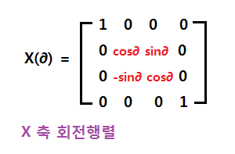
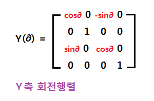
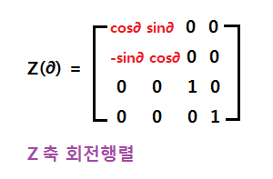
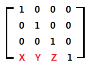

---

<a href="https://marmelo12.tistory.com/338">marmelo12.tistory.com</a>

<a href="https://marmelo12.tistory.com/336?category=1015259">marmelo12.tistory.com</a>

---

우리는 물체를 로컬 좌표계에서 월드 좌표계로 변환 전 <b>크기, 회전, 위치</b>를 변경한다.

위의 작업을 수행하기 위해 보통<b> Scale,Rotation,Translation행렬</b>을 <b>결합 </b>하여 각 정점을 곱 연산해 배치하게 된다.

- 단위행렬이어도 상관없다.
- 행렬의 결합법칙을 이용하여 정점의 S R T연산을 한번에 곱연산을 하여 연산량을 줄이는게 중요.
- 각 물체는 월드 공간의 자신만의 월드 행렬을 하나씩 가지고 있다.
- S \* R \* T \* M(기타 행렬)의 순서로 최종 변환 행렬을 결합해야 한다.

### Scale

- 스케일 행렬은 월드 공간에 올라갈 물체의 크기를 바꾼다.


물체의 크기를 바꿀 때 위의 Scale행렬을 곱한다. 

주 대각선상에서 물체의 3차원 좌표가 그대로 곱해지는 것을 알 수 있다.

(DirectX에서는 왼손 좌표계를 사용하여 1 x 3의 행벡터를 이용한다.?)

하지만 위의 행렬의 크기를 보면 

3x3크기가 아닌 4x4의 크기를 사용하게 되는데

그 이유는 정점의 변환을 한번의 행렬 곱으로 하기 위함이다.

(<b><u>행렬의 결합법칙을 이용하여</u></b><u> </u><b><u>한번의 행렬과의 곱연산으로 처리하기 위해 </u></b><b><span><u>동차 좌표계</u></span></b><b><u>를 이용함)</u></b>

    <b>A(BC) = AB(C)</b>

<b>동차 좌표계</b>

<ul>
<li>
한 차원의 좌표(N차원)에서 하나의 좌표(N + 1)를 추가로 표현한 것.
</li>
<li>
즉 정점의 위치를 나타내는 x,y,z의 1 \* 3 행 벡터에서 w성분을 추가한 x,y,z,w의 1 \* 4 행 벡터로 표현. (행렬 내항일치 - 검색필요)
</li>
<li>
위의 w성분에서는 0을 넣을 시 방향을 의미하고 그렇지 않으면 위치를 의미한다.
</li>
<li>
Scaling과 Rotation만을 고려한다면 3 x 3행렬만으로도 가능하지만 

<b>이동변환까지</b> 한번의 행렬과의 곱연산으로 처리하려면 4 x 4 사용해야함
</li>
</ul>


위와 같이 한 사각형 면을 가지는 물체가 존재하고 각 정점의 좌표가 위와 같다고 보자.

저 사각형면의 크기를 정확히 3배로 키우고 싶을 때 밑과 같이 행렬의 연산을 통해 크기를 키울 수 있다.


그럼 각 정점의 값은 각각

(-6,6,6,1)

(6,6,6,1)

(-6,-6,6,1)

(6,-6,6,1)

모든 정점의 좌표의 x,y,z성분이 정확히 3배씩 증가한것을 알 수 있다.

간단하게 테스트 하기 위해 Dx환경에서의 2차원 공간에서의 크기 변환을 본다.

```arduino
Matrix2x2 S;// 2x2크기의 행렬.// 주 대각선
S._11 = 2.0f;
S._12 = 0.0f;
S._21 = 0.0f;
S._22 = 2.0f;

// NDC좌표로 변환된 각 정점의 좌표들
Vector2 v0 = m_rectObj->m_vertexList[0].vertexCoord * S;
Vector2 v1 = m_rectObj->m_vertexList[1].vertexCoord * S;
Vector2 v2 = m_rectObj->m_vertexList[2].vertexCoord * S;
Vector2 v3 = m_rectObj->m_vertexList[3].vertexCoord * S;

m_rectObj->m_vertexList[0].vertexCoord = v0;
m_rectObj->m_vertexList[1].vertexCoord = v1;
m_rectObj->m_vertexList[2].vertexCoord = v2;
m_rectObj->m_vertexList[3].vertexCoord = v3;
```

SRT변환은 월드행렬에 들어가게 되고, DX에서는 정점쉐이더 단계에서 처리되지만, 위에서는 모두 처리되고 난 후의 좌표에서 처리.

### Rotation







### Transfer


