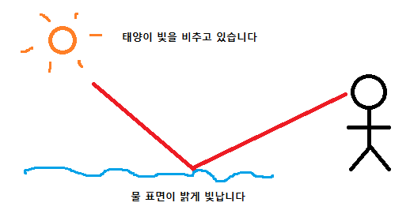
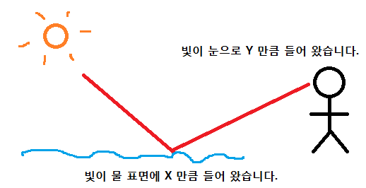
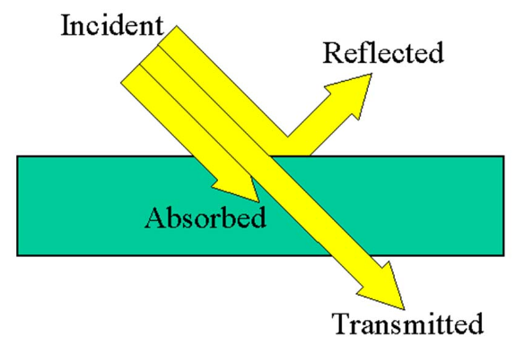

---

PBR 공부하다가

radiance, irradiance, luminance, illuminace라는 용어들을 많이 접했다.

이것들의 사전적 의미는

<b>radiance - 복사 휘도</b>

<b>irradiance - 복사 조도</b>

<b>luminance - 휘도</b>

<b>illuminace - 조도</b>

라고 한다.

### <b>방사측정( Radiometry ) 과 광도측정( Photometry )</b>

<b>방사측정 : 전체영역</b>에서의 빛을 다루기 위해 에너지를 측정하는것

- radiance, irradiance를 다룬다
- 제곱미터당 일(work)률의 단위로 에너지를 측정한다. (power)

<b>광도측정 : 가시영역</b>에서의 빛을 다루기 위해 에너지를 측정하는것

- luminace, illuminace를 다룬다.
- 제곱미터당 루멘 단위로 에너지를 측정한다. (brightness)

### 그래서 조도와 휘도가 뭔데?

조도의 "조( 照 )"는 "비출 조" 입니다. 그리고 휘도의 "휘( 輝 )"는 "빛날 휘"이다.

즉 <b>조도는 active</b>한 느낌이고, <b>휘도는 passive</b>한 느낌이다.

그림2에서 물에 비치는 <b>빛 X는 조도</b>, 눈으로 들어오는 <b>빛 Y는 휘도</b>이다.

우리가 조도와 휘도를 구분하는 이유는

현실세계의 빛은 표면에 반사한 빛이 100퍼센트 우리 눈으로 들어오지 않기 때문에

이를 계산하기 위해서 조도와 휘도를 구분한다.

물체의 표면에 빛이 반사 할 때 incident, absorbed, transimitted, emitted가 일어난다.

현실세계의 빛은 우리 눈으로 들어오는 빛의 정보가 중요한 것이기 때문에

우리는 emitted는 고려하지 않는다.

