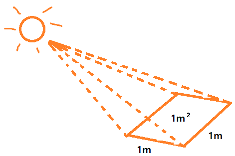
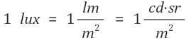
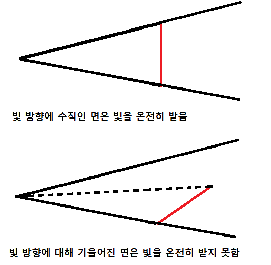
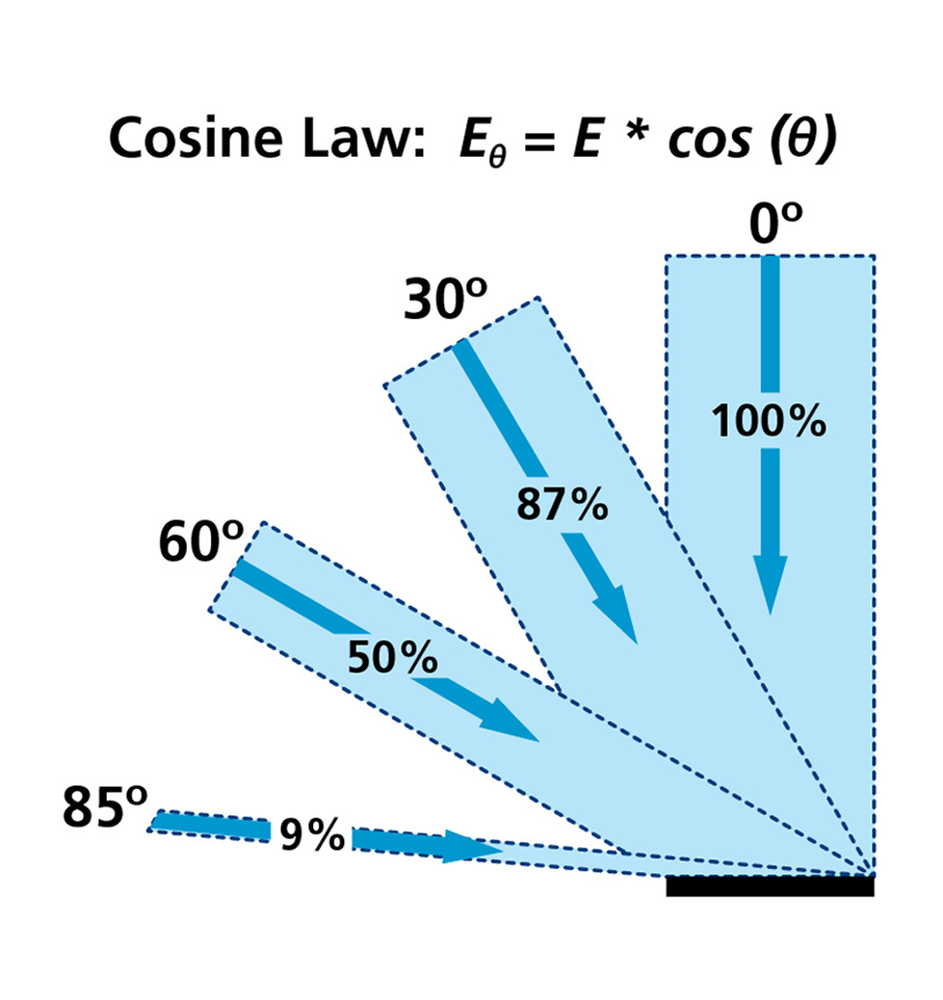

---

<b>조도</b>

- 단위면적당 광속 (입사광 to 표면)

1m\^2에 들어온 빛의 양이 조도이고 이것을 <b>1럭스(lux)</b>라고 부른다

<b>조도를 측정할때는 2가지를 고려해야한다.</b>

<b>조도의 감쇠</b>는 다른 페이지에서 설명이 되어있음

<b>조도의 기울기</b> 

현실에서는 모든 표면이 광원을 마주보고 있지 않다.

이러한 기울기에 따라서 조도의 양을 계산하는 것을

<b>램버트 코사인 규칙</b>이라고 부른다.

