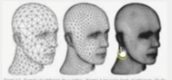

---

기하 쉐이더에서는 기하 정보를 수정해서 좀 더 자세하게 만들 수 있다.



이 그림에서 맨 오른쪽 모델의 기하 정보를 cpu에서 보내려고하면 cpu의 부하가 너무 커지게 된다.

이제는 gpu의 성능이 좋아져서 모델의 세부화를 gpu에서 처리할 수 있다.

쉽게 말 해 vertex의 개수를 늘려서 렌더링을 할 수 있다는 것이다.

---

정점 쉐이더를 통과한 정점들이 정해준 개수씩 묶여서 기하 쉐이더로 들어오게 된다.

```c++
TriangleStream 면 3개씩 Point면 1개씩~~~
```

(hull과 domain은 우선은 신경쓰지 않는다.)

쉐이더의 초기화 부분이나 세팅해주는부분은 다른 쉐이더와 같다.

GS에서는 strip을 쉐이더 내부에서 진행하기 때문에 topology를 굳이 line/triangle로 할 필요는 없다.

```c++
context->IASetPrimitiveTopology(D3D11_PRIMITIVE_TOPOLOGY_POINTLIST); 
// 포인트의 연결은 gs에서 수행한다.
```

POINTLIST Topology는 연결관계가 필요 없기 때문에 DrawIndexed() 대신 Draw() 사용한다.

```c++
// POINTLIST는 연결관계가 필요 없기 때문에 DrawIndexed() 대신 Draw() 사용
context->Draw(m_indexCount, 0);
```

쉐이더는 렌더링을 거친 이후에도 context에 그 정보가 남아 있어서 

Geometry Shader를 쓰지 않는 다른 물체들을 위해 nullptr로 설정해야한다.

```c++
context->GSSetShader(nullptr, 0, 0);
```

GS의  In/Output이다.

```c++
struct GeometryShaderInput
{
    float4 pos : SV_POSITION; 
// vertex shader에서 SV_position으로 넘겨주기 때문에 여기도 SV_POSITION로 넘어옴
// 아직 레스터화를 거치기 이전이기 때문에 정점쉐이더에서 넘겨주는 그대로임 (원근나누기X)
};

struct PixelShaderInput
{
    float4 pos : SV_POSITION; // not POSITION
    uint primID : SV_PrimitiveID; // 이 primitive가 몇번째 primitive인지 알려주고싶음
 
// Primitive는 Rasterizer가 그리는 단위를 말한다.
// ex ) 삼각형 여러개를 그리면 최소단위가 삼각형 선분이면 선분 점이면 점...

};
```

아래는 예시의 코드이다.

```c++
[maxvertexcount(100)] // 최대 출력 Vertex 갯수
void main(point GeometryShaderInput input[1], uint primID : SV_PrimitiveID,
                              inout PointStream<PixelShaderInput> outputStream)
{
   
    
    PixelShaderInput output;
    
    output.pos = input[0].pos;
    
    for (int i = 0; i < 100; i ++)
    {
        output.pos = input[0].pos + float4(0.0, 0.003, 0.0, 0.0) * float(i);
        output.pos = mul(output.pos, view);
        output.pos = mul(output.pos, proj);
        output.primID = primID;

        outputStream.Append(output);// outpput에 새로운 정점 정보를 append해준다.
    }
 
    // 주의: GS는 Triangle Strips으로 출력합니다.
    // https://learn.microsoft.com/en-us/windows/win32/direct3d9/triangle-strips

    //outputStream.RestartStrip(); // Strip을 다시 시작
}
```

이렇게 하면 outputStream에 apped된 정점들이 다음 쉐이더로 넘어간다.
