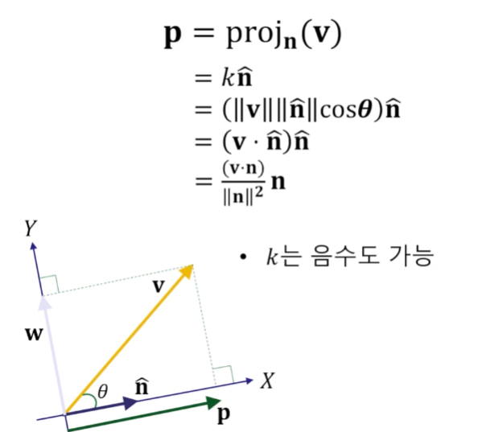
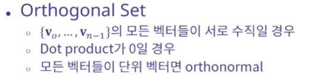
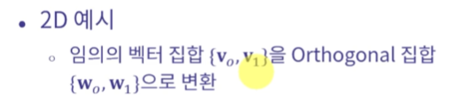
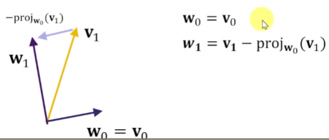
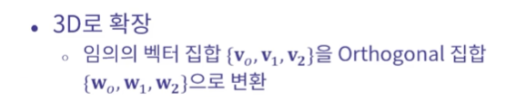
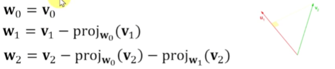
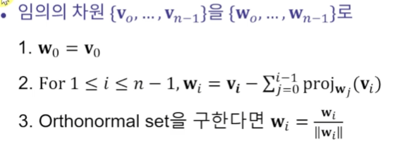

---

<b>직교투영, 수직투영</b>

어떤 벡터를 특정 벡터에 대해 <b>수직으로 투영</b>시킨다.

위의 식의 결과에서 벡터 n을 곱해주지 않으면 그게 바로 정사영이다.

### Orthogonalization

- 임의의 벡터 집합을 서로 직교하는 벡터의 집합으로 변환해준다.

<b>Orthogonal Set</b>

서로 수직인 벡터들의 집합.

2차원에서는 무조건 2개로 한쌍이 나올수밖에 없음

<b>방법</b>

- 벡터 v1을 w0과 수직을 이루는 벡터로 직교투영 시킨 행렬을 v1에서 빼준다.

### Gram-Schmidt Orthogonalization

- 임의의 차원을 <b>특정한 규칙</b>으로 <b>Orthogonalization 할 수 있다.</b>

<b>3차원에서의</b> <b>방법</b>

- w0과 v1을 2차원 직교화시킨다.
- w0과 v2, w1과 v2를 각각 직교화시켜서 서로 빼준다.

<b>즉 </b>

## <b>근데 사실 외적해서 다 구할 수 있다. ㅋㅋㅋ</b>
