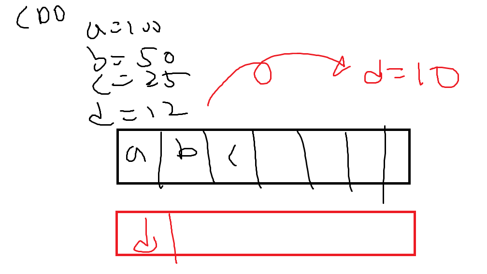

---

직렬화는 객체를 바이트 스트림으로 만든다는 것을 뜻한다.

그냥 말이 어렵지 객체의 데이터를 I/O가 용이하도록 배열안에 쑤셔넣는걸 말한다.

언리얼에서는 <b>Serialization</b>을 CDO에도 사용중이다. CDO에서 사용하는 <b>Serialization</b>은 약간 달라서 <b>SerializationDelta</b>라고 부른다.

### <b>SerializationDelta</b>

<b>SerializationDelta</b>는 단순하게 CDO정보를 직렬화 해서 객체를 만들때 해당 메모리에서 값들을 들고오는것 뿐만 아니라 값 변경을 감지하는 역할도 한다.

그림처럼 CDO에서 바뀐 부분이 있으면 해당 바뀐 부분만 따로 저장해놓는게 <b>SerializationDelta</b>의 방식이다.

예를들어 드문 일이겠지만 전사 캐릭터를 상속받은 BP100개를 만드는데 모두 하나의 어트리뷰트만 다르다고 했을때

공통된 어트리뷰트는 하나의 메모리에서 가져오고 바뀐부분만 기록해놨다가 인스턴스에 올렸을때 해당 부분만 따로 가져오도록 하면 메모리관점에서 용이할 것이다.

그리고 이 <b>SerializationDelta</b>는 데디서버에서도 빛을 보인다. 서버에서는 패킷의 크기를 최소화해야하기때문에 <b>SerializationDelta</b>를 사용하면 패킷의 크기를 줄이는데 도움이 될 것이라고 생각한다.
